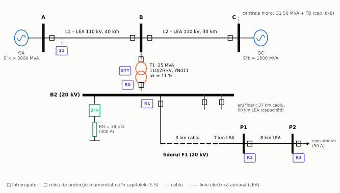
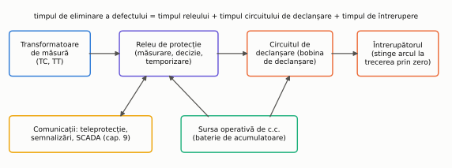
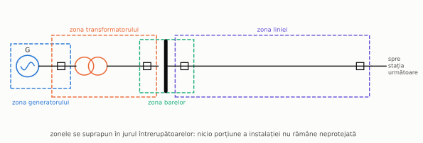
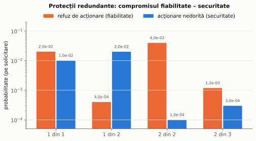

# Capitolul 0. Introducere

> **Obiective.** După acest capitol ar trebui să puteți: (1) enumera defectele și regimurile anormale dintr-un sistem electroenergetic și efectele lor; (2) explica diferența dintre o protecție și o automatizare; (3) formula cerințele de selectivitate, rapiditate, sensibilitate și siguranță și compromisul dintre ele; (4) descrie lanțul de protecție, de la transformatorul de măsură la întrerupător; (5) folosi codurile funcțiilor de protecție (IEEE C37.2) și echivalentele lor din IEC 61850; (6) citi schema rețelei de referință folosite în tot cursul.

Un sistem electroenergetic funcționează aproape tot timpul în **regim normal**: tensiuni și frecvență apropiate de valorile nominale, curenți sub valorile admisibile. Din când în când apar însă **defecte** (de exemplu un scurtcircuit provocat de un trăsnet) și **regimuri anormale** (de exemplu o suprasarcină sau o scădere a frecvenței). Echipamentele care le detectează și reacționează automat, în fracțiuni de secundă, sunt subiectul acestui curs.

Toate problemele din curs folosesc aceeași **rețea de referință** (figura 0.1), descrisă în § 0.7.

*Figura 0.1 – Rețeaua de referință: rețeaua de 110 kV (A–B–C), stația B cu transformatorul T1 și rețeaua de 20 kV alimentată din bara B2.*

Cursul urmărește în special trei cărți de referință publicate de firme din domeniu: ghidul Alstom *Network Protection & Automation Guide* [1], cărțile lui G. Ziegler (Siemens) despre protecția de distanță și cea diferențială [2, 3] și manualul ABB editat de W. A. Elmore [7]. Lista completă este în [README](README.md#bibliografie).

---

## 0.1. Defecte și regimuri anormale

**Defectele** sunt legături accidentale între faze sau între faze și pământ (scurtcircuite, puneri la pământ) ori întreruperi ale unei faze. După fazele implicate, scurtcircuitele pot fi **trifazate** (simetrice), **bifazate**, **bifazate cu pământ** și **monofazate** (o fază cu pământul). Calculul lor este subiectul capitolului 1.

Cauzele sunt foarte diverse: descărcări atmosferice, îmbătrânirea sau deteriorarea izolației, păsări și vegetație, manevre greșite, defecte mecanice. O parte din defectele liniilor aeriene sunt **trecătoare**: arcul electric se stinge după ce linia este deconectată, iar izolația (aerul) își reface rigiditatea. Pe această observație se bazează reanclanșarea automată (capitolul 7).

**Regimurile anormale** nu sunt defecte propriu-zise, dar devin periculoase dacă durează: suprasarcina (încălzire), supratensiunea, scăderea frecvenței la un deficit de putere activă (capitolul 8), pendulațiile de putere și pierderea sincronismului (capitolele 5 și 7), funcționarea nesimetrică a generatoarelor (capitolul 6).

Efectele unui scurtcircuit sunt:

- **termice** – căldura degajată în conductoare este proporțională cu $I^2 t$. La curenții de scurtcircuit (de zeci de ori curentul nominal), o durată de câteva secunde poate distruge izolația (problema 0.1);
- **electrodinamice** – forțele dintre conductoare sunt proporționale cu pătratul valorii instantanee a curentului, deci cu pătratul **curentului de șoc** $i_p$ (§ 1.3);
- **scăderea tensiunii** în toată zona din jurul defectului, resimțită de consumatori (motoare care se opresc, procese întrerupte);
- **pierderea stabilității** generatoarelor, dacă defectul nu este eliminat suficient de repede (capitolul 7);
- **pericol pentru oameni** (tensiuni de atingere și de pas la punerile la pământ) și **incendii** (arcul electric).

Toate aceste efecte cresc cu durata defectului. De aceea defectul trebuie **eliminat**, adică porțiunea defectă trebuie deconectată cât mai repede.

## 0.2. Protecții și automatizări

- O **protecție** (releu de protecție, funcție de protecție) detectează un defect sau un regim anormal într-o zonă precizată și comandă **deconectarea** acelei zone (prin întrerupătoarele ei) sau emite o semnalizare.
- O **automatizare** acționează pentru a **menține sau restabili** funcționarea: reanclanșează o linie după un defect trecător (RAR), trece alimentarea pe o sursă de rezervă (AAR), deconectează o parte din consumatori când frecvența scade (DASF), menține tensiunea și frecvența la valorile prescrise (regulatoarele automate).

Cele două categorii lucrează împreună. De exemplu, după ce protecția de distanță a deconectat o linie (capitolul 5), reanclanșarea automată încearcă să o repună sub tensiune (capitolul 7). La nivelul stației, ambele sunt astăzi funcții software ale acelorași echipamente numerice (IED), legate printr-o rețea de comunicații (capitolul 9).

## 0.3. Cerințele impuse protecțiilor

| Cerința | Ce înseamnă | Cum se verifică în curs |
|---|---|---|
| **Selectivitate** | se deconectează numai elementul defect, cu cel mai mic număr de întrerupătoare | coordonarea în timp (§ 3.4), protecții cu zonă închisă (capitolul 4), zone de distanță (capitolul 5) |
| **Rapiditate** | defectul este eliminat cât mai repede | timpul critic de eliminare (capitolul 7), problema 0.1 |
| **Sensibilitate** | protecția acționează și la cel mai mic curent de defect din zona ei | curenții minimi de scurtcircuit (§ 1.2), coeficienții de sensibilitate (§ 3.3) |
| **Siguranță în funcționare** | protecția acționează când trebuie (**siguranța acționării**, în engleză *dependability*) și numai când trebuie (**securitatea**, *security*) | redundanța (problema 0.2) |

Cerințele se contrazic parțial. O protecție foarte sensibilă și foarte rapidă riscă să acționeze și la fenomene care nu sunt defecte (curentul de magnetizare la conectarea unui transformator, pornirea unui motor, pendulațiile). O protecție foarte selectivă prin temporizare este lentă. Proiectarea protecțiilor înseamnă găsirea unui compromis, verificat prin calcul.

Și cele două componente ale siguranței se contrazic. Dacă două protecții independente comandă **fiecare** declanșarea (schema „1 din 2”), probabilitatea refuzului scade, dar cea a acționării nedorite crește. Dacă se cere acordul **amândurora** („2 din 2”), se întâmplă invers. Schema „2 din 3” le îmbunătățește pe amândouă față de o singură protecție, cu prețul a trei echipamente (problema 0.2, figura 0.4).

## 0.4. Lanțul de protecție

*Figura 0.2 – Elementele care participă la eliminarea unui defect.*

1. **Transformatoarele de măsură** (de curent și de tensiune) reduc mărimile primare la valori standard (de regulă 1 A sau 5 A și 100 V) și separă galvanic circuitele secundare de înalta tensiune (capitolul 2).
2. **Releul de protecție** prelucrează mărimile măsurate, decide dacă există un defect în zona lui și, după temporizarea reglată, dă comanda de declanșare. Releele au evoluat de la cele **electromecanice** la cele **statice** (electronice analogice) și apoi la cele **numerice**: un releu numeric eșantionează curenții și tensiunile, le prelucrează cu un microprocesor și poate îndeplini zeci de funcții (protecție, automatizare, măsură, înregistrare de perturbații, comunicație). În terminologia IEC 61850 el se numește **IED** (*Intelligent Electronic Device*).
3. **Circuitul de declanșare** transmite comanda la **bobina de declanșare** a întrerupătorului.
4. **Întrerupătorul** separă contactele. Arcul electric se stinge la o trecere prin zero a curentului.
5. **Sursa operativă** de curent continuu (baterie de acumulatoare cu redresor) alimentează releele și circuitele de comandă și trebuie să funcționeze și când tensiunea alternativă dispare din cauza defectului.

Timpul de eliminare a defectului este suma timpului releului, a timpului circuitului de declanșare și a timpului de întrerupere al întrerupătorului. Valorile concrete folosite în probleme (de exemplu 0,06 s pentru întreruperea unui întrerupător de 20 kV) sunt date de problemă și sunt precizate în enunțuri.

## 0.5. Zone de protecție. Protecții de bază și de rezervă

Fiecare element al instalației (generator, transformator, bare, linie) are o **zonă de protecție** delimitată de transformatoarele de curent ale protecției sale. Zonele vecine se **suprapun** în jurul întrerupătoarelor, astfel încât nicio porțiune să nu rămână neprotejată (figura 0.3).

*Figura 0.3 – Zonele de protecție se suprapun în jurul întrerupătoarelor.*

- **Protecția de bază** (principală) elimină defectele din zona ei cât mai repede și selectiv.
- **Protecția de rezervă** intervine dacă protecția de bază sau întrerupătorul refuză. Ea poate fi **la distanță** (protecția elementului din amonte, cu temporizare mai mare – de exemplu R0 față de R1 în capitolul 3) sau **locală** (o a doua protecție a aceluiași element, alimentată din alte circuite, și protecția la refuzul întrerupătorului, capitolul 7).

Unele protecții au o zonă **închisă**, delimitată exact de transformatoarele de curent (protecția diferențială, capitolul 4). Ele sunt selective fără temporizare. Altele au o zonă **deschisă**, dependentă de reglaj și de regimul rețelei (protecțiile maximale, capitolul 3, și cele de distanță, capitolul 5). Ele obțin selectivitatea prin reglaj și temporizare.

## 0.6. Codurile funcțiilor de protecție

În scheme și în documentația producătorilor, funcțiile sunt notate cu **numerele din standardul IEEE C37.2** [S12] (cunoscute și ca „coduri ANSI”). Standardul IEC 61850 [S10] definește, pentru aceleași funcții, **noduri logice** cu nume de patru litere (capitolul 9). Tabelul cuprinde funcțiile folosite în curs.

| Cod IEEE C37.2 | Funcția | Nod logic IEC 61850 | Capitolul |
|---|---|---|---|
| 21 | protecție de distanță | PDIS | 5 |
| 25 | sincronizare / control de sincronism | – | 7 |
| 27 / 59 | minimă / maximă de tensiune | – | 6, 8 |
| 32 | protecție direcțională de putere (de exemplu putere inversă) | – | 6 |
| 40 | protecție la pierderea excitației | – | 6 |
| 46 | protecție la sarcină nesimetrică (curent de secvență inversă) | – | 6 |
| 49 | protecție termică (mașini, transformatoare) | – | 6 |
| 50 / 51 | protecție maximală de curent instantanee / temporizată | PTOC | 3 |
| 50BF | protecție la refuzul întrerupătorului | RBRF | 7 |
| 67 | protecție maximală de curent direcțională | – | 3 |
| 79 | reanclanșare automată | RREC | 7 |
| 81 | protecție de frecvență (81U minimă, 81O maximă, 81R după viteza de variație) | – | 8 |
| 86 | releu de blocare (*lockout*) | – | 4 |
| 87 | protecție diferențială | PDIF | 4 |
| 90 | dispozitiv de reglaj (de exemplu regulatorul de ploturi) | – | 8 |
| – | întrerupătorul (nodul logic al echipamentului primar) | XCBR | 9 |

În coloana nodurilor logice, „–” înseamnă că nodul logic al funcției nu este detaliat în curs.

Un sufix precizează mărimea: N pentru curentul rezidual (de exemplu 51N, protecția homopolară temporizată), G pentru generator sau pământ, T pentru transformator.

## 0.7. Rețeaua de referință a cursului

Pentru unitate, problemele din toate capitolele folosesc aceeași rețea (figura 0.1, la începutul capitolului). Datele ei sunt **construite pentru curs**, cu valori din domeniile uzuale, și nu reproduc o instalație reală.

| Element | Date | Folosit în |
|---|---|---|
| sursele echivalente QA și QC | S"k = 3000 MVA (la A) și 1500 MVA (la C), X/R = 10, $Z_0 = Z_1$ | cap. 1, 5 |
| liniile L1 (A–B) și L2 (B–C) | LEA 110 kV, 40 km și 30 km; $z_1$ = 0,12 + j0,40 Ω/km, $z_0$ = 0,30 + j1,20 Ω/km | cap. 1, 2, 5 |
| transformatorul T1 | 25 MVA, 110/20 kV, YNd11, $u_k$ = 11 %, $P_k$ = 120 kW; neutrul de 110 kV legat direct la pământ; impedanța homopolară văzută de pe partea de 110 kV egală cu cea de scurtcircuit | cap. 1, 4 |
| tratarea neutrului rețelei de 20 kV | bobină de punct neutru (BPN) cu rezistor de 38,49 Ω (limitează curentul la 300 A); în probleme se compară cu neutrul izolat și cu bobina de stingere | cap. 1, 2, 3 |
| fiderul F1 | B2–P1: 3 km cablu Al 185 mm² ($z_1$ = 0,164 + j0,12 Ω/km, $z_0$ = 0,66 + j0,40 Ω/km, $C_1 = C_0$ = 0,26 µF/km) + 7 km LEA Ol-Al 70 mm² ($z_1$ = 0,413 + j0,36 Ω/km, $z_0$ = 0,56 + j1,55 Ω/km, $C_1$ = 0,0095 µF/km, $C_0$ = 0,005 µF/km); P1–P2: 8 km din aceeași LEA. Sarcini maxime: 180 A la plecare, 110 A pe P1–P2, 50 A la consumatorul din P2 | cap. 1, 3 |
| restul rețelei de 20 kV | 37 km de cablu și 60 km de LEA (contează prin capacitățile lor față de pământ) | cap. 1, 3 |
| releele R0 … R3 | protecțiile maximale ale fiderului F1 și ale intrării de 20 kV a lui T1 | cap. 3 |
| protecția de distanță 21 | în A, pe linia L1; TC 600/1 A, TT 110/0,1 kV | cap. 2, 5 |
| generatorul G1 | hidrogenerator de 50 MVA, 10,5 kV, cu transformator bloc, racordat în C; contribuția lui la curenții de scurtcircuit din capitolul 1 este inclusă în sursa echivalentă QC | cap. 6, 7, 8 |
| motorul M1 | motor asincron de 800 kW, 6 kV | cap. 6, 7 |

Toate calculele (curenți de defect, reglaje, verificări) sunt făcute de scripturile din [`scripts/`](scripts/), din aceste date (vezi secțiunea „Cum au fost verificate calculele” din [README](README.md#cum-au-fost-verificate-calculele)).

---

## Probleme rezolvate

### Problema 0.1 – Cât timp suportă cablul curentul de scurtcircuit

Fiderul F1 începe cu un cablu de 20 kV cu conductor de aluminiu de 185 mm² și izolație XLPE. Curentul de scurtcircuit trifazat maxim la bara B2 este I"k3 = 6,03 kA (problema 1.2). Cât timp poate dura defectul fără ca temperatura conductorului să depășească limita de scurtcircuit?

**Rezolvare.** Pe durate scurte, căldura nu are timp să se transmită izolației și mediului (încălzire **adiabatică**). Condiția de verificare este

$$\boxed{I^2\thinspace t \le (k\thinspace S)^2}$$

unde $k$ depinde de material și de temperaturile inițială și finală admise. Pentru conductor de aluminiu cu izolație XLPE (de la 90 °C la 250 °C), valoarea tabelată (folosită în standardele seriei IEC 60364) este $k$ = 94 A·√s/mm² [S20]. Rezultă:

- curentul admisibil timp de 1 s: $I_{1s} = k\thinspace S$ = 94 · 185 = 17,39 kA;
- durata admisibilă la 6,03 kA: $t_{max} = (k S / I)^2$ = (17 390 / 6034)² = **8,31 s**.

Temperatura finală pentru câteva durate de eliminare (din ecuația adiabatică, cu temperatura inițială de 90 °C):

| durata defectului | 0,1 s | 0,5 s | 1 s | 2 s | 8,31 s |
|---|---|---|---|---|---|
| temperatura finală | 92 °C | 98 °C | 106 °C | 122 °C | 248 °C |

Calculul folosește valoarea efectivă a componentei alternative, $I''_k$, constantă (defect departe de generatoare). Componenta aperiodică (§ 1.3) adaugă energia $I^2 T\thinspace(1 - e^{-2t/T})$, cu $T$ = 42,5 ms la B2: 42,1 % în plus la 0,1 s, dar numai 8,5 % la 0,5 s și 4,2 % la 1 s. Cu componenta aperiodică maximă, durata admisibilă scade de la 8,31 s la 8,265 s.

Cablul suportă deci curentul de scurtcircuit chiar și pe durata temporizărilor protecțiilor maximale (capitolul 3, sub 1 s). Rezerva este însă mult mai mică pentru secțiuni mai mici, în rețele cu putere de scurtcircuit mai mare sau la refuzul unei protecții.

**Verificare.** Factorul $k$ se poate calcula și din constantele de material, cu forma generală $k = \sqrt{Q_c(\beta + 20)/\rho_{20}\cdot\ln[(\beta + \theta_f)/(\beta + \theta_i)]}$. Pentru aluminiu, cu $Q_c$ = 2,5·10⁻³ J/(K·mm³), $\beta$ = 228 K și $\rho_{20}$ = 28,264·10⁻⁶ Ω·mm, rezultă $K = \sqrt{Q_c(\beta + 20)/\rho_{20}}$ = 148,1 și $k$ = 94,55, față de 94 în tabel. Același calcul pentru cupru dă $k$ = 142,9, față de 143 în tabel. La $t_{max}$ temperatura calculată este 248 °C, adică puțin sub 250 °C, pentru că valoarea din tabel (94) este rotunjită în jos. Durata admisibilă cu componenta aperiodică (8,265 s) rezultă și prin integrarea numerică a pătratului curentului asimetric real: 8,267 s; diferența provine din termenii oscilanți ai lui $i^2$, pe care formula îi neglijează.

### Problema 0.2 – Redundanța protecțiilor

O protecție refuză să acționeze la un defect cu probabilitatea $p_r$ = 0,02 și acționează nedorit (la un defect din afara zonei ei) cu probabilitatea $p_n$ = 0,01. Se compară scheme cu una, două și trei protecții independente identice.

**Rezolvare.** Fiecare protecție se comportă independent. Pentru $n$ protecții, dintre care trebuie să acționeze cel puțin $m$ ca să se dea comanda („$m$ din $n$”):

| Schema | P(refuz) | P(acționare nedorită) |
|---|---|---|
| 1 din 1 | $p_r$ = 2,0·10⁻² | $p_n$ = 1,0·10⁻² |
| 1 din 2 | $p_r^2$ = 4,0·10⁻⁴ | $1-(1-p_n)^2$ = 1,99·10⁻² |
| 2 din 2 | $1-(1-p_r)^2$ = 3,96·10⁻² | $p_n^2$ = 1,0·10⁻⁴ |
| 2 din 3 | $3p_r^2 - 2p_r^3$ = 1,18·10⁻³ | $3p_n^2 - 2p_n^3$ = 2,98·10⁻⁴ |

*Figura 0.4 – Probabilitățile de refuz și de acționare nedorită pentru cele patru scheme.*

Schema „1 din 2” (două protecții, oricare declanșează) reduce refuzul de 50 de ori, dar dublează acționările nedorite. „2 din 2” face invers. „2 din 3” le reduce pe amândouă: refuzul de 17 ori și acționările nedorite de 34 de ori.

**Verificare.** Scriptul simulează 2 000 000 de solicitări, cu stări aleatoare independente ale celor trei protecții (metoda Monte Carlo), și numără cazurile. Toate cele opt probabilități simulate se încadrează în ±5 abateri standard de valorile analitice. De exemplu, la „2 din 3” rezultă 1,19·10⁻³ (refuz) și 3,06·10⁻⁴ (acționare nedorită).

---

## Întrebări de autoevaluare

1. De ce crește pericolul unui scurtcircuit cu durata lui? Numiți două efecte care depind de $I^2 t$ și unul care depinde de valoarea de vârf a curentului.
   

Răspuns
Căldura degajată în conductoare și în arcul electric este proporțională cu $I^2 t$: ea deteriorează izolația (problema 0.1) și poate provoca incendii. De durată depind și pierderea stabilității generatoarelor și durata golului de tensiune la consumatori. Forțele electrodinamice depind de pătratul valorii instantanee a curentului, deci de curentul de șoc $i_p$, care apare în prima semiperioadă.

2. Care este diferența dintre o protecție și o automatizare? Dați câte două exemple.
   

Răspuns
Protecția detectează un defect sau un regim anormal și deconectează zona afectată (sau semnalizează): protecția maximală de curent, protecția diferențială. Automatizarea menține sau restabilește funcționarea: reanclanșarea automată, anclanșarea automată a rezervei, descărcarea automată a sarcinii la scăderea frecvenței, regulatoarele de tensiune și de frecvență.

3. De ce selectivitatea și rapiditatea se contrazic la protecțiile maximale de curent, dar nu și la protecția diferențială?
   

Răspuns
Protecția maximală are zonă deschisă: același curent de defect îl văd toate releele din amonte, iar selectivitatea se obține prin temporizări crescătoare spre sursă (§ 3.4), deci prin întârzieri. Protecția diferențială are zonă închisă, delimitată de transformatoarele de curent: ea compară curenții de la capetele zonei și știe dacă defectul este în interior, deci poate acționa instantaneu fără să piardă selectivitatea.

4. Ce înseamnă „siguranța acționării” și „securitatea” unei protecții? Care schemă cu două protecții o favorizează pe fiecare?
   

Răspuns
Siguranța acționării (*dependability*) este capacitatea de a acționa la toate defectele din zonă; securitatea (*security*) este capacitatea de a nu acționa în afara lor. Schema „1 din 2” (oricare dintre protecții declanșează) favorizează siguranța acționării; schema „2 din 2” (trebuie să fie de acord amândouă) favorizează securitatea (problema 0.2).

5. De ce zonele de protecție se suprapun în jurul întrerupătoarelor?
   

Răspuns
Ca să nu existe nicio porțiune neprotejată. Transformatoarele de curent ale protecțiilor vecine se montează de o parte și de alta a întrerupătorului, astfel încât un defect între ele (de exemplu chiar în întrerupător) să fie văzut de ambele protecții. Prețul este că un defect în zona comună deconectează ambele elemente.

6. De ce sursa operativă a protecțiilor este de curent continuu, din baterii?
   

Răspuns
Pentru că defectul însuși poate face să dispară sau să scadă tensiunea alternativă din stație tocmai când protecția trebuie să acționeze. Bateria asigură alimentarea releelor și a bobinelor de declanșare independent de rețeaua de curent alternativ.

## Bibliografie

- [1] Alstom Grid – *Network Protection & Automation Guide*, 2011.
- [4] Siemens – *Power Engineering Guide*, Edition 8.0.
- [7] W. A. Elmore (ed.) – *Protective Relaying: Theory and Applications*, ed. 2, Marcel Dekker, 2003.
- [9] ABB – *Distribution Automation Handbook*, secțiunea 8.
- [14] R. Tîrnovan, I. Vădan, H. Bălan, A. Botezan – *Protecții prin relee în sistemele electroenergetice*, U.T. Press, 2008.
- [15] S. Ștefănescu, R.-A. Tîrnovan – *Automatizări în sistemele electroenergetice – Curs*, U.T. Press, 2019.
- [S10] IEC 61850; [S12] IEEE C37.2-2022; [S20] seria IEC 60364 și IEC 60949.
