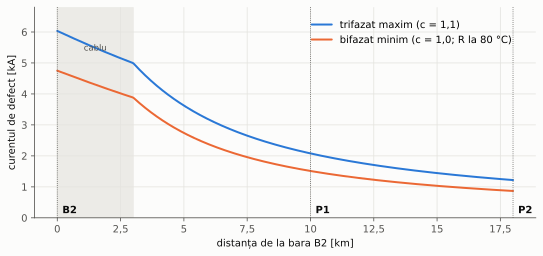
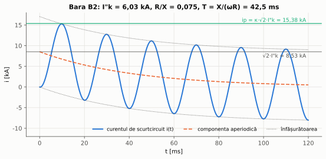
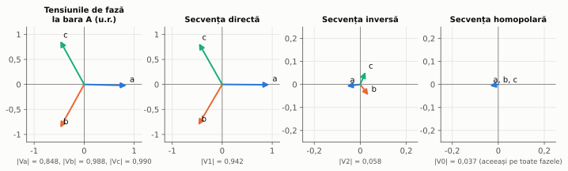
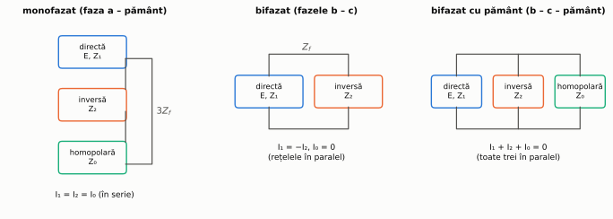
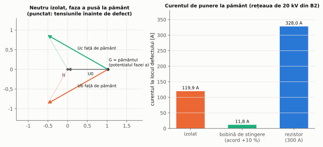

# Capitolul 1. Regimuri de defect

> **Obiective.** După acest capitol ar trebui să puteți: (1) lucra în unități relative și trece impedanțele de pe un nivel de tensiune pe altul; (2) calcula curentul de scurtcircuit trifazat cu metoda sursei echivalente din IEC 60909-0, în variantele de curent maxim și minim; (3) calcula curentul de șoc; (4) descompune un sistem nesimetric în componente simetrice și conecta rețelele de secvență pentru defectele nesimetrice; (5) compara modurile de tratare a neutrului rețelelor de medie tensiune după curentul de punere la pământ și supratensiunile pe fazele sănătoase.

Reglajele protecțiilor se stabilesc din **curenții de defect**: cei maximi decid selectivitatea și solicitările echipamentelor, cei minimi decid sensibilitatea. Capitolul prezintă metodele de calcul folosite în tot cursul, aplicate rețelei de referință (§ 0.7). Toate rezultatele sunt calculate pe **trei căi independente** (unități relative „de mână”, rețele de secvență, rezolvarea directă în coordonate de fază) de scripturile din [`scripts/`](scripts/).

---

## 1.1. Unități relative

O mărime în **unități relative** (u.r.) este raportul dintre valoarea ei și o **valoare de bază**. Se aleg o putere de bază $S_b$, comună întregii rețele, și câte o tensiune de bază $U_b$ pentru fiecare nivel de tensiune, în raportul transformatoarelor. Celelalte baze rezultă:

$$Z_b = \frac{U_b^2}{S_b}, \qquad I_b = \frac{S_b}{\sqrt3\thinspace U_b}, \qquad z = \frac{Z}{Z_b}.$$

Avantajul este că transformatoarele „dispar”: o impedanță are aceeași valoare în u.r. văzută de pe oricare parte a transformatorului. Impedanța de scurtcircuit a unui transformator dată prin tensiunea de scurtcircuit $u_k$ (raportată la puterea lui nominală $S_n$) devine, pe baza $S_b$,

$$\boxed{z_T = u_k\thinspace \frac{S_b}{S_n}}$$

(problema 1.1). Rezistența rezultă din pierderile în scurtcircuit: $R_T = P_k U_n^2 / S_n^2$.

## 1.2. Curentul de scurtcircuit trifazat (IEC 60909-0)

Standardul IEC 60909-0 [S1] folosește **metoda sursei de tensiune echivalente**: toate t.e.m. din rețea se înlocuiesc cu o singură sursă, de tensiune $c\thinspace U_n/\sqrt3$, aplicată la locul defectului, iar rețeaua se reduce la impedanța ei echivalentă $Z_k$ văzută din acel punct. Curentul de scurtcircuit inițial simetric este

$$\boxed{I''_{k} = \frac{c\thinspace U_n}{\sqrt3\thinspace |Z_k|}}$$

**Factorul de tensiune** $c$ acoperă variațiile de tensiune din funcționare. Pentru rețelele de medie și înaltă tensiune (peste 1 kV), $c_{max}$ = 1,10 pentru curenții maximi și $c_{min}$ = 1,00 pentru curenții minimi [S1].

O rețea de alimentare cunoscută numai prin puterea ei de scurtcircuit $S''_{kQ} = \sqrt3\thinspace U_n I''_{kQ}$ se înlocuiește cu impedanța care dă exact acest curent:

$$Z_Q = \frac{c\thinspace U_n^2}{S''_{kQ}} .$$

Curenții **maximi** (cu $c_{max}$) servesc la verificarea echipamentelor și la coordonarea protecțiilor; curenții **minimi** servesc la verificarea sensibilității: se calculează cu $c_{min}$, pentru configurația rețelei care dă curentul cel mai mic și cu rezistențele conductoarelor încălzite de curentul de defect. În curs, rezistențele liniilor de 20 kV se iau la 80 °C pentru curenții minimi, cu coeficientul de temperatură al aluminiului (aproximativ 0,004 K⁻¹): ele cresc cu 24 %.

Pentru **transformatoarele de rețea**, IEC 60909-0 introduce un factor de corecție a impedanței [S1]:

$$K_T = 0{,}95\thinspace\frac{c_{max}}{1 + 0{,}6\thinspace x_T} ,$$

unde $x_T$ este reactanța relativă a transformatorului. Pentru T1 ($x_T \approx$ 0,11), $K_T$ = 0,9803, iar efectul asupra curentului la bara B2 este de +1,67 % (problema 1.5). În celelalte probleme ale cursului factorul este neglijat; diferența este sub precizia cu care se cunosc datele rețelei.

*Figura 1.4 – Curentul de defect în funcție de locul defectului pe fiderul F1: trifazat maxim și bifazat minim. Scăderea este mai lentă pe cablu (reactanță mică) și mai rapidă pe linia aeriană.*

## 1.3. Curentul de șoc

La apariția scurtcircuitului, curentul nu poate varia brusc (rețeaua este inductivă). De aceea, peste componenta alternativă apare o **componentă aperiodică** care se amortizează cu constanta de timp $T = X/(\omega R)$ (figura 1.3). Valoarea maximă instantanee, **curentul de șoc** $i_p$, apare după aproximativ o semiperioadă și dă solicitările electrodinamice. IEC 60909-0 o calculează cu

$$\boxed{i_p = \kappa\thinspace\sqrt2\thinspace I''_k, \qquad \kappa = 1{,}02 + 0{,}98\thinspace e^{-3R/X}}$$

unde $R/X$ este raportul impedanței de scurtcircuit [S1]. Pentru rețelele buclate, standardul dă trei metode de alegere a raportului $R/X$ (A, B și C); în curs se folosește raportul impedanței echivalente de la locul defectului.

*Figura 1.3 – Curentul de scurtcircuit la bara B2 pentru momentul de conectare care dă componenta aperiodică maximă (problema 1.4).*

## 1.4. Componente simetrice

Un sistem trifazat **nesimetric** de fazori $\underline{V}_a$, $\underline{V}_b$, $\underline{V}_c$ se poate scrie, în mod unic, ca sumă a trei sisteme simetrice:

- **de secvență directă** ($\underline{V}_1$, $a^2\underline{V}_1$, $a\underline{V}_1$) – succesiunea normală a, b, c;
- **de secvență inversă** ($\underline{V}_2$, $a\underline{V}_2$, $a^2\underline{V}_2$) – succesiunea a, c, b;
- **de secvență homopolară** ($\underline{V}_0$, $\underline{V}_0$, $\underline{V}_0$) – trei fazori egali,

cu operatorul $a = e^{j120°}$. Transformarea și inversa ei sunt

$$\begin{bmatrix}\underline{V}_a\\ \underline{V}_b\\ \underline{V}_c\end{bmatrix} = \begin{bmatrix}1&1&1\\ 1&a^2&a\\ 1&a&a^2\end{bmatrix}\begin{bmatrix}\underline{V}_0\\ \underline{V}_1\\ \underline{V}_2\end{bmatrix}, \qquad \underline{V}_0 = \frac{\underline{V}_a+\underline{V}_b+\underline{V}_c}{3},\quad \underline{V}_1 = \frac{\underline{V}_a+a\underline{V}_b+a^2\underline{V}_c}{3},\quad \underline{V}_2 = \frac{\underline{V}_a+a^2\underline{V}_b+a\underline{V}_c}{3}.$$

*Figura 1.1 – Tensiunile de la bara A în timpul unui defect monofazat la bara B și componentele lor simetrice (u.r. față de $c\thinspace U_n/\sqrt3$).*

Utilitatea metodei: un element **simetric** (linie, transformator, generator) nu „amestecă” secvențele. Fiecare secvență vede propria impedanță, $Z_1$, $Z_2$ sau $Z_0$, iar rețeaua se descompune în trei **rețele de secvență** independente. Numai rețeaua directă conține t.e.m. Nesimetria este concentrată la locul defectului, unde rețelele de secvență se conectează între ele.

Câteva proprietăți folosite în curs:

- la linii și transformatoare $Z_2 = Z_1$; la liniile aeriene $Z_0$ este de câteva ori mai mare decât $Z_1$ (curentul homopolar se întoarce prin pământ), aici $z_0/z_1 \approx$ 3;
- curentul homopolar trece printr-un transformator numai dacă există cale de întoarcere: la T1 (YNd11) există pe partea de 110 kV, prin neutrul legat la pământ, dar nu și pe partea în triunghi. Pe partea de 110 kV, T1 apare în rețeaua homopolară ca o impedanță spre pământ;
- transformatorul YNd11 rotește fazorii de secvență directă cu +30° de la 110 kV la 20 kV și pe cei de secvență inversă cu −30° (relevant la protecția diferențială, capitolul 4);
- **curentul rezidual** $\underline{I}_a + \underline{I}_b + \underline{I}_c = 3\underline{I}_0$ și **tensiunea reziduală** $3\underline{V}_0$ apar numai la defectele cu pământul; pe ele se bazează protecțiile homopolare (§ 2.5, § 3.7).

## 1.5. Defecte nesimetrice

Condițiile la locul defectului impun conectarea rețelelor de secvență ca în figura 1.2. Cu $\underline{E}$ = tensiunea dinaintea defectului ($c\thinspace U_n/\sqrt3$), $Z_1$, $Z_2$, $Z_0$ impedanțele Thevenin de secvență văzute de la locul defectului și $Z_f$ impedanța defectului:

| Defectul | Conectarea | Curenții |
|---|---|---|
| monofazat (a – pământ) | rețelele în **serie** | $\underline{I}_1 = \underline{I}_2 = \underline{I}_0 = \dfrac{\underline{E}}{Z_1 + Z_2 + Z_0 + 3Z_f}$, $\underline{I}_a = 3\underline{I}_0$ |
| bifazat (b – c) | directă și inversă în **paralel** | $\underline{I}_1 = -\underline{I}_2 = \dfrac{\underline{E}}{Z_1 + Z_2 + Z_f}$, $\underline{I}_0 = 0$ |
| bifazat cu pământ | toate trei în **paralel** | $\underline{I}_1 = \dfrac{\underline{E}}{Z_1 + Z_2 \parallel Z_0}$ |

*Figura 1.2 – Conectarea rețelelor de secvență pentru defectele nesimetrice.*

Două consecințe utile:

$$\boxed{I''_{k2} = \frac{\sqrt3}{2}\thinspace I''_{k3}} \quad (Z_2 = Z_1), \qquad \boxed{\frac{I''_{k1}}{I''_{k3}} = \left|\frac{3}{2 + Z_0/Z_1}\right|}$$

Curentul bifazat este cu 13 % mai mic decât cel trifazat. Departe de generatoare, unde $Z_2 = Z_1$, el este **curentul minim** de scurtcircuit între faze, folosit la verificarea sensibilității protecțiilor maximale (§ 3.3). Curentul monofazat depășește curentul trifazat numai dacă $Z_0 < Z_1$, adică dacă în apropiere sunt multe neutre de transformatoare legate la pământ.

## 1.6. Tratarea neutrului rețelelor de medie tensiune

În rețelele de 110 kV și peste, neutrele transformatoarelor sunt legate la pământ, iar o punere la pământ este un scurtcircuit monofazat, cu curenți de ordinul kiloamperilor. În rețelele de medie tensiune (6–20 kV) se folosesc, inclusiv în România, trei moduri de tratare a neutrului: **izolat**, **compensat prin bobină de stingere** și **legat la pământ prin rezistor**. Rezistorul se conectează la neutrul unei **bobine de punct neutru** (BPN, un transformator de formare a neutrului), pentru că înfășurarea de 20 kV a transformatorului de alimentare este în triunghi și nu are neutru accesibil. Operatorii de distribuție din România au specificații tehnice pentru aceste echipamente, de exemplu [S21].

**Neutru izolat.** Singura cale de întoarcere a curentului este prin **capacitățile față de pământ** ale fazelor sănătoase din toată rețeaua legată galvanic. Curentul de punere la pământ este

$$\boxed{I_C = 3\thinspace\omega\thinspace C_0\thinspace U_f}$$

unde $C_0$ este capacitatea unei faze față de pământ pentru toată rețeaua. Curentul este mic (zeci de amperi), dar tensiunea fazelor sănătoase crește la aproximativ $\sqrt3\thinspace U_f$ (tensiunea de linie, figura 1.5), iar arcul la locul defectului se poate reaprinde intermitent și produce supratensiuni. Rețeaua poate funcționa un timp cu defectul, dar acesta trebuie găsit.

**Neutru compensat (bobina de stingere).** O bobină între neutru și pământ produce un curent inductiv în opoziție cu cel capacitiv. Dacă reactanța ei este acordată pe $X_N \approx 1/(3\omega C_0)$, la locul defectului rămâne numai un **curent rezidual** mic (componenta datorată dezacordului și pierderilor), iar arcul se stinge de la sine. Detectarea selectivă a fiderului defect devine mai dificilă (§ 3.8).

**Neutru tratat prin rezistor.** Rezistorul limitează curentul de defect la o valoare aleasă (în rețeaua de referință, 300 A), suficientă pentru protecții homopolare simple și selective (§ 3.7). Defectul se deconectează rapid. Supratensiunile tranzitorii sunt mai mici decât la neutrul izolat.

*Figura 1.5 – Stânga: tensiunile la o punere la pământ în rețeaua cu neutru izolat (pământul preia potențialul fazei defecte). Dreapta: curentul la locul defectului pentru cele trei moduri de tratare (problema 1.6).*

---

## Probleme rezolvate

### Problema 1.1 – Unități relative și curentul de scurtcircuit la bara de 20 kV

Să se calculeze, în unități relative, impedanțele rețelei de referință și curentul de scurtcircuit trifazat maxim la barele B, B2, P1 și P2. Baze: $S_b$ = 100 MVA, $U_b$ = 110 kV și 20 kV.

**Rezolvare.** Bazele: $Z_b$ = 121,0 Ω și 4,0 Ω; $I_b$ = 524,9 A și 2886,8 A.

- Sursa QA: $|Z_{QA}| = c\thinspace U_n^2/S''_k$ = 1,1 · 110² / 3000 = 4,437 Ω, cu X/R = 10 → $z_{QA}$ = 0,0036 + j0,0365. Analog $z_{QC}$ = 0,0073 + j0,0730.
- Liniile: $Z_{L1}$ = 40 · (0,12 + j0,40) = 4,8 + j16 Ω → $z_{L1}$ = 0,0397 + j0,1322; $z_{L2}$ = 0,0298 + j0,0992.
- Transformatorul: $z_T = u_k\thinspace S_b/S_n$ = 0,11 · 100/25 = 0,440, cu rezistența din $P_k$: $z_T$ = 0,0192 + j0,4396.
- Fiderul (pe baza de 20 kV): $z_{F1a}$ = (3,383 + j2,88)/4 = 0,846 + j0,720; $z_{F1b}$ = 0,826 + j0,720.

Bara B este alimentată din două părți: $z_B = (z_{QA} + z_{L1}) \parallel (z_{QC} + z_{L2})$ = 0,0201 + j0,0852. Apoi se adună în serie:

| Bara | $z_k$ [u.r.] | $I''_{k3} = c\thinspace I_b/\vert z_k\vert$ |
|---|---|---|
| B (110 kV) | 0,0201 + j0,0852 | **6,592 kA** |
| B2 (20 kV) | 0,0393 + j0,5248 | **6,034 kA** |
| P1 | 0,8851 + j1,2448 | **2,079 kA** |
| P2 | 1,7111 + j1,9648 | **1,219 kA** |

**Verificare.** Același curent rezultă (cu diferențe sub 0,01 %) pe alte două căi: (a) din matricea impedanțelor nodale a rețelei de secvență directă, construită în ohmi, cu raportul complex al transformatorului; (b) din rezolvarea rețelei direct în coordonate de fază, cu transformatorul modelat ca trei unități monofazate conectate fizic în stea și în triunghi, și defectul ca trei rezistențe de 10⁻⁴ Ω spre pământ. Se verifică și $|z_T|$ = 0,440 = $u_k S_b/S_n$.

### Problema 1.2 – Curenții maximi și minimi la toate barele

Să se calculeze, la toate barele, curentul trifazat maxim, curentul trifazat minim și curentul bifazat minim.

**Rezolvare.** Curentul minim folosește $c_{min}$ = 1,0 și, pentru liniile de 20 kV, rezistențele la 80 °C (de 1,24 ori mai mari).

| Bara | $Z_1$ [Ω] | $I''_{k3max}$ | $S''_k$ | $I''_{k3min}$ | $I''_{k2min}$ (R la 80 °C) |
|---|---|---|---|---|---|
| A | 0,456 + j3,950 | 17,567 kA | 3347 MVA | 15,970 kA | 13,831 kA |
| B | 2,434 + j10,314 | 6,592 kA | 1256 MVA | 5,993 kA | 5,190 kA |
| C | 0,943 + j6,972 | 9,929 kA | 1892 MVA | 9,027 kA | 7,817 kA |
| B2 | 0,157 + j2,099 | 6,034 kA | 209 MVA | 5,485 kA | 4,750 kA |
| P1 | 3,540 + j4,979 | 2,079 kA | 72 MVA | 1,890 kA | **1,512 kA** |
| P2 | 6,844 + j7,859 | 1,219 kA | 42 MVA | 1,108 kA | **0,867 kA** |

La A, puterea de scurtcircuit (3347 MVA) este mai mare decât cea a sursei QA (3000 MVA), pentru că la defect contribuie și sursa QC, prin liniile L2 și L1. La P1 și P2, încălzirea conductoarelor reduce curentul bifazat minim de la 1,637 kA la 1,512 kA și de la 0,960 kA la 0,867 kA. Aceste valori se folosesc la verificarea sensibilității protecțiilor fiderului (problema 3.2).

**Verificare.** Pentru fiecare bară se verifică: (a) $I''_{k3min}/I''_{k3max} = c_{min}/c_{max}$ = 0,909; (b) $I''_{k2} = (\sqrt3/2)\thinspace I''_{k3}$; (c) curentul bifazat calculat cu rețelele de secvență coincide cu cel din rezolvarea în coordonate de fază, cu un defect între fazele b și c.

### Problema 1.3 – Defectul monofazat în rețeaua de 110 kV

Să se calculeze curentul de scurtcircuit monofazat la barele A, B și C și să se compare cu cel trifazat.

**Rezolvare.** Din rețeaua homopolară (sursele cu $Z_0 = Z_1$, liniile cu $z_0$ = 0,30 + j1,20 Ω/km, T1 ca impedanță spre pământ la B):

| Bara | $Z_0$ [Ω] | $Z_0/Z_1$ | $I''_{k1}$ | $I''_{k1}/I''_{k3}$ | tensiunea maximă pe fazele sănătoase |
|---|---|---|---|---|---|
| A | 0,442 + j4,164 | 1,053 ∠ 0,53° | 17,263 kA | 0,983 | 1,011 · $c\thinspace U_n/\sqrt3$ |
| B | 2,822 + j16,736 | 1,602 ∠ 3,71° | 5,494 kA | 0,833 | 1,112 · $c\thinspace U_n/\sqrt3$ |
| C | 0,870 + j7,747 | 1,108 ∠ 1,29° | 9,585 kA | 0,965 | 1,024 · $c\thinspace U_n/\sqrt3$ |

La B, departe de surse, raportul $Z_0/Z_1$ este cel mai mare (liniile au $z_0 \approx 3 z_1$), deci curentul monofazat este cel mai mic în raport cu cel trifazat, iar tensiunea fazelor sănătoase crește cel mai mult (cu 11 %).

**Verificare.** (a) Raportul $I''_{k1}/I''_{k3}$ coincide cu formula $|3/(2 + Z_0/Z_1)|$ la toate cele trei bare; (b) curentul monofazat calculat cu rețelele de secvență coincide cu cel din rezolvarea în coordonate de fază, cu faza a legată la pământ printr-o rezistență de 10⁻⁴ Ω.

### Problema 1.4 – Curentul de șoc

Să se calculeze curentul de șoc la barele B2 și A.

**Rezolvare.** Din impedanța de scurtcircuit (problema 1.2):

- B2: $R/X$ = 0,157/2,099 = 0,0749 → $\kappa = 1{,}02 + 0{,}98\thinspace e^{-0{,}225}$ = **1,803**; $i_p$ = 1,803 · √2 · 6,034 = **15,38 kA**;
- A: $R/X$ = 0,1155 → $\kappa$ = **1,713**; $i_p$ = **42,56 kA**.

Constanta de timp a componentei aperiodice la B2 este $T = X/(\omega R)$ = 42,5 ms (figura 1.3). Ea contează și la saturația transformatoarelor de curent (§ 2.3).

**Verificare.** Formula lui κ din IEC 60909-0 este o aproximare. Pentru un circuit R-L cu același raport R/X, scriptul caută numeric maximul curentului $i(t) = \sqrt2\thinspace I''_k[\sin(\omega t + \alpha - \varphi) - \sin(\alpha - \varphi)\thinspace e^{-t/T}]$ după unghiul de conectare α (din 0,25° în 0,25°) și după timp. Rezultă κ = 1,794 la B2 și 1,704 la A. Formula standardului este cu 0,5 % mai mare, deci acoperitoare.

### Problema 1.5 – Factorul de corecție $K_T$

Cât se modifică curentul de scurtcircuit la bara B2 dacă impedanța lui T1 se corectează cu factorul $K_T$ din IEC 60909-0?

**Rezolvare.** $K_T = 0{,}95 \cdot 1{,}1/(1 + 0{,}6 \cdot 0{,}11)$ = **0,9803**. Cu impedanța transformatorului înmulțită cu $K_T$, curentul la B2 crește de la 6,034 kA la **6,135 kA** (+1,67 %).

**Verificare.** Scriptul recalculează rețeaua cu impedanța corectată (inclusiv rezistența) și verifică atât valoarea lui $K_T$, cât și faptul că efectul este sub 2 %, ceea ce justifică neglijarea lui în celelalte probleme ale cursului.

### Problema 1.6 – Punerea la pământ în rețeaua de 20 kV

Rețeaua de 20 kV alimentată din B2 cuprinde 40 km de cablu ($C_0$ = 0,26 µF/km) și 75 km de LEA ($C_0$ = 0,005 µF/km). Să se calculeze curentul la o punere la pământ metalică pe bara B2 pentru neutrul (a) izolat, (b) compensat cu o bobină de stingere acordată cu 10 % peste curentul capacitiv, (c) legat la pământ printr-un rezistor de 300 A. Se lucrează la tensiunea nominală ($c$ = 1).

**Rezolvare.** Capacitatea totală: $C_0$ = 40 · 0,26 + 75 · 0,005 = 10,775 µF pe fază.

(a) $I_C = 3\omega C_0 U_f$ = 3 · 314,16 · 10,775·10⁻⁶ · 11 547 = **117,3 A**. Tensiunile fazelor sănătoase cresc la aproximativ $\sqrt3\thinspace U_f$, adică la tensiunea de linie.

(b) Pentru supracompensare cu 10 %: $X_N = 1/(1{,}1 \cdot 3\omega C_0)$ = **89,52 Ω** (L = 0,285 H), $I_L = U_f/X_N$ = 129,0 A. Curentul rezidual la locul defectului este $I_L - I_C \approx$ **11,7 A**, de 10 ori mai mic decât cel capacitiv.

(c) $R_N = U_f/300$ A = **38,49 Ω**. Curentul de defect are o componentă activă de 300 A și una capacitivă de 117 A: $\sqrt{300^2 + 117^2} \approx$ **322 A**.

**Verificare.** Rezolvarea exactă a rețelei, cu toate capacitățile și impedanțele, pe două căi (rețele de secvență și coordonate de fază, care coincid între ele), dă:

| Neutru | formula de manual | calcul exact | tensiunile fazelor sănătoase (exact) |
|---|---|---|---|
| izolat | 117,3 A | 119,9 A | 1,763 și 1,765 · $U_f$ |
| bobină de stingere | 11,73 A | 11,79 A | 1,743 și 1,743 · $U_f$ |
| rezistor | 322,1 A | 328,0 A | 1,730 și 1,788 · $U_f$ |

Diferențele (de cel mult 2,2 %) au două cauze, pe care formulele de manual le neglijează: tensiunea dinaintea defectului este cu 0,74 % mai mare decât $U_f$ (capacitățile rețelei în gol ridică tensiunea), iar impedanțele longitudinale $Z_1 + Z_2$, inductive, micșorează puțin impedanța capacitivă totală (|Z₀| = 295,4 Ω față de |Z₀ + Z₁ + Z₂| = 291,2 Ω). Pentru neutrul izolat, formula $3\thinspace|\underline{E}|/|Z_0 + Z_1 + Z_2|$, care include ambele efecte, reproduce exact rezultatul numeric (119,9 A).

---

## Întrebări de autoevaluare

1. De ce o impedanță are aceeași valoare în unități relative pe ambele părți ale unui transformator?
   

Răspuns
Pentru că tensiunile de bază ale celor două niveluri sunt în raportul transformatorului, iar puterea de bază este aceeași. Raportând o impedanță pe celălalt nivel, ea se înmulțește cu pătratul raportului de transformare; impedanța de bază se înmulțește cu același factor, deci raportul lor nu se schimbă.

2. De ce se calculează doi curenți de scurtcircuit, unul maxim și unul minim? La ce servește fiecare?
   

Răspuns
Curentul maxim (cu $c_{max}$, configurația cu cele mai multe surse) dă solicitările termice și electrodinamice ale echipamentelor și curenții la care se verifică selectivitatea protecțiilor. Curentul minim (cu $c_{min}$, rezistențe calde, configurația cea mai slabă, de regulă defect bifazat) dă cazul cel mai greu pentru sensibilitate: protecția trebuie să acționeze sigur și la acest curent.

3. De ce curentul de șoc depinde de raportul R/X?
   

Răspuns
Pentru că componenta aperiodică se amortizează cu constanta de timp $T = X/(\omega R)$. La R/X mic ea se amortizează lent și se adună aproape integral la vârful primei semiperioade, deci κ se apropie de 2. La R/X mare se amortizează repede și κ se apropie de 1.

4. De ce la un defect bifazat nu apare curent homopolar, iar la unul monofazat cele trei rețele de secvență sunt în serie?
   

Răspuns
La defectul bifazat fără pământ curenții de fază se închid între fazele b și c ($I_b = -I_c$, $I_a = 0$), deci suma lor este nulă și $I_0 = 0$. La defectul monofazat $I_b = I_c = 0$, ceea ce, transformat în componente, înseamnă $I_0 = I_1 = I_2$: același curent parcurge toate rețelele de secvență, adică ele sunt conectate în serie.

5. Ce avantaje și ce dezavantaje are tratarea neutrului prin rezistor față de neutrul izolat?
   

Răspuns
Avantaje: curentul de defect este bine definit (sute de amperi, practic independent de capacitățile rețelei), deci protecțiile homopolare sunt simple și selective; supratensiunile pe fazele sănătoase și cele tranzitorii (arc intermitent) sunt mai mici; defectul se elimină rapid. Dezavantaje: fiecare punere la pământ deconectează fiderul (continuitate mai slabă decât la neutrul izolat sau compensat), curentul la locul defectului este mai mare (tensiuni de atingere și de pas, deteriorări), iar defectele cu rezistență mare rămân greu de detectat (§ 3.7).

6. De ce o bobină de stingere poate stinge arcul la locul defectului?
   

Răspuns
Curentul ei inductiv este în opoziție cu curentul capacitiv al rețelei și îl compensează aproape complet. La locul defectului rămâne un curent rezidual mic, iar tensiunea care reapare pe faza defectă după stingerea arcului crește lent, astfel că arcul nu se mai reaprinde.

## Bibliografie

- [1] Alstom Grid – *Network Protection & Automation Guide*, 2011.
- [6] R. Roeper – *Short-circuit Currents in Three-phase Systems*, ed. 2, Siemens AG, 1985.
- [7] W. A. Elmore (ed.) – *Protective Relaying: Theory and Applications*, ed. 2, Marcel Dekker, 2003.
- [13] C. Prévé – *Protection of Electrical Networks*, ISTE, 2006.
- [14] R. Tîrnovan, I. Vădan, H. Bălan, A. Botezan – *Protecții prin relee în sistemele electroenergetice*, U.T. Press, 2008.
- [17] P. Kundur – *Power System Stability and Control*, McGraw-Hill, 1994.
- [S1] IEC 60909-0:2016; [S21] ST 96-MT – *Rezistor pentru tratarea neutrului rețelelor de MT*, Distribuție Energie, 2020.
