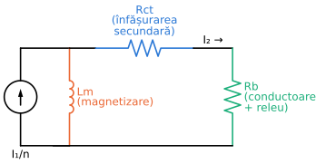
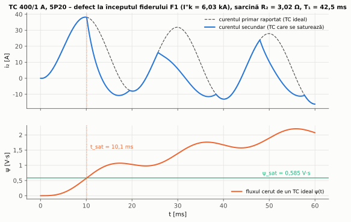
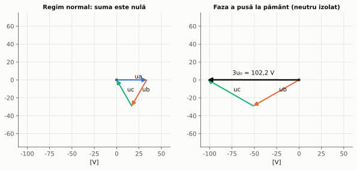
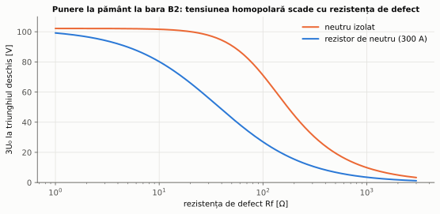

# Capitolul 2. Transformatoare de măsură

> **Obiective.** După acest capitol ar trebui să puteți: (1) explica rolul transformatoarelor de curent (TC) și de tensiune (TT) în lanțul de protecție; (2) interpreta clasele de precizie pentru protecție (5P20, 10P, 3P, 6P); (3) verifica dacă un TC nu se saturează la curentul maxim de defect, ținând seama de sarcina reală din secundar; (4) explica saturația produsă de componenta aperiodică și consecințele ei; (5) obține tensiunea homopolară cu înfășurarea în triunghi deschis; (6) trece impedanțele din primar în secundar pentru protecția de distanță.

Releele nu măsoară direct mărimile din instalația primară. Între ele se află transformatoarele de măsură, iar o protecție nu poate fi mai bună decât semnalele pe care le primește. Mai ales la curenți de defect mari, transformatorul de curent poate deforma puternic semnalul, iar protecția trebuie să rămână corectă și în acest caz.

---

## 2.1. Rolul transformatoarelor de măsură

Transformatoarele de măsură:

- **reduc** curenții și tensiunile primare la valori standardizate (curenți secundari de 1 A sau 5 A, tensiuni de 100 V între faze), astfel încât releele să fie aceleași pentru orice nivel de tensiune;
- **izolează galvanic** circuitele secundare (releele, oamenii care lucrează la ele) de înalta tensiune;
- permit **combinarea** mărimilor: suma curenților de fază dă curentul rezidual $3I_0$, înfășurările în triunghi deschis dau tensiunea reziduală $3U_0$ (§ 2.5).

Transformatoarele de măsură **pentru protecție** au cerințe diferite de cele pentru măsurarea energiei: ele trebuie să reproducă suficient de fidel curenți de zeci de ori mai mari decât cel nominal, în timp ce transformatoarele pentru măsură trebuie să fie foarte precise în jurul curentului nominal și, de preferință, să se satureze la curenți mari, ca să protejeze aparatele de măsură.

Standardele actuale sunt IEC 61869-2 (TC) [S7], IEC 61869-3 (TT inductive) [S8] și IEC 61869-9 (interfața digitală) [S9]. Ele înlocuiesc vechile IEC 60044-1, -2, -6 și -8.

## 2.2. Transformatorul de curent pentru protecție

Primarul TC este parcurs de curentul liniei, iar secundarul, cu $n$ ori mai multe spire, alimentează releele. Raportat la secundar, TC este o sursă de curent $I_1/n$ în paralel cu **ramura de magnetizare** (figura 2.1). Curentul care ajunge la sarcină este $I_2 = I_1/n - I_m$. Curentul de magnetizare $I_m$, foarte mic în regim normal, este cauza erorilor.

*Figura 2.1 – Schema echivalentă a TC raportată la secundar: $R_{ct}$ – rezistența înfășurării secundare, $R_b$ – sarcina (conductoarele de legătură și releul).*

Pentru a produce curentul $I_2$ prin rezistențele din secundar, miezul trebuie să dezvolte tensiunea electromotoare

$$E_2 = I_2\thinspace(R_{ct} + R_b),$$

iar fluxul din miez este proporțional cu $E_2$. Când fluxul se apropie de saturație, $I_m$ crește brusc și eroarea devine mare. **Sarcina din secundar contează deci la fel de mult ca și curentul.**

**Clasele de precizie pentru protecție** (IEC 61869-2 [S7]) se notează, de exemplu, **5P20**:

- **5P** – eroarea compusă este de cel mult 5 % la curentul limită de precizie (pentru 10P, 10 %). La curentul nominal, eroarea de raport este de cel mult ±1 % (5P), respectiv ±3 % (10P);
- **20** – **factorul limită de precizie** (ALF): eroarea compusă se respectă până la 20 de ori curentul nominal, **cu sarcina nominală** conectată. Valorile standardizate ale ALF sunt 5, 10, 15, 20 și 30;
- sarcina nominală se dă în VA (de exemplu 5 VA la 1 A înseamnă $R_n$ = 5 Ω).

Dacă sarcina reală $R_b$ este mai mică decât cea nominală $R_n$, TC rămâne precis până la un curent mai mare. Tensiunea electromotoare disponibilă este aceeași, deci:

$$\boxed{ALF_{ef} = ALF\thinspace\frac{R_{ct} + R_n}{R_{ct} + R_b}}$$

La releele numerice, cu consum foarte mic, sarcina este dată mai ales de conductoarele de legătură, iar factorul limită efectiv poate fi de câteva ori mai mare decât cel nominal (problema 2.1).

Pentru aplicațiile în care contează comportarea tranzitorie (protecții diferențiale, protecții de distanță rapide), IEC 61869-2 definește și clase specificate altfel decât prin ALF, de exemplu clasa PX (specificată prin tensiunea de cot a curbei de magnetizare și rezistența înfășurării) și clasa PR (cu remanență limitată). Cartea lui Ziegler [3] tratează pe larg dimensionarea TC pentru protecția diferențială.

**Regulă de securitate.** Secundarul unui TC aflat sub curent nu se deschide niciodată. Fără sarcină, tot curentul primar devine curent de magnetizare, miezul intră adânc în saturație, iar la fiecare trecere a fluxului prin zero apar vârfuri de tensiune foarte mari, periculoase pentru oameni și pentru izolație. Înainte de a scoate un releu din circuit, secundarul TC se **scurtcircuitează** (cu cleme speciale de încercare).

## 2.3. Saturația sub componenta aperiodică

Curentul de scurtcircuit conține, pe lângă componenta alternativă, o componentă aperiodică cu constanta de timp $T_1 = X/(\omega R)$ a rețelei (§ 1.3). Pentru un TC ideal, fluxul din miez este integrala tensiunii secundare. Cu curentul secundar $i_2 = \sqrt2\thinspace I_2\thinspace(e^{-t/T_1} - \cos\omega t)$ printr-o sarcină rezistivă totală $R_2 = R_{ct} + R_b$:

$$\psi(t) = R_2\sqrt2\thinspace I_2\left[T_1\left(1 - e^{-t/T_1}\right) - \frac{\sin\omega t}{\omega}\right].$$

Termenul cu $\sin\omega t$ este fluxul alternativ normal, de amplitudine $R_2\sqrt2 I_2/\omega$. Termenul cu $T_1$ crește monoton spre $R_2\sqrt2 I_2 T_1$. Raportul dintre fluxul maxim cu componentă aperiodică completă și cel în regim simetric este aproximativ

$$\boxed{K_{tf} \approx 1 + \omega\thinspace T_1}$$

La $T_1$ = 42,5 ms (bara B2), $K_{tf}$ = 14,3: pentru a nu se satura deloc, TC ar trebui să aibă un miez de 14 ori mai mare decât îi cere regimul simetric. În practică se acceptă că TC se saturează, dar abia **după** un timp suficient pentru ca protecția să decidă corect (**timpul până la saturație**, problema 2.2).

*Figura 2.2 – Curentul secundar al unui TC 5P20 cu conductoare lungi, la un defect cu componentă aperiodică completă (problema 2.2). Sus: curentul ideal și cel real. Jos: fluxul cerut de un TC ideal comparat cu fluxul de saturație.*

Consecințele saturației pentru protecții:

- valoarea efectivă a curentului secundar scade, deci protecțiile maximale cu temporizare dependentă **întârzie**, iar treptele instantanee pot să nu acționeze;
- la protecțiile diferențiale, saturația TC de pe o singură parte a zonei la un **defect exterior** produce un curent diferențial fals. De aceea se folosesc caracteristici cu frânare și detectoare de saturație (capitolul 4);
- **remanența**: după deconectare, miezul poate rămâne magnetizat, iar la următorul defect (de exemplu după o reanclanșare, capitolul 7) se saturează mai repede.

Remediile sunt: sarcină mică în secundar (conductoare scurte și groase, relee numerice), TC cu miez mai mare sau cu întrefier (remanență mică), TC cu curent secundar de 1 A în loc de 5 A (pierderile în conductoare scad de 25 de ori) și algoritmi de protecție care decid în primele milisecunde, înainte de saturație.

## 2.4. Transformatorul de tensiune

TT inductive funcționează practic în gol (sarcina este impedanța mare a releelor), deci erorile lor sunt mici. Clasele pentru protecție (IEC 61869-3 [S8]) sunt **3P** (eroare de tensiune ±3 %, defazaj ±120 de minute) și **6P** (±6 %, ±240 de minute). Ele sunt valabile într-un domeniu larg, de la 5 % din tensiunea nominală până la tensiunea nominală înmulțită cu factorul de tensiune nominal al TT, pentru că la un scurtcircuit apropiat tensiunea scade foarte mult, iar pe fazele sănătoase poate crește.

La înaltă tensiune se folosesc des **transformatoarele de tensiune capacitive**: un divizor capacitiv urmat de un transformator inductiv acordat. Ele au un regim tranzitoriu propriu la căderile bruște de tensiune, de care trebuie să țină seama protecțiile de distanță rapide (capitolul 5).

Secundarul unui TT **nu se scurtcircuitează**: curentul ar fi foarte mare. Circuitele secundare se protejează cu siguranțe sau întrerupătoare automate, iar protecțiile care folosesc tensiunea (de distanță, direcționale) supraveghează aceste circuite (funcția de supraveghere a siguranțelor, *fuse failure*).

## 2.5. Tensiunea homopolară. Înfășurarea în triunghi deschis

TT pentru rețelele cu neutru izolat, compensat sau tratat prin rezistor au trei înfășurări: primarul între fază și pământ (de exemplu $20/\sqrt3$ kV), o înfășurare secundară în stea ($100/\sqrt3$ V) pentru tensiunile de fază și de linie și o înfășurare **suplimentară** de $100/3$ V. Cele trei înfășurări suplimentare legate în serie formează **triunghiul deschis**, la bornele căruia apare suma tensiunilor de fază, adică $3U_0$ raportat la secundar.

- În regim normal, suma este nulă (figura 2.3, stânga).
- La o punere la pământ metalică într-o rețea cu neutru izolat, tensiunea fazei defecte devine zero, iar celelalte două cresc la tensiunea de linie. Suma este $3U_0 = -3U_f$, iar la triunghiul deschis apar $3 \cdot 100/3$ = **100 V** (figura 2.3, dreapta).
- Dacă defectul are rezistență, $U_0$ scade, cu atât mai mult cu cât neutrul este legat mai „ferm” la pământ (figura 2.4, problema 2.3).

*Figura 2.3 – Tensiunile înfășurărilor suplimentare (100/3 V) și suma lor la bornele triunghiului deschis.*

*Figura 2.4 – Tensiunea la triunghiul deschis în funcție de rezistența de defect, pentru o punere la pământ la bara B2.*

Pe tensiunea $3U_0$ se bazează protecția de tensiune homopolară (59N, semnalizarea punerii la pământ în rețelele izolate) și elementele direcționale homopolare (§ 3.8). Curentul $3I_0$ se obține fie prin legarea în paralel a celor trei TC de fază (montaj **rezidual**), fie cu un **TC toroidal** care înconjoară toate cele trei faze ale cablului. Montajul rezidual este afectat de erorile diferite ale celor trei TC, de aceea la curenți homopolari mici se preferă TC toroidal.

## 2.6. Impedanța văzută în secundar

Protecția de distanță (capitolul 5) măsoară raportul dintre tensiunea și curentul secundar. Cu rapoartele $n_{TC} = I_{1n}/I_{2n}$ și $n_{TT} = U_{1n}/U_{2n}$:

$$\boxed{Z_{sec} = Z_{prim}\thinspace\frac{n_{TC}}{n_{TT}}}$$

Reglajele releelor se dau fie în ohmi secundari, fie în ohmi primari (releele numerice fac singure conversia dacă primesc rapoartele TC și TT).

## 2.7. Transformatoare de măsură cu ieșire digitală

În stațiile digitale (capitolul 9), mărimile analogice sunt eșantionate lângă echipamentul primar de **unități de achiziție** (*merging units*) și transmise releelor prin rețeaua Ethernet a procesului, ca **valori eșantionate**. IEC 61869-9 [S9] prevede frecvențe de eșantionare preferate de 4800 de eșantioane pe secundă (pentru măsură și protecție) și 14 400 de eșantioane pe secundă (pentru calitatea energiei). Profilul mai vechi IEC 61850-9-2LE folosea 80 de eșantioane pe perioadă, adică 4000 pe secundă la 50 Hz. Senzorii pot fi transformatoare clasice sau senzori neconvenționali (bobine Rogowski, divizoare rezistive sau capacitive, senzori optici), fără problemele de saturație ale miezului de fier.

---

## Probleme rezolvate

### Problema 2.1 – Verificarea TC al fiderului F1

Releul R1 al fiderului F1 (capitolul 3) este alimentat de TC 400/1 A, 5P20, 5 VA, cu $R_{ct}$ = 1,5 Ω. Conductoarele de legătură au 10 m (dus) și 2,5 mm² Cu, iar releul numeric consumă 0,1 VA la 1 A. Se saturează TC la curentul maxim de scurtcircuit al barei B2?

**Rezolvare.**

- Sarcina nominală: $R_n$ = 5 VA / (1 A)² = 5 Ω.
- Sarcina reală, la un defect între faze (curentul parcurge conductorul dus și întors): $R_{cond}$ = 0,0178 · 20 / 2,5 = 0,142 Ω; $R_{releu}$ = 0,1 Ω; $R_b$ = **0,242 Ω**.
- $ALF_{ef}$ = 20 · (1,5 + 5)/(1,5 + 0,242) = **74,6**.
- Curentul maxim la B2 este 6034 A, adică 15,08 · $I_n$.

Cum 74,6 > 15,08, TC rămâne în clasa 5P la curentul simetric maxim, cu o rezervă de 4,95 ori.

**Verificare.** Pe calea tensiunilor electromotoare: la limita de precizie, cu sarcina nominală, miezul dezvoltă $E_{ALF} = 20 \cdot 1 \cdot (1{,}5 + 5)$ = 130,0 V. La defect, cu sarcina reală, este necesară $E = 15{,}08 \cdot 1 \cdot (1{,}5 + 0{,}242)$ = 26,28 V. Raportul 130,0/26,28 = 4,95 coincide cu $ALF_{ef}/(I_k/I_n)$.

### Problema 2.2 – Saturația sub componenta aperiodică

Același TC alimentează un releu aflat la 100 m (conductoare de 2,5 mm²). Defectul de la B2 are componenta aperiodică maximă ($T_1$ = X/(ωR) = 42,5 ms). Se consideră, aproximativ, că miezul se saturează la fluxul corespunzător tensiunii electromotoare de la limita de precizie. După cât timp se saturează TC?

**Rezolvare.**

- Sarcina totală: $R_2 = R_{ct} + R_{cond} + R_{releu}$ = 1,5 + 1,424 + 0,1 = **3,024 Ω**.
- Fluxul de saturație: $\psi_{sat} \approx \sqrt2\thinspace E_{ALF}/\omega$ = √2 · 130 / 314,16 = **0,585 V·s**.
- Fluxul maxim în regim simetric: $R_2\sqrt2 I_2/\omega$ = 3,024 · √2 · 15,08 / 314,16 = **0,205 V·s**. Fără componenta aperiodică, TC nu s-ar satura.
- Cu componenta aperiodică: $K_{tf}$ = 1 + 314,16 · 0,0425 = 14,3, iar fluxul cerut ar ajunge la circa 2,95 V·s, de **5 ori** fluxul de saturație. TC se saturează.
- Timpul până la saturație este rădăcina ecuației $\psi(t) = \psi_{sat}$, cu expresia lui $\psi(t)$ din § 2.3: $t_{sat}$ = **10,09 ms**, adică aproximativ o semiperioadă.

Pentru a nu se satura deloc, sarcina totală ar trebui să fie sub 0,601 Ω, ceea ce nu se poate obține cu rezistența proprie de 1,5 Ω. Soluțiile sunt cele din § 2.3: conductoare mai scurte sau mai groase, un TC dimensionat pentru regimul tranzitoriu, sau un releu care decide în primele 10 ms.

**Verificare.** (a) Integrarea numerică a tensiunii $R_2\thinspace i_2(t)$, cu pasul de 1 µs, atinge fluxul de saturație la 10,09 ms, ca soluția analitică. (b) Un model neliniar al TC (curba de magnetizare liniară pe porțiuni, rezolvat pas cu pas) arată că abaterea curentului secundar față de cel ideal depășește 10 % din valoarea de vârf la 10,20 ms (figura 2.2), la 0,1 ms după momentul calculat analitic.

### Problema 2.3 – Tensiunea la triunghiul deschis

TT ale barei B2 au rapoartele $\frac{20}{\sqrt3} : \frac{0{,}1}{\sqrt3} : \frac{0{,}1}{3}$ kV. Ce tensiune apare la triunghiul deschis la o punere la pământ pe bara B2, pentru neutrul izolat și pentru neutrul tratat prin rezistor, la rezistențele de defect de 0, 50 și 200 Ω?

**Rezolvare.** Pentru defectul metalic în rețeaua izolată, teoria (§ 2.5) dă $3U_0 = 3U_f$, deci la secundar $3 \cdot 11\thinspace547 / (11\thinspace547/(100/3))$ = **100 V**. Calculul exact al rețelei dă:

| $R_f$ | neutru izolat | neutru tratat prin rezistor (300 A) |
|---|---|---|
| 0 Ω | 102,2 V | 101,8 V |
| 50 Ω | 90,8 V | 42,8 V |
| 200 Ω | 44,6 V | 15,4 V |

La defectul metalic, tensiunea este practic aceeași, indiferent de tratarea neutrului: faza defectă are potențialul pământului. La defectele rezistive, rezistorul de neutru, mult mai mic decât reactanța capacitivă a rețelei, „preia” tensiunea, iar $U_0$ scade mult mai repede. O protecție de tensiune homopolară este deci mult mai sensibilă la defectele rezistive în rețeaua izolată decât în cea tratată prin rezistor; în aceasta din urmă se folosesc protecțiile de curent homopolar (§ 3.7).

**Verificare.** Pentru fiecare caz, suma celor trei tensiuni de fază calculate în coordonate de fază (raportată la secundar) coincide cu $3U_0$ din calculul cu rețele de secvență. Valoarea de 102,2 V depășește cu 2,2 % valoarea teoretică de 100 V, din aceleași motive ca în problema 1.6 (creșterea de tensiune produsă de capacitățile rețelei).

### Problema 2.4 – Impedanța liniei L1 văzută în secundar

Protecția de distanță din A (linia L1) este alimentată de TC 600/1 A și TT 110/0,1 kV. Care este impedanța liniei în ohmi secundari?

**Rezolvare.** $Z_{L1}$ = 40 · (0,12 + j0,40) = 4,8 + j16 Ω = 16,70 ∠ 73,30° Ω primari. Factorul de conversie este $n_{TC}/n_{TT}$ = 600/1100 = 0,5455, deci $Z_{L1,sec}$ = **9,112 ∠ 73,30° Ω**.

**Verificare.** Scriptul simulează un scurtcircuit trifazat metalic la bara B și calculează tensiunea și curentul secundar în A: $U$ = 50,33 V, $I$ = 5,524 A, iar raportul lor este 9,112 ∠ 73,30° Ω, aceeași valoare.

---

## Întrebări de autoevaluare

1. Ce înseamnă notația 5P20 și de ce un TC 5P20 cu sarcină mică rămâne precis la mai mult de 20 de ori curentul nominal?
   

Răspuns
Eroarea compusă este de cel mult 5 % până la de 20 de ori curentul nominal, cu sarcina nominală. Precizia este limitată de tensiunea electromotoare pe care o poate dezvolta miezul fără să se satureze. Cu o sarcină mai mică decât cea nominală, aceeași tensiune corespunde unui curent mai mare: $ALF_{ef} = ALF\thinspace(R_{ct} + R_n)/(R_{ct} + R_b)$.

2. De ce componenta aperiodică saturează un TC care nu s-ar satura la curentul simetric de aceeași valoare efectivă?
   

Răspuns
Fluxul din miez este integrala tensiunii secundare. Componenta alternativă produce un flux alternativ, de amplitudine limitată. Componenta aperiodică are semn constant, iar integrala ei crește aproape liniar până la $R_2\sqrt2 I_2 T_1$, de circa $\omega T_1$ ori fluxul alternativ. Pentru $T_1$ de zeci de milisecunde, fluxul cerut este de peste zece ori mai mare.

3. De ce nu se deschide niciodată secundarul unui TC aflat sub curent?
   

Răspuns
Pentru că TC impune curentul. Fără sarcină, tot curentul primar devine curent de magnetizare, miezul se saturează puternic, iar la variațiile rapide ale fluxului (la trecerile lui prin zero) apar vârfuri de tensiune foarte mari, periculoase pentru oameni și pentru izolație.

4. Ce tensiune apare la triunghiul deschis în regim normal și la o punere la pământ metalică într-o rețea izolată? De ce?
   

Răspuns
În regim normal, suma tensiunilor de fază este nulă, deci tensiunea este practic zero (numai nesimetriile mici ale rețelei). La punerea la pământ metalică, faza defectă are tensiunea zero față de pământ, iar celelalte două tensiunea de linie. Suma lor este $3U_f$, iar înfășurările de 100/3 V dau 100 V.

5. De ce se folosesc TC cu secundar de 1 A la distanțe mari între TC și releu?
   

Răspuns
Puterea pierdută în conductoarele de legătură este $R I^2$. La 1 A, ea este de 25 de ori mai mică decât la 5 A pentru același conductor. Sarcina mai mică înseamnă un factor limită efectiv mai mare și un timp până la saturație mai lung.

6. Ce avantaj are un TC toroidal față de montajul rezidual al celor trei TC de fază pentru protecția homopolară?
   

Răspuns
În montajul rezidual, curentul $3I_0$ este diferența mică dintre curenți de fază mari, iar erorile diferite ale celor trei TC (mai ales la saturație sau la pornirea motoarelor) produc un curent rezidual fals. TC toroidal măsoară direct suma fluxurilor celor trei faze, deci curentul homopolar real, și permite reglaje de câțiva amperi.

## Bibliografie

- [1] Alstom Grid – *Network Protection & Automation Guide*, 2011.
- [3] G. Ziegler – *Numerical Differential Protection*, ed. 2, Publicis, 2012.
- [7] W. A. Elmore (ed.) – *Protective Relaying: Theory and Applications*, ed. 2, Marcel Dekker, 2003.
- [10] ABB – *Switchgear Manual*, ed. 11, Cornelsen, 2006.
- [S7] IEC 61869-2:2012; [S8] IEC 61869-3:2011; [S9] IEC 61869-9:2016.
