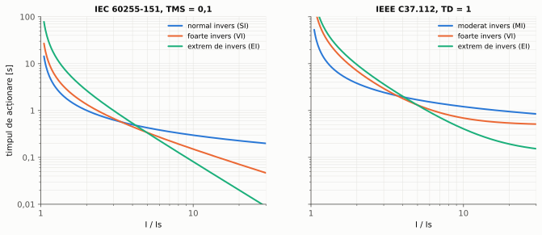
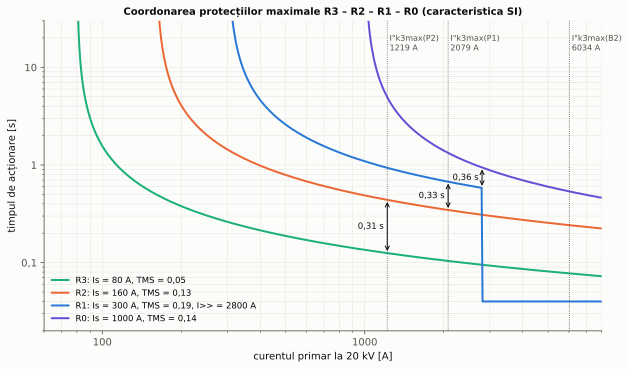
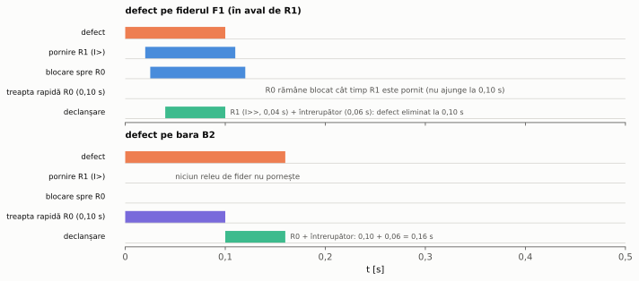
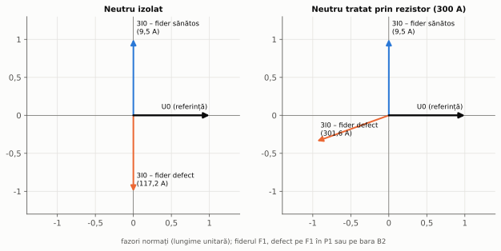

# Capitolul 3. Protecția maximală de curent

> **Obiective.** După acest capitol ar trebui să puteți: (1) explica funcționarea treptelor instantanee și temporizate (ANSI 50/51); (2) folosi caracteristicile dependente IEC 60255-151 și IEEE C37.112; (3) alege curentul de pornire din curentul de sarcină și verifica sensibilitatea; (4) coordona în timp protecțiile unui fider radial și justifica treapta de timp; (5) regla treapta instantanee și calcula zona acoperită; (6) explica protecția barelor prin logică de blocare; (7) regla protecția homopolară și folosi direcția curentului homopolar pentru selectivitate.

Protecția maximală de curent este cea mai veche și cea mai răspândită protecție. Ea acționează când curentul depășește un prag reglat. Este protecția de bază a rețelelor radiale de medie tensiune și protecția de rezervă aproape peste tot în rest. Exemplul capitolului este fiderul F1 al rețelei de referință (figura 0.1), cu releele R3 (la consumatorul din P2), R2 (în P1), R1 (la plecarea din B2) și R0 (pe intrarea de 20 kV a transformatorului T1).

---

## 3.1. Principiul

Releul compară valoarea efectivă a curentului (la releele numerice, amplitudinea componentei fundamentale, calculată din eșantioane) cu un **curent de pornire** $I_s$. Dacă $I > I_s$, releul „pornește” și, după o **temporizare**, comandă declanșarea. După eliminarea defectului, releul revine când curentul scade sub $k_r I_s$, unde $k_r < 1$ este **raportul de revenire**.

Există trei tipuri de trepte:

- **treaptă instantanee** (ANSI 50, notată I>>), fără temporizare intenționată;
- **treaptă cu timp independent** (ANSI 51 cu timp definit), cu temporizare constantă, oricare ar fi curentul;
- **treaptă cu timp dependent** (ANSI 51, notată I>), cu timp cu atât mai scurt cu cât curentul este mai mare.

Selectivitatea se obține prin **temporizări crescătoare spre sursă**: releul cel mai apropiat de defect trebuie să acționeze primul. Problema temporizării independente este că releele de lângă sursă, unde curenții de defect sunt cei mai mari, au tocmai temporizările cele mai lungi. Caracteristicile dependente compensează parțial acest dezavantaj.

## 3.2. Caracteristici dependente

Standardul IEC 60255-151 [S2] definește timpul de acționare prin

$$\boxed{t(I) = TMS \cdot \frac{k}{(I/I_s)^\alpha - 1}}$$

unde $TMS$ este multiplicatorul de timp. Familia IEEE C37.112 [S3] adaugă un termen constant: $t = TD\cdot[A/((I/I_s)^p - 1) + B]$.

| Caracteristica | Constante |
|---|---|
| IEC normal invers (SI) | $k$ = 0,14, $\alpha$ = 0,02 |
| IEC foarte invers (VI) | $k$ = 13,5, $\alpha$ = 1 |
| IEC extrem de invers (EI) | $k$ = 80, $\alpha$ = 2 |
| IEEE moderat invers (MI) | $A$ = 0,0515, $B$ = 0,114, $p$ = 0,02 |
| IEEE foarte invers (VI) | $A$ = 19,61, $B$ = 0,491, $p$ = 2 |
| IEEE extrem de invers (EI) | $A$ = 28,2, $B$ = 0,1217, $p$ = 2 |

*Figura 3.1 – Caracteristicile IEC (TMS = 0,1) și IEEE (TD = 1).*

Alegerea caracteristicii:

- **SI** – timpul variază puțin cu curentul. Este potrivită când curentul de defect variază mult cu regimul sursei (selectivitatea se păstrează);
- **VI** – timpul este aproximativ invers proporțional cu curentul. Este potrivită când curentul scade mult în lungul fiderului (aici timpul crește odată cu distanța);
- **EI** – timpul este aproximativ invers proporțional cu $I^2$, ca încălzirea. Se coordonează bine cu siguranțele fuzibile și tolerează curenții de pornire de scurtă durată (pornirea motoarelor, reconectarea sarcinilor după o întrerupere).

Releele numerice calculează timpul dependent și pentru curenți variabili. În scripturile cursului, ele sunt modelate printr-un **integrator**: cât timp $I > I_s$, releul adună $\Delta t/t(I)$ și declanșează când suma ajunge la 1. Pentru un curent constant, rezultatul este exact $t(I)$ (problema 3.1). Releele reale au și o caracteristică de **revenire**: când curentul scade sub prag, „suma” se anulează imediat sau scade treptat (unele relee imită astfel revenirea lentă a releelor electromecanice). În problemele cursului curentul este constant pe durata defectului, deci revenirea nu intervine.

## 3.3. Curentul de pornire. Sensibilitatea

Curentul de pornire trebuie:

1. să fie **mai mare decât curentul maxim de sarcină**, cu o rezervă, iar releul trebuie să revină după eliminarea unui defect exterior. În curs se folosește condiția
   $$I_s \ge \frac{k_{\text{sig}}}{k_r}\thinspace I_{\text{sarcină,max}}, \qquad k_{\text{sig}} = 1{,}3, \quad k_r = 0{,}95 ;$$
2. să fie **suficient de mic** ca releul să acționeze sigur la curentul **minim** de defect din zona lui (§ 1.2, defect bifazat cu $c_{min}$). Coeficientul de sensibilitate $k_s = I_{k,min}/I_s$ trebuie să fie cel puțin **1,5 în zona proprie** și cel puțin **1,3 în zona de rezervă** (criteriile adoptate în acest curs).

Valorile $k_{\text{sig}}$, $k_r$ și coeficienții minimi de sensibilitate sunt **date de proiectare** ale cursului: ele acoperă erorile TC (§ 2.2), erorile releului și incertitudinea datelor rețelei. În practică se iau din normele operatorului de rețea și din documentația releului.

Condițiile se contrazic când curentul de sarcină este apropiat de curentul minim de defect (fideri lungi, rețele slabe). Atunci se folosesc protecții de distanță (capitolul 5) sau protecții cu blocare la sarcină.

## 3.4. Coordonarea în timp

Două relee succesive, unul în aval (mai aproape de defect) și unul în amonte, se coordonează la **curentul maxim de defect care trece prin amândouă**: un defect imediat în aval de releul din aval. La acest curent diferența dintre timpii lor trebuie să fie cel puțin **treapta de timp** $\Delta t$. La curenți mai mici, caracteristicile dependente se depărtează și diferența crește (figura 3.2).

Treapta de timp trebuie să acopere tot ce se poate întâmpla între momentul în care releul din aval dă comanda și momentul în care releul din amonte ar ajunge să declanșeze:

$$\boxed{\Delta t \ge t_{\text{întrerupere}} + t_{\text{depășire}} + t_{\text{siguranță}} + \varepsilon\thinspace(t_{\text{aval}} + t_{\text{amonte}})}$$

- $t_{\text{întrerupere}}$ – timpul de întrerupere al întrerupătorului din aval: defectul există până atunci;
- $t_{\text{depășire}}$ (*overshoot*) – timpul cât releul din amonte poate continua să „numere” după ce curentul a dispărut;
- $\varepsilon$ – eroarea relativă de timp a releelor. Cazul cel mai defavorabil este cel în care releul din aval întârzie și cel din amonte se grăbește;
- $t_{\text{siguranță}}$ – o rezervă pentru erorile TC și pentru incertitudinea datelor.

Cu datele din problema 3.2 (0,06 s, 0,02 s, 0,05 s și ±5 %), această condiție cere între 0,16 și 0,21 s. Cursul folosește o **treaptă de 0,3 s**, rotunjită acoperitor, și verifică pentru fiecare pereche de relee că marja realizată acoperă și cazul cel mai defavorabil al erorilor.

*Figura 3.2 – Caracteristicile releelor R3, R2, R1 și R0 și marjele în punctele de coordonare (problema 3.2).*

## 3.5. Treapta instantanee

Treapta instantanee a unui releu nu poate fi selectivă prin timp. Ea trebuie să **nu vadă** defectele din zona releului următor. Se reglează deci peste curentul maxim la capătul zonei proprii (la bara următoare), cu o rezervă pentru erori și pentru componenta aperiodică. În curs, rezerva este 1,3:

$$I_{>>} \ge 1{,}3\thinspace I''_{k3max}(\text{bara următoare}).$$

Treapta acoperă numai porțiunea de linie pe care curentul de defect depășește $I_{>>}$. Lungimea acestei porțiuni scade când sursa este mai slabă și la defectele bifazate (problema 3.2). Dacă impedanța liniei este mică față de cea a sursei, curentul variază puțin în lungul liniei, iar treapta instantanee acoperă o porțiune mică sau deloc. La fiderul F1, cablul de la început are reactanță mică (figura 1.1), iar aproape toată acoperirea vine de pe porțiunea de linie aeriană.

## 3.6. Protecția barelor prin blocare

Releul R0 al intrării în stație trebuie coordonat cu releele fiderilor, deci are temporizarea cea mai mare din stație. Un defect chiar pe bara B2 este însă văzut **numai** de R0, nu și de releele fiderilor. Logica de **blocare inversă** (*reverse blocking*) folosește această observație:

- R0 are o treaptă rapidă, cu temporizare scurtă (în curs 0,10 s) și cu același curent de pornire ca treapta temporizată (1000 A);
- orice releu de fider care **pornește** trimite un semnal de blocare spre R0 (prin fir sau, în stațiile moderne, prin mesaje GOOSE IEC 61850, capitolul 9);
- dacă defectul este pe un fider, releul fiderului pornește, blochează treapta rapidă a lui R0 și elimină defectul cu treptele proprii;
- dacă defectul este pe bară, niciun releu de fider nu pornește, iar R0 declanșează după 0,10 s.

Pragurile de pornire ale releelor de fider trebuie să fie mai mici decât pragul treptei rapide a lui R0 (aici 300 A < 1000 A), ca orice defect pe fider care pornește R0 să pornească și releul fiderului. Temporizarea treptei rapide trebuie să fie mai mare decât timpul în care semnalul de blocare ajunge la R0 (pornirea releului de fider, transmisia, prelucrarea), altfel R0 ar declanșa înainte să fie blocat (problema 9.3). Figura 3.3 arată cele două cazuri.

*Figura 3.3 – Diagrama de timp a logicii de blocare pentru un defect pe fider (sus) și unul pe bară (jos).*

## 3.7. Protecția homopolară

La defectele cu pământul, curentul **rezidual** $3I_0$ (§ 1.4) este practic nul în regim normal. O protecție care îl măsoară (ANSI 50N/51N) poate fi deci mult mai sensibilă decât protecția de fază, al cărei reglaj trebuie să depășească sarcina.

Reglajul depinde de tratarea neutrului (§ 1.6):

- **neutru tratat prin rezistor** – curentul de defect este de ordinul sutelor de amperi și circulă numai prin fiderul defect. Un fider sănătos vede doar **curentul capacitiv propriu**, la orice punere la pământ din rețea. Reglajul trebuie să depășească acest curent, cu rezervă. Sensibilitatea se exprimă prin **rezistența de defect maximă** detectată (problema 3.4);
- **neutru izolat sau compensat** – curentul de defect este mic și comparabil cu curentul capacitiv al fiderilor sănătoși. Mărimea curentului nu mai este suficientă, iar selectivitatea se obține din **direcția** lui (§ 3.8).

## 3.8. Protecția direcțională

Când curentul de defect poate veni din ambele sensuri (rețele buclate, linii în paralel, transformatoare în paralel, generatoare distribuite), releul maximal trebuie completat cu un **element direcțional** (ANSI 67, respectiv 67N pentru curentul homopolar). Acesta compară faza curentului cu cea a unei tensiuni de referință și acționează numai dacă unghiul dintre ele se află într-un semiplan reglat, centrat pe **unghiul caracteristic**.

Pentru punerile la pământ, referința este tensiunea homopolară $U_0$ (§ 2.5). Problema 3.5 și figura 3.4 arată de ce direcția curentului homopolar identifică fiderul defect:

- **neutru izolat** – un fider sănătos vede curentul capacitiv propriu, **înaintea** lui $U_0$ cu 90°. Prin fiderul defect circulă, în sens invers, curentul capacitiv al întregului rest al rețelei, **în urma** lui $U_0$ cu 90°. Elementul direcțional folosește componenta reactivă a curentului (metoda „sin φ”);
- **neutru tratat prin rezistor** – curentul fiderului defect este dominat de componenta activă dată de rezistor și este practic în opoziție cu $U_0$;
- **neutru compensat** – bobina de stingere compensează componenta reactivă, deci direcția trebuie stabilită din componenta **activă** a curentului rezidual (metoda „cos φ”, eventual cu un rezistor conectat temporar în paralel cu bobina) sau din fenomenele tranzitorii de la apariția defectului.

*Figura 3.4 – Curentul homopolar al fiderului F1, raportat la $U_0$, pentru un defect pe F1 (fider defect) și pentru un defect pe bara B2 (fider sănătos).*

---

## Probleme rezolvate

### Problema 3.1 – Timpii de acționare

Să se calculeze timpii de acționare ai caracteristicilor IEC (TMS = 0,1) și IEEE (TD = 1) la 2, 5, 10 și 20 de ori curentul de pornire.

**Rezolvare.** Din formulele din § 3.2:

| Caracteristica | 2·Is | 5·Is | 10·Is | 20·Is |
|---|---|---|---|---|
| IEC SI | 1,003 s | 0,428 s | 0,297 s | 0,227 s |
| IEC VI | 1,350 s | 0,338 s | 0,150 s | 0,071 s |
| IEC EI | 2,667 s | 0,333 s | 0,081 s | 0,020 s |
| IEEE MI | 3,803 s | 1,688 s | 1,207 s | 0,948 s |
| IEEE VI | 7,028 s | 1,308 s | 0,689 s | 0,540 s |
| IEEE EI | 9,522 s | 1,297 s | 0,407 s | 0,192 s |

Între 2·Is și 20·Is, timpul caracteristicii SI scade de 4,4 ori, al celei VI de 19 ori, iar al celei EI de 133 de ori.

**Verificare.** Pentru caracteristicile IEC, scriptul simulează releul numeric ca integrator (§ 3.2) cu pasul de 0,1 ms și un curent constant. Timpul de declanșare coincide cu formula în limita a 0,2 ms în toate cele 12 cazuri. La curent constant, integratorul folosește aceeași formulă $t(I)$, deci verificarea confirmă implementarea integratorului (folosit în problema 3.2), nu formula însăși.

### Problema 3.2 – Coordonarea protecțiilor fiderului F1

Releele R3 (consumatorul din P2), R2 (în P1), R1 (plecarea F1 din B2) și R0 (intrarea de 20 kV a lui T1) au caracteristica SI. Curenții de sarcină maximi sunt 50 A (R3), 110 A (R2), 180 A (R1) și curentul nominal al lui T1, 722 A (R0). Date pentru treapta de timp (§ 3.4): întrerupătoarele au timpul de întrerupere de 0,06 s, releele au eroarea de timp ±5 % și depășirea de 0,02 s, rezerva de siguranță este 0,05 s. Treapta instantanee are timpul propriu de 0,04 s. Să se aleagă reglajele și să se verifice sensibilitatea și selectivitatea.

**Rezolvare.**

*Curenții de defect* (problema 1.2):

| Bara | $I''_{k3max}$ | $I''_{k2min}$ (R la 80 °C, configurația cea mai slabă) |
|---|---|---|
| B2 | 6034 A | 4070 A |
| P1 | 2079 A | 1444 A |
| P2 | 1219 A | 845 A |

*Curenții de pornire* (§ 3.3):

| Releu | $1{,}3\thinspace I_{\text{sarcină}}/0{,}95$ | $I_s$ ales | TC |
|---|---|---|---|
| R3 | 68 A | 80 A | 100/1 A |
| R2 | 151 A | 160 A | 200/1 A |
| R1 | 246 A | 300 A | 400/1 A |
| R0 | 988 A | 1000 A | 1000/1 A |

*Sensibilitatea* (defect bifazat minim, configurația cea mai slabă): R2 în P2: 5,28; R1 în P1: 4,81 (zona proprie) și în P2: 2,82 (rezervă); R0 în B2: 4,07 și în P1: 1,44 (rezervă). Toate depășesc 1,5, respectiv 1,3. Pentru R3 s-a verificat numai curentul de la locul releului (P2): 10,56; zona lui, spre consumator, nu face parte din rețeaua de referință.

*Treapta instantanee a lui R1*: $1{,}3 \cdot 2079$ = 2703 A, aleasă **2800 A**.

*Coordonarea în timp* (treapta 0,3 s), începând cu releul cel mai depărtat de sursă, R3, cu TMS = 0,05:

| Pereche | Curentul de coordonare | $t_{\text{aval}}$ | TMS (rotunjit în sus) | $t_{\text{amonte}}$ | Marja | Marja minimă din § 3.4 |
|---|---|---|---|---|---|---|
| R2 față de R3 | 1219 A (defect în P2) | 0,125 s | 0,13 | 0,439 s | 0,314 s | 0,158 s |
| R1 față de R2 | 2079 A (defect în P1) | 0,346 s | 0,19 | 0,674 s | 0,328 s | 0,181 s |
| R0 față de R1 | 2800 A (reglajul I>> al lui R1) | 0,582 s | 0,14 | 0,942 s | 0,360 s | 0,206 s |

R0 se coordonează cu R1 la curentul treptei instantanee a lui R1: la curenți mai mari, R1 acționează instantaneu și marja crește.

Treapta instantanee a lui R1 acoperă **7,02 km (70 %)** din tronsonul B2–P1 de 10 km la defect trifazat maxim și **4,86 km (49 %)** la defect bifazat minim (configurația normală, R la 80 °C); în configurația cea mai slabă, 4,24 km (42 %). Distanța se calculează cu impedanța reală a traseului: primii 3 km sunt cablu, cu impedanță mică pe km, restul linie aeriană (figura 1.1).

**Verificare.** (a) Fiecare TMS a fost calculat cu formula inversă și ca rădăcină numerică a ecuației $t_{\text{amonte}} - t_{\text{aval}} = \Delta t$; valorile coincid (verificare de calcul: aceeași ecuație). Curenții minimi au fost calculați și în coordonate de fază, în configurația cea mai slabă. (b) Calea independentă pentru curenți: scriptul simulează defecte trifazate în P2, P1 și B2 în rețeaua rezolvată în coordonate de fază și modelează toate releele ca integratoare. Ordinea de acționare este cea dorită, cu marje de cel puțin 0,3 s față de releul următor:

| Defect în | Curent | R3 | R2 | R1 | R0 |
|---|---|---|---|---|---|
| P2 | 1219 A | **0,125 s** | 0,439 s | 0,936 s | 4,944 s |
| P1 | 2079 A | – | **0,346 s** | 0,674 s | 1,329 s |
| B2 (plecarea F1) | 6034 A | – | – | **0,040 s** | 0,536 s |

(c) Limita treptei instantanee a fost verificată introducând o bară intermediară pe tronsonul B2–P1, la 7,02 km și respectiv la 4,86 km de B2, cu porțiunile reale de cablu și de linie aeriană: curentul de defect calculat acolo (în componente simetrice și în coordonate de fază) este exact 2800 A.

### Problema 3.3 – Protecția barelor de 20 kV prin blocare

Cât durează eliminarea unui defect pe bara B2, cu și fără logica de blocare? Întrerupătorul are timpul de întrerupere de 0,06 s.

**Rezolvare.** Fără logica de blocare, defectul este eliminat de treapta temporizată a lui R0: la 6034 A, $t$ = 0,536 s, plus întreruperea: **0,596 s**. Cu treapta rapidă de 0,10 s, blocată de pornirea releelor de fider: 0,10 + 0,06 = **0,16 s**, de 3,7 ori mai repede. Energia degajată în locul defectului (arcul de pe bară) și în legătura de la transformator la bară scade în același raport.

**Verificare.** Problema este o aplicație directă; scriptul confirmă numai că reducerea este de cel puțin 3 ori. Timpul de 0,536 s este cel obținut în simularea cu integrator din problema 3.2. Bugetul de timp al semnalului de blocare transmis prin GOOSE este calculat în problema 9.3.

### Problema 3.4 – Protecția homopolară a fiderului F1

Rețeaua de 20 kV are neutrul tratat prin rezistor (300 A). Fiderul F1 are 3 km de cablu ($C_0$ = 0,26 µF/km) și 15 km de LEA ($C_0$ = 0,005 µF/km). Să se regleze protecția homopolară a lui R1 și să se afle rezistența de defect maximă detectată la capătul fiderului (P2).

**Rezolvare.**

- $C_0$(F1) = 3 · 0,26 + 15 · 0,005 = 0,855 µF; curentul capacitiv propriu $3\omega C_0 U_f$ = **9,30 A**. La o punere la pământ în afara fiderului, R1 vede acest curent.
- Reglajul ales: $3I_0>$ = **20 A** primar, de 2,1 ori curentul capacitiv propriu. Curentul se măsoară cu un TC toroidal (§ 2.5) de 100/1 A, deci 0,2 A secundar; montajul rezidual al TC de fază de 400/1 A nu ar fi potrivit pentru un reglaj atât de mic (curentul rezidual fals produs de erorile TC la defectele între faze). Temporizarea se coordonează cu protecțiile homopolare din aval și nu se calculează aici.
- Pentru un defect în P2 cu rezistența $R_f$, curentul este aproximativ $U_f/(R_N + R_f)$, cu $R_N$ = 38,49 Ω. Din $U_f/(R_N + R_f)$ = 20 A rezultă $R_f \approx$ **539 Ω**. Calculul exact dă **535 Ω**.

Un defect cu rezistență mai mare (de exemplu un conductor căzut pe un sol uscat) nu mai este detectat de această protecție. Pentru el sunt necesare protecții homopolare foarte sensibile sau metode speciale.

**Verificare.** (a) Curentul văzut de R1 la un defect exterior (pe bara B2), calculat în coordonate de fază, este 9,48 A, față de 9,30 A din formulă. Diferența de 1,9 % provine din aceleași efecte neglijate de formulă ca în problema 1.6 (creșterea tensiunii produsă de capacități și impedanțele longitudinale). (b) Rezistența maximă rezultă identică, 535 Ω, din două calcule exacte independente (coordonate de fază și componente simetrice), rezolvate fiecare numeric după $R_f$. Estimarea de mână diferă cu 0,6 %.

### Problema 3.5 – Direcția curentului homopolar

Se compară curentul homopolar al fiderului F1 la un defect pe F1 (în P1) și la un defect pe bara B2, pentru neutrul izolat și pentru neutrul tratat prin rezistor.

**Rezolvare.** Rezultatele calculului exact, raportate la $U_0$:

| Neutru | Defect pe F1 (fider defect) | Defect pe B2 (F1 sănătos) |
|---|---|---|
| izolat | 117,2 A, **−90°** ($\lvert U_0 \rvert$ = 1,086 $U_f$) | 9,5 A, **+90°** |
| rezistor (300 A) | 301,6 A, **−160,2°** | 9,5 A, **+90°** |

Fiderul sănătos vede întotdeauna curentul lui capacitiv, înaintea lui $U_0$ cu 90°. În rețeaua izolată, fiderul defect conduce spre locul defectului curentul capacitiv al restului rețelei, cu semn opus: în urma lui $U_0$ cu 90°. În rețeaua cu rezistor, la acesta se adaugă curentul rezistorului, de 300 A, în opoziție cu $U_0$. Rezultanta este în urma lui $U_0$ cu 160,2°. În ambele cazuri, elementul direcțional deosebește clar cele două situații (figura 3.4).

Formula de manual $3\omega C_{0,\text{rest}} U_f$ dă 108,0 A pentru fiderul defect din rețeaua izolată, mai puțin decât 117,2 A. Diferența vine din faptul că, la un defect în P1, tensiunea homopolară de la bara B2 crește la 1,086 $U_f$: inductivitatea homopolară a fiderului este în serie cu capacitatea mare a restului rețelei.

**Verificare.** (a) Calea independentă: curenții reziduali și tensiunea $U_0$ calculate în coordonate de fază coincid cu cele din rețelele de secvență, în toate cele patru cazuri. (b) Verificare de consistență (bilanțul curenților la bara B2, cu $U_0$ calculat): în rețeaua izolată $\lvert 3I_0 \rvert = 3\omega C_{0,\text{rest}} \lvert U_0 \rvert$, iar în rețeaua cu rezistor $3\underline{I}_0 = -(\underline{U}_0/R_N + j\thinspace 3\omega C_{0,\text{rest}} \underline{U}_0)$.

---

## Întrebări de autoevaluare

1. De ce temporizarea independentă este dezavantajoasă pe un fider radial cu multe trepte de selectivitate?
   

Răspuns

   Temporizările cresc spre sursă cu câte o treaptă de timp, deci releul de lângă sursă are temporizarea cea mai mare. Acolo însă curenții de defect sunt cei mai mari, deci și solicitările. Caracteristicile dependente reduc timpul la curenți mari și compensează parțial acest dezavantaj (figura 3.2).

   

2. De ce curentul de pornire se împarte la raportul de revenire?
   

Răspuns

   După eliminarea unui defect exterior, curentul revine la valoarea de sarcină (eventual mărită de reaccelerarea motoarelor). Releul trebuie să revină în starea de repaus, adică curentul trebuie să scadă sub $k_r I_s$. Condiția $k_r I_s > k_{\text{sig}} I_{\text{sarcină}}$ dă $I_s > k_{\text{sig}} I_{\text{sarcină}}/k_r$.

   

3. La ce curent se verifică selectivitatea dintre două relee succesive și de ce?
   

Răspuns

   La curentul maxim care trece prin ambele relee, adică la un defect imediat în aval de releul din aval, în regimul maxim al sursei. La acest curent caracteristicile dependente sunt cel mai apropiate. La curenți mai mici ele se depărtează, deci marja crește.

   

4. Ce componente trebuie să acopere treapta de timp?
   

Răspuns

   Timpul de întrerupere al întrerupătorului din aval (defectul durează până la deschiderea lui), timpul de depășire al releului din amonte, erorile de timp ale celor două relee în cazul cel mai defavorabil și o rezervă pentru erorile TC și incertitudinea datelor (§ 3.4).

   

5. De ce treapta instantanee acoperă o porțiune mai mică a liniei când sursa este slabă?
   

Răspuns

   Reglajul ei se stabilește la curentul maxim (sursa în regim maxim) la capătul liniei. Când sursa este slabă, curenții de defect sunt mai mici în toate punctele, deci punctul în care curentul scade sub reglaj se apropie de releu.

   

6. Cum poate R0 elimina rapid un defect pe bară fără să-și piardă selectivitatea față de fideri?
   

Răspuns

   Prin logica de blocare inversă: R0 are o treaptă rapidă care este blocată de pornirea oricărui releu de fider. Un defect pe un fider pornește releul fiderului, care blochează treapta rapidă; un defect pe bară nu pornește niciun releu de fider, deci treapta rapidă acționează (§ 3.6).

   

7. De ce în rețeaua cu neutru izolat nu ajunge mărimea curentului homopolar pentru a găsi fiderul defect?
   

Răspuns

   Pentru că un fider sănătos lung (cu capacitate mare) poate vedea un curent capacitiv propriu comparabil cu curentul prin fiderul defect, dacă restul rețelei este mic. Direcția curentului însă diferă: înaintea lui $U_0$ pe fiderii sănătoși, în urma lui pe cel defect (problema 3.5).

   

## Bibliografie

- [1] Alstom Grid – *Network Protection & Automation Guide*, 2011.
- [7] W. A. Elmore (ed.) – *Protective Relaying: Theory and Applications*, ed. 2, Marcel Dekker, 2003.
- [9] ABB – *Distribution Automation Handbook*, secțiunea 8 (coordonarea releelor, protecția la puneri la pământ în rețelele de medie tensiune).
- [13] C. Prévé – *Protection of Electrical Networks*, ISTE, 2006.
- [14] R. Tîrnovan, I. Vădan, H. Bălan, A. Botezan – *Protecții prin relee în sistemele electroenergetice*, U.T. Press, 2008.
- [16] R.-A. Tîrnovan – *Protecții digitale în sistemele electroenergetice*, U.T. Press, 2019.
- [S2] IEC 60255-151:2009; [S3] IEEE C37.112-2018.
