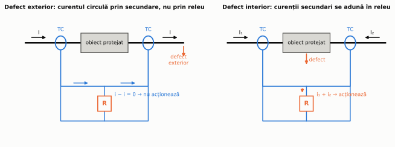
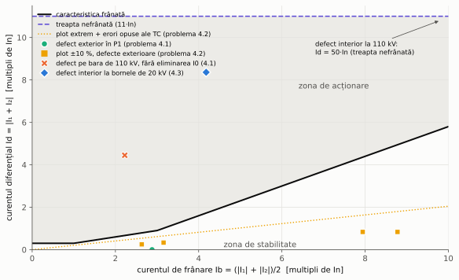
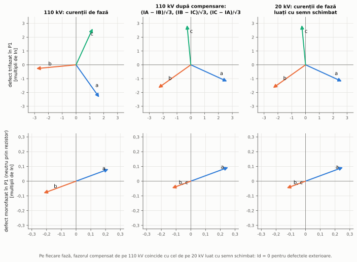
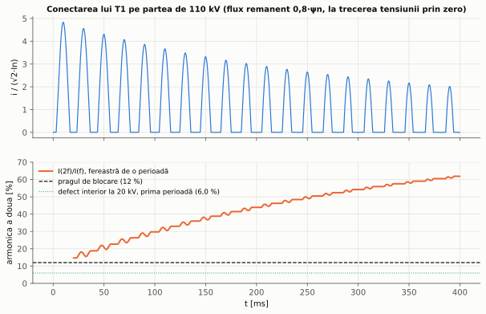
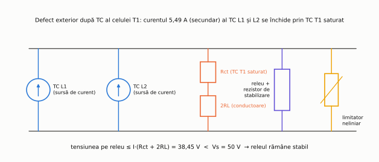

# Capitolul 4. Protecția diferențială

> **Obiective.** După acest capitol ar trebui să puteți: (1) explica principiul protecției diferențiale și de ce ea este selectivă fără temporizare; (2) defini curentul diferențial și curentul de frânare și citi o caracteristică cu frânare; (3) adapta amplitudinile și compensa grupa de conexiuni a unui transformator, inclusiv eliminarea componentei homopolare; (4) verifica stabilitatea protecției la defecte exterioare, cu comutatorul de ploturi în poziție extremă și cu erorile transformatoarelor de curent; (5) explica curentul de magnetizare la conectare și blocarea la armonica a doua; (6) descrie protecția diferențială a barelor (de impedanță mare și mică) și a liniilor.

Protecția diferențială compară curenții de la **toate** capetele elementului protejat. Ea are o zonă **închisă**, delimitată exact de transformatoarele de curent (§ 0.5), deci nu trebuie coordonată în timp cu protecțiile vecine: poate acționa instantaneu. De aceea este protecția de bază a transformatoarelor, generatoarelor, motoarelor mari și barelor, iar cu un canal de comunicație și a liniilor.

În capitol folosim transformatorul **T1** al rețelei de referință (25 MVA, 110/20 kV, YNd11, § 0.7) și bara B de 110 kV.

---

## 4.1. Principiul

Pe fiecare capăt al obiectului protejat se montează câte un TC, cu același raport (raportat la curentul nominal al obiectului), iar secundarele se leagă astfel încât curenții să **circule** între ele; releul este legat în ramura care unește punctele de egal potențial ale circuitului secundar (figura 4.1). Schema este cunoscută și după numele inventatorilor ei (Merz–Price).

*Figura 4.1 – La un defect exterior curentul secundar circulă prin cele două TC și nu trece prin releu; la un defect interior curenții secundari se adună în releu.*

- La un **defect exterior** (sau la sarcină), curentul care intră în zonă iese din ea; curenții secundari se compensează, iar releul este parcurs (ideal) de zero.
- La un **defect interior**, curenții de pe ambele capete intră în zonă; prin releu trece suma lor, adică (raportat la secundar) curentul de defect.

Releul nu are nevoie de temporizare: el „știe” unde este defectul din semnul relativ al curenților, nu din valoarea lor. Toată dificultatea protecției diferențiale constă în a menține curentul prin releu suficient de mic la defectele exterioare mari, când TC au erori și se pot satura (§ 2.3), iar la transformatoare și când curenții de pe cele două părți nu sunt egali nici măcar în regim ideal (§ 4.3).

## 4.2. Curentul diferențial și curentul de frânare

Releele numerice calculează, pe fiecare fază, din curenții care **intră** în zonă (raportați la secundar și adaptați, § 4.3):

$$\boxed{I_d = \left|\underline{I}_1 + \underline{I}_2\right|, \qquad I_b = \frac{|\underline{I}_1| + |\underline{I}_2|}{2}}$$

$I_d$ este **curentul diferențial** (de acționare), iar $I_b$ – **curentul de frânare** (de stabilizare), o măsură a curentului care traversează zona. Producătorii folosesc definiții diferite pentru curentul de frânare (media, suma sau maximul modulelor, eventual numai pentru unele capete); reglajele trebuie citite întotdeauna împreună cu definiția folosită de releul respectiv. În curs folosim media modulelor.

La un defect exterior, $I_d$ nu este exact zero: erorile TC (care cresc cu curentul), raportul real al transformatorului diferit de cel pentru care s-a făcut adaptarea (comutatorul de ploturi) și curentul de magnetizare produc un curent diferențial **aproximativ proporțional cu curentul traversant**. De aceea pragul de acționare nu este constant, ci crește cu curentul de frânare – **caracteristica cu frânare** (figura 4.2). În curs folosim o caracteristică cu două pante (date de reglaj ale cursului):

$$I_{d,acț} = \begin{cases} \max\left(0{,}30\thinspace I_n;\ 0{,}30\thinspace I_b\right), & I_b \le 3\thinspace I_n \\ 0{,}30 \cdot 3\thinspace I_n + 0{,}70\thinspace(I_b - 3\thinspace I_n), & I_b > 3\thinspace I_n \end{cases}$$

- **pragul minim** (0,30·In) acoperă curentul de magnetizare și erorile la curenți mici;
- **prima pantă** (30 %) acoperă erorile proporționale cu curentul: comutatorul de ploturi și erorile TC; în problema 4.2 se arată că, pentru T1, acestea dau cel mult 20,47 % din curentul de frânare;
- **a doua pantă** (70 %), mai abruptă, acoperă saturația TC la curenți traversanți mari, când un TC poate da un curent mult mai mic decât celălalt.

*Figura 4.2 – Caracteristica cu frânare folosită în curs și punctele de funcționare calculate în problemele 4.1–4.3. Punctele defectelor exterioare rămân sub caracteristică; defectul exterior de pe bara de 110 kV ar intra în zona de acționare dacă releul nu ar elimina componenta homopolară.*

Pe lângă treapta frânată, releele au o **treaptă nefrânată** (instantanee), care acționează numai după $I_d$, fără frânare și fără blocarea la armonici (§ 4.4). Ea se reglează peste curentul diferențial maxim care poate apărea la un defect exterior sau la conectare. Dacă la un defect exterior un TC se saturează complet, curentul diferențial poate ajunge cel mult la curentul traversant; pentru T1, cel mai mare curent traversant este cel al unui defect pe bara B2, 8,36·In (problema 4.3). De aceea treapta nefrânată se reglează în curs la **11·In**: peste acest curent și peste fundamentala curentului de magnetizare la conectare (2,61·In, problema 4.4).

Cerințele funcționale pentru protecțiile diferențiale frânate și nefrânate ale motoarelor, generatoarelor și transformatoarelor sunt stabilite în IEC 60255-187-1 [S6].

## 4.3. Protecția diferențială a transformatorului

Un transformator nu este un „conductor”: curenții de pe cele două părți diferă ca valoare și ca fază chiar în regim normal. Releul trebuie să corecteze trei efecte înainte de a calcula $I_d$ și $I_b$.

**1. Adaptarea de amplitudine.** Curenții nominali ai lui T1 sunt 131,2 A pe 110 kV și 721,7 A pe 20 kV. TC standardizate alese (150/1 A și 800/1 A) nu au exact raportul curenților nominali, așa că releul înmulțește curentul secundar de pe fiecare parte cu un factor de adaptare și lucrează în **multipli ai curentului nominal al transformatorului**:

$$k_{IT} = \frac{150}{131{,}2} = 1{,}1432, \qquad k_{JT} = \frac{800}{721{,}7} = 1{,}1085 .$$

Vechile relee electromecanice foloseau pentru aceasta TC intermediare; releele numerice o fac prin calcul.

**2. Compensarea grupei de conexiuni.** La T1 (YNd11), sistemul direct de pe 20 kV este **defazat înainte cu 30°** față de cel de pe 110 kV, iar sistemul invers – înapoi cu 30° (§ 1.4). Releul rotește curenții de pe partea în stea cu o matrice care face exact acest lucru:

$$\boxed{\begin{bmatrix} I'_A \\ I'_B \\ I'_C \end{bmatrix} = \frac{1}{\sqrt3}\begin{bmatrix} 1 & -1 & 0 \\ 0 & 1 & -1 \\ -1 & 0 & 1 \end{bmatrix} \begin{bmatrix} I_A \\ I_B \\ I_C \end{bmatrix}}$$

Pentru sistemul direct, $I'_A = I_A\thinspace(1 - a^2)/\sqrt3 = I_A \angle +30°$; pentru cel invers, $I'_A = I_A\thinspace(1 - a)/\sqrt3 = I_A\angle -30°$, exact defazajele transformatorului (figura 4.3).

**3. Eliminarea componentei homopolare.** Neutrul înfășurării de 110 kV a lui T1 este legat la pământ, așa că la un defect cu pământul în rețeaua de **110 kV** T1 debitează curent homopolar pe partea de 110 kV (prin neutrul lui), fără niciun curent corespunzător în liniile de 20 kV (curentul homopolar circulă în interiorul triunghiului). Fără corecție, acest curent ar apărea ca diferențial și protecția ar declanșa transformatorul la un defect exterior. Matricea de mai sus are suma coeficienților pe fiecare linie zero, deci **elimină automat componenta homopolară**. În schemele clasice, același efect se obținea legând în triunghi TC de pe partea în stea. La transformatoarele YNyn (fără defazaj), releul elimină explicit $I_0$ din curenții de pe partea legată la pământ.

*Figura 4.3 – Fazorii curenților la un defect trifazat și la unul monofazat în P1 (exteriori zonei), în multipli ai curenților nominali: după compensare, fiecare fazor de pe 110 kV este egal și opus celui de pe 20 kV.*

Pe lângă acestea, protecția diferențială a transformatorului trebuie să țină seama de:

- **comutatorul de ploturi**: adaptarea se face pentru raportul nominal; în pozițiile extreme apare un curent diferențial proporțional cu sarcina (problema 4.2);
- **curentul de magnetizare**: în regim normal este mic (în modelul din problema 4.4, 0,4 % din In) și este acoperit de pragul minim; la conectare și la supraexcitare devine însă mare (§ 4.4);
- **defectele cu pământul pe partea de 20 kV**: în rețeaua cu neutrul tratat prin rezistor, curentul de defect este limitat la circa 300 A, adică 0,4–0,46·In al lui T1; dacă releul elimină și componenta homopolară de pe partea de 20 kV, el vede numai 2/3 din curent, sub pragul minim (problema 4.3). Aceste defecte sunt lăsate unei protecții dedicate (§ 4.5).

## 4.4. Curentul de magnetizare la conectare

La conectarea unui transformator în gol, fluxul din miez nu pornește de la valoarea lui de regim permanent, ci de la **fluxul remanent** lăsat de ultima deconectare. Dacă tensiunea $v = V_m \sin\omega t$ se aplică la trecerea ei prin zero, fluxul crește, într-o semiperioadă, cu

$$\Delta\psi = \int_0^{\pi/\omega} V_m \sin\omega t\thinspace dt = \frac{2 V_m}{\omega} = 2\thinspace\psi_n ,$$

adică ajunge (fără rezistențe) la $\psi_{rem} + 2\psi_n$ – de aproape trei ori fluxul nominal pentru $\psi_{rem}$ = 0,8·ψn. Miezul se saturează adânc, iar curentul de magnetizare, limitat numai de inductivitatea înfășurării cu miezul saturat și de cea a rețelei, ajunge la câțiva curenți nominali (problema 4.4). Curentul are forma unor **impulsuri unipolare** care se amortizează lent (figura 4.4), cu constanta de timp dată de rezistențele circuitului.

Curentul de magnetizare circulă numai pe partea alimentată, deci pentru protecția diferențială este un **curent diferențial**. Treapta frânată ar acționa dacă nu ar fi blocată. Forma de undă are însă un conținut mare de **armonica a doua** (o undă unipolară nu are simetrie de semiundă), pe care curenții de defect nu îl au. Releele calculează raportul $I_{2f}/I_{1f}$ pe o fereastră de o perioadă și blochează treapta frânată cât timp raportul depășește un prag; în curs pragul este **12 %**. Alegerea lui este justificată în problema 4.4:

- în simulare, curentul de conectare al lui T1 are în cel mai defavorabil caz 14,7 % în prima perioadă, apoi raportul crește (61,8 % după 0,4 s);
- un defect interior la bornele de 20 kV, cu componentă aperiodică maximă, are numai 6,0 % în prima perioadă și nu este blocat;
- un defect interior la bornele de 110 kV are 12,6 % în prima perioadă și ar putea fi blocat câteva milisecunde, dar curentul lui (50·In) acționează treapta nefrânată, care nu se blochează.

*Figura 4.4 – Simularea conectării lui T1 pe partea de 110 kV (model monofazat, flux remanent 0,8·ψn, conectare la trecerea tensiunii prin zero): curentul (sus) și raportul armonicii a doua pe o fereastră alunecătoare de o perioadă (jos).*

Marja dintre cele două situații este mică și depinde puternic de miezul transformatorului: în simulare, un cot de saturație mai jos (1,1·ψn în loc de 1,2·ψn) coboară raportul minim la 10,6 % (problema 4.4). Din acest motiv, releele moderne completează criteriul armonicii a doua cu alte criterii: blocarea tuturor fazelor când una singură detectează conectarea (blocare încrucișată), analiza formei de undă (intervalele în care curentul este aproape zero), iar reglajul se verifică pentru transformatorul concret.

La **supraexcitare** (tensiune prea mare sau frecvență prea mică, adică $U/f$ mare – de exemplu la descărcarea bruscă a unui generator), curentul de magnetizare crește și el, dar rămâne simetric; el conține mai ales armonica a cincea. Unele relee blochează treapta frânată și după armonica a cincea, iar supraexcitarea se tratează cu o protecție separată, după raportul $U/f$ (capitolul 6).

## 4.5. Alte protecții ale transformatorului

Protecția diferențială nu acoperă toate defectele transformatorului; ea se completează cu:

- **releul de gaze (Buchholz)**, la transformatoarele în ulei cu conservator: un defect în cuvă (chiar o scurtcircuitare între câteva spire, cu curent prea mic pentru protecția diferențială) descompune uleiul în gaze. Acumularea lentă a gazelor dă un semnal de avertizare; un val de ulei spre conservator (defect puternic) comandă declanșarea;
- **protecția homopolară a neutrului** (curentul prin legătura neutrului la pământ sau prin bobina de punct neutru, § 1.6) și **protecția diferențială restrânsă la pământ**, care compară curentul din neutru cu suma curenților de fază ai aceleiași înfășurări și detectează defectele cu pământul cu curent mic, ca cel din problema 4.3 (c);
- **protecția termică** (49), după un model termic de felul celui din § 6.2, și supravegherea temperaturii uleiului și a înfășurărilor;
- **protecțiile maximale** de rezervă pe ambele părți (capitolul 3), care acoperă și defectele exterioare neeliminate.

Declanșările date de protecțiile care indică un defect interior (diferențială, gaze) trec de obicei printr-un **releu de blocare** (86, § 0.6): după o asemenea declanșare, transformatorul nu poate fi reconectat până când personalul nu verifică defectul și nu deblochează manual releul.

## 4.6. Protecția diferențială a barelor

O bară are multe circuite; un defect pe bară este rar, dar foarte grav (se pierd toate circuitele), iar un defect exterior foarte apropiat produce cei mai mari curenți traversanți posibili printr-un singur TC. Există două familii de scheme:

- **de impedanță mare**: secundarele tuturor TC (cu același raport) sunt legate în paralel pe un releu de tensiune cu un rezistor de stabilizare de valoare mare. La un defect exterior, cel mai defavorabil caz este saturația completă a TC de pe circuitul cu defectul: el devine, în secundar, o simplă rezistență $R_{ct}$, iar curentul celorlalte TC se închide prin ea și prin conductoarele de legătură. Tensiunea pe releu este atunci cel mult
  $$\boxed{V_s \ge I_{k,sec}\thinspace(R_{ct} + 2R_L)}$$
  ($R_L$ – rezistența unui conductor de legătură; bucla are două conductoare), iar releul se reglează peste această tensiune (figura 4.5, problema 4.5). La un defect interior, toate TC debitează în releul de impedanță mare și dezvoltă o tensiune mult mai mare. Schema este simplă și foarte stabilă, dar cere TC dedicate, cu același raport;
- **de impedanță mică (numerice, cu frânare)**: releul primește curenții tuturor circuitelor (adesea prin unități de achiziție în celule), îi adaptează prin calcul (rapoartele TC pot fi diferite), calculează $I_d$ și $I_b$ ca în § 4.2 și urmărește configurația separatoarelor de bare, ca să știe ce circuite aparțin fiecărei secții de bare. Multe relee recunosc saturația TC (de exemplu, din faptul că, la un defect exterior, curentul diferențial apare abia după câteva milisecunde de la defect) și o tratează ca atare.

*Figura 4.5 – Cazul de stabilitate al schemei de impedanță mare: TC al circuitului cu defectul exterior este complet saturat și se reduce la rezistența lui.*

## 4.7. Protecția diferențială a liniilor

La o linie, cele două capete sunt la kilometri distanță, deci curenții trebuie transmiși pe un **canal de comunicație** [8], [3]. Releele numerice de la cele două capete schimbă eșantioane sau fazori ai curenților, de obicei prin fibră optică (directă sau prin rețeaua de telecomunicații), și calculează fiecare $I_d$ și $I_b$. Probleme specifice:

- **sincronizarea**: curenții comparați trebuie să fie măsurați în același moment; releele măsoară timpul de propagare pe canal (presupunând, de obicei, întârzieri egale pe cele două sensuri) sau folosesc un semnal de timp extern, de exemplu de la GPS (capitolul 9);
- **curentul capacitiv** al liniei (mare la cablurile și liniile lungi) apare ca diferențial; releele îl compensează din tensiune sau îl acoperă prin pragul minim;
- **canalul** poate cădea; releul trece atunci pe o protecție de rezervă (de exemplu de distanță sau maximală, capitolele 3 și 5).

Protecția diferențială de linie are zona închisă, deci este selectivă fără temporizare și nu este influențată de pendulații, de rezistența de defect sau de alimentarea de la capătul opus – dificultățile principale ale protecției de distanță (capitolul 5).

---

## Probleme rezolvate

### Problema 4.1 – Adaptarea și compensarea grupei de conexiuni

Protecția diferențială a lui T1 este alimentată de TC 150/1 A pe 110 kV și 800/1 A pe 20 kV. Să se calculeze factorii de adaptare și mărimile releului la trei defecte **exterioare**: (a) trifazat în P1; (b) monofazat pe bara B de 110 kV; (c) monofazat în P1 (rețeaua de 20 kV tratată prin rezistor). Toate cu $c_{max}$.

**Rezolvare.**

- $I_n$ = 25 MVA/(√3 · 110 kV) = **131,2 A** pe 110 kV și 25 MVA/(√3 · 20 kV) = **721,7 A** pe 20 kV; factorii de adaptare sunt **1,1432** și **1,1085** (§ 4.3).

| Defect | curenții primari pe 110 kV | curenții primari pe 20 kV | $I_d$ (cu eliminarea $I_0$) | $I_b$ |
|---|---|---|---|---|
| (a) trifazat în P1 | 378,0 A pe fiecare fază | 2079,0 A pe fiecare fază | 0 | 2,881·In |
| (b) monofazat pe bara B | 583,8 A pe fiecare fază, toți în fază ($I_0$ = 583,8 A) | 0 | 0 | 0 |
| (c) monofazat în P1 | 30,7 / 30,7 / 0 A | 194,9 / 97,5 / 97,5 A | 0 | 0,270 / 0,135 / 0,135·In |

- (a) În secundar circulă 2,520 A pe 110 kV și 2,599 A pe 20 kV; după adaptare, ambele devin 2,881·In, iar după compensarea defazajului de 30° fazorii sunt egali și opuși (figura 4.3): $I_d$ = 0.
- (b) Curentul prin T1 este pur homopolar: el intră pe fazele de 110 kV și iese prin neutru, iar pe 20 kV nu apare nimic. Matricea de compensare îl elimină: $I_d$ = 0. **Fără eliminarea componentei homopolare**, releul ar vedea pe fiecare fază $I_d$ = 583,8/131,2 = **4,449·In**, cu $I_b$ = 2,22·In, mult peste prag: protecția ar declanșa T1 la fiecare defect cu pământul din rețeaua de 110 kV din apropiere.
- (c) Pe 20 kV curentul de defect are componentă homopolară, dar ea vine de la bobina de punct neutru, nu din T1: liniile lui T1 transportă numai componentele directă și inversă. După compensare, $I_d$ = 0 pe toate fazele.

**Verificare.** Curenții de 20 kV au fost calculați pe două căi: (1) din componentele simetrice ale curentului de 110 kV (rețelele de secvență), cu teoria transformatorului YNd11 – raportul $n$ = 5,5, defazajul +30° pentru sistemul direct și −30° pentru cel invers, fără homopolară în liniile triunghiului; (2) din rezolvarea rețelei în coordonate de fază, în care T1 este format din trei transformatoare monofazate legate fizic în stea și în triunghi. Curenții coincid pentru toate cele trei defecte, iar $I_b$ calculat din ei la fel. Pentru cazul (b), curentul diferențial fără eliminarea homopolarei este exact $|I_0|/I_n$ pe fiecare fază.

### Problema 4.2 – Comutatorul de ploturi în poziție extremă

Comutatorul de ploturi al lui T1 permite modificarea raportului cu ±10 % pe partea de 110 kV. Releul este adaptat pentru raportul nominal. Să se verifice stabilitatea la defecte trifazate exterioare în P1 și pe bara B2, în ambele poziții extreme; apoi să se adauge erorile TC.

**Rezolvare.** Cu raportul real $t \cdot n$ (t = 1,10 sau 0,90), curentul de 110 kV este, raportat la 20 kV, de $1/t$ ori curentul de 20 kV. După adaptarea pentru $n$:

$$\frac{I_d}{I_b} = \frac{|1 - 1/t|}{(1 + 1/t)/2} = \begin{cases} 0{,}0952 & t = 1{,}10 \\ 0{,}1053 & t = 0{,}90 \end{cases}$$

| Plot | defect | $I_b$ | $I_d$ | pragul caracteristicii |
|---|---|---|---|---|
| +10 % | P1 | 2,633·In | 0,251·In | 0,790·In |
| +10 % | B2 | 8,778·In | 0,836·In | 4,945·In |
| −10 % | P1 | 3,158·In | 0,332·In | 1,010·In |
| −10 % | B2 | 7,942·In | 0,836·In | 4,360·In |

Toate punctele sunt sub caracteristică (figura 4.2). Cel mai defavorabil caz adaugă erori **opuse** de câte 5 % ale celor două TC (eroarea compusă a clasei 5P, § 2.2, luată acoperitor pentru toți curenții): raportul $I_d/I_b$ ajunge la **0,2047**, sub panta de 0,30, cu o rezervă de 1,47.

**Verificare.** (1) Rezolvând rețeaua în coordonate de fază cu raportul real al lui T1 modificat (121 kV, respectiv 99 kV pe partea de 110 kV), raportul $I_d/I_b$ calculat de releu este exact 0,0952 și 0,1053, pentru ambele defecte – nu depinde de curent. (2) Maximul raportului cu erorile TC, căutat numeric pe o grilă de 41 de poziții ale ploturilor și 21 × 21 de combinații de erori între −5 % și +5 %, este tot 0,2047, la plotul −10 % (curentul de 110 kV cu +5 %, cel de 20 kV cu −5 %).

### Problema 4.3 – Defecte interioare

Să se verifice acționarea protecției la: (a) un scurtcircuit trifazat la bornele de 20 kV ale lui T1, între transformator și TC de 20 kV; (b) un scurtcircuit trifazat la bornele de 110 kV; (c) o punere la pământ la bornele de 20 kV (rețeaua tratată prin rezistor), pentru $c$ = 1,1 și $c$ = 1,0.

**Rezolvare.**

- (a) Rețeaua de 20 kV nu are surse, deci TC de 20 kV nu văd curent; tot curentul vine de pe 110 kV: $I_d$ = **8,360·In**, $I_b$ = 4,180·In. Pragul caracteristicii este 0,30 · 3 + 0,70 · (4,180 − 3) = **1,726·In**, deci protecția acționează cu o rezervă de 4,84. Treapta nefrânată (11·In) nu este atinsă; acționează treapta frânată, care nu este blocată (armonica a doua 6,0 %, problema 4.4).
- (b) Defectul este alimentat din rețeaua de 110 kV: $I_d$ = **50,24·In**, de peste patru ori treapta nefrânată, care acționează instantaneu.
- (c) Componentele directă și inversă ale curentului de defect vin prin T1 (TC de 110 kV), iar componenta homopolară vine de la bobina de punct neutru prin TC de 20 kV.

| $c$ | curentul de defect | $I_d$, homopolara de pe 20 kV păstrată | $I_d$, homopolara de pe 20 kV eliminată |
|---|---|---|---|
| 1,1 | 328,9 A = 0,456·In | 0,456·In | 0,304·In |
| 1,0 | 299,0 A = 0,414·In | 0,414·In | 0,276·In |

Cu pragul minim de 0,30·In, protecția sesizează defectul numai dacă homopolara de pe 20 kV este păstrată în calcul (rezerva este doar 0,41/0,30 = 1,38), iar dacă este eliminată, defectul nu este sesizat la $c$ = 1,0. Concluzia: defectele cu pământul din rețelele cu neutrul tratat prin rezistor nu se lasă protecției diferențiale a transformatorului, ci protecției homopolare a neutrului sau unei protecții diferențiale restrânse la pământ (§ 4.5).

**Verificare.** (a) $I_d$ coincide cu $I''_{k3}(B2)/I_n$ = 6034/721,7 = 8,36, valoarea calculată independent în capitolul 1. (b) La fel, $I''_{k3}(B)/I_n$ = 6592/131,2 = 50,24. (c) Pe calea componentelor simetrice: curentul de defect este $3I_0$, iar componentele directă și inversă transmise prin T1 sunt egale cu $I_0$ și, pe faza defectă, în fază; fără homopolară releul vede $2I_0 = (2/3)\thinspace I_{defect}$, adică exact valorile din coloana a patra.

### Problema 4.4 – Curentul de magnetizare la conectare

T1 se conectează în gol pe partea de 110 kV. Model (monofazat, pentru o fază): tensiunea de fază $V_m = \sqrt2 \cdot 110/\sqrt3$ kV, rețeaua de la bara B ($R$ = 2,434 Ω, $X$ = 10,314 Ω, capitolul 1), rezistența înfășurării 1,16 Ω; curba de magnetizare liniară până la 1,2·ψn (curentul de magnetizare la ψn: 0,4 % din In, valoare de vârf), iar peste cot inductivitatea înfășurării cu miezul saturat corespunde unei reactanțe de 0,30 u.r. (date de model). Flux remanent 0,8·ψn, conectare la trecerea tensiunii prin zero. Să se determine vârful curentului, armonica a doua și să se justifice pragul de blocare.

**Rezolvare.**

- $\psi_n = V_m/\omega$ = **285,9 V·s**; $L_m$ = 385 H; inductivitatea cu miezul saturat $L_s$ = 0,4622 H; inductivitatea rețelei $L_r$ = 0,0328 H.
- Fără rezistențe, la $\omega t = \pi$: $L_r\thinspace i + \psi = \psi_{rem} + 2\psi_n$, iar în saturație $\psi = \psi_s + (i - i_s)\thinspace L_s$. Rezultă vârful
  $$i_{max} = \frac{\psi_{rem} + 2\psi_n - \psi_s + i_s L_s}{L_r + L_s} = \textbf{924,9 A}.$$
- Cu rezistențe (simulare numerică, figura 4.4): vârful este **897,3 A = 4,84·(√2·In)**. În prima perioadă, fundamentala are 2,592·In (valoare efectivă), componenta continuă 2,844·In, iar armonica a doua **14,7 %** din fundamentală. Pe fereastra alunecătoare, raportul minim este 14,7 % (în prima perioadă) și crește la 61,8 % după 0,4 s; fundamentala maximă este 2,606·In.
- Fără blocare, protecția ar acționa (2,59·In > 0,30·In). Treapta nefrânată (11·In) nu este atinsă.
- Curenții de defect interiori, cu componentă aperiodică maximă (constanta de timp a rețelei, capitolul 1), au în prima perioadă: la bornele de 20 kV (R/X = 0,0749) **6,0 %**, la bornele de 110 kV (R/X = 0,2360) **12,6 %**.
- Pragul de **12 %** se află între 6,0 % (defect interior, nu trebuie blocat) și 14,7 % (conectare, trebuie blocată). Defectul de la bornele de 110 kV, cu 12,6 %, ar fi blocat în prima perioadă, dar curentul lui (50,24·In, problema 4.3) acționează treapta nefrânată.

Sensibilitatea la datele modelului (simulări de 0,1 s):

| Variantă | vârful curentului | armonica a doua minimă |
|---|---|---|
| flux remanent 0 | 2,44·(√2·In) | 54,1 % |
| flux remanent 0,4·ψn | 3,65·(√2·In) | 33,3 % |
| flux remanent 0,8·ψn (cazul de bază) | 4,84·(√2·In) | 14,7 % |
| cot de saturație 1,1·ψn | 5,13·(√2·In) | 10,6 % |
| cot de saturație 1,3·ψn | 4,54·(√2·In) | 19,1 % |

Cu cât miezul este mai saturat, cu atât impulsurile sunt mai late și armonica a doua mai mică. Pentru un cot de 1,1·ψn, pragul de 12 % nu ar mai bloca în prima perioadă – motivul pentru care releele combină mai multe criterii (§ 4.4) și pentru care reglajul se verifică cu datele transformatorului real.

**Verificare.** (1) Simularea (Runge–Kutta de ordinul 4, pas de 2 µs), rulată fără rezistențe, dă vârful de 924,9 A, ca formula analitică. (2) Metoda de calcul al armonicilor (transformata Fourier discretă pe o perioadă) a fost verificată pe impulsuri sinusoidale trunchiate $i(\theta) = \cos\theta - \cos\alpha$ pentru $|\theta| \le \alpha$, a căror serie Fourier se calculează analitic: raportul armonicii a doua este 70,50 %, 42,44 % și 17,13 % pentru unghiurile de conducție de 120°, 180° și 240°, identic pe ambele căi (toți coeficienții până la armonica a cincea coincid cu o abatere sub 2·10⁻⁴). Valoarea de 14,7 % a curentului de conectare corespunde unui unghi de conducție puțin peste 240°, în acord cu impulsurile late din figura 4.4.

### Problema 4.5 – Protecția de bare de impedanță mare

Bara B de 110 kV are o protecție de impedanță mare, cu TC 1200/1 A pe circuite, $R_{ct}$ = 4,0 Ω, conductoare de legătură de 1,5 Ω (un sens), releu cu curentul de acționare de 0,1 A. Curentul de magnetizare al unui TC la tensiunea de reglaj este 0,03 A (din curba de magnetizare; date de problemă). Să se regleze tensiunea releului și să se calculeze sensibilitatea.

**Rezolvare.**

- La un defect trifazat pe bară, aporturile sunt 3315 A dinspre A (prin L1) și 3279 A dinspre C (prin L2). La un defect exterior imediat după TC al unei linii, TC acesteia este parcurs de aportul celeilalte surse; cel mai mare este **3315 A**, adică 2,762 A în secundar.
- $V_s \ge$ 2,762 · (4,0 + 2 · 1,5) = **19,3 V**; cu o rezervă de cel puțin 1,2 și rotunjire la 5 V, se alege $V_s$ = **25 V**; rezistența releului (cu rezistorul de stabilizare) este $V_s/I_R$ = 250 Ω.
- Curentul primar minim de acționare: TC trebuie să alimenteze releul (0,1 A) și magnetizarea celor trei TC la 25 V: $I_{op}$ = 1200 · (0,1 + 3 · 0,03) = **228 A**. Cel mai mic defect pe bară (monofazat, $c_{min}$) are 4994 A: sensibilitatea este **21,9**.

**Verificare.** Circuitul secundar a fost rezolvat nodal: TC sănătoase ca surse de curent ideale, TC saturat ca rezistență $R_{ct} + 2R_L$, în paralel cu releul de 250 Ω. Tensiunea pe releu este 18,81 V, cu 2,7 % sub valoarea formulei (releul preia o mică parte din curent); formula este deci acoperitoare, iar releul reglat la 25 V rămâne stabil.

---

## Întrebări de autoevaluare

1. De ce protecția diferențială nu are nevoie de temporizare pentru a fi selectivă?
   

Răspuns
Zona ei este închisă, delimitată exact de TC. Releul decide din semnul relativ al curenților de la capete (care intră sau ies din zonă), nu din valoarea lor, deci nu poate confunda un defect exterior cu unul interior și nu trebuie coordonat cu protecțiile vecine.

2. De ce caracteristica releului diferențial are pantă (frânare) și nu un prag constant?
   

Răspuns
La defectele exterioare apare un curent diferențial fals proporțional cu curentul traversant: erorile TC, raportul real diferit de cel de adaptare (ploturile), iar la curenți mari saturația TC. Un prag constant ar trebui ales peste curentul fals maxim și ar face protecția insensibilă la defectele interioare mici. Pragul proporțional cu curentul de frânare rămâne mic la sarcină și crește numai când curentul traversant crește.

3. Ce se întâmplă cu protecția diferențială a unui transformator YNd11 la un defect cu pământul în rețeaua de 110 kV, dacă releul nu elimină componenta homopolară?
   

Răspuns
Neutrul legat la pământ al înfășurării în stea permite curentului homopolar să circule pe fazele de 110 kV ale transformatorului; pe partea în triunghi curentul homopolar rămâne în interiorul înfășurării și nu ajunge la TC de 20 kV. Releul vede un curent diferențial egal cu $I_0$ pe fiecare fază (4,449·In în problema 4.1) și declanșează greșit transformatorul.

4. De ce conține curentul de magnetizare la conectare armonica a doua, iar curentul de scurtcircuit aproape deloc?
   

Răspuns
Curentul de conectare este format din impulsuri unipolare (miezul se saturează numai într-un sens), deci nu are simetrie de semiundă; o asemenea formă conține armonici pare. Curentul de scurtcircuit este sinusoidal, cu o componentă aperiodică; în prima perioadă aceasta produce și ea puțină armonică a doua (6–13 % în problema 4.4), de aceea pragul de blocare trebuie ales cu grijă și completat de treapta nefrânată.

5. De ce nu poate proteja protecția diferențială a transformatorului defectele cu pământul de pe partea de 20 kV, într-o rețea tratată prin rezistor?
   

Răspuns
Rezistorul limitează curentul de defect la circa 300 A, sub jumătate din curentul nominal al transformatorului, aproape de pragul minim al protecției, iar componenta homopolară vine de la bobina de punct neutru. Pentru aceste defecte se folosesc protecția homopolară a neutrului sau protecția diferențială restrânsă la pământ, cu pragurile raportate la curentul de defect, nu la curentul nominal.

6. Ce caz verifică formula $V_s \ge I_{k,sec}(R_{ct} + 2R_L)$ la protecția de bare de impedanță mare?
   

Răspuns
Un defect exterior imediat după TC al unui circuit, cu acest TC complet saturat: el nu mai produce curent și se reduce la rezistența lui. Curentul celorlalte TC se închide prin această rezistență și prin conductoarele de legătură, iar tensiunea pe releu este cel mult produsul lor. Releul reglat peste această tensiune rămâne stabil; la un defect interior, toate TC debitează în releul de impedanță mare și tensiunea crește mult.

7. Ce problemă specifică are protecția diferențială a liniilor, față de cea a transformatorului?
   

Răspuns
Capetele sunt la distanță, deci curenții se transmit pe un canal de comunicație; măsurările trebuie sincronizate (întârzierea canalului se măsoară sau se folosește un semnal de timp extern), curentul capacitiv al liniei apare ca diferențial și trebuie compensat, iar la căderea canalului releul trebuie să treacă pe o protecție de rezervă.

## Bibliografie

- [1] Alstom Grid – *Network Protection & Automation Guide*, 2011.
- [3] G. Ziegler – *Numerical Differential Protection: Principles and Applications*, ed. 2, Publicis, 2012.
- [7] W. A. Elmore (ed.) – *Protective Relaying: Theory and Applications*, ed. 2, Marcel Dekker, 2003.
- [8] W. A. Elmore – *Pilot Protective Relaying*, Marcel Dekker, 2000.
- [9] ABB – *Distribution Automation Handbook*, secțiunea 8 (protecția transformatoarelor de înaltă tensiune).
- [14] R. Tîrnovan, I. Vădan, H. Bălan, A. Botezan – *Protecții prin relee în sistemele electroenergetice*, U.T. Press, 2008.
- [16] R.-A. Tîrnovan – *Protecții digitale în sistemele electroenergetice*, U.T. Press, 2019.
- [S6] IEC 60255-187-1:2021; [S7] IEC 61869-2:2012; [S12] IEEE C37.2-2022.
