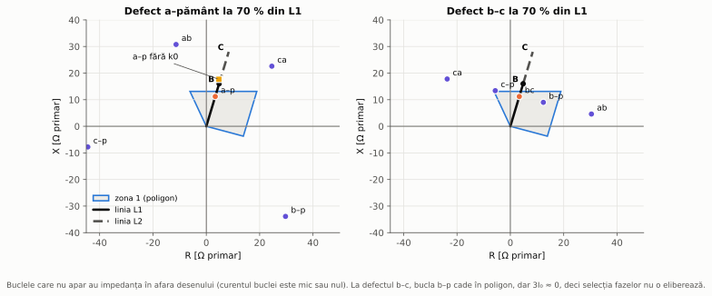
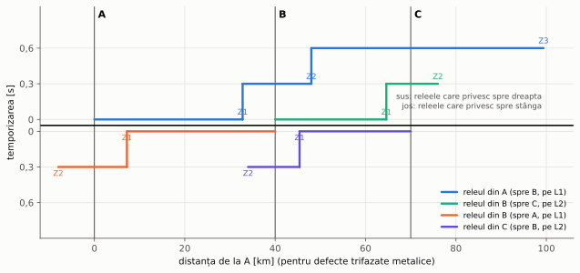
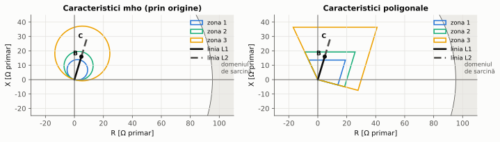
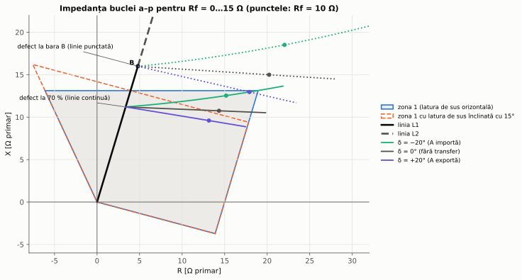
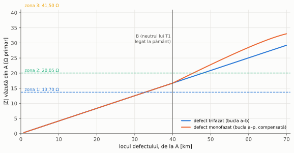
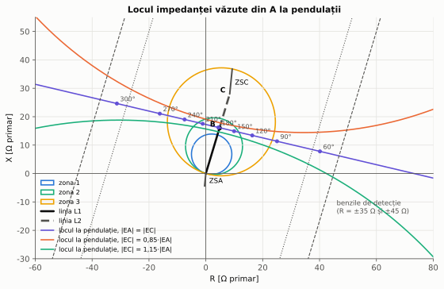
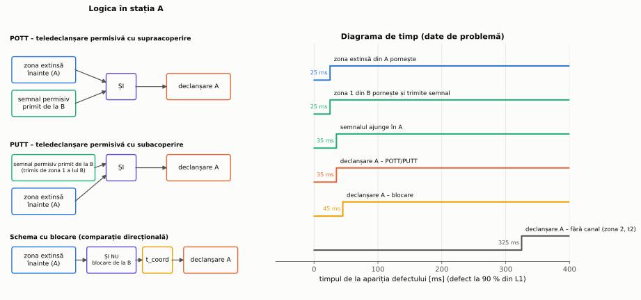

# Capitolul 5. Protecția de distanță

> **Obiective.** După acest capitol ar trebui să puteți: (1) explica de ce o protecție care măsoară impedanța are o acoperire independentă de puterea de scurtcircuit a sursei; (2) scrie impedanțele celor șase bucle măsurate și justifica factorul de compensare homopolară $k_0$; (3) alege acoperirile și temporizările celor trei zone dintr-un buget de erori și din condițiile de selectivitate; (4) desena caracteristicile mho și poligonale în planul R-X și verifica dacă un punct este în interiorul lor; (5) calcula impedanța aparentă la defecte prin rezistență, cu alimentare de la capătul opus sau cu alimentare intermediară, și explica supraacoperirea și subacoperirea; (6) verifica zona de sarcină, descrie comportarea la pendulații și explica schemele de teleprotecție.

Liniile rețelelor de înaltă tensiune sunt adesea alimentate de la ambele capete și fac parte din rețele buclate. Protecția maximală de curent (capitolul 3) devine greu de coordonat în asemenea rețele: curentul de defect depinde puternic de configurația rețelei, iar defectele sunt alimentate din ambele sensuri. Protecția de **distanță** (cod ANSI/IEEE **21**, § 0.6) măsoară **impedanța** dintre locul releului și locul defectului. Pentru un defect metalic, această impedanță este proporțională cu distanța până la defect și nu depinde de puterea surselor. Cerințele funcționale ale protecției de distanță sunt standardizate în IEC 60255-121 [S4]. Cartea lui G. Ziegler (Siemens) [2] este dedicată în întregime protecției de distanță numerice; subiectul este tratat și în ghidul Alstom [1] și în manualul ABB editat de Elmore [7], iar schemele cu canal de comunicație în [8].

În capitol folosim releul 21 din stația A, care protejează linia **L1** (A–B, 40 km) a rețelei de referință (§ 0.7). Dincolo de B urmează linia L2 (B–C, 30 km) și transformatorul T1 (110/20 kV, YNd11, cu neutrul de 110 kV legat la pământ). Releul este alimentat de un TC 600/1 A și un TT 110/0,1 kV; impedanțele secundare sunt cele primare înmulțite cu $n_{TC}/n_{TT}$ = 600/1100 = 0,5455 (§ 2.6, problema 2.4). Toate valorile numerice din capitol sunt calculate de scripturile [`probleme_cap05.py`](scripts/probleme_cap05.py) și [`figuri_cap05.py`](scripts/figuri_cap05.py), fiecare pe cel puțin două căi independente: rețelele de secvență și rezolvarea rețelei direct în coordonate de fază, cu o bară intermediară F în locul defectului.

---

## 5.1. Principiul: impedanța până la locul defectului

La un scurtcircuit trifazat metalic pe linie, la distanța $x$ (fracțiune din lungime) de releu, tensiunea la bornele releului este căderea de tensiune pe porțiunea de linie dintre releu și defect:

$$\underline{U}_A = x\thinspace \underline{Z}_L\thinspace \underline{I}_A \qquad \Rightarrow \qquad \boxed{\underline{Z}_m = \frac{\underline{U}_A}{\underline{I}_A} = x\thinspace \underline{Z}_L}$$

Curentul $\underline{I}_A$ depinde de impedanța sursei, dar raportul $\underline{U}_A/\underline{I}_A$ nu. Acesta este avantajul esențial față de protecția maximală: la fiderul F1 din capitolul 3, treapta instantanee acoperea 63 % din tronsonul B2–P1 la curentul de scurtcircuit maxim și numai 40 % la cel minim (problema 3.2). O zonă a protecției de distanță acoperă aceeași porțiune de linie în ambele regimuri.

Releul vede mărimile secundare, deci reglajele se exprimă de obicei în ohmi secundari: $Z_{sec} = Z_{prim}\thinspace n_{TC}/n_{TT}$. Pentru L1, $\underline{Z}_{L1}$ = 4,80 + j16,00 Ω = 16,70 ∠ 73,30° Ω primar, adică 9,112 Ω secundar.

## 5.2. Buclele de defect măsurate

Pe o linie trifazată pot apărea zece tipuri de scurtcircuit: trei monofazate, trei bifazate, trei bifazate cu pământ și unul trifazat. Releul calculează continuu impedanțele a **șase bucle**:

- trei bucle **fază–fază**, de exemplu $\underline{Z}_{bc} = (\underline{U}_b - \underline{U}_c)/(\underline{I}_b - \underline{I}_c)$. Pentru un defect b–c (cu sau fără pământ) sau trifazat, acest raport este $x\thinspace\underline{Z}_1$, fiindcă în diferența $\underline{U}_b - \underline{U}_c$ căderile de tensiune produse de curentul homopolar se anulează și rămâne $x\thinspace\underline{Z}_1(\underline{I}_b - \underline{I}_c)$;
- trei bucle **fază–pământ**. Pentru un defect a–pământ metalic, tensiunea fazei a la releu este suma căderilor de tensiune de secvență pe porțiunea de linie (§ 1.4):

$$\underline{U}_a = x\left[\underline{Z}_1(\underline{I}_1 + \underline{I}_2) + \underline{Z}_0\thinspace\underline{I}_0\right] = x\thinspace\underline{Z}_1\left(\underline{I}_a + \frac{\underline{Z}_0 - \underline{Z}_1}{3\underline{Z}_1}\thinspace 3\underline{I}_0\right),$$

de unde

$$\boxed{\underline{Z}_{a-p} = \frac{\underline{U}_a}{\underline{I}_a + \underline{k}_0\thinspace 3\underline{I}_0} = x\thinspace\underline{Z}_1, \qquad \underline{k}_0 = \frac{\underline{Z}_0 - \underline{Z}_1}{3\thinspace\underline{Z}_1}}$$

Factorul de **compensare homopolară** $\underline{k}_0$ face ca bucla fază–pământ să măsoare tot impedanța de secvență directă, la fel ca buclele fază–fază; astfel, aceleași reglaje în ohmi servesc pentru toate tipurile de defect. Pentru liniile rețelei de referință $\underline{k}_0$ = 0,653 + j0,046 = 0,655 ∠ 4,02°. Fără compensare, un defect monofazat la 70 % din L1 ar apărea la 110 % din linie (problema 5.2).

Releul trebuie să știe și **care** buclă corespunde defectului (*selecția fazelor*). La un defect a–pământ numai bucla a–p măsoară corect; celelalte bucle văd impedanțe mari sau unghiuri fără legătură cu linia (figura 5.1, stânga). La un defect b–c, buclele b–p și c–p pot cădea în caracteristică (figura 5.1, dreapta). Curentul homopolar este însă practic nul, așa că un criteriu de tipul „bucla fază–pământ se eliberează numai dacă $3I_0$ depășește un prag” le exclude (problema 5.4). Criteriile concrete diferă de la un producător la altul.

*Figura 5.1 – Impedanțele celor șase bucle văzute de releul din A la un defect metalic la 70 % din L1, în planul R-X, împreună cu zona 1 (poligonală). Stânga: defect a–pământ (pătratul arată bucla a–p fără compensare homopolară); dreapta: defect b–c.*

## 5.3. Zone și temporizări

Releul nu poate fi reglat să acopere exact 100 % din linie: impedanța reală a liniei diferă de cea de calcul, iar TT, TC și releul au erori. Dacă zona instantanee ar acoperi toată linia, un defect imediat după bara B, care trebuie eliminat de protecția liniei L2, ar putea fi văzut în zona instantanee a lui A. Ar declanșa atunci ambele linii, iar selectivitatea (§ 0.3) s-ar pierde. De aceea protecția are mai multe **zone** în trepte (figura 5.2):

- **zona 1** – **subacoperă** linia proprie (sub 100 %) și acționează fără temporizare intenționată. Acoperirea maximă rezultă din bugetul de erori: dacă toate erorile acționează în sensul cel mai defavorabil, releul vede defectul de la capătul liniei mai aproape decât este, de

$$f_{sup} = \frac{(1 + \varepsilon_{TC})(1 + \varepsilon_{releu})}{(1 - \varepsilon_{linie})(1 - \varepsilon_{TT})}$$

ori. Deci $k_1 < 1/f_{sup}$. Cu erorile din problema 5.1 (linie ±5 %, TT ±3 % – clasa 3P [S8], TC ±1 %, releu ±5 %), $f_{sup}$ = 1,151 și $k_1 \le$ 0,869; s-a ales $k_1$ = 0,85;
- **zona 2** – **supraacoperă** linia proprie, ca să acopere sigur bara B și ultimele procente ale liniei. Trebuie ca $k_2 > f_{sub}$ = 1,150 (factorul de subacoperire, din aceleași erori). Zona 2 este temporizată, ca să lase protecția liniei următoare să acționeze întâi. Pentru selectivitate, ea nu trebuie să ajungă dincolo de zona 1 a releului de pe linia următoare (în problema 5.1: cel mult 50,8 % din L2, față de minimum 73,9 % acoperit de zona 1 a releului din B);
- **zona 3** – **rezervă la distanță** pentru linia următoare (acoperă L2 până la C, inclusiv când protecția sau întrerupătorul liniei L2 refuză). Ea are cea mai mare temporizare.

Temporizările urmează aceeași logică a treptei de timp ca la protecțiile maximale (§ 3.4). În problemele capitolului se folosesc $t_1$ = 0, $t_2$ = 0,3 s și $t_3$ = 0,6 s (date de problemă, cu treapta de 0,3 s din capitolul 3). Treapta trebuie să acopere timpul de eliminare al defectului de către protecția și întrerupătorul liniei următoare, plus o rezervă.

*Figura 5.2 – Treptele de timp ale protecțiilor de distanță de pe liniile L1 și L2, pentru defecte trifazate metalice. Sus: releele care privesc de la stânga la dreapta; jos: releele care privesc de la dreapta la stânga. Zonele 1 se suprapun pe porțiunea din mijlocul fiecărei linii; ultimele 15 % de lângă fiecare capăt sunt acoperite instantaneu numai de releul din capătul apropiat.*

| Zona | Acoperire (primar) | Secundar | X / R (poligon), primar | Temporizare |
|---|---|---|---|---|
| 1 | 0,85·$Z_{L1}$ = 14,20 Ω ∠ 73,3° (34,0 km) | 7,745 Ω | 13,60 Ω / 15,0 Ω | 0 |
| 2 | 1,20·$Z_{L1}$ = 20,05 Ω ∠ 73,3° (48,0 km) | 10,934 Ω | 19,20 Ω / 20,0 Ω | 0,3 s |
| 3 | 38,00 Ω ∠ 73,3° (91,0 km) | 20,727 Ω | 36,40 Ω / 30,0 Ω | 0,6 s |

Distanțele în km sunt pentru defecte trifazate metalice, pe linii de același tip. Zona 3 a fost mărită la 38 Ω, adică 1,30·($Z_{L1} + Z_{L2}$), pentru defectele **monofazate** de la capătul L2: neutrul lui T1, legat la pământ, mărește impedanța pe care o vede releul (§ 5.6, problema 5.5). La defecte trifazate, zona 3 ajunge astfel cu 21 km dincolo de C. Trebuie deci coordonată și cu protecțiile liniilor care pleacă din C, care nu fac parte din rețeaua de referință.

## 5.4. Caracteristicile de acționare în planul R-X

O zonă este o regiune din planul impedanței complexe $\underline{Z} = R + jX$. Releul acționează în zona respectivă când impedanța buclei cade în interiorul regiunii (figura 5.3).

**Caracteristica mho** este un cerc care trece prin origine și are ca diametru vectorul de reglaj $\underline{Z}_r$, orientat după unghiul liniei:

$$\left|\underline{Z} - \frac{\underline{Z}_r}{2}\right| \le \frac{|\underline{Z}_r|}{2} \qquad \Longleftrightarrow \qquad \left|\arg\frac{\underline{Z}_r - \underline{Z}}{\underline{Z}}\right| \le 90^\circ$$

A doua formă este a unui **comparator de fază**: un punct este în cerc dacă unghiul subîntins de diametru din acel punct este cel puțin 90°. Releele electromecanice și statice realizau direct această comparație între două tensiuni, $\underline{I}\thinspace\underline{Z}_r - \underline{U}$ și $\underline{U}$. Cercul trece prin origine, deci caracteristica este **direcțională**: defectele din spatele releului (în cadranul III) nu sunt văzute. În scripturi, apartenența la cerc este testată pe ambele căi (distanța față de centru și comparatorul de fază), iar rezultatele trebuie să coincidă.

**Caracteristica poligonală** (patrulateră) are acoperiri reglabile independent pe reactanță (latura de sus) și pe rezistență (latura din dreapta, paralelă cu linia). Ea mai are o dreaptă direcțională (aici la −15°) și o limită spre stânga (aici la 115°). Avantajul ei este acoperirea rezistivă mare, independentă de lungimea liniei, utilă la defecte prin arc sau prin rezistența prizei de pământ a stâlpului (§ 5.5).

*Figura 5.3 – Zonele releului din A cu caracteristici mho (stânga) și poligonale (dreapta), linia L1 (continuu) și L2 (întrerupt), și domeniul de sarcină, în ambele sensuri de transfer: |Z| ≥ 95,3 Ω, |φ| ≤ 30° (§ 5.7). Domeniul de sarcină este departe de toate zonele.*

**Direcția și tensiunea de memorie.** La un defect trifazat chiar lângă releu, tensiunea măsurată scade practic la zero ($\underline{U}_A = x\thinspace\underline{Z}_L\thinspace\underline{I}_A$, cu $x \to 0$), iar unghiul ei nu mai poate fi folosit pentru decizia de direcție. Releele folosesc atunci tensiunea memorată dinaintea defectului (memoria de tensiune, câteva perioade) sau, la defectele nesimetrice, tensiunea fazelor sănătoase (polarizare încrucișată).

## 5.5. Rezistența de defect și alimentarea de la capătul opus

Un defect monofazat are de regulă o rezistență $R_f$: arcul electric, rezistența stâlpului și a prizei lui de pământ. Curentul total prin $R_f$ este $\underline{I}_F$, suma contribuțiilor de la ambele capete. Din ecuația buclei:

$$\boxed{\underline{Z}_{ap} = x\thinspace\underline{Z}_L + R_f\thinspace\frac{\underline{I}_F}{\underline{I}_A + \underline{k}_0\thinspace 3\underline{I}_0}}$$

Al doilea termen este rezistența de defect „văzută” de releu:

- **amplificată**, fiindcă $|\underline{I}_F| > |\underline{I}_{A,comp}|$ când și celălalt capăt alimentează defectul. În problema 5.3, la un defect la bara B, raportul este 1,40…1,70;
- **rotită** cu unghiul $\beta = \arg(\underline{I}_F/\underline{I}_{A,comp})$, care depinde de încărcarea liniei dinaintea defectului. La capătul care **exportă** putere, curentul de la celălalt capăt rămâne în urmă și $\beta < 0$. Termenul rezistiv coboară atunci în planul R-X, reactanța aparentă scade și releul poate „vedea” defectul mai aproape decât este: **supraacoperire**. La capătul care **importă**, $\beta > 0$ și apare **subacoperire**.

În rețeaua de referință, cu transferul A → C de 89,5 MW (problema 5.3), un defect **la bara B** prin 10 Ω apare la 18,50 + j13,35 Ω, adică **în zona 1**: reactanța aparentă (13,35 Ω) este sub acoperirea reactivă de 13,60 Ω. Zona 1 a lui A ar declanșa deci pentru un defect pe care trebuie să-l elimine protecția lui L2 sau a barei B. Un remediu este **înclinarea laturii de sus** a poligonului cu un unghi cel puțin egal cu $|\beta|$ (figura 5.4); cu 13° (10,86° + 2° rezervă), niciun defect la bara B nu mai intră în zona 1. Înclinarea are un preț: la capătul care importă, acoperirea rezistivă la 70 % din linie scade de la 12,9 Ω la 7,6 Ω. O alternativă este adaptarea înclinării la sensul transferului de putere măsurat înainte de defect.

*Figura 5.4 – Impedanța buclei a–p pentru defecte monofazate prin $R_f$ = 0…15 Ω, la 70 % din L1 (linii continue) și la bara B (linii punctate), pentru trei regimuri de transfer înainte de defect. La capătul care exportă (δ = +15°), defectul de la bara B prin 10 Ω intră în zona 1 cu latura orizontală, dar nu și în zona cu latura înclinată.*

## 5.6. Alimentarea intermediară

Dacă între releu și defect există o bară prin care **intră** curent de defect de la altă sursă (*infeed*), releul vede o impedanță mai mare decât cea reală: **subacoperire**. Pentru un defect pe linia L2, la distanța $x$ de B:

$$\underline{Z}_{ap} = \underline{Z}_{L1} + x\thinspace\underline{Z}_{L2}\thinspace\frac{\underline{I}_{L2,comp}}{\underline{I}_{A,comp}},$$

unde $\underline{I}_{L2,comp}$ este curentul compensat care intră în L2 din B. Dacă la bară curentul **iese** spre alt element (*outfeed*), apare situația inversă, adică supraacoperirea.

În rețeaua de referință nu există o sursă la bara B în secvența directă: T1 nu are generare pe partea de 20 kV. Defectele **trifazate** de pe L2 sunt deci văzute exact ($\underline{Z}_{L1} + x\thinspace\underline{Z}_{L2}$). Neutrul de 110 kV al lui T1 este însă legat la pământ, iar înfășurarea în triunghi închide calea curentului homopolar. T1 este deci o **sursă homopolară** la B. La un defect monofazat la mijlocul lui L2, prin neutrul lui T1 trece un curent $3I_0$ = 1091 A, mai mare decât cel care vine din A (1078 A). Impedanța văzută din A crește cu 7–14 % (figura 5.5, problema 5.5). Consecințele practice:

- zona 2 acoperă mai puțin din L2 la defectele monofazate decât la cele trifazate. Un defect monofazat la 25 % din L2 este văzut la 21,30 Ω, peste acoperirea de 20,05 Ω a zonei 2;
- zona 3 trebuie reglată pentru cel mai defavorabil caz, defectul monofazat de la capătul L2 (33,02 Ω, înmulțit cu $f_{sub}$ = 1,15). De aici rezultă valoarea de 38 Ω din tabelul de reglaje.

*Figura 5.5 – Modulul impedanței văzute din A în funcție de locul defectului, de-a lungul liniilor L1 și L2. După bara B, curba defectelor monofazate se depărtează de cea a defectelor trifazate din cauza curentului homopolar prin neutrul lui T1.*

## 5.7. Sarcina și zona 3

În regim normal, releul vede **impedanța de sarcină** $\underline{Z}_s = \underline{U}/\underline{I}$. Ea este cu atât mai mică cu cât curentul este mai mare și tensiunea mai mică, iar unghiul ei este unghiul de defazaj al sarcinii (mic, în jurul axei R). Zonele, mai ales zona 3 (cea mai mare), nu trebuie să cuprindă domeniul de sarcină. Altfel o suprasarcină la tensiune redusă ar provoca o declanșare fără defect (*load encroachment*), tocmai în regimurile grele în care sistemul are cea mai mare nevoie de linie.

Cu datele problemei 5.6 (curent maxim 600 A, tensiune minimă 0,9·$U_n$, |φ| ≤ 30°), $Z_{s,min}$ = 95,26 Ω primar. Pe direcția de 30°, limita cercului mho al zonei 3 este la 27,66 Ω, iar cea a poligonului la 41,90 Ω; rezerva este mare. Poligonul are avantajul că acoperirea rezistivă se poate limita separat, fără să se micșoreze acoperirea pe reactanță. Unele relee au și o caracteristică specială de blocare la sarcină (*load blinder*).

## 5.8. Pendulații și pierderea sincronismului

După o perturbație mare (un defect eliminat, deconectarea unei linii), unghiul dintre t.e.m. ale celor două părți ale sistemului oscilează (capitolul 7). Tensiunile și curenții variază lent, ca la un defect care se deplasează, iar impedanța văzută de releu parcurge un **loc geometric** în planul R-X. Pentru sistemul cu două surse echivalente, $\underline{E}_A$ în spatele lui $\underline{Z}_{SA}$ și $\underline{E}_C$ în spatele lui $\underline{Z}_{SC}$, legate prin liniile L1 și L2:

$$\underline{I} = \frac{\underline{E}_A - \underline{E}_C}{\underline{Z}_T}, \quad \underline{U}_A = \underline{E}_A - \underline{Z}_{SA}\thinspace\underline{I} \qquad\Rightarrow\qquad \boxed{\underline{Z} = \frac{\underline{E}_A\thinspace\underline{Z}_T}{\underline{E}_A - \underline{E}_C} - \underline{Z}_{SA}}, \qquad \underline{Z}_T = \underline{Z}_{SA} + \underline{Z}_{L1} + \underline{Z}_{L2} + \underline{Z}_{SC}$$

Pentru $|\underline{E}_A| = |\underline{E}_C|$, locul este o dreaptă, mediatoarea segmentului $\underline{Z}_T$. Ea trece la δ = 180° prin **centrul electric** $\underline{Z}_T/2 - \underline{Z}_{SA}$. Pentru t.e.m. de mărimi diferite, locul este un cerc (figura 5.6). În rețeaua de referință, centrul electric este la 16,80 ∠ 74,74° Ω, practic la bara B.

Dacă pendulația este **stabilă** (sistemul revine la sincronism), protecția nu trebuie să declanșeze. Locul poate însă intra în zone: la o alunecare de 0,5 Hz el rămâne 428 ms în zona 2, mai mult decât temporizarea ei de 300 ms (problema 5.7). Releele au de aceea o funcție de **blocare la pendulații**. Metoda clasică se bazează pe viteza de variație a impedanței. La un defect, impedanța sare practic instantaneu din domeniul de sarcină în zonă. La o pendulație, ea traversează lent o bandă dintre două caracteristici concentrice (aici dreptele paralele cu linia prin R = 45 Ω și R = 35 Ω). Dacă traversarea durează mai mult decât o temporizare reglată (aici 30 ms), releul recunoaște pendulația și blochează zonele. Temporizarea trebuie să fie mai mare decât timpul de răspuns al filtrelor de măsură (de ordinul unei perioade), ca un defect real să nu fie confundat cu o pendulație. Dacă pendulația este **instabilă** (pierderea sincronismului), sistemul trebuie separat în puncte alese dinainte, printr-o funcție de declanșare la pierderea sincronismului.

*Figura 5.6 – Locul impedanței văzute din A la pendulații, pentru t.e.m. egale (dreapta, cu valorile lui δ) și diferite (cercuri), zonele mho și benzile de detecție. Segmentele $Z_{SA}$, L1, L2, $Z_{SC}$ formează impedanța totală $Z_T$.*

## 5.9. Funcții auxiliare: închiderea pe defect și supravegherea tensiunii

- **Închiderea pe defect** (*switch-onto-fault*): la conectarea unei linii pe care a rămas un defect (de exemplu scurtcircuitoarele de lucru uitate montate), nu există tensiune memorată, iar un defect apropiat poate să nu fie văzut corect. Logica: pe o durată scurtă după comanda de închidere, orice pornire a protecției (sau un curent mare) dă declanșare instantanee.
- **Supravegherea circuitelor de tensiune**: dacă se întrerupe circuitul secundar al TT (siguranță arsă, întreruptor automat deschis), releul vede tensiune nulă și curent de sarcină, adică o impedanță aproape nulă, deci un „defect” în zona 1. Funcția de supraveghere recunoaște situația, de exemplu după apariția tensiunii de secvență inversă sau homopolare fără curentul corespunzător, sau după contactul auxiliar al întreruptorului automat al TT. Ea blochează protecția de distanță și poate activa în locul ei o protecție maximală de rezervă.

## 5.10. Teleprotecția

Zona 1 acoperă cel mult 85 % din linie, deci un defect lângă un capăt este eliminat instantaneu numai de releul din capătul apropiat. Releul din capătul îndepărtat îl vede în zona 2 și declanșează după $t_2$. Pentru liniile importante, unde eliminarea rapidă la ambele capete contează pentru stabilitate (capitolul 7) și pentru reanclanșarea automată, cele două relee schimbă semnale printr-un canal de comunicație (figura 5.7):

- **PUTT** (teledeclanșare permisivă cu subacoperire): releul care vede defectul în zona 1 trimite un semnal permisiv. Celălalt releu declanșează dacă primește semnalul și vede și el defectul înainte, într-o zonă extinsă;
- **POTT** (teledeclanșare permisivă cu supraacoperire): fiecare releu trimite semnal permisiv când zona lui extinsă (supraacoperitoare) vede defectul înainte și declanșează când primește semnalul de la celălalt capăt. Schema are nevoie de logici suplimentare pentru inversarea curentului pe liniile paralele și pentru capătul cu alimentare slabă (*weak infeed*);
- **blocarea** (comparația direcțională): releul care vede defectul **în spate** trimite un semnal de blocare. Celălalt releu declanșează după o mică temporizare de coordonare dacă vede defectul înainte și nu a primit blocare. Schema rămâne rapidă la pierderea canalului, dar poate declanșa neselectiv la defecte exterioare în acest caz.

Schemele permisive sunt sigure (*secure*): un canal defect nu produce declanșări. Schema cu blocare este dependentă (*dependable*): un canal defect nu împiedică declanșarea. Schemele și cerințele asupra canalului sunt tratate în [8].

*Figura 5.7 – Logica schemelor de teleprotecție în stația A și diagrama de timp pentru un defect la 90 % din L1 (date de problemă: timp propriu al releului 25 ms, canal 10 ms, temporizare de coordonare 20 ms).*

## 5.11. Protecția de distanță și protecția diferențială a liniei

Protecția diferențială longitudinală a liniei (capitolul 4) compară curenții de la cele două capete și este absolut selectivă: acționează numai la defecte interioare, indiferent de rezistența de defect, de pendulații sau de alimentarea intermediară. Ea are însă nevoie permanent de un canal de comunicație cu întârziere cunoscută și nu oferă rezervă pentru liniile vecine. Protecția de distanță funcționează fără canal, oferă rezervă la distanță prin zonele 2 și 3 și permite localizarea defectului din impedanța măsurată. Cele două principii se pot combina, în același releu numeric sau în două sisteme de protecție redundante (§ 0.3, problema 0.2).

---

## Probleme rezolvate

### Problema 5.1 – Reglajele zonelor

Să se stabilească acoperirile și temporizările zonelor protecției de distanță din A pentru linia L1, în ohmi primari și secundari. Erorile (date de problemă): impedanța liniei ±5 %, TT ±3 % (clasa 3P [S8]), TC ±1 % (eroarea de raport a clasei 5P la curentul nominal [S7]), releul ±5 %.

**Rezolvare.**

1. Impedanțele: $\underline{Z}_{L1}$ = 4,80 + j16,00 Ω = 16,70 ∠ 73,30° Ω, $\underline{Z}_{L2}$ = 12,53 ∠ 73,30° Ω, $\underline{Z}_{0L1}$ = 49,48 ∠ 75,96° Ω, iar $\underline{k}_0 = (\underline{Z}_0 - \underline{Z}_1)/(3\underline{Z}_1)$ = 0,6529 + j0,0459 = 0,655 ∠ 4,02°.
2. **Zona 1.** $f_{sup}$ = (1,01 · 1,05)/(0,95 · 0,97) = 1,1508, deci $k_1 \le$ 1/1,1508 = 0,869. Se alege $k_1$ = 0,85: $Z_1$ = 14,20 Ω ∠ 73,3°.
3. **Zona 2.** $f_{sub}$ = (1,05 · 1,03)/(0,99 · 0,95) = 1,1499, deci $k_2 \ge$ 1,150. Se alege $k_2$ = 1,20: $Z_2$ = 20,05 Ω. Verificarea selectivității cu releul din B (care protejează L2 cu aceeași regulă $k_1$ = 0,85): zona 2 a lui A pătrunde pe L2 cel mult (1,20 · 16,70 · 1,1508 − 16,70)/12,53 = 50,8 %. Zona 1 a releului din B acoperă cel puțin 0,85/1,1499 = 73,9 % din L2, deci un defect văzut de zona 2 din A este eliminat întâi de zona 1 din B.
4. **Zona 3.** Defectul monofazat la capătul lui L2 este văzut din A la 33,02 ∠ 72,50° Ω (mai mult decât $Z_{L1} + Z_{L2}$ = 29,22 Ω, din cauza alimentării homopolare prin T1, § 5.6). Trebuie $Z_3 \ge$ 1,150 · 33,02 = 37,97 Ω; se alege 38,00 Ω.
5. **Transformatorul T1.** La un defect trifazat pe bara de 20 kV, cu sursa C deconectată (cazul cel mai defavorabil, fără alimentare intermediară), releul vede $Z_{L1} + Z_{T1}$ = 69,56 ∠ 84,12° Ω. Zona 3 cu supraacoperire maximă ajunge la 38,00 · 1,1508 = 43,73 Ω, deci nicio zonă nu vede rețeaua de 20 kV; nu este necesară coordonarea cu protecțiile de 20 kV din capitolul 3.
6. **Temporizări** (date de problemă): $t_1$ = 0, $t_2$ = 0,3 s, $t_3$ = 0,6 s. **Secundar** (× 0,5455): 7,745 Ω, 10,934 Ω, 20,727 Ω; acoperirile rezistive ale poligoanelor, 15, 20 și 30 Ω primar, devin 8,18, 10,91 și 16,36 Ω secundar.

**Verificare.** (a) Factorii $f_{sup}$ și $f_{sub}$ din formulă sunt egali cu extremele găsite prin enumerarea tuturor celor 16 combinații de semne ale celor patru erori. (b) Impedanța până la bara de 20 kV calculată prin rezolvarea rețelei în coordonate de fază este egală cu $\underline{Z}_{L1} + \underline{Z}_{T1}$ calculată din $u_k$ și $P_k$. (c) La un defect trifazat simulat exact la limita zonei 1 (85 % din L1), raportul dintre tensiunea și curentul secundare (după TT și TC) este 2,226 + j7,418 Ω, adică exact reglajul secundar al zonei 1.

### Problema 5.2 – Defect monofazat la 70 % din L1

Un defect metalic faza a – pământ apare la 70 % din L1, cu ambele surse în funcțiune și fără transfer de putere înainte de defect. Ce impedanță măsoară bucla a–p, cu și fără compensare homopolară?

**Rezolvare.** Curenții și tensiunea la A, din rețelele de secvență cu bara intermediară F: $\underline{I}_a$ = 3078,6 ∠ −76,9° A, $3\underline{I}_0$ = 2664,4 ∠ −76,0° A, $\underline{U}_a$ = 56,343 ∠ −1,80° kV.

- Cu compensare: $\underline{Z} = \underline{U}_a/(\underline{I}_a + \underline{k}_0\thinspace 3\underline{I}_0)$ = 11,693 ∠ 73,30° Ω $= 0{,}7\thinspace\underline{Z}_{L1}$: defectul este măsurat exact, în zona 1.
- Fără compensare: $\underline{Z} = \underline{U}_a/\underline{I}_a$ = 18,302 ∠ 75,06° Ω, adică 109,6 % din $|Z_{L1}|$. Defectul ar ieși din zona 1 și ar fi eliminat abia de zona 2: subacoperire de 39,6 puncte procentuale.

Celelalte bucle (figura 5.1, stânga): b–p 45,06 ∠ −48,8° Ω, c–p 45,10 ∠ −170,1° Ω, a–b 32,78 ∠ 110,2° Ω, c–a 33,39 ∠ 42,6° Ω, iar bucla b–c nu are curent. Niciuna nu este în zona 1.

**Verificare.** (a) Tensiunile și curenții la A calculați cu rețelele de secvență coincid cu cei din rezolvarea în coordonate de fază. (b) Impedanța compensată este egală cu 0,7·$\underline{Z}_{L1}$ (teoria din § 5.2). (c) Impedanța necompensată din simulare este egală cu formula $0{,}7\thinspace\underline{Z}_{L1}(1 + \underline{k}_0\thinspace 3\underline{I}_0/\underline{I}_a)$.

### Problema 5.3 – Rezistența de defect și transferul de putere

Același defect, dar prin $R_f$ = 10 Ω, la 70 % din L1 și la capătul liniei (bara B). Regimul dinaintea defectului: t.e.m. sursei C în urma celei din A cu δ = −15°, 0° și +15° (transfer A → C de −84,6 MW, 0 și 89,5 MW). Este defectul în zona 1? Cum trebuie înclinată latura de sus a poligonului?

**Rezolvare.** Impedanța aparentă $\underline{Z}_{ap} = x\thinspace\underline{Z}_{L1} + R_f\thinspace\underline{I}_F/\underline{I}_{A,comp}$:

| Locul | δ | $\underline{Z}_{ap}$ [Ω] | modulul $I_F/I_{A,comp}$ | β | Zona 1? |
|---|---|---|---|---|---|
| 70 % | −15° | 15,02 + j12,03 | 1,169 | +4,05° | da |
| 70 % | 0° | 14,34 + j10,75 | 1,099 | −2,36° | da |
| 70 % | +15° | 13,46 + j9,83 | 1,019 | −7,73° | da |
| bara B | −15° | 21,70 + j17,47 | 1,697 | +5,03° | nu |
| bara B | 0° | 20,23 + j14,99 | 1,547 | −3,68° | nu |
| bara B | +15° | 18,50 + j13,35 | 1,396 | −10,86° | **da – supraacoperire** |

La capătul care exportă (δ = +15°), defectul de la bara B intră în zona 1. Unghiul maxim cu care rezistența de defect coboară este 10,86°, deci latura de sus se înclină cu 13° (2° rezervă). Rezultatul (figura 5.4):

- niciun defect la bara B, cu $R_f$ = 0…10 Ω și δ = −15…+15°, nu mai intră în zona 1;
- acoperirea rezistivă la 70 % din linie devine 14,7 Ω (δ = +15°, neschimbată), 12,3 Ω (δ = 0°, față de 13,5 Ω) și 7,6 Ω (δ = −15°, față de 12,9 Ω).

La capătul care importă, înclinarea reduce deci acoperirea rezistivă sub 10 Ω. Compromisul trebuie cântărit pentru fiecare linie, după sensurile de transfer posibile.

**Verificare.** (a) Pentru fiecare caz, formula (cu curenții din rețelele de secvență) dă aceeași impedanță ca raportul $\underline{U}_a/\underline{I}_{a,comp}$ din rezolvarea în coordonate de fază. (b) Apartenența la poligon este testată cu două algoritme diferite (semnul produsului vectorial pe fiecare latură și algoritmul general de apartenență la poligon din matplotlib), care coincid. (c) Acoperirea rezistivă maximă este găsită prin bisecție pe $R_f$ și, separat, prin baleiere cu pasul de 0,05 Ω; rezultatele coincid în limita pasului.

### Problema 5.4 – Defect bifazat la 70 % din L1

Defect metalic între fazele b și c la 70 % din L1. Ce măsoară buclele?

**Rezolvare.** Bucla b–c: $(\underline{U}_b - \underline{U}_c)/(\underline{I}_b - \underline{I}_c)$ = 11,69 ∠ 73,30° Ω = 0,7·$\underline{Z}_{L1}$, în zona 1 (atât în cercul mho, cât și în poligon). Buclele b–p (15,30 ∠ 36,0° Ω) și c–p (14,54 ∠ 112,9° Ω) cad și ele în poligon, dar curentul homopolar la A este practic nul (3I0 ≈ 0, față de $|I_b|$ = 3765 A). Un criteriu de eliberare a buclelor cu pământ după $3I_0$ le exclude, iar releul declanșează corect, pe bucla b–c. Buclele a–b (30,75 Ω) și c–a (29,62 Ω) sunt în afara zonei 1.

**Verificare.** (a) Bucla b–c este egală cu 0,7·$\underline{Z}_{L1}$ (teorie, § 5.2). (b) Aceeași valoare rezultă din rețelele de secvență și din rezolvarea în coordonate de fază. (c) Apartenența la zona 1 este confirmată de ambele teste mho (distanță la centru și comparator de fază) și de ambele teste de poligon.

### Problema 5.5 – Defecte pe linia L2 văzute din A

Ce impedanțe măsoară releul din A la defecte trifazate și monofazate metalice pe L2? Ce vede releul din B pentru linia L1 (care privește spre A)?

**Rezolvare.**

| Locul (de la B) | Trifazat (bucla a–b) | $Z_{L1} + x\thinspace Z_{L2}$ | Monofazat (bucla a–p) | Raport | Zona releului A |
|---|---|---|---|---|---|
| 25 % | 19,84 ∠ 73,3° Ω | 19,84 Ω | 21,30 ∠ 72,7° Ω | 1,074 | 3 |
| 50 % | 22,97 ∠ 73,3° Ω | 22,97 Ω | 25,73 ∠ 72,4° Ω | 1,120 | 3 |
| 75 % | 26,10 ∠ 73,3° Ω | 26,10 Ω | 29,82 ∠ 72,3° Ω | 1,143 | 3 |
| 100 % | 29,22 ∠ 73,3° Ω | 29,22 Ω | 33,02 ∠ 72,5° Ω | 1,130 | 3 |

(ultima coloană este pentru defectele monofazate). Defectele trifazate sunt văzute exact, fiindcă la B nu intră curent de secvență directă. Cele monofazate sunt văzute cu 7–14 % mai departe: la defect la 50 % din L2, prin neutrul lui T1 trec 1091 A ($3I_0$), mai mult decât cei 1078 A care vin din A.

Releul din B pentru linia L1, care privește spre A, vede defectul trifazat de la 50 % din L2 la 6,26 ∠ −106,7° Ω. Punctul este în cadranul III, în afara tuturor zonelor: defectul este **în spate**.

**Verificare.** (a) Defectele trifazate: impedanța din simulare este egală cu $\underline{Z}_{L1} + x\thinspace\underline{Z}_{L2}$. (b) Defectele monofazate: formula cu alimentarea intermediară, $\underline{Z}_{L1} + x\thinspace\underline{Z}_{L2}\thinspace\underline{I}_{L2,comp}/\underline{I}_{A,comp}$ (curenți din rețelele de secvență), este egală cu impedanța din rezolvarea în coordonate de fază. (c) Defectul din spate: în B nu intră curent de secvență directă, deci $\underline{U}_B = 0{,}5\thinspace\underline{Z}_{L2}\thinspace\underline{I}$, iar curentul care intră în L1 dinspre B este $-\underline{I}$. Rezultă $\underline{Z} = -0{,}5\thinspace\underline{Z}_{L2}$ = −1,80 − j6,00 Ω, egal cu valoarea simulată.

### Problema 5.6 – Sarcina maximă și zona 3

Linia L1 poate transporta cel mult 600 A, la o tensiune care poate scădea la 0,9·$U_n$ și cu un unghi de defazaj de cel mult 30° (date de problemă). Intră sarcina în vreo zonă?

**Rezolvare.** $Z_{s,min} = 0{,}9\thinspace U_n/(\sqrt3\thinspace I_{max})$ = 99 000/(1,732 · 600) = 95,26 Ω primar (51,96 Ω secundar). Pe direcția de 30°, limita zonei 3 este la $|Z_3|\cos(\varphi_L - 30°)$ = 38,00 · cos 43,3° = 27,66 Ω pentru cercul mho. Pentru poligon, intersecția dreptei din dreapta ($R = R_3 + X\cot\varphi_L$) cu direcția de 30° dă 41,90 Ω. Rezerva este de peste 2 ori în ambele cazuri. Acoperirea rezistivă a poligonului zonei 3 ar putea crește până la 56,8 Ω păstrând o rezervă de 20 % față de sarcină (reglată: 30 Ω).

**Verificare.** (a) Limita poligonului pe direcția de 30° este calculată analitic și, separat, prin căutare numerică cu testul de apartenență (41,90 Ω în ambele cazuri). (b) Domeniul de sarcină (|Z| de la 95,26 la 285,8 Ω, unghiuri de la −30° la +30°) a fost eșantionat în 1830 de puncte; niciunul nu intră în vreo zonă mho sau poligonală.

### Problema 5.7 – Pendulații

Pentru sistemul cu două surse echivalente (QA și QC, legate prin L1 și L2), să se calculeze locul impedanței văzute din A, centrul electric, timpul de traversare a benzii de detecție la o alunecare de 1 Hz și timpul petrecut în zona 2 la o pendulație de 0,5 Hz.

**Rezolvare.** $\underline{Z}_{SA}$ = 4,437 ∠ 84,29° Ω, $\underline{Z}_{SC}$ = 8,873 ∠ 84,29° Ω, $\underline{Z}_T$ = 42,375 ∠ 76,73° Ω. Cu t.e.m. egale:

| δ | 60° | 90° | 120° | 150° | 180° |
|---|---|---|---|---|---|
| $\underline{Z}$ [Ω] | 40,89 ∠ 10,98° | 27,49 ∠ 24,37° | 21,12 ∠ 39,38° | 17,92 ∠ 56,28° | 16,80 ∠ 74,74° |

Centrul electric ($\underline{Z}_T/2 - \underline{Z}_{SA}$) este la 16,80 ∠ 74,74° Ω, practic la bara B. El este dincolo de zona 1 (14,20 Ω), dar în zona 2.

- **Banda de detecție** (drepte paralele cu linia prin R = 45 Ω și 35 Ω) este traversată între δ = 51,83° și δ = 63,85°. La alunecarea de 1 Hz ($\dot\delta$ = 360°/s), traversarea durează (63,85° − 51,83°)/360°/s = 33,4 ms. Cu temporizarea de detecție de 30 ms sunt recunoscute pendulațiile cu alunecarea până la 1,11 Hz.
- **Zona 2** este traversată între δ = 141,5° și 218,5°. La o alunecare de 0,5 Hz, locul rămâne în zonă (218,5° − 141,5°)/180°/s = 428 ms, mai mult decât $t_2$ = 300 ms. Fără blocare la pendulații, zona 2 ar declanșa linia la o pendulație care poate fi stabilă.

**Verificare.** (a) Locul calculat cu formula închisă este egal cu raportul $\underline{U}_A/\underline{I}_A$ obținut prin rezolvarea întregii rețele (inclusiv T1) cu $\underline{E}_C$ rotit cu δ, la cinci valori ale lui δ și pentru t.e.m. diferite ($|E_C|$ = 0,85·$|E_A|$). (b) Timpul de traversare a benzii rezultă și dintr-o simulare în timp (rețeaua rezolvată la fiecare 0,1 ms, δ crescând cu 1 Hz): 33,3 ms. (c) Unghiul de intrare în zona 2, găsit ca rădăcină a ecuației cercului pe formula închisă, coincide cu cel găsit prin baleierea locului calculat cu rețeaua și testat cu comparatorul de fază (141,52° față de 141,53°).

### Problema 5.8 – Câștigul de timp cu teleprotecție

Un defect apare la 90 % din L1. Date de problemă: timpul propriu al releelor 25 ms, canalul de comunicație 10 ms, temporizarea de coordonare a schemei cu blocare 20 ms, timpul de întrerupere al întrerupătorului 60 ms. În cât timp este eliminat defectul la capătul A?

**Rezolvare.** Releul din A vede 15,03 Ω, adică zona 2; releul din B vede 1,67 Ω, adică zona 1. B declanșează deci instantaneu, iar A:

| Schema | Comanda de declanșare în A | Eliminarea defectului în A |
|---|---|---|
| fără teleprotecție (zona 2) | 25 + 300 = 325 ms | 385 ms |
| PUTT sau POTT | 25 + 10 = 35 ms | 95 ms |
| blocare | 25 + 20 = 45 ms | 105 ms |

Temporizarea de coordonare a schemei cu blocare trebuie să depășească timpul în care un eventual semnal de blocare de la celălalt capăt (timpul de pornire al elementului invers plus canalul) ar ajunge în A.

**Verificare.** Timpii din formule coincid cu cei dintr-o simulare a logicii schemelor, cu semnalele evaluate pe o grilă de 1 ms.

---

## Întrebări de autoevaluare

1. De ce acoperirea unei zone a protecției de distanță nu depinde de puterea de scurtcircuit a sursei, iar a unei trepte instantanee maximale depinde?

Răspuns
Pentru un defect metalic, tensiunea la releu este căderea pe porțiunea de linie până la defect, $U = x Z_L I$, deci raportul $U/I = x Z_L$ conține numai datele liniei. Curentul de defect, pe care îl măsoară protecția maximală, depinde și de impedanța sursei.

2. Ce măsoară bucla a–pământ fără compensare homopolară la un defect monofazat și de ce?

Răspuns
$U_a/I_a = x Z_1 (1 + k_0\thinspace 3I_0/I_a)$, mai mult decât $x Z_1$: tensiunea conține și căderea produsă de curentul homopolar pe impedanța homopolară, mai mare decât cea directă. Releul ar subacoperi (în problema 5.2, 110 % în loc de 70 %).

3. De ce zona 1 nu se reglează la 100 % din linie? Ce s-ar întâmpla dacă eroarea TC (aici ±1 %) ar ajunge la 5 %, cât permite clasa 5P la curentul limită de precizie?

Răspuns
Din cauza erorilor (date ale liniei, TT, TC, releu), un defect imediat după bara opusă ar putea fi văzut în zona 1 și linia ar declanșa neselectiv. Cu 5 % la TC, $f_{sup}$ = (1,05 · 1,05)/(0,95 · 0,97) = 1,1964, deci $k_1 \le$ 0,836, iar reglajul de 0,85 ar trebui redus.

4. Ce condiții trebuie să îndeplinească acoperirea zonei 2?

Răspuns
Să acopere sigur bara opusă, inclusiv cu erorile ($k_2 > f_{sub}$). Să nu depășească zona 1 a protecției liniei următoare (altfel cele două relee ar declanșa simultan după $t_2$). Să nu ajungă prin transformatoare în rețeaua de tensiune inferioară cu care nu este coordonată.

5. De ce, la capătul care exportă putere, un defect prin rezistență poate produce supraacoperire, iar la cel care importă, subacoperire?

Răspuns
Termenul $R_f I_F/I_{A,comp}$ este rotit cu unghiul dintre curentul total de defect și curentul măsurat. La capătul care exportă, contribuția celuilalt capăt rămâne în urmă, unghiul este negativ și termenul coboară în planul R-X (reactanța aparentă scade): supraacoperire. La capătul care importă, unghiul este pozitiv: subacoperire.

6. De ce neutrul legat la pământ al lui T1 schimbă impedanța văzută din A la defectele monofazate de pe L2, dar nu și la cele trifazate?

Răspuns
T1 nu are surse pe partea de 20 kV, deci nu aduce curent de secvență directă la B. Înfășurarea YN cu triunghiul de pe partea cealaltă este însă o cale pentru curentul homopolar, care intră în L2 din B fără să treacă prin releul din A: alimentare intermediară homopolară, deci subacoperire la defectele cu pământ.

7. Cum deosebește releul o pendulație de un defect?

Răspuns
După viteza de variație a impedanței: la un defect, impedanța sare practic instantaneu din domeniul de sarcină în zonă. La o pendulație, ea se deplasează lent și traversează în timp măsurabil o bandă dintre două caracteristici (în problema 5.7, 33,4 ms la 1 Hz), timp comparat cu o temporizare reglată.

8. Care este diferența esențială dintre schemele permisive și schema cu blocare la pierderea canalului de comunicație?

Răspuns
La schemele permisive, fără semnal nu există declanșare accelerată; rămâne doar declanșarea în zona 2, deci schema este sigură, dar mai lentă. La schema cu blocare, lipsa semnalului înseamnă „nicio blocare”: releul declanșează rapid și la defecte exterioare văzute în zona extinsă. Schema este dependentă, dar poate pierde selectivitatea.

9. De ce trebuie supravegheate circuitele de tensiune ale protecției de distanță?

Răspuns
Dacă tensiunea secundară dispare (siguranță arsă), releul vede o impedanță aproape nulă și ar declanșa în zona 1 fără defect. Supravegherea recunoaște situația și blochează protecția de distanță.

---

## Bibliografie

- [1] Alstom Grid – *Network Protection & Automation Guide*, 2011.
- [2] G. Ziegler – *Numerical Distance Protection: Principles and Applications*, ed. 4, Publicis, 2011.
- [4] Siemens – *Power Engineering Guide*, Edition 8.0.
- [7] W. A. Elmore (ed.) – *Protective Relaying: Theory and Applications*, ed. 2, Marcel Dekker, 2003.
- [8] W. A. Elmore – *Pilot Protective Relaying*, Marcel Dekker, 2000.
- [9] ABB – *Distribution Automation Handbook*, secțiunea 8 (inclusiv protecția rețelelor buclate).
- [14] R. Tîrnovan, I. Vădan, H. Bălan, A. Botezan – *Protecții prin relee în sistemele electroenergetice*, U.T. Press, 2008.
- [16] R.-A. Tîrnovan – *Protecții digitale în sistemele electroenergetice*, U.T. Press, 2019.
- [S4] IEC 60255-121:2014 – *Functional requirements for distance protection*.
- [S7] IEC 61869-2:2012 (transformatoare de curent); [S8] IEC 61869-3:2011 (transformatoare de tensiune inductive).
- [S12] IEEE C37.2-2022 (codul 21).
