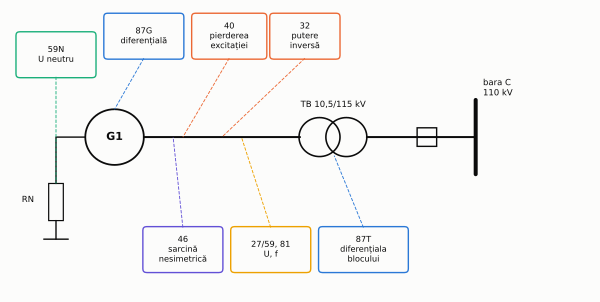
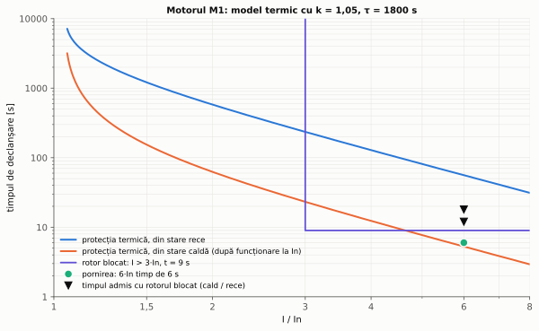
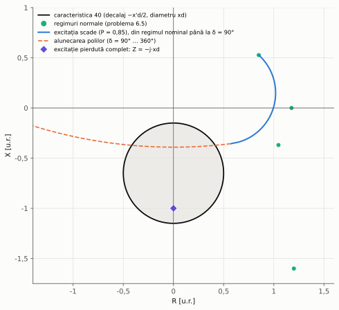
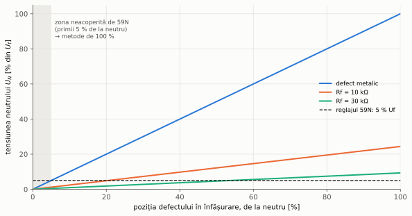

# Capitolul 6. Protecția generatoarelor și a motoarelor

> **Obiective.** După acest capitol ar trebui să puteți: (1) enumera defectele și regimurile anormale ale mașinilor electrice și protecțiile corespunzătoare, cu codurile lor; (2) deduce timpul de declanșare al protecției termice din modelul termic de ordinul întâi și să-l calculați din stare rece și caldă; (3) coordona protecția termică, protecția la pornire prelungită și rotor blocat cu datele motorului; (4) regla protecția la putere inversă și explica de ce ea cere o măsurare foarte precisă a unghiului; (5) regla protecția la pierderea excitației în planul R–X și urmări traiectoria impedanței; (6) calcula consumul capabilității la sarcină nesimetrică; (7) explica de ce protecția de tensiune homopolară acoperă numai 95 % din înfășurarea statorică.

Mașinile rotative sunt cele mai scumpe elemente ale unei instalații, iar multe regimuri periculoase pentru ele (suprasarcina, pierderea excitației, sarcina nesimetrică, regimul de motor) **nu sunt scurtcircuite**: curenții nu sunt mari, dar mașina se deteriorează dacă regimul durează. Protecțiile lor sunt deci, în mare parte, protecții de **regim anormal**, cu temporizări de secunde sau minute, alături de protecțiile rapide la defecte interioare (diferențiala, capitolul 4).

În capitol folosim două mașini ale rețelei de referință (§ 0.7), cu date construite pentru curs:

| Mașina | Date |
|---|---|
| generatorul **G1** | hidrogenerator, 50 MVA, 10,5 kV, cos φ = 0,85; $x_d$ = 1,00, $x_q$ = 0,65, $x'_d$ = 0,30, $x''_d$ = 0,20, $x_2$ = 0,22 u.r.; H = 3,5 s; transformator bloc TB 50 MVA, 10,5/115 kV, YNd11, $u_k$ = 12 %; din catalog: puterea absorbită în regim de motor 1,5 % din Pn, curentul invers admis permanent 0,08·In, $(I_2/I_n)^2\thinspace t$ admis = 20 s |
| motorul asincron **M1** | 800 kW, 6 kV, η = 0,955, cos φ = 0,87; $I_p/I_n$ = 6; pornirea durează 6 s; timpul admis cu rotorul blocat 12 s din stare caldă și 18 s din stare rece; constanta de timp termică 1800 s |

---

## 6.1. Defecte și regimuri anormale. Protecțiile mașinilor

| Defect sau regim | Efect | Protecția (cod IEEE C37.2 [S12]) |
|---|---|---|
| scurtcircuit în înfășurarea statorică | arc, distrugerea înfășurării și a miezului | diferențială (87G, 87M; capitolul 4), maximală instantanee la motoare (50) |
| punere la pământ a statorului | arderea miezului în punctul defectului; poate evolua în scurtcircuit | tensiune homopolară (59N) și metode de 100 % (§ 6.8); homopolară de curent la motoare (50N/51N) |
| suprasarcină | îmbătrânirea izolației | protecția termică (49, § 6.2) |
| pornire prelungită, rotor blocat (motoare) | încălzirea rapidă a rotorului | maximală temporizată dedicată (§ 6.3) |
| sarcină nesimetrică, fază întreruptă | curenți de frecvență dublă în rotor, încălzirea lui | curent de secvență inversă (46, § 6.7) |
| regim de motor al generatorului | pericol pentru turbină | putere inversă (32, § 6.5) |
| pierderea excitației | absorbție mare de putere reactivă, funcționare asincronă | 40 (§ 6.6) |
| tensiune sau frecvență anormale; supraexcitare ($U/f$ mare) | solicitarea izolației, supraîncălzirea miezului, vibrații | minimă / maximă de tensiune (27/59), frecvență (81), protecție după $U/f$ |

Notă: codul 40 este folosit pentru protecția la pierderea excitației; denumirea exactă din IEEE C37.2 nu a putut fi verificată pentru această ediție a cursului.

*Figura 6.1 – Principalele protecții ale grupului G1–TB și mărimile pe care le folosesc.*

## 6.2. Protecția termică: modelul de ordinul întâi

Protecția termică (49) nu măsoară temperatura, ci o **calculează** dintr-un model. Cel mai simplu model consideră mașina un singur corp omogen, încălzit de pierderile Joule ($\propto I^2$) și răcit proporțional cu supratemperatura. Cu supratemperatura raportată la cea admisă permanent, $\theta$, ecuația este

$$\tau\thinspace\frac{d\theta}{dt} + \theta = \left(\frac{I}{k\thinspace I_B}\right)^2 ,$$

unde $\tau$ este constanta de timp termică, $I_B$ curentul de bază (de obicei curentul nominal), iar $k\thinspace I_B$ curentul admis permanent: la acest curent, în regim staționar, $\theta = 1$. Releul declanșează când $\theta$ ajunge la 1.

Pentru un curent constant $I$, pornind de la starea staționară corespunzătoare curentului anterior $I_p$, adică $\theta_0 = (I_p/kI_B)^2$, soluția este $\theta(t) = \theta_\infty + (\theta_0 - \theta_\infty)\thinspace e^{-t/\tau}$, cu $\theta_\infty = (I/kI_B)^2$. Condiția $\theta(t) = 1$ dă timpul de declanșare:

$$\boxed{t = \tau\thinspace\ln\frac{I^2 - I_p^2}{I^2 - (k\thinspace I_B)^2}}$$

- pentru $I_p = 0$ (mașină rece) se obține **curba „rece”**;
- pentru $I_p = I_n$ (după funcționare îndelungată la sarcină nominală) se obține **curba „caldă”**, mult mai jos (figura 6.2).

Standardul IEC 60255-149 [S5] stabilește cerințele funcționale ale releelor termice, cu curbele „rece” și „caldă” ale unui model termic de ordinul întâi. Releele reale pot folosi modele mai detaliate (de exemplu cu constante de timp diferite pentru mașina oprită și în funcțiune), dar principiul rămâne același: releul are **memorie** – ține cont de istoria curentului, nu numai de valoarea lui de acum.

*Figura 6.2 – Curbele „rece” și „caldă” ale protecției termice a motorului M1, caracteristica protecției de rotor blocat, punctul de pornire și timpii admiși cu rotorul blocat (problemele 6.1–6.3).*

## 6.3. Pornirea și rotorul blocat. Celelalte protecții ale motoarelor

La pornire, motorul absoarbe de câteva ori curentul nominal (pentru M1, 6·In timp de 6 s). Pentru modelul termic, o pornire este un „impuls” de căldură: din stare rece el adaugă $\Delta\theta \approx (I_p/kI_B)^2\thinspace t_p/\tau$, puțin; din stare caldă poate depăși însă limita (problema 6.2). Releul **blochează repornirea** până când modelul termic arată că o pornire completă mai încape în rezerva termică.

Cu **rotorul blocat**, curentul de pornire rămâne și căldura se concentrează în rotor, care se încălzește mult mai repede decât indică modelul termic al întregii mașini (constanta de timp de funcționare este de ordinul zecilor de minute, iar timpul admis cu rotorul blocat – de ordinul secundelor). Pentru M1, modelul termic ar declanșa un rotor blocat din stare rece abia după 56 s, deși motorul admite 18 s. De aceea motoarele au o protecție separată, **la pornire prelungită și rotor blocat**: o treaptă maximală cu temporizare independentă, reglată:

- **în curent**: sub curentul de pornire, dar peste suprasarcinile lăsate protecției termice;
- **în timp**: peste durata pornirii normale (cu rezervă) și sub timpul admis cu rotorul blocat.

Dacă timpul admis cu rotorul blocat ar fi **mai mic** decât durata pornirii (motoare mari cu inerție mare), cele două cazuri nu s-ar mai putea separa după timp; se folosește atunci un traductor de turație: rotorul care nu începe să se rotească este declanșat înainte de expirarea timpului de pornire.

Alte protecții ale motoarelor:

- **maximală instantanee** (50), la scurtcircuite, reglată peste curentul de pornire (cu rezervă pentru vârful aperiodic de la conectare);
- **homopolară** (50N/51N), cu TC toroidal (§ 2.2, § 3.7);
- **curent de secvență inversă** (46): o fază întreruptă sau o tensiune nesimetrică produc în rotor curenți de frecvență aproape dublă, care îl încălzesc mult mai mult decât curentul direct de aceeași valoare;
- **minimă de tensiune** (27): deconectează motoarele la dispariția tensiunii, ca să nu pornească toate deodată la revenirea ei; ea se coordonează cu automatizările de transfer (capitolul 7).

## 6.4. Protecțiile generatorului

Generatorul este protejat la defecte interioare de **protecția diferențială** (87G, principiul din capitolul 4: la generator ambele capete ale fiecărei faze sunt accesibile, la borne și la neutru, deci nu apar problemele de adaptare și de grupă ale transformatorului) și de **protecția la punere la pământ a statorului** (§ 6.8). Grupul generator–transformator are adesea și o protecție diferențială a întregului bloc (87T în figura 6.1).

Regimurile anormale specifice generatorului sunt tratate în paragrafele următoare: regimul de motor (§ 6.5), pierderea excitației (§ 6.6) și sarcina nesimetrică (§ 6.7). Le completează protecțiile de tensiune și de frecvență (27/59, 81), protecția la supraexcitare (după raportul $U/f$, important la pornirea și oprirea grupului, când frecvența este mică) și o protecție de rezervă la scurtcircuite exterioare, care trebuie să funcționeze și când curentul de scurtcircuit al generatorului scade (de la valoarea supratranzitorie spre cea de regim permanent, care poate fi mai mică decât curentul nominal).

## 6.5. Protecția la putere inversă (32)

Dacă admisia agentului motor în turbină se închide cu întrerupătorul generatorului închis, mașina continuă să se rotească sincron, dar ca **motor**: absoarbe din rețea puterea activă necesară pierderilor din turbină și generator. Pentru generator regimul nu este periculos, pentru turbină poate fi. Protecția măsoară puterea activă și declanșează, temporizat, când aceasta devine negativă și depășește un prag.

Pragul trebuie să fie **sub** puterea absorbită în regim de motor, care este mică (pentru G1, 1,5 % din Pn, din datele producătorului). Dificultatea este că, în acest regim, puterea reactivă poate fi mult mai mare decât cea activă: unghiul dintre curent și tensiune este aproape de 90°, iar o eroare mică de unghi în lanțul de măsură (TC, TT, releu) produce o eroare mare de putere activă:

$$\Delta P \approx Q\thinspace\varepsilon .$$

Protecția la putere inversă cere deci TC și TT cu erori de unghi mici (clase de măsură) și un releu cu măsurare precisă a unghiului (problema 6.4). Temporizarea evită acționarea la inversări scurte de putere, de exemplu în timpul sincronizării sau al pendulațiilor.

## 6.6. Protecția la pierderea excitației (40)

Dacă excitația se pierde (întreruperea circuitului de excitație, defect al excitatoarei), t.e.m. a generatorului scade cu constanta de timp a înfășurării de excitație. Generatorul continuă să producă putere activă (turbina îl antrenează), dar **absoarbe putere reactivă** din rețea, unghiul intern crește până la limita de stabilitate (§ 7.1), după care mașina iese din sincronism și funcționează asincron: rotorul se încălzește (curenți induși de frecvența alunecării), iar tensiunea rețelei din jur scade.

Releul măsoară impedanța la bornele generatorului, $Z = U_b/I$. În regim normal, cu putere activă, punctul este în semiplanul $R > 0$, departe de origine. Pentru un model cu poli înecați, cu t.e.m. $E$ în spatele lui $x_d$ și rețeaua de putere infinită în spatele reactanței externe $x_e$ (transformator și rețea):

- când $E$ scade la putere activă constantă, impedanța coboară în cadranul al patrulea (figura 6.3);
- după ieșirea din sincronism, unghiul intern parcurge toate valorile, iar impedanța descrie un cerc care trece prin zona din jurul axei $-jX$;
- la pierderea completă a excitației ($E$ = 0), generatorul este doar reactanța $jx_d$, iar impedanța văzută este exact $Z = -j\thinspace x_d$.

Un reglaj clasic, folosit în curs, este o caracteristică **mho decalată**: un cerc cu diametrul pe axa $-jX$, de la $-j\thinspace x'_d/2$ la $-j(x'_d/2 + x_d)$. Decalajul de $x'_d/2$ ține caracteristica departe de origine (defectele trifazate apropiate dau impedanțe mici), iar diametrul $x_d$ cuprinde punctul $E$ = 0. Protecția acționează cu temporizare (impedanța poate trece prin cerc și la pendulații stabile), iar unele relee folosesc două zone sau condiții suplimentare (de exemplu, tensiune scăzută).

*Figura 6.3 – Caracteristica protecției la pierderea excitației a lui G1, regimurile normale, traiectoria impedanței la scăderea excitației (P = 0,85), cercul descris la alunecarea polilor și punctul corespunzător pierderii complete a excitației (problema 6.5).*

## 6.7. Protecția la sarcină nesimetrică (46)

Curentul de secvență inversă din stator produce un câmp care se rotește invers față de rotor, deci induce în rotor curenți de **frecvență dublă**. Ei circulă la suprafața rotorului (crestături, pene, înfășurarea de amortizare) și îl încălzesc local. Capabilitatea generatorului se exprimă prin doi parametri dați de producător:

- curentul invers admis **permanent**, $I_{2,adm}$ (pentru G1, 0,08·In);
- constanta $K = (I_2/I_n)^2\thinspace t$ admisă pentru regimurile de scurtă durată (pentru G1, 20 s).

Releul calculează componenta inversă din curenții de fază (§ 1.4) și integrează $(I_2/I_n)^2$ în timp, ca un model termic: declanșează când integrala ajunge la $K$. Astfel ține cont și de defectele exterioare nesimetrice eliminate lent, care consumă o parte din capabilitate (problema 6.6).

## 6.8. Protecția la punere la pământ a statorului

Generatoarele legate în bloc cu un transformator (cu înfășurarea în triunghi pe partea generatorului) formează o rețea separată, cu puțină capacitate față de pământ. Neutrul generatorului se leagă la pământ printr-o **rezistență mare** (de obicei un transformator monofazat cu un rezistor în secundar), care limitează curentul de punere la pământ la câțiva amperi și amortizează supratensiunile.

La o punere la pământ metalică într-un punct aflat la fracțiunea $x$ din înfășurare, măsurată de la neutru, punctul defect are potențialul pământului, iar tensiunea dintre neutru și pământ devine

$$\boxed{U_N = x\thinspace U_f}$$

oricare ar fi capacitățile și rezistența de neutru (problema 6.7). O protecție de tensiune homopolară (59N), reglată la 5 % din $U_f$, sesizează deci defectele de pe **95 %** din înfășurare, începând de la borne; defectele din apropierea neutrului dau o tensiune prea mică (figura 6.4). Cu o rezistență de defect, tensiunea scade și acoperirea se reduce.

*Figura 6.4 – Tensiunea neutrului lui G1 în funcție de poziția defectului, pentru un defect metalic și pentru rezistențe de defect de 10 kΩ și 30 kΩ; zona de lângă neutru nu este acoperită de 59N.*

Pentru zona rămasă se folosesc **metode de 100 %**: una urmărește armonica a treia a tensiunii (generată în mod natural de mașină și distribuită între neutru și borne prin capacitățile acestora; un defect lângă neutru o modifică), alta injectează în neutru o tensiune de frecvență diferită de cea a rețelei și măsoară curentul care se închide prin rezistența de izolație.

59N trebuie temporizată sau coordonată cu protecțiile rețelei de înaltă tensiune: un defect cu pământul pe partea de 110 kV poate transmite o tensiune homopolară mică pe partea generatorului prin capacitatea dintre înfășurările transformatorului bloc.

---

## Probleme rezolvate

### Problema 6.1 – Modelul termic al motorului M1

Protecția termică a lui M1 are $I_B = I_n$, $k$ = 1,05 și $\tau$ = 1800 s. Să se calculeze timpii de declanșare din stare rece și din stare caldă (după funcționare îndelungată la $I_n$) la 1,2; 1,5; 2 și 6·In.

**Rezolvare.** $I_n = P_n/(\sqrt3\thinspace U_n\thinspace \eta\thinspace \cos\varphi)$ = 800 kW/(√3 · 6 kV · 0,955 · 0,87) = **92,65 A**. Cu formula din § 6.2:

| $I/I_n$ | din stare rece ($I_p$ = 0) | din stare caldă ($I_p = I_n$) |
|---|---|---|
| 1,2 | 2611,5 s | 477,4 s |
| 1,5 | 1212,0 s | 154,0 s |
| 2,0 | 580,4 s | 62,6 s |
| 6,0 | 56,0 s | 5,3 s |

Diferența dintre cele două stări este mare la suprasarcini mici: motorul cald este deja aproape de limita lui termică, $\theta_0 = (1/1{,}05)^2$ = 0,907.

**Verificare.** Fiecare timp a fost recalculat pe încă două căi: (1) avansând starea termică pas cu pas cu soluția exactă pe pas a ecuației; (2) integrând ecuația diferențială cu metoda Runge–Kutta de ordinul 4. Toate cele 16 comparații coincid cu formula, cu abatere sub 10⁻⁴.

### Problema 6.2 – Pornirea și blocarea repornirii

Ce stare termică adaugă o pornire a lui M1 (6·In, 6 s)? Se poate porni motorul imediat după oprirea lui din funcționare îndelungată la $I_n$? Dacă nu, cât trebuie să aștepte, știind că motorul oprit se răcește cu o constantă de timp de trei ori mai mare (date de problemă) și că pornirea trebuie să se poată încheia cu o rezervă de 20 % în timp?

**Rezolvare.**

- La 6·In, $\theta_\infty = (6/1{,}05)^2$ = 32,65; o pornire din stare rece adaugă $\Delta\theta = \theta_\infty(1 - e^{-t_p/\tau})$ = **0,1087** (aproximativ $\theta_\infty\thinspace t_p/\tau$ = 0,1088).
- Din stare caldă ($\theta_0$ = 0,907), releul ar declanșa după **5,28 s**, înainte de încheierea pornirii (6 s): pornirea este blocată.
- Starea admisă la pornire: timpul de declanșare de la 6·In, pornind de la $\theta_{adm}$, trebuie să fie 1,2 · 6 = 7,2 s:
  $$\theta_{adm} = \theta_\infty - (\theta_\infty - 1)\thinspace e^{1{,}2\thinspace t_p/\tau} = \textbf{0,8731}.$$
- Cu $\tau_r$ = 3 · 1800 = 5400 s, timpul de așteptare este $\tau_r \ln(\theta_0/\theta_{adm})$ = **206 s**.

Modelul este mai prudent decât datele motorului (care admit 12 s cu rotorul blocat din stare caldă): o pornire din stare caldă ar fi încăput în capabilitatea reală. Parametrii modelului termic ($k$, $\tau$, eventual constante separate pentru pornire și pentru răcire) se aleg deci verificând curbele releului față de curbele de capabilitate ale motorului.

**Verificare.** (1) Răcirea simulată numeric, cu pasul de 0,5 s, ajunge la $\theta_{adm}$ după 206 s. (2) Pornind de la $\theta_{adm}$, simularea Runge–Kutta a unei porniri de durată nelimitată la 6·In declanșează după exact 7,20 s, adică 1,2·$t_p$.

### Problema 6.3 – Protecția la pornire prelungită și rotor blocat

Să se regleze protecția la rotor blocat a lui M1 și să se verifice comportarea protecțiilor la o pornire normală, la rotor blocat din stare rece și la rotor blocat din stare caldă.

**Rezolvare.**

- Curentul: între suprasarcinile lăsate protecției termice (de exemplu 1,5·In) și curentul de pornire (6·In): se alege **I> = 3·In = 278,0 A**.
- Timpul: peste 1,5 · $t_p$ = 9 s și cel mult 0,75 · 12 s = 9 s (rezervă față de timpul admis din stare caldă): **t = 9 s**.
- Modelul termic singur ar declanșa un rotor blocat din stare rece după 56,0 s, mult peste cele 18 s admise: protecția separată este necesară.

| Scenariu | Rezultat |
|---|---|
| pornire normală din stare rece | nicio declanșare |
| rotor blocat din stare rece | declanșează protecția de rotor blocat după 9,00 s (< 18 s admis) |
| rotor blocat din stare caldă | declanșează protecția termică după 5,28 s (< 12 s admis) |

**Verificare.** Cele trei scenarii au fost simulate cu cele două protecții rulând în paralel (modelul termic integrat numeric și temporizatorul treptei maximale), cu curentul în funcție de timp (6·In pe durata pornirii, apoi In; respectiv 6·In tot timpul la rotor blocat). Timpii de declanșare coincid cu temporizarea reglată (9 s) și cu formula termică (5,28 s).

### Problema 6.4 – Protecția la putere inversă a lui G1

Să se regleze protecția 32 a lui G1 (TC 3000/1 A, TT 10,5/0,1 kV) la 50 % din puterea absorbită în regim de motor. Ce eroare de unghi poate avea lanțul de măsură, dacă în regim de motor generatorul are Q = 0,3·Sn (supraexcitat), iar eroarea de putere trebuie să rămână sub jumătate din reglaj?

**Rezolvare.**

- $P_n = S_n \cos\varphi$ = **42,50 MW**; puterea de motor = 1,5 % · 42,50 = **0,6375 MW**; reglajul: **0,3187 MW** = 0,637 % din Sn.
- În secundar: $P_{sec} = P/(n_{TC}\thinspace n_{TT})$ = 0,3187·10⁶/(3000 · 105) = **1,012 W** (pentru toate cele trei faze, la 100 V și 1 A nominali).
- Eroarea de unghi: $\Delta P \approx Q\thinspace\varepsilon \le 0{,}5\thinspace P_{reglaj}$, deci $\varepsilon \le$ 0,5 · 0,3187/15 = 0,01063 rad = **0,609°**, adică 36,5 minute de arc pentru tot lanțul TC–TT–releu.

**Verificare.** (1) Fazorii secundari ai regimului de motor (P = −0,6375 MW, Q = +15 Mvar), calculați pe faze și însumați, dau −2,024 W, exact $-P_{motor}/(n_{TC}\thinspace n_{TT})$: releul acționează. (2) Eroarea de unghi admisă, calculată exact din $|S|\cos(\varphi - \varepsilon) - P = 0{,}5\thinspace P_{reglaj}$, este tot 0,609°.

### Problema 6.5 – Protecția la pierderea excitației a lui G1

Să se exprime caracteristica protecției 40 în ohmi primari și secundari, să se verifice că regimurile normale sunt în afara ei și să se urmărească impedanța la pierderea excitației (P = 0,85 u.r.). Rețeaua este reprezentată prin puterea de scurtcircuit din bara C (capitolul 1, cu $c$ = 1).

**Rezolvare.**

- $Z_b = U_n^2/S_n$ = 10,5²/50 = **2,205 Ω**. Decalaj: $x'_d/2$ = 0,15 u.r. = **0,331 Ω**; diametru: $x_d$ = 1,00 u.r. = **2,205 Ω** primari. În secundar (factorul $n_{TC}/n_{TT}$ = 3000/105 = 28,57): **9,45 Ω** și **63,00 Ω**.
- Regimurile normale ($U$ = 1 u.r., $Z = U^2/S^*$):

| Regim | Z [u.r.] | față de caracteristică |
|---|---|---|
| nominal, supraexcitat (P = 0,85, Q = 0,527) | 0,850 + j0,527 | în afară |
| P = 0,85, Q = 0 | 1,176 + j0,000 | în afară |
| P = 0,85, subexcitat Q = −0,3 | 1,046 − j0,369 | în afară |
| P = 0,3, subexcitat Q = −0,4 | 1,200 − j1,600 | în afară |

- Rețeaua: $S''_k$(C) = 1720 MVA, deci $x_s = S_n/S''_k$ = 0,0291 u.r.; cu transformatorul bloc, $x_e$ = 0,12 + 0,0291 = **0,1491 u.r.**
- Când excitația scade la P = 0,85 constant, limita de stabilitate ($\delta$ = 90°) se atinge la $E$ = 0,85 · (1,00 + 0,1491) = **0,9767**; impedanța este atunci 0,574 − j0,439 u.r., **încă în afara** caracteristicii.
- După ieșirea din sincronism, cu $E$ = 0,9767, impedanța intră în caracteristică pentru $\delta$ între **103,6° și 256,4°** (la fiecare alunecare a polilor). La $\delta$ = 180°, $Z = jx_e - j(x_d + x_e)/(E + 1)$ = −j0,432 u.r.
- La pierderea completă a excitației, $Z = -j\thinspace x_d$ = **−j1,000 u.r.**, în interiorul caracteristicii.

Protecția nu acționează deci înainte de limita de stabilitate, ci în regimul asincron care urmează; temporizarea ei se alege astfel încât acesta să nu dureze prea mult.

**Verificare.** Apartenența fiecărui punct la caracteristică a fost decisă pe două căi: (1) geometric, comparând distanța până la centrul cercului cu raza; (2) cu un comparator de fază, ca în relee: punctul este în cerc dacă unghiul dintre $Z - Z_{sus}$ și $Z - Z_{jos}$ (capetele diametrului) este de cel puțin 90° (teorema lui Thales). Cele două metode dau același rezultat pentru toate regimurile normale și pentru toate cele 3601 puncte ale cercului de alunecare. Impedanța la $\delta$ = 180° și la $E$ = 0 coincide cu expresiile calculate de mână.

### Problema 6.6 – Sarcina nesimetrică

Un defect bifazat pe bara C de 110 kV este eliminat de o protecție de rezervă după 1 s. Ce parte din capabilitatea $K$ = 20 s a lui G1 consumă? Dacă după eliminare rămâne o fază întreruptă, cu $I_2$ = 0,15 u.r. (date de problemă), în cât timp se epuizează capabilitatea?

**Rezolvare.** Rețelele de secvență văzute din C au două ramuri în paralel: generatorul cu transformatorul ($z_{1g} = j(x''_d + x_T)$ = j0,32, $z_{2g} = j(x_2 + x_T)$ = j0,34) și rețeaua ($z_s$ = j0,0291). Pentru defectul bifazat, $\underline{I}_1 = -\underline{I}_2 = E/(\underline{z}_1 + \underline{z}_2)$, iar generatorul preia din curentul invers fracțiunea $z_s/(z_{2g} + z_s)$:

- curentul invers al generatorului: $I_2$ = **1,474 u.r.**;
- un defect de 1 s consumă $(I_2)^2 t$ = **2,17 s** din cele 20 s; un asemenea defect ar putea dura cel mult 20/1,474² = **9,20 s**;
- cu $I_2$ = 0,15 u.r. după eliminare (peste cele 0,08 u.r. admise permanent), restul de 17,83 s se consumă în **792 s**: protecția 46 trebuie să declanșeze generatorul.

**Verificare.** (1) $I_2$ al generatorului a fost recalculat rezolvând nodal circuitul în coordonate de fază (generatorul cu $Z_2 \ne Z_1$, rețeaua, defectul între fazele b și c), apoi descompunând curentul generatorului în componente simetrice: tot 1,474 u.r. (2) Integrarea numerică a lui $(I_2)^2$ pe profilul de timp (1,474 u.r. timp de 1 s, apoi 0,15 u.r.) atinge 20 s la 793,3 s de la defect, ca în calculul analitic.

### Problema 6.7 – Punerea la pământ a statorului lui G1

Capacitatea față de pământ pe fază a circuitului generatorului (generator, bare, transformator bloc, condensatoare de protecție) este 0,25 µF (date de problemă). Rezistența de neutru se alege astfel încât curentul ei la un defect la borne să fie egal cu curentul capacitiv. Protecția 59N este reglată la 5 % din $U_f$. Ce parte din înfășurare este acoperită și ce rezistență de defect maximă se sesizează la borne și la mijlocul înfășurării?

**Rezolvare.**

- $U_f$ = 10,5/√3 = **6062 V**; $I_C = 3\omega C\thinspace U_f$ = **1,428 A**; $R_N = 1/(3\omega C)$ = **4244 Ω** (raportată la primar), deci și $I_R$ = 1,428 A.
- La un defect metalic, $U_N = x\thinspace U_f$: defectele de la 6 % de neutru în sus sunt sesizate, cel de la 4 % nu. Protecția acoperă **95 %** din înfășurare.
- Cu rezistență de defect $R_f$, legea lui Kirchhoff pentru curenți (neutru, borne, punctul de defect) dă
  $$\underline{U}_N = -\frac{x\thinspace \underline{E}_f / R_f}{1/R_N + 3j\omega C + 1/R_f},$$
  iar condiția $|U_N| = 0{,}05\thinspace U_f$ devine o ecuație de gradul 2 în $R_f$: rezistența maximă sesizată este **57,86 kΩ** la borne și **27,81 kΩ** la mijlocul înfășurării.
- Cu un transformator de neutru 6062/240 V, reglajul în secundar este 0,05 · 240 = **12,0 V**.

**Verificare.** Tensiunea neutrului a fost recalculată prin analiza nodală modificată a circuitului (noduri: neutrul, cele trei borne și punctul de defect, cu sursele de tensiune ale înfășurării între ele), independent de formula de mai sus: coincide pentru toate pozițiile și rezistențele încercate, iar rezistențele maxime obținute prin căutarea numerică a rădăcinii coincid cu soluțiile ecuației de gradul 2.

---

## Întrebări de autoevaluare

1. De ce protecția termică a unei mașini are „memorie”, iar o protecție maximală obișnuită nu?
   

Răspuns
Pentru că starea termică a mașinii depinde de toată istoria curentului: o mașină care a funcționat la sarcină nominală este deja caldă și suportă mult mai puțin o suprasarcină decât una rece. Modelul termic integrează pierderile în timp (ecuația de ordinul întâi) și ține cont de starea anterioară; protecția maximală compară doar curentul de acum cu un prag.

2. De ce protecția termică nu poate înlocui protecția la rotor blocat?
   

Răspuns
Modelul termic folosește constanta de timp a întregii mașini în funcțiune (de ordinul zecilor de minute). Cu rotorul blocat, căldura se concentrează în rotor, care se încălzește în câteva secunde peste limită. Pentru M1, modelul ar declanșa abia după 56 s din stare rece, deși motorul admite 18 s.

3. Ce se întâmplă dacă timpul admis cu rotorul blocat este mai mic decât durata pornirii?
   

Răspuns
Cele două situații nu mai pot fi separate după timp: orice temporizare suficientă pentru pornire depășește timpul admis cu rotorul blocat. Se folosește un traductor de turație: dacă rotorul nu începe să se rotească, motorul este declanșat fără să se aștepte sfârșitul timpului de pornire.

4. De ce protecția la putere inversă are nevoie de transformatoare de măsură cu erori de unghi foarte mici?
   

Răspuns
Puterea activă absorbită în regim de motor este mică (1,5 % din Pn la G1), iar puterea reactivă poate fi mult mai mare; unghiul dintre curent și tensiune este aproape de 90°. O eroare de unghi ε produce o eroare de putere activă de aproximativ Q·ε; pentru G1, eroarea lanțului de măsură trebuie să fie sub 0,61°.

5. De ce caracteristica protecției la pierderea excitației este decalată față de origine?
   

Răspuns
Defectele apropiate și pendulațiile produc impedanțe mici în jurul originii; decalajul de $x'_d/2$ pe axa $-jX$ ține caracteristica departe de ele. Diametrul $x_d$ cuprinde punctul $-jx_d$, impedanța văzută la pierderea completă a excitației.

6. Ce efect are curentul de secvență inversă asupra rotorului unui generator?
   

Răspuns
Câmpul produs de el se rotește invers față de rotor, deci, față de rotor, cu viteza dublă: induce în rotor curenți de frecvență dublă, care circulă la suprafață și îl încălzesc local. Capabilitatea se exprimă prin curentul invers admis permanent și prin constanta $K = (I_2/I_n)^2 t$.

7. De ce protecția de tensiune homopolară a statorului nu acoperă toată înfășurarea?
   

Răspuns
La un defect metalic în punctul aflat la fracțiunea $x$ de neutru, tensiunea neutrului este $x\thinspace U_f$; aproape de neutru ea este prea mică pentru a fi deosebită de tensiunile homopolare normale. Cu reglajul de 5 %, ultimii 5 % de lângă neutru rămân neacoperiți; pentru ei se folosesc metodele de 100 % (armonica a treia, injecție de tensiune).

## Bibliografie

- [1] Alstom Grid – *Network Protection & Automation Guide*, 2011.
- [3] G. Ziegler – *Numerical Differential Protection: Principles and Applications*, ed. 2, Publicis, 2012.
- [4] Siemens – *Power Engineering Guide*, Edition 8.0.
- [7] W. A. Elmore (ed.) – *Protective Relaying: Theory and Applications*, ed. 2, Marcel Dekker, 2003.
- [9] ABB – *Distribution Automation Handbook*, secțiunea 8 (protecția motoarelor și a generatoarelor).
- [14] R. Tîrnovan, I. Vădan, H. Bălan, A. Botezan – *Protecții prin relee în sistemele electroenergetice*, U.T. Press, 2008.
- [17] P. Kundur – *Power System Stability and Control*, McGraw-Hill, 1994.
- [S5] IEC 60255-149:2013; [S12] IEEE C37.2-2022.
