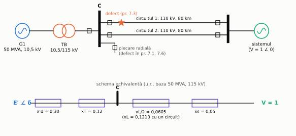
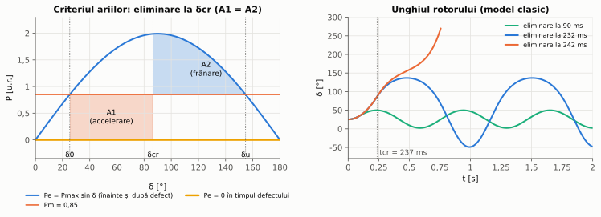
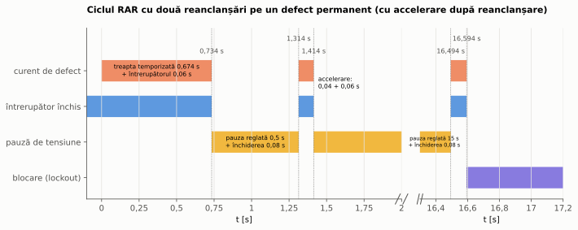
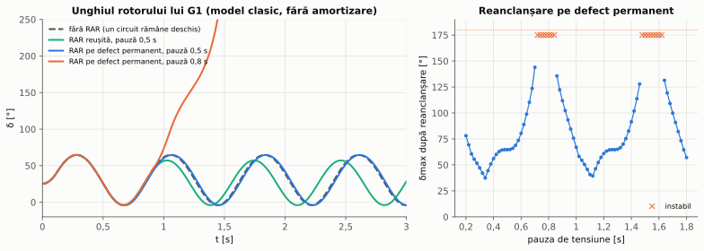
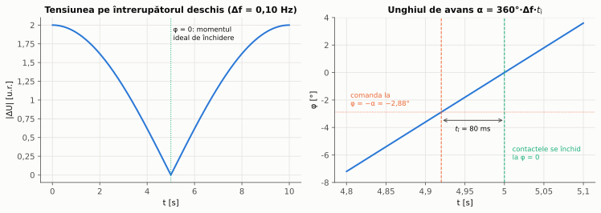
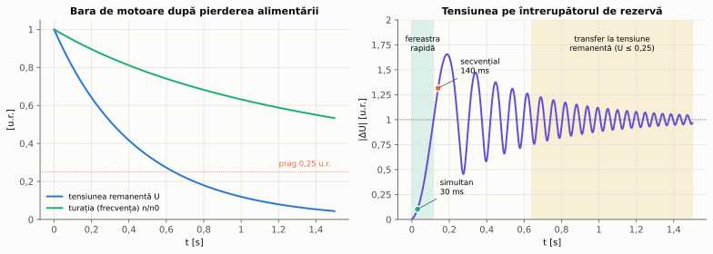
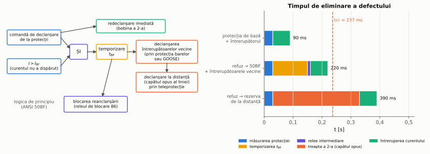

# Capitolul 7. Automatizări de rețea

> **Obiective.** După acest capitol ar trebui să puteți: (1) explica de ce durata unui defect este limitată de stabilitatea tranzitorie a generatoarelor și calcula timpul critic de eliminare cu criteriul ariilor egale; (2) descrie funcționarea reanclanșării automate (RAR): pauza, timpul de revenire, blocarea, numărul de reanclanșări, accelerarea după reanclanșare; (3) analiza efectul unei reanclanșări reușite sau nereușite asupra stabilității; (4) formula condițiile de sincronizare și calcula unghiul de avans al comenzii de închidere; (5) descrie anclanșarea automată a rezervei (AAR) pe o bară cu motoare și alege metoda de transfer; (6) explica logica protecției la refuzul întrerupătorului și reglajul temporizării ei.

Protecțiile din capitolele 3–6 detectează defectul și deconectează elementul afectat. Automatizările din acest capitol restabilesc apoi alimentarea și funcționarea normală: **reanclanșarea automată** (cod IEEE C37.2: 79) repune sub tensiune o linie după un defect trecător, **sincronizarea** (25) leagă în paralel două părți ale sistemului, iar **anclanșarea automată a rezervei** (AAR) trece consumatorii pe o sursă de rezervă. În același capitol tratăm **protecția la refuzul întrerupătorului** (50BF). Ea este o protecție de rezervă locală (§ 0.5), dar reglajul ei depinde de aceleași considerente de timp și de stabilitate ca automatizările, iar logica ei este o automatizare de stație. Codurile funcțiilor sunt cele din tabelul § 0.6 [S12].

Pentru generatorul G1 (§ 0.7) folosim în acest capitol o **schemă de studiu separată**, care nu face parte din rețeaua de referință din figura 0.1 (figura 7.1). Centrala din C este legată de sistem printr-o linie dublă de 110 kV (2 × 80 km), iar restul sistemului este o **bară de putere infinită**: tensiune și frecvență constante, în spatele reactanței $x_s$ = 0,05 u.r. Aceste date sunt construite pentru curs. Rețeaua de studiu este mai slabă decât rețeaua de referință: puterea de scurtcircuit la bara C este aici de aproximativ 609 MVA, față de 1892 MVA în problema 1.2. În capitolul 1, contribuția centralei la curenții de scurtcircuit este inclusă în sursa echivalentă QC.

*Figura 7.1 – Schema de studiu pentru stabilitatea lui G1 și schema ei echivalentă (unități relative pe baza 50 MVA, 115 kV). Defectele din problemele 7.1 și 7.6 sunt pe o plecare radială din bara C, iar cel din problema 7.3 pe circuitul 1 al liniei duble.*

---

## 7.1. Timpul de eliminare a defectului și stabilitatea tranzitorie

În timpul unui scurtcircuit trifazat apropiat de centrală, tensiunea barei C scade aproape la zero și generatorul nu mai poate livra putere activă în rețea. Turbina continuă însă să dea puterea mecanică $P_m$: regulatorul de viteză (capitolul 8) este prea lent ca să o reducă în câteva zecimi de secundă. Diferența $P_m - P_e$ accelerează rotorul, iar unghiul $\delta$ dintre t.e.m. a generatorului și tensiunea sistemului crește. Dacă defectul durează prea mult, generatorul nu mai poate fi frânat după eliminarea lui și **iese din sincronism** (pierde stabilitatea). Problema este tratată pe larg în [17]; aici folosim **modelul clasic**, cu următoarele simplificări:

- generatorul este o t.e.m. constantă $E'$ în spatele reactanței tranzitorii $x'_d$. Este o aproximare: fluxul rotoric scade lent, cu constanta de timp tranzitorie. Pentru G1, fără intervenția regulatorului de tensiune, $E'$ ar scădea cu aproximativ 6 % până la momentul critic (problema 7.1);
- rezistențele și amortizarea sunt neglijate (rezultatul este acoperitor pentru prima oscilație);
- puterea mecanică este constantă.

Ecuația mișcării rotorului, în unități relative, este

$$\boxed{\frac{2H}{\omega_0}\frac{d^2\delta}{dt^2} = P_m - P_e, \qquad P_e = P_{max}\sin\delta, \qquad P_{max} = \frac{E'\thinspace V}{x}}$$

unde $H$ este constanta de inerție [s], $\omega_0 = 2\pi f_0$, iar $x$ este reactanța totală dintre t.e.m. $E'$ și bara de putere infinită. În timpul defectului de lângă bara C, $P_e = 0$.

**Criteriul ariilor egale.** Înmulțind ecuația mișcării cu $d\delta/dt$ și integrând, se obține că viteza relativă a rotorului se anulează (iar unghiul începe să scadă) numai dacă **aria de accelerare** $A_1$, cuprinsă între $P_m$ și $P_e$ cât timp $P_m > P_e$, este egalată de o **arie de frânare** $A_2$, cuprinsă între $P_e$ și $P_m$ după eliminarea defectului (figura 7.2). Aria de frânare disponibilă se termină la unghiul $\delta_u = \pi - \delta_0$, unde caracteristica $P_{max}\sin\delta$ coboară din nou sub $P_m$. Dacă defectul este eliminat la unghiul $\delta_{cr}$ pentru care $A_1 = A_2$ (cu caracteristica $P_e$ dinainte și de după defect aceeași), atunci

$$\boxed{\cos\delta_{cr} = (\pi - 2\delta_0)\sin\delta_0 - \cos\delta_0}$$

Cu $P_e = 0$ în timpul defectului, unghiul crește parabolic, $\delta(t) = \delta_0 + \omega_0 P_m t^2/(4H)$, de unde **timpul critic de eliminare**:

$$\boxed{t_{cr} = \sqrt{\frac{4H\thinspace(\delta_{cr} - \delta_0)}{\omega_0\thinspace P_m}}}$$

*Figura 7.2 – Stânga: ariile de accelerare și de frânare la eliminarea defectului în momentul critic. Dreapta: unghiul rotorului lui G1 pentru trei momente de eliminare (problema 7.1).*

Pentru G1, timpul critic rezultă 237 ms (problema 7.1). Un defect eliminat de protecția de bază (de ordinul a 30 ms) și de întrerupător (60 ms) nu pune problema stabilității. Situația este alta dacă defectul trebuie eliminat de o **protecție de rezervă de la distanță**, de exemplu de treapta a 2-a a protecțiilor de distanță de la capetele opuse ale liniei duble (capitolul 5: temporizarea 0,3 s, plus timpul de măsurare și timpul întrerupătorului, în total 0,39 s). Chiar dacă rețeaua ar rămâne intactă după eliminare, acest timp depășește timpul critic. În realitate, rezerva de la distanță deconectează linia dublă, iar G1 se separă de sistem. De aici trei consecințe practice:

1. pe elementele importante se folosesc **două protecții de bază independente** (§ 0.5, problema 0.2), astfel încât refuzul uneia să nu lase defectul în seama rezervei de la distanță;
2. refuzul **întrerupătorului** trebuie tratat local și repede, prin protecția la refuzul întrerupătorului (§ 7.5);
3. pe liniile la care ambele capete trebuie să declanșeze rapid se folosesc scheme de teleprotecție (capitolul 5).

Timpul critic depinde de punctul de funcționare (crește dacă generatorul este mai puțin încărcat), de locul defectului și de tipul lui. La un defect monofazat, fazele sănătoase transmit în continuare o parte din putere, așa că $P_e$ nu scade la zero, iar timpul critic este mai mare.

## 7.2. Reanclanșarea automată (RAR)

Multe defecte de pe liniile aeriene sunt **trecătoare**: un arc electric amorsat de un trăsnet, de o atingere a conductoarelor pe vânt sau de o pasăre se stinge când linia este scoasă de sub tensiune, iar izolația (aerul) își reface rigiditatea. Linia poate fi apoi repusă sub tensiune automat, după o pauză. Proporția defectelor trecătoare depinde de rețea și se stabilește din statistica de exploatare. Reanclanșarea în rețelele de distribuție este tratată, de exemplu, în ghidul ABB [9] (secțiunea 8.14).

Pe cabluri reanclanșarea nu se folosește: o străpungere a izolației solide a cablului nu se reface, iar reanclanșarea ar repeta doar solicitarea la scurtcircuit. Fiderii **micști** pun o problemă de compromis. Fiderul F1, de exemplu, începe cu 3 km de cablu, urmați de linie aeriană. O reanclanșare pe un defect din porțiunea de cablu nu aduce niciun folos. De aceea reanclanșarea se blochează când defectul poate fi localizat pe porțiunea de cablu, iar altfel se acceptă acest risc pentru a păstra avantajul ei la defectele trecătoare de pe porțiunea aeriană.

**Mărimile caracteristice** (figura 7.3):

- **pauza reglată** (*dead time*) – timpul reglat în automat, de la deschiderea întrerupătorului până la comanda de închidere. Linia stă fără tensiune ceva mai mult: **pauza de tensiune** = pauza reglată + timpul de închidere al întrerupătorului (în problema 7.2: 0,5 s + 0,08 s = 0,58 s). Pauza de tensiune trebuie să depășească timpul necesar deionizării canalului arcului. Acesta crește cu tensiunea și cu curentul arcului și se ia din datele de exploatare; în probleme pauza este o dată de problemă;
- **timpul de revenire** (*reclaim time*) – după o reanclanșare, dacă protecția nu mai declanșează în acest interval, ciclul este considerat reușit, iar automatul revine la starea inițială. O declanșare în acest interval trece automatul la reanclanșarea următoare sau la blocare;
- **numărul de reanclanșări** – una sau mai multe, de exemplu o reanclanșare rapidă urmată de una lentă, ca în problema 7.2;
- **blocarea** (*lockout*) – după ultima reanclanșare nereușită, întrerupătorul rămâne deschis până la intervenția operatorului. RAR este blocată și când declanșarea vine de la protecții la care reanclanșarea nu are sens: protecția barelor, protecția transformatoarelor, protecția la refuzul întrerupătorului (§ 7.5), declanșarea manuală.

*Figura 7.3 – Ciclul cu două reanclanșări pe fiderul F1, la un defect permanent (problema 7.2). După fiecare reanclanșare, protecția declanșează accelerat. Axa timpului este întreruptă între 2 s și 16,3 s.*

**Reanclanșarea trifazată și monofazată.** La reanclanșarea **trifazată** se deschid toate cele trei faze, chiar și la un defect monofazat. Pe durata pauzei, legătura respectivă nu mai transmite putere (problema 7.3). La reanclanșarea **monofazată** se deschide doar faza defectă. Aceasta cere întrerupătoare cu acționare separată pe faze (monopolară) și o protecție care selectează faza defectă. Fazele sănătoase transmit în continuare o parte din putere, ceea ce ajută stabilitatea. În schimb, faza deschisă rămâne cuplată capacitiv cu fazele sub tensiune și poate întreține un arc secundar, așa că pauza monofazată trebuie să fie mai lungă.

**Interacțiunea cu protecțiile.** Dacă reanclanșarea se face pe un defect permanent, este util ca protecția să declanșeze **fără temporizarea obișnuită** (*accelerare după reanclanșare*, în engleză *trip on reclose*). Astfel scade solicitarea termică (problema 7.2). Contează și durata celui de-al doilea defect: în problema 7.3, eliminarea lui în 0,30 s în loc de 0,12 s mărește unghiul maxim al lui G1 la 128,6°, iar în 0,35 s G1 iese din sincronism. Funcția înrudită *switch onto fault* (SOTF) accelerează declanșarea după o **închidere manuală** pe o linie fără tensiune, de exemplu uitată legată la pământ. În rețelele de distribuție aeriene, reanclanșatoarele montate pe linie (*reclosers*) au propriile protecții și cicluri. Ele se coordonează cu siguranțele fuzibile și cu releele din amonte după aceleași principii ca în § 3.4.

**Condiții pe liniile buclate.** O linie alimentată de la ambele capete se reanclanșează întâi la un capăt, unde se verifică „linie fără tensiune, bară cu tensiune”. Celălalt capăt închide apoi numai dacă **controlul sincronismului** (§ 7.3) constată că tensiunile de o parte și de alta a întrerupătorului sunt apropiate ca valoare, frecvență și fază.

**Efectul asupra stabilității** (figura 7.4, problema 7.3). O reanclanșare reușită reface reactanța de transfer și ajută generatorul. O reanclanșare pe un defect permanent produce însă un al doilea defect, care accelerează din nou rotorul. Efectul depinde de **momentul** în care se produce, adică de faza oscilației rotorului: dacă rotorul se mișcă înainte, al doilea defect îl împinge spre pierderea stabilității; dacă se mișcă înapoi, îl frânează. Pentru G1, reanclanșarea pe defect permanent este instabilă pentru pauze de tensiune între 0,72 și 0,84 s și din nou între 1,48 și 1,62 s, dar stabilă pentru 0,5 s. Ferestrele se repetă pentru că modelul clasic neglijează amortizarea: oscilațiile rotorului nu se sting. În realitate amortizarea reduce oscilațiile, iar ferestrele târzii sunt mai puțin periculoase. Pauza se alege deci și cu un studiu de stabilitate, nu numai din condiția de deionizare.

*Figura 7.4 – Stânga: unghiul rotorului lui G1 pentru o reanclanșare reușită și pentru reanclanșări pe defect permanent după 0,5 s și 0,8 s. Dreapta: unghiul maxim atins după reanclanșarea pe defect permanent, în funcție de pauza de tensiune (× = instabil). Model clasic, fără amortizare.*

## 7.3. Sincronizarea și controlul sincronismului

Închiderea unui întrerupător între două părți active ale sistemului (un generator și rețeaua, sau două rețele) cere, ca la orice conectare în paralel, aceeași **succesiune a fazelor** (verificată la punerea în funcțiune), **tensiuni** apropiate, **frecvențe** apropiate și **unghi** apropiat de zero în momentul închiderii. Două dispozitive se ocupă de aceasta:

- **sincronizatorul automat** (folosit la generatoare) comandă regulatorul de viteză și regulatorul de tensiune al generatorului până când diferențele intră în limite. Apoi dă comanda de închidere **în avans**, astfel încât contactele să se atingă exact când unghiul trece prin zero;
- **releul de control al sincronismului** (*synchro-check*) nu reglează nimic. El doar **permite** închiderea (manuală sau prin RAR) dacă diferența de tensiune $\Delta U$, alunecarea $\Delta f$ și unghiul $\Delta\varphi$ sunt sub pragurile reglate.

La alunecarea $\Delta f$, unghiul dintre cele două tensiuni crește cu $360°\cdot\Delta f$ pe secundă. Dacă de la comandă până la atingerea contactelor trece timpul $t_{\text{î}}$ (releu + întrerupător), comanda trebuie dată cu **unghiul de avans**

$$\boxed{\alpha = 360°\cdot\Delta f\cdot t_{\text{î}} \qquad \left(\text{cu accelerație } a: \ \alpha = 360°\cdot\left(\Delta f\thinspace t_{\text{î}} + \tfrac{a\thinspace t_{\text{î}}^2}{2}\right)\right)}$$

*Figura 7.5 – Stânga: tensiunea pe întrerupătorul deschis variază cu perioada alunecării (bătăi). Dreapta: comanda dată la unghiul −α face ca închiderea să aibă loc la unghi zero (problema 7.4).*

O închidere cu unghiul $\varphi$ între tensiuni (de valori egale) aplică pe reactanța dintre cele două surse tensiunea $|\Delta U| = 2\sin(\varphi/2)$. Rezultă un curent de egalizare și un cuplu de șoc pe arborele generatorului. La 180° curentul se apropie de cel al unui scurtcircuit la borne (problema 7.4).

## 7.4. Anclanșarea automată a rezervei (AAR)

Consumatorii importanți – serviciile proprii ale centralelor, instalațiile industriale cu procese continue – au două surse: o **sursă de lucru** și o **sursă de rezervă**, fiecare cu întrerupătorul ei. Dacă sursa de lucru se pierde, AAR deschide întrerupătorul de lucru și închide întrerupătorul de rezervă. Logica unui AAR cuprinde:

- **pornirea** – la comanda de declanșare a întrerupătorului de lucru dată de protecțiile lui (sau la un semnal de pierdere a sursei din amonte), ori la scăderea tensiunii pe bară sub un prag, menținută un timp reglat. Temporizarea pornirii de la minimă tensiune se coordonează cu protecțiile și cu RAR din amonte: AAR nu trebuie să intervină cât timp o protecție din amonte elimină un defect sau o reanclanșare din amonte poate reface alimentarea;
- **condițiile** – sursa de rezervă are tensiune, iar cele două surse nu ajung să funcționeze în paralel. De regulă paralelul nu este permis pentru că ar crește curentul de scurtcircuit pe bară peste capacitatea echipamentelor și pentru că între surse cu tensiuni sau unghiuri diferite ar circula curenți de egalizare. La transferul secvențial, condiția se verifică direct (întrerupătorul de lucru deschis). La transferul simultan, ea este asigurată de timpii proprii ai întrerupătoarelor: cel de lucru se deschide (50 ms) înainte ca cel de rezervă să se închidă (80 ms);
- **blocările** – AAR nu acționează dacă bara s-a deconectat din cauza unui **defect pe bară** (s-ar închide sursa de rezervă pe defect), dacă întrerupătorul de lucru a fost deschis manual, dacă AAR a acționat deja o dată (o singură încercare) sau dacă un întrerupător a refuzat.

**Bara cu motoare.** După pierderea alimentării, motoarele nu se opresc instantaneu. Ele continuă să se rotească și să producă o **tensiune remanentă** $U_r$ (problema 7.5, figura 7.6). Valoarea ei scade odată cu fluxul rotoric (constanta de timp $T_0$) și cu turația, iar frecvența ei scade odată cu turația. Unghiul $\theta$ dintre tensiunea remanentă și tensiunea sursei de rezervă crește din ce în ce mai repede. Pentru un cuplu rezistent proporțional cu pătratul turației (pompe, ventilatoare), cu sarcina $p$ și constanta de inerție $H$ raportate la puterea motoarelor, și pornind de la $U_r(0)$ = 1 u.r. și turația sincronă, ecuația mișcării $2H\thinspace d\omega/dt = -p\thinspace\omega^2$ dă

$$\boxed{\omega(t) = \frac{1}{1 + p\thinspace t/(2H)}, \qquad U_r(t) = \omega(t)\thinspace e^{-t/T_0}, \qquad \theta(t) = 2\pi f_0\left[t - \frac{2H}{p}\ln\left(1 + \frac{p\thinspace t}{2H}\right)\right]}$$

La închiderea sursei de rezervă, motoarele primesc diferența $|\Delta U| = |1 - U_r e^{-j\theta}|$. Un motor oprit, conectat la tensiunea nominală, absoarbe curentul de pornire, pe care îl suportă la fiecare pornire. În acest curs folosim de aceea criteriul **$|\Delta U| \le 1$ u.r.**: curentul la reconectare nu depășește curentul de pornire. Criteriul este dedus aici, nu preluat dintr-o normă. În literatura americană se întâlnește și o limită de 1,33 u.r. a raportului tensiune/frecvență rezultant (ANSI C50.41); ea nu a putut fi verificată pentru această versiune a cursului.

**Metodele de transfer** (momentul $t$ = 0 este cel în care bara rămâne fără alimentare):

- **transferul rapid** – închiderea sursei de rezervă imediat, cât timp unghiul este mic. Poate fi **simultan** (comenzile de deschidere și de închidere date deodată) sau **secvențial** (închiderea după confirmarea deschiderii, deci mai târziu). Fereastra disponibilă depinde și de modul de pornire: o pornire de la protecția de minimă tensiune, cu temporizarea ei, pierde fereastra rapidă (problema 7.5);
- **transferul în fază** – închiderea la prima trecere a unghiului prin zero, cu o comandă dată în avans (ca la sincronizare). Este pretențios: în problema 7.5 prima coincidență de fază are loc la 275 ms, când alunecarea a ajuns la 6,92 Hz, așa că o comandă cu 80 ms înainte trebuie dată cu 174° înaintea coincidenței, pe baza unei predicții a mișcării motoarelor;
- **transferul la tensiune remanentă** – închiderea după ce $U_r$ scade sub un prag, fără măsurarea unghiului. Atunci, oricare ar fi unghiul, $|\Delta U| \le 1 + U_r$. Criteriul $|\Delta U| \le 1$ ar fi garantat pentru orice unghi numai la $U_r = 0$. În problemă acceptăm o depășire de cel mult 10 % și alegem pragul $U_r \le$ 0,10 u.r. (o alegere de proiectare, nu o valoare normată). Un prag de 0,25 u.r. ar permite $|\Delta U|$ până la 1,25 u.r. Motoarele, mult încetinite, repornesc apoi toate deodată. Curentul total mare produce un gol de tensiune. De aceea se poate prevedea deconectarea unei părți din motoare și repornirea lor ulterioară, eșalonată.

*Figura 7.6 – Bara de motoare de 6 kV după pierderea alimentării (problema 7.5). Stânga: tensiunea remanentă și turația. Dreapta: tensiunea care ar apărea pe întrerupătorul de rezervă, cu fereastra transferului rapid, momentele de închidere pentru pornirile (a) și (b) și zona transferului la tensiune remanentă ($U_r \le$ 0,10 u.r.).*

## 7.5. Protecția la refuzul întrerupătorului (50BF)

Un întrerupător poate refuza să întrerupă din mai multe cauze: un defect al mecanismului de acționare, al bobinei de declanșare sau al circuitului ei de alimentare, ori al camerei de stingere. Rezerva de la distanță (§ 0.5) ar elimina defectul prin protecțiile elementelor vecine, dar mai lent (vezi § 7.1) și deconectând mai multe elemente decât este necesar. De aceea, în stațiile importante există o **protecție la refuzul întrerupătorului**, cu codul IEEE C37.2 50BF și nodul logic RBRF în IEC 61850 (capitolul 9). În documente tehnice de limbă română apare pentru ea și abrevierea DRRI (sursele găsite provin din Republica Moldova).

**Logica** (figura 7.7, stânga):

1. orice comandă de declanșare dată de protecțiile unui element pornește funcția 50BF a întrerupătorului respectiv;
2. funcția dă imediat o **redeclanșare** a aceluiași întrerupător, pe a doua bobină de declanșare (dacă refuzul s-a datorat primului circuit de declanșare, întrerupătorul se deschide acum);
3. dacă, după temporizarea $t_{BF}$, curentul prin întrerupător este încă peste pragul $I_{BF}$, funcția declanșează **toate întrerupătoarele vecine**, adică cele care alimentează aceeași secție de bare. Comanda trece prin protecția barelor sau prin mesaje GOOSE (capitolul 9). La liniile ei mai trimite și o **declanșare la distanță** la capătul opus. Funcția blochează reanclanșarea (releul de blocare 86).

Pentru defectele cu curent mic (de exemplu cele detectate de protecția de gaze a transformatorului, capitolul 4), criteriul de curent se înlocuiește cu poziția contactelor auxiliare ale întrerupătorului.

**Temporizarea** trebuie să fie mai mare decât timpul în care un întrerupător sănătos întrerupe curentul, plus timpul de revenire al detectorului de curent după întrerupere, plus o marjă. Ea trebuie să fie totuși cât mai mică, pentru că se adaugă la timpul de eliminare:

$$\boxed{t_{BF} \ge t_{\text{întrerupere}} + t_{\text{revenire detector}} + \text{marjă}, \qquad t_{\text{eliminare}} = t_{\text{protecție}} + t_{BF} + t_{\text{relee}} + t_{\text{întrerupătoare vecine}}}$$

În problema 7.6, timpul total la refuzul întrerupătorului (0,22 s) rămâne sub timpul critic al lui G1 (0,237 s), dar cu o rezervă de numai 17 ms. Rezerva de la distanță (0,39 s) depășește timpul critic. Detectoarele de curent cu revenire rapidă, întrerupătoarele rapide și transmiterea comenzilor prin rețeaua stației reduc acest timp.

*Figura 7.7 – Stânga: logica de principiu a protecției 50BF. Dreapta: timpul de eliminare a unui defect de lângă bara C, comparat cu timpul critic al lui G1 (problemele 7.1 și 7.6).*

---

## Probleme rezolvate

### Problema 7.1 – Timpul critic de eliminare pentru generatorul G1

G1 (50 MVA, $x'_d$ = 0,30 u.r., $H$ = 3,5 s) funcționează la puterea activă nominală $P_m$ = 0,85 u.r. (adică $S_n\cos\varphi_n$), cu tensiunea la borne și tensiunea sistemului egale cu 1 u.r. Schema este cea din figura 7.1. Un scurtcircuit trifazat apare pe o plecare radială din bara C, foarte aproape de bară, astfel încât în timpul defectului $P_e = 0$. După eliminarea defectului, legătura G1–sistem este aceeași ca înainte. Să se calculeze timpul critic de eliminare.

**Rezolvare.** Baza pe partea de 110 kV este $Z_b$ = 115²/50 = 264,5 Ω. Reactanțele în u.r. sunt: transformatorul bloc $x_T$ = 0,12 (uk = 12 % la 50 MVA); un circuit al liniei, 0,40 Ω/km · 80 km = 32 Ω, adică $x_L$ = 0,1210; sistemul $x_s$ = 0,05. Cu ambele circuite, reactanța dintre bornele generatorului și sistem este $x_T + x_L/2 + x_s$ = 0,2305, iar reactanța totală, cu $x'_d$, este 0,5305.

Unghiul tensiunii la borne rezultă din $P = U_t V\sin\theta_t/0{,}2305$: $\theta_t$ = 11,30°, iar generatorul livrează Q = 0,0841 u.r. T.e.m. din spatele reactanței tranzitorii este

$$\underline{E}' = \underline{U}_t + j x'_d\thinspace\underline{I} = 1{,}0565\angle 25{,}27°,$$

deci $\delta_0$ = 25,27° și $P_{max} = E'V/x$ = 1,0565/0,5305 = 1,9915 u.r. (de 2,34 ori puterea transmisă). Din criteriul ariilor:

$$\cos\delta_{cr} = (\pi - 2\delta_0)\sin\delta_0 - \cos\delta_0 \ \Rightarrow\ \delta_{cr} = 86{,}55°,$$

$$t_{cr} = \sqrt{\frac{4\cdot 3{,}5\cdot(1{,}5106 - 0{,}4410)}{314{,}16\cdot 0{,}85}} = \mathbf{236{,}8\ ms}.$$

Dacă defectul este eliminat în 90 ms (protecție 30 ms + întrerupător 60 ms), G1 rămâne stabil. Rezerva de la distanță ar elimina defectul în 30 + 300 + 60 = 390 ms (măsurare, treapta a 2-a, întrerupător). Chiar presupunând că după eliminare rețeaua rămâne intactă, G1 ar pierde sincronismul. În realitate, rezerva de la distanță deconectează linia dublă, iar G1 se separă de sistem.

Cât de bună este ipoteza $E'$ constant? Pentru un defect în C, constanta de timp tranzitorie este $T'_d = T'_{d0}(x'_d + x_T)/(x_d + x_T)$ = 1,875 s. $E'$ ar tinde spre 0,517 u.r. (din t.e.m. inițială $E_q$ = 1,378 u.r.), dar până la $t_{cr}$ scade doar cu 6,1 %, fără intervenția regulatorului de tensiune. Aproximarea este acceptabilă pentru un calcul de prima oscilație. O scădere a lui $E'$ ar micșora puțin $P_{max}$ și deci timpul critic.

**Verificare.** Calea independentă este o **bisecție pe timpul de eliminare**, cu simularea completă a ecuației mișcării (stabil / instabil pe 5 s). Ea dă timpul critic 236,81 ms, la fel ca formula. Ca verificări de consecvență (care folosesc aceleași relații ca formula): puterea calculată din $E'$, $\delta_0$ și reactanța totală este exact $P_m$ = 0,85; integrarea cu $P_e = 0$ atinge $\delta_{cr}$ la 236,8 ms; ariile la $\delta_{cr}$ sunt egale ($A_1 = A_2$ = 0,9092 u.r.·rad). Simularea arată și eliminarea la 0,98·$t_{cr}$ = 232,1 ms stabilă (unghi maxim 136,7°) și eliminarea la 1,02·$t_{cr}$ = 241,5 ms instabilă, iar simularea confirmă și concluziile pentru 90 ms și 390 ms. Scăderea de 6,1 % a lui $E'$ a fost verificată prin integrarea numerică a ecuației $T'_d\thinspace dE'/dt = E'_\infty - E'$.

### Problema 7.2 – Ciclul de reanclanșare pe fiderul F1

Releul R1 al fiderului F1 are reglajele din problema 3.2: $I_s$ = 300 A, TMS = 0,19 (caracteristică normal inversă), treapta instantanee la 2800 A. Automatul RAR face două reanclanșări, cu pauzele reglate de 0,5 s și 15 s, și are timpul de revenire de 30 s. Întrerupătorul se deschide în 0,06 s și se închide în 0,08 s. Să se determine succesiunea evenimentelor pentru un defect trifazat la capătul tronsonului B2–P1, trecător sau permanent, cu și fără accelerare după reanclanșare (declanșare în 0,04 s dacă $I > I_s$).

**Rezolvare.** Curentul de defect este 2079 A (problema 1.2), sub pragul treptei instantanee, deci acționează treapta temporizată în $t$ = 0,6738 s. Prima declanșare se termină la 0,6738 + 0,06 = 0,7338 s. Pauza reglată de 0,5 s înseamnă o pauză de tensiune de 0,58 s (cu timpul de închidere).

- **Defect trecător** (dispare în pauză): închiderea la 1,314 s este reușită, iar la 1,314 + 30 = 31,314 s automatul revine la starea inițială. Consumatorii sunt întrerupți 0,58 s, iar curentul de defect circulă în total 0,734 s.
- **Defect permanent, fără accelerare**: fiecare reanclanșare repetă temporizarea de 0,6738 s. Curentul de defect circulă de trei ori câte 0,7338 s, în total 2,201 s. Evenimentele sunt: deschideri la 0,734 s, 2,048 s și 17,861 s, închideri la 1,314 s și 17,128 s, blocare la 17,861 s.
- **Defect permanent, cu accelerare**: după fiecare reanclanșare declanșarea durează 0,04 + 0,06 = 0,10 s. Curentul circulă în total 0,934 s, iar blocarea are loc la 16,594 s (figura 7.3).

Solicitarea termică a cablului de 185 mm² Al de la începutul fiderului (problema 0.1) este $I^2 t$ = 3,17·10⁶, 9,52·10⁶ și respectiv 4,04·10⁶ A²s. Toate valorile sunt mult sub limita adiabatică $(kS)^2$ = 302·10⁶ A²s. Accelerarea reduce de peste două ori solicitarea la un defect permanent.

O precauție: după pauza lungă de 15 s, la reconectare circulă curenții de magnetizare ai transformatoarelor din aval și curenții sporiți ai sarcinii reconectate după o întrerupere (*cold load pickup*). O treaptă accelerată reglată la $I_s$ ar putea declanșa fără defect. De aceea accelerarea se face de obicei cu un prag mai mare, cu o scurtă temporizare sau cu blocare la armonica a 2-a (capitolul 4).

**Verificare.** Ciclul a fost simulat și ca automat cu stări (închis – pauză – blocat), pas cu pas la 1 ms. Simularea verifică **logica automatului** (succesiunea evenimentelor, numărarea reanclanșărilor, blocarea, revenirea), nu și temporizarea releului, care este aceeași funcție în ambele calcule. Succesiunea este aceeași, iar momentele coincid cu cele analitice în limita pasului de 1 ms (de exemplu blocarea la 17,862 s în simulare, față de 17,861 s).

### Problema 7.3 – Reanclanșarea trifazată a liniei duble: reușită și pe defect permanent

Pe circuitul 1 al liniei duble apare un scurtcircuit trifazat lângă bara C ($P_e$ = 0 cât durează). Circuitul este deconectat la ambele capete după 0,12 s și rămâne deschis pe durata pauzei de tensiune $t_m$, apoi se reanclanșează. Pe defect permanent, protecția declanșează din nou în 0,12 s (cu accelerare), iar circuitul rămâne deschis definitiv. Considerăm, ca idealizare, că ambele capete se închid simultan. În realitate se închide întâi un capăt, iar celălalt după controlul sincronismului (§ 7.2). Să se analizeze stabilitatea lui G1 (date din problema 7.1) pentru $t_m$ = 0,5 s și 0,8 s.

**Rezolvare.** Puterea maximă transmisibilă este 1,9915 u.r. cu ambele circuite, 1,7876 u.r. cu un singur circuit și 0 în timpul defectului. Ecuația mișcării se integrează pe etape (figura 7.4). Unghiul maxim din tabel este cel atins **după reanclanșare** (prima oscilație, comună tuturor cazurilor, ajunge la 64,7°):

| Cazul | La reanclanșare | $\delta_{max}$ după reanclanșare |
|---|---|---|
| fără RAR (circuitul rămâne deschis) | – | stabil, 64,7° (prima oscilație) |
| $t_m$ = 0,5 s, defect trecător | t = 0,62 s, δ = −1,0°, rotorul se mișcă înapoi | stabil, 57,2° |
| $t_m$ = 0,5 s, defect permanent | idem; după al doilea defect (0,74 s): δ = 0,4° | stabil, 64,7° |
| $t_m$ = 0,8 s, defect trecător | t = 0,92 s, δ = 47,4°, rotorul se mișcă înainte | stabil, 61,5° |
| $t_m$ = 0,8 s, defect permanent | după al doilea defect (1,04 s): δ = 91,5°, Δω = 8,70 rad/s | **instabil** |

Reanclanșarea reușită este stabilă în ambele cazuri. Pe defect permanent, rezultatul depinde de faza oscilației. După 0,5 s rotorul revine spre unghiuri mici, iar al doilea defect doar îi frânează mișcarea înapoi. După 0,8 s rotorul se mișcă înainte, iar al doilea defect îl duce la 91,5° cu viteză mare, de unde aria de frânare nu mai ajunge.

Dacă se variază pauza de tensiune din 0,02 în 0,02 s, între 0,2 și 1,8 s, rezultă că reanclanșarea pe defect permanent este instabilă pentru 0,72…0,84 s și pentru 1,48…1,62 s. Ferestrele se repetă cu perioada oscilației rotorului, pentru că modelul neglijează amortizarea. Perioada este 0,774 s în simulare, puțin mai mult decât perioada oscilațiilor mici cu un circuit, 0,748 s (f = 1,337 Hz în jurul lui $\delta_e$ = 28,39°).

Contează și durata celui de-al doilea defect. Cu pauza de 0,5 s (stabilă mai sus), dacă al doilea defect ar fi eliminat în 0,30 s, unghiul maxim după reanclanșare ar crește la 128,6°, iar dacă ar fi eliminat în 0,35 s, G1 ar ieși din sincronism.

Pentru controlul sincronismului la reanclanșarea unui capăt, contează unghiul dintre tensiunile de pe cele două părți ale întrerupătorului deschis: bara C și bara stației de la celălalt capăt al circuitului. În regim staționar cu un singur circuit, $|U_C|$ = 0,9903 u.r. și $|U_R|$ = 0,9949 u.r., iar unghiul dintre ele este **5,99°**.

**Verificare.** (1) În etapele cu $P_e$ = 0, unghiul calculat cu formula parabolei, $\delta = \delta_s + \Delta\omega_s t + \omega_0 P_m t^2/(4H)$, coincide cu integrarea numerică. (2) Pentru ultima etapă, criteriul ariilor scris ca bilanț de energie, $W = (H/\omega_0)\Delta\omega^2 - P_m\delta - P_{max}\cos\delta$ = constant, dă același unghi maxim ca simularea în cazurile stabile. În cazul instabil, energia depășește bariera de la $\delta_u$ („aria de frânare nu ajunge”). (3) Unghiul de 5,99° rezultă identic din calculul cu fazori și din relația $P = U_C U_R\sin\theta/x_L$.

### Problema 7.4 – Unghiul de avans la sincronizarea lui G1

Generatorul G1 se sincronizează cu alunecarea Δf = 0,10 Hz (generatorul mai rapid). Timpul de la comanda de închidere la atingerea contactelor este 80 ms. (a) Ce unghi de avans trebuie folosit? (b) Cum se modifică acesta dacă alunecarea crește cu 0,05 Hz/s? (c) Ce curent de egalizare ar rezulta la o închidere cu decalaj?

**Rezolvare.** (a) $\alpha$ = 360° · 0,10 · 0,08 = **2,880°**. (b) $\alpha$ = 360°·(0,10·0,08 + 0,05·0,08²/2) = **2,9376°**. Termenul de accelerație adaugă 0,0576°. Eroarea este mică aici, dar crește cu pătratul timpului de închidere. (c) Reactanța dintre t.e.m. supratranzitorie a generatorului și sistem este $x''_d + x_T + x_L/2 + x_s$ = 0,4305 u.r.:

| Decalajul φ | 2,88° | 10° | 30° | 90° | 180° |
|---|---|---|---|---|---|
| $\lvert\Delta U\rvert = 2\sin(\varphi/2)$ [u.r.] | 0,050 | 0,174 | 0,518 | 1,414 | 2,000 |
| curentul de egalizare [u.r.] | 0,12 | 0,40 | 1,20 | 3,29 | 4,65 |

La 180° curentul (4,65 u.r.) se apropie de curentul unui scurtcircuit trifazat la bornele generatorului ($1/x''_d$ = 5,0 u.r.).

**Verificare.** (a) O simulare cu pas de 10 µs, în care comanda se dă când unghiul ajunge la −α, arată închiderea la 0,000°. Ea eșantionează însă aceeași lege liniară, deci este doar o verificare de consecvență. (b) Pentru cazul cu accelerație, unghiul se obține prin **integrarea numerică a frecvenței de alunecare**. Scenariul este o dată a verificării: alunecarea crește de la 0,02 Hz cu 0,05 Hz/s, iar unghiul inițial (−37,50°) este ales astfel încât comanda să cadă când alunecarea este 0,10 Hz (la t = 1,6000 s). Sincronizatorul simulat calculează continuu unghiul de avans și dă comanda la Δf = 0,1000 Hz; închiderea are loc la 0,0000°. Dacă ar ignora accelerația, închiderea s-ar face la 0,058°, cât prevede termenul $360°\cdot a\thinspace t_{\text{î}}^2/2$. (c) Egalitatea $2\sin(\varphi/2) = |1 - e^{j\varphi}|$ este o identitate trigonometrică: calculul cu fazori este doar o verificare de consecvență.

### Problema 7.5 – AAR pe bara de 6 kV a motoarelor

O bară de 6 kV alimentează motoare cu puterea aparentă nominală totală de 5,0 MVA, printre care motorul M1 (§ 0.7). Mașinile de lucru (pompe, ventilatoare) cer la turația nominală $p$ = 0,70 u.r., cu un cuplu proporțional cu pătratul turației. Constanta de inerție a grupului este $H$ = 0,60 s, iar fluxul motoarelor deconectate scade cu constanta de timp $T_0$ = 0,60 s ($p$ și $H$ sunt raportate la 5,0 MVA). La $t$ = 0, când bara rămâne fără alimentare, $U_r$ = 1 u.r., iar alunecarea motoarelor este neglijată. Întrerupătorul de lucru se deschide în 50 ms, cel de rezervă se închide în 80 ms, iar confirmarea deschiderii durează 10 ms. Se compară trei moduri de pornire a AAR: (a) de la comanda de declanșare a întrerupătorului de lucru, cu bara alimentată până la deschiderea lui; (b) de la un semnal de pierdere a sursei din amonte, primit imediat; (c) de la protecția de minimă tensiune, cu temporizarea de 0,5 s. Să se aleagă metoda de transfer.

**Rezolvare.** Cu relațiile din § 7.4:

| t [s] | 0,05 | 0,10 | 0,20 | 0,50 | 1,00 |
|---|---|---|---|---|---|
| turația n/n₀ | 0,9717 | 0,9449 | 0,8955 | 0,7742 | 0,6316 |
| frecvența $U_r$ [Hz] | 48,58 | 47,24 | 44,78 | 38,71 | 31,58 |
| $U_r$ [u.r.] | 0,894 | 0,800 | 0,642 | 0,336 | 0,119 |
| unghiul θ [°] | 12,9 | 50,5 | 195,0 | 1102,6 | 3820,1 |
| $\lvert\Delta U\rvert$ [u.r.] | 0,237 | 0,789 | 1,628 | 0,701 | 1,094 |

Fereastra transferului rapid ($|\Delta U| \le 1$ u.r.) se închide la **115,7 ms**, când θ = 67,3°. Momentele de închidere a sursei de rezervă, măsurate de la $t$ = 0:

| Pornirea | Transferul | Închiderea rezervei | θ | $U_r$ [u.r.] | $\lvert\Delta U\rvert$ [u.r.] | |
|---|---|---|---|---|---|---|
| (a) comanda de declanșare | simultan: 80 − 50 | 30 ms | 4,7° | 0,935 | 0,102 | admis |
| (a) comanda de declanșare | secvențial: 10 + 80 | 90 ms | 41,1° | 0,818 | 0,660 | admis |
| (b) pierderea sursei din amonte | simultan: 80 | 80 ms | 32,6° | 0,836 | 0,539 | admis |
| (b) pierderea sursei din amonte | secvențial: 50 + 10 + 80 | 140 ms | 97,6° | 0,732 | 1,315 | **neadmis** |

La pornirea (a), bara rămâne alimentată până la deschiderea întrerupătorului de lucru, așa că ambele variante se încadrează în fereastră. La pornirea (b), alimentarea dispare înaintea comenzilor, iar varianta secvențială ratează fereastra: inerția mică a grupului face ca unghiul să crească prea repede.

La pornirea (c), AAR poate închide sursa de rezervă cel mai devreme la 640 ms (500 + 50 + 10 + 80), mult după închiderea ferestrei rapide. În jurul acestui moment (590–690 ms), $|\Delta U|$ variază între 0,757 și 1,263 u.r., cu o alunecare de aproximativ 13,6 Hz. O închidere „oarbă” ar fi deci la întâmplare. Se folosește transferul la tensiune remanentă, cu pragul ales în § 7.4: $U_r$ scade la 0,10 u.r. după **1,087 s**, când turația a scăzut la 0,612·n₀. Închiderea are loc la 1,167 s, cu $U_r$ = 0,085 u.r. și $|\Delta U|$ = 0,956 u.r.; oricare ar fi unghiul, $|\Delta U| \le$ 1,10 u.r. Motoarele trebuie însă să reaccelereze de la 61 % din turație, cu un curent apropiat de cel de pornire. Pentru comparație, cu pragul de 0,25 u.r. închiderea ar fi posibilă după 0,641 s, dar $|\Delta U|$ ar putea ajunge la 1,25 u.r.

Se alege pornirea de la comanda de declanșare (a) sau de la semnalul sursei din amonte (b), cu transfer rapid simultan. Transferul la tensiune remanentă rămâne ca rezervă, pentru pornirea de la minimă tensiune (c).

**Verificare.** Turația, tensiunea remanentă și unghiul au fost calculate și prin **integrarea numerică a ecuațiilor diferențiale** ($2H\thinspace d\omega/dt = -p\omega^2$, $d\psi/dt = -\psi/T_0$, $d\theta/dt = 2\pi f_0(1 - \omega)$). Ele coincid cu formulele în toate cele 20 001 puncte. Din integrarea numerică rezultă aceleași valori pentru sfârșitul ferestrei rapide (115,8 ms), prima coincidență de fază (275 ms) și momentul $U_r$ = 0,10 u.r. (1,087 s), în limita pasului de 0,1 ms. Și valorile $|\Delta U|$ din tabel au fost recalculate din soluția numerică. Concordanța dintre „pauza mai mică decât fereastra” și „$|\Delta U| \le 1$” este doar o verificare de consecvență, pentru că ambele folosesc aceeași funcție.

### Problema 7.6 – Reglajul protecției la refuzul întrerupătorului

Un defect pe plecarea radială din bara C (problema 7.1) este detectat de protecția de bază în 30 ms. Comanda ei ajunge direct la bobina de declanșare, prin contactele de ieșire ale terminalului numeric. Comenzile 50BF spre întrerupătoarele vecine trec însă prin relee intermediare de 10 ms. Întrerupătorul întrerupe în 60 ms, detectorul de curent revine în 15 ms după întrerupere, iar marja de siguranță este 40 ms. (a) Ce temporizare $t_{BF}$ se alege? (b) Este stabil G1 dacă întrerupătorul plecării refuză? Se consideră că schema stației (de exemplu bare duble, cu plecarea defectă pe alt sistem de bare decât G1 și linia dublă) lasă G1 legat la sistem după acționarea 50BF.

**Rezolvare.** (a) $t_{BF} \ge$ 0,060 + 0,015 + 0,040 = 0,115 s; se reglează **0,12 s**. Dacă și comanda de bază ar trece printr-un releu intermediar, ar trebui $t_{BF} \ge$ 0,125 s, deci 0,13 s, iar timpul total de mai jos ar crește la 0,23 s. (b) Timpul de eliminare la refuzul întrerupătorului este 0,03 + 0,12 + 0,01 + 0,06 = **0,22 s**, sub $t_{cr}$ = 0,237 s: G1 rămâne stabil, dar cu o rezervă de numai 17 ms. Temporizarea maximă compatibilă cu stabilitatea este $t_{cr} - (0{,}03 + 0{,}01 + 0{,}06)$ = 137 ms. Dacă refuzul ar fi lăsat în seama rezervei de la distanță (0,03 + 0,30 + 0,06 = 0,39 s), timpul ar depăși $t_{cr}$ chiar presupunând rețeaua intactă după eliminare. În realitate, rezerva de la distanță ar deconecta și linia dublă (figura 7.7).

**Verificare.** Simularea ecuației mișcării cu eliminarea la 0,22 s rămâne stabilă, iar cea cu eliminarea la 0,39 s este instabilă, în acord cu comparația față de $t_{cr}$ din problema 7.1.

---

## Întrebări de autoevaluare

1. De ce un defect trifazat apropiat de o centrală accelerează rotorul generatorului? Ce mărime limitează durata admisibilă a defectului?
   

Răspuns

   În timpul defectului tensiunea barei scade aproape la zero și generatorul nu mai poate transmite putere activă, în timp ce turbina continuă să dea puterea mecanică. Excedentul accelerează rotorul și unghiul δ crește. Durata admisibilă este limitată de timpul critic de eliminare: dacă defectul durează mai mult, aria de frânare disponibilă după eliminare nu mai poate absorbi energia acumulată și generatorul iese din sincronism (§ 7.1).

   

2. Cum se modifică timpul critic dacă generatorul funcționează la jumătate din puterea nominală? Justificați calitativ.
   

Răspuns

   Crește. Cu $P_m$ mai mic, unghiul inițial $\delta_0$ este mai mic, aria de frânare disponibilă este mai mare, iar accelerația în timpul defectului ($\propto P_m$) este mai mică. Ambele efecte măresc durata admisibilă (formulele din § 7.1).

   

3. De ce reanclanșarea nu se folosește pe cabluri, dar se folosește pe liniile aeriene?
   

Răspuns

   Pe liniile aeriene multe defecte sunt arcuri în aer, care se sting când linia este deconectată, iar aerul își reface rigiditatea: reanclanșarea reface alimentarea. Într-un cablu defectul este o străpungere a izolației solide, care nu se reface: reanclanșarea ar produce doar un nou scurtcircuit.

   

4. Ce sunt pauza reglată, pauza de tensiune și timpul de revenire? Ce se întâmplă dacă protecția declanșează în timpul de revenire?
   

Răspuns

   Pauza reglată este timpul de la deschiderea întrerupătorului la comanda de închidere. Pauza de tensiune, cât linia stă efectiv fără tensiune, este pauza reglată plus timpul de închidere al întrerupătorului; ea trebuie să permită deionizarea canalului arcului. Timpul de revenire începe la reanclanșare: dacă în acest interval nu mai apare nicio declanșare, ciclul este considerat reușit și automatul revine la starea inițială. O declanșare în timpul de revenire înseamnă că defectul persistă: automatul trece la reanclanșarea următoare sau, după ultima, la blocare.

   

5. De ce o reanclanșare pe defect permanent poate fi stabilă pentru o pauză și instabilă pentru alta, mai lungă (problema 7.3)?
   

Răspuns

   Pentru că efectul celui de-al doilea defect depinde de faza oscilației rotorului în momentul reanclanșării. Dacă rotorul se mișcă înainte, defectul îl accelerează în același sens și îl poate scoate din sincronism; dacă se mișcă înapoi, defectul îi frânează mișcarea. În modelul fără amortizare, ferestrele instabile se repetă cu perioada oscilației (aici aproximativ 0,77 s); amortizarea reală le atenuează pe cele târzii.

   

6. Ce rol are accelerarea după reanclanșare? Prin ce diferă de funcția SOTF?
   

Răspuns

   După o reanclanșare pe defect permanent, protecția declanșează fără temporizarea obișnuită. Astfel scade durata totală a curentului de defect (solicitarea termică, problema 7.2) și durata celui de-al doilea defect, care afectează stabilitatea generatoarelor (problema 7.3). Funcția SOTF (*switch onto fault*) face același lucru după o închidere manuală pe o linie fără tensiune, de exemplu uitată legată la pământ.

   

7. Ce verifică un releu de control al sincronismului și prin ce diferă de un sincronizator automat?
   

Răspuns

   Releul de control al sincronismului doar permite închiderea dacă diferența de tensiune, alunecarea și unghiul dintre tensiunile de o parte și de alta a întrerupătorului sunt sub pragurile reglate. Sincronizatorul automat acționează asupra generatorului (viteză, tensiune) până când condițiile sunt îndeplinite și dă comanda de închidere cu unghiul de avans α = 360°·Δf·t_î.

   

8. De ce la transferul pe o bară cu motoare nu se poate închide sursa de rezervă oricând? Care sunt metodele de transfer și de ce contează modul de pornire a AAR?
   

Răspuns

   Motoarele produc o tensiune remanentă care rămâne în urmă ca fază față de sursa de rezervă. O închidere când unghiul este mare aplică motoarelor o diferență de tensiune de până la aproape 2 u.r., cu curenți și cupluri de șoc periculoase. Metodele sunt: transferul rapid (simultan sau secvențial, cât unghiul este mic), transferul în fază (la prima trecere prin zero, cu comandă în avans) și transferul la tensiune remanentă (după ce tensiunea remanentă scade sub un prag). Modul de pornire contează pentru că fereastra rapidă durează aici doar 115,7 ms de la pierderea alimentării: pornirea de la comanda de declanșare sau de la un semnal din amonte o poate folosi, iar pornirea temporizată de la minimă tensiune nu, și trebuie să aștepte scăderea tensiunii remanente (problema 7.5).

   

9. De ce AAR trebuie blocată când bara a fost deconectată de protecția barelor?
   

Răspuns

   Pentru că atunci bara are un defect: închiderea sursei de rezervă ar alimenta din nou defectul, cu un nou scurtcircuit și cu deconectarea și a sursei de rezervă.

   

10. Cum se alege temporizarea protecției la refuzul întrerupătorului? De ce nu se poate lua oricât de mare?
    

Răspuns

    Ea trebuie să depășească timpul de întrerupere al unui întrerupător sănătos, plus timpul de revenire al detectorului de curent, plus o marjă, ca să nu se declanșeze inutil întrerupătoarele vecine. Ea se adaugă însă la timpul de eliminare a defectului în caz de refuz, care trebuie să rămână sub timpul critic al generatoarelor din apropiere (problema 7.6).

    

## Bibliografie

- [1] Alstom Grid – *Network Protection & Automation Guide*, 2011.
- [7] W. A. Elmore (ed.) – *Protective Relaying: Theory and Applications*, ed. 2, Marcel Dekker, 2003 (protecția de rezervă, stabilitatea).
- [9] ABB – *Distribution Automation Handbook*, secțiunea 8 (8.13 – protecția de rezervă, document 1MRS757293; 8.14 – reanclanșarea automată, document 1MRS757294).
- [14] R. Tîrnovan, I. Vădan, H. Bălan, A. Botezan – *Protecții prin relee în sistemele electroenergetice*, U.T. Press, 2008.
- [15] S. Ștefănescu, R.-A. Tîrnovan – *Automatizări în sistemele electroenergetice – Curs*, U.T. Press, 2019.
- [17] P. Kundur – *Power System Stability and Control*, McGraw-Hill, 1994 (stabilitatea tranzitorie, criteriul ariilor egale).
- [S10] IEC 61850 (nodurile logice RREC, RBRF; mesajele GOOSE); [S12] IEEE C37.2-2022 (codurile 25, 50BF, 79, 86).
