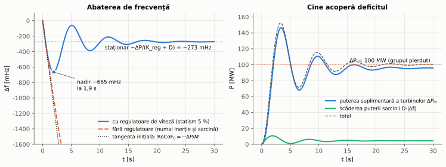
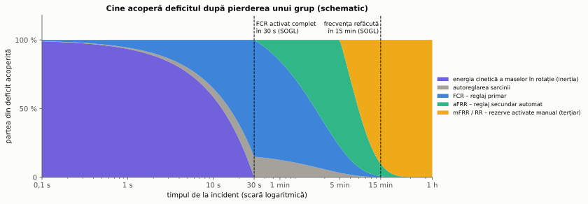
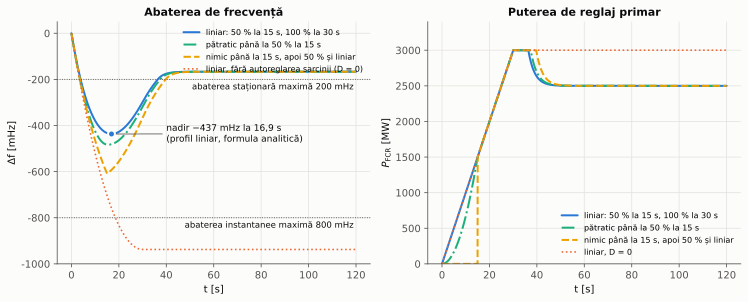
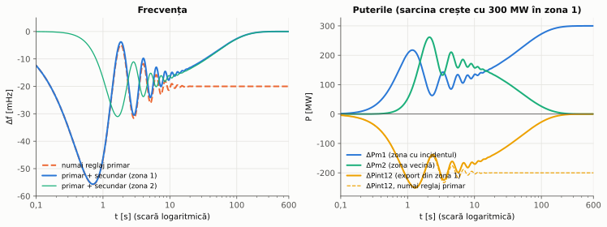
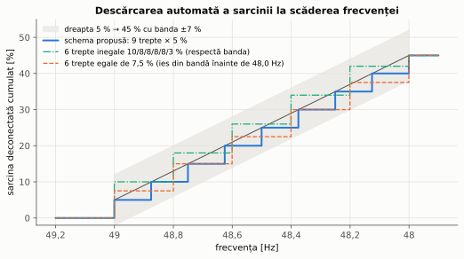
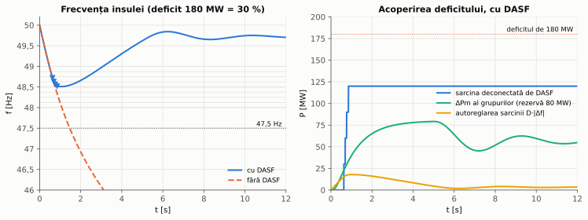
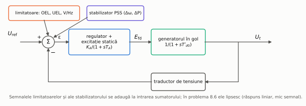
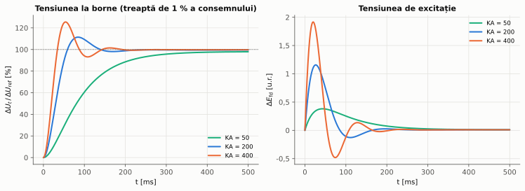
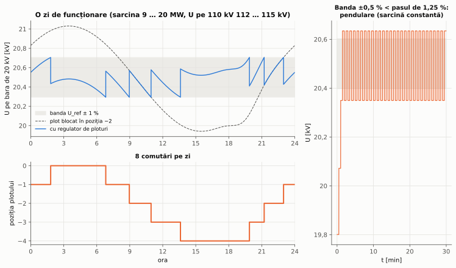

# Capitolul 8. Reglajul automat al frecvenței și al tensiunii

> **Obiective.** După acest capitol ar trebui să puteți: (1) lega abaterea de frecvență de dezechilibrul dintre producție și consum și de inerția sistemului (viteza inițială de variație a frecvenței, nadirul); (2) calcula abaterea staționară de frecvență din statismul regulatoarelor și din autoreglarea sarcinii; (3) descrie reglajul primar, secundar și terțiar și valorile impuse în Europa continentală de Regulamentul (UE) 2017/1485; (4) explica eroarea de reglaj a zonei (ACE) și de ce reglajul secundar face ca zona cu dezechilibrul să-și acopere singură deficitul; (5) proiecta o schemă de descărcare automată a sarcinii la scăderea frecvenței (DASF) care respectă Regulamentul (UE) 2017/2196 și să o verificați prin simulare; (6) analiza bucla de reglaj automat al tensiunii unui generator (eroare staționară, suprareglare, limitatoare, stabilizator); (7) alege banda de insensibilitate și temporizarea regulatorului de ploturi al unui transformator și să explicați compensarea căderii de tensiune.

Capitolele 3–7 au tratat **defectele**: fenomene rapide, eliminate prin deconectare. Acest capitol tratează **reglajul continuu** al celor două mărimi care caracterizează calitatea funcționării sistemului: **frecvența**, comună întregului sistem sincron și determinată de echilibrul puterilor active, și **tensiunea**, locală și legată în principal de circulația puterii reactive. Funcțiile de protecție asociate sunt releul de frecvență (codul 81, cu variantele 81U, 81O și 81R) și dispozitivul de reglaj (codul 90), din tabelul codurilor IEEE C37.2 (§ 0.6).

Toate rezultatele numerice din capitol sunt calculate și verificate de scriptul [`scripts/probleme_cap08.py`](scripts/probleme_cap08.py), cu modelele din [`scripts/calcul_cap08.py`](scripts/calcul_cap08.py); figurile sunt produse de [`scripts/figuri_cap08.py`](scripts/figuri_cap08.py) din aceleași modele.

---

## 8.1. Echilibrul puterilor și frecvența

Toate generatoarele sincrone ale unui sistem interconectat se rotesc cu aceeași viteză electrică; frecvența rețelei este măsura ei. Energia cinetică a maselor în rotație (rotoare de generatoare, turbine, motoare) se scrie cu **constanta de inerție** $H$ (energia cinetică la viteza nominală raportată la puterea nominală, în secunde): $E_c = H\thinspace S$. Când puterea mecanică a turbinelor diferă de puterea cerută de consumatori, diferența este luată din (sau stocată în) energia cinetică, iar viteza – deci frecvența – variază. Liniarizând în jurul frecvenței nominale $f_0$ și considerând toate generatoarele legate rigid între ele (modelul „cu o singură bară” [17]):

$$\boxed{M\thinspace \frac{d\Delta f}{dt} = \Delta P_m - \Delta P - D\thinspace \Delta f, \qquad M = \frac{2\thinspace H\thinspace S}{f_0}\ \ [\text{MW·s/Hz}]}$$

unde $\Delta P$ este dezechilibrul (de exemplu puterea grupului pierdut), $\Delta P_m$ creșterea puterii turbinelor produsă de regulatoarele de viteză, iar $D\thinspace\Delta f$ **autoreglarea sarcinii**: motoarele și o parte din ceilalți consumatori absorb mai puțină putere când frecvența scade ($D$ în MW/Hz).

**Primele momente.** Imediat după incident, regulatoarele nu au reacționat încă și $\Delta f = 0$, deci frecvența începe să scadă cu viteza

$$\boxed{\text{RoCoF}_0 = \left.\frac{d\Delta f}{dt}\right|_{t=0^+} = -\frac{\Delta P}{M}}$$

(în engleză *rate of change of frequency*, RoCoF). Ea depinde **numai de inerție**: un sistem cu multe generatoare racordate prin convertoare (eoliene, fotovoltaice), care nu au mase legate sincron de rețea, are un $M$ mai mic și un RoCoF mai mare la același dezechilibru.

**Fără regulatoare**, frecvența ar tinde exponențial, cu constanta de timp $M/D$, spre $\Delta f = -\Delta P/D$. În problema 8.1 aceasta înseamnă −6,25 Hz – o valoare la care sistemul s-ar prăbuși mult înainte (figura 8.1, linia întreruptă). Echilibrul trebuie refăcut de turbine.

*Figura 8.1 – Sistemul izolat din problema 8.1 după pierderea unui grup de 100 MW: abaterea de frecvență cu și fără regulatoare de viteză (stânga) și contribuțiile care acoperă deficitul (dreapta). Punctul cel mai de jos al curbei se numește **nadir**.*

## 8.2. Regulatorul de viteză. Statismul și caracteristica rețelei

Regulatorul de viteză al unei turbine deschide vana (de abur, de gaze sau de apă) când frecvența scade. El are o caracteristică cu **statism** $s$ (în engleză *droop*): la o abatere de frecvență egală cu $s\thinspace f_0$, puterea crește cu puterea nominală $P_n$ a grupului. Pentru un grup sau un ansamblu de grupuri:

$$\Delta P_m = -K\thinspace \Delta f, \qquad K = \frac{P_n}{s\thinspace f_0}\ \ [\text{MW/Hz}].$$

Ansamblul format de regulatoare și de sarcină are deci, în regim staționar, o **caracteristică putere–frecvență** $\lambda = K + D$, iar abaterea staționară după un dezechilibru $\Delta P$ este

$$\boxed{\Delta f_{st} = -\frac{\Delta P}{K + D}}$$

Ea nu depinde de inerție și nici de constantele de timp ale turbinelor. Acestea determină însă **drumul** până acolo: nadirul și momentul lui. În problema 8.1, cu aceleași regulatoare și aceeași abatere staționară de −273,2 mHz, nadirul este −422 mHz cu o turbină rapidă ($T_t$ = 0,5 s), −665 mHz cu $T_t$ = 2 s și −931 mHz cu $T_t$ = 5 s. Statismul face ca o creștere a sarcinii să fie împărțită între grupuri proporțional cu $P_n/s$, deci previzibil; abaterea de frecvență rămâne însă nenulă până la intervenția reglajului secundar (§ 8.3).

Regulatoarele reale au și o **bandă moartă** (zonă în care nu reacționează intenționat) și o **insensibilitate** (abaterea minimă pe care o pot sesiza). Pentru grupurile racordate la rețea, Regulamentul (UE) 2016/631 (RfG) [S18] cere, pentru modul de reglaj sensibil la frecvență (FSM), un statism reglabil între 2 % și 12 %, o bandă moartă reglabilă între 0 și 500 mHz și o insensibilitate între 10 și 30 mHz. Pentru reglajul limitat la creșterea frecvenței (LFSM-O), operatorul de transport alege pragul între 50,2 Hz și 50,5 Hz și statismul între 2 % și 12 %. Valorile concrete se stabilesc de operatorul de transport (nu sunt valori implicite ale regulamentului).

## 8.3. Reglajul primar, secundar și terțiar

Reglajul frecvenței este organizat pe niveluri care se succed în timp (figura 8.2):

- **Reglajul primar** – rezerva pentru stabilizarea frecvenței (în engleză *frequency containment reserve*, FCR): acțiunea proporțională a regulatoarelor de viteză din § 8.2, în câteva secunde. El **oprește căderea** frecvenței, dar lasă o abatere staționară. Toate grupurile din sistemul sincron participă, nu doar cele din zona în care a apărut dezechilibrul.
- **Reglajul secundar automat** – rezerva de restabilire a frecvenței cu activare automată (*automatic frequency restoration reserve*, aFRR): un regulator central, cu acțiune integrală, al fiecărei zone de reglaj (§ 8.4). El **readuce frecvența** la valoarea nominală și **schimburile** dintre zone la valorile programate, eliberând rezerva primară.
- **Reglajul terțiar** – rezervele de restabilire activate manual (mFRR) și rezervele de înlocuire (RR): repornirea sau redispecerizarea grupurilor, care eliberează la rândul ei rezerva secundară, pentru incidentul următor.

*Figura 8.2 – Schematic: partea din deficit acoperită de fiecare mecanism după pierderea unui grup. Proporțiile sunt ilustrative; singurele valori numerice (30 s și 15 min) sunt cele din tabelul de mai jos.*

Pentru zona sincronă **Europa continentală** (din care face parte și sistemul României), Regulamentul (UE) 2017/1485 (SOGL) [S16] fixează valorile din tabel.

| Mărime (Europa continentală) | Valoare |
|---|---|
| domeniul standard al frecvenței | ±50 mHz |
| abaterea instantanee maximă a frecvenței | 800 mHz |
| abaterea staționară maximă a frecvenței | 200 mHz |
| timpul de restabilire a frecvenței | 15 min |
| timpul după care se declanșează starea de alertă | 5 min |
| incidentul de referință (dimensionarea FCR) | 3000 MW, în ambele sensuri |
| activarea completă a FCR | la o abatere de ±200 mHz, în cel mult 30 s (cel puțin 50 % în 15 s) |
| precizia minimă a măsurării frecvenței pentru FCR | 10 mHz |
| insensibilitatea plus banda moartă intenționată (FCR) | cel mult 10 mHz |

Din primele valori rezultă direct **caracteristica minimă** a reglajului primar: 3000 MW la 200 mHz, adică 15 000 MW/Hz pentru întreaga Europă continentală. Problema 8.2 calculează, pe un model agregat, abaterea staționară și nadirul la incidentul de referință, cu cea mai lentă activare a FCR admisă (creștere liniară, 100 % în 30 s). Rezultatele sunt în figura 8.3: nadirul este −437 mHz la 16,9 s, iar abaterea staționară −166,7 mHz, deci ambele limite din tabel sunt respectate. Același calcul fără autoreglarea sarcinii ($D = 0$) dă −937,5 mHz. Respectarea limitei de 800 mHz se bazează deci și pe inerție, pe autoreglarea sarcinii și pe faptul că FCR reală este, de regulă, mai rapidă decât minimul cerut.

*Figura 8.3 – Răspunsul modelului agregat al Europei continentale la pierderea a 3000 MW (problema 8.2), cu FCR activată liniar în 30 s.*

## 8.4. Reglajul secundar în sistemele interconectate

Un sistem sincron mare este împărțit în **zone de reglaj**, legate prin linii de interconexiune; fiecare zonă are un program de schimb cu vecinii. Regulatorul secundar al zonei $i$ calculează **eroarea de reglaj a zonei** (în engleză *area control error*, ACE):

$$\boxed{ACE_i = \Delta P_{int,i} + K_i\thinspace \Delta f}$$

unde $\Delta P_{int,i}$ este abaterea exportului net al zonei față de program, iar $K_i$ – factorul de influență a frecvenței al zonei (MW/Hz). Regulatorul are acțiune **integrală**: modifică consemnele grupurilor din zona lui cu $\Delta P_{c,i} = -K_I\int ACE_i\thinspace dt$, până când $ACE_i = 0$. Comenzile ajung la grupuri prin sistemul de teleconducere al operatorului de transport (capitolul 9).

**De ce corectează numai zona cu dezechilibrul.** Să presupunem că sarcina crește cu $\Delta P_{L1}$ în zona 1. După reglajul primar, ambele zone au aceeași abatere $\Delta f = -\Delta P_{L1}/(\beta_1 + \beta_2)$, cu $\beta_i = K_{reg,i} + D_i$ caracteristicile naturale ale zonelor. Zona 2 ajută zona 1 cu $\Delta P_{int,12} = -\beta_2\thinspace\Delta P_{L1}/(\beta_1 + \beta_2)$ (exportul zonei 1 scade). Dacă factorul $K_i$ este ales egal cu $\beta_i$:

$$ACE_2 = -\Delta P_{int,12} + \beta_2\thinspace\Delta f = \frac{\beta_2\thinspace\Delta P_{L1}}{\beta_1 + \beta_2} - \frac{\beta_2\thinspace\Delta P_{L1}}{\beta_1 + \beta_2} = 0, \qquad ACE_1 = \Delta P_{int,12} + \beta_1\thinspace\Delta f = -\Delta P_{L1}.$$

Regulatorul zonei 2 nu face nimic, iar cel al zonei 1 crește producția exact cu deficitul ei. Simularea din problema 8.4 confirmă acest raționament (figura 8.4).

*Figura 8.4 – Două zone interconectate după creșterea sarcinii cu 300 MW în zona 1 (problema 8.4): numai cu reglaj primar (linii întrerupte) și cu reglaj secundar (linii continue). Scara de timp este logaritmică, pentru a se vedea atât oscilația dintre zone din primele secunde, cât și acțiunea lentă a reglajului secundar.*

Linia de interconexiune face ca cele două zone să oscileze una față de cealaltă (un **mod interzonal**, de ordinul a 0,1–1 Hz). Amortizarea lui depinde de regulatoare, de turbine și de interconexiune. În modelul din problema 8.4, cu turbine mai lente ($T_t$ = 1 s) și o interconexiune de două ori mai puternică, modul devine instabil. Modelul este simplificat, dar arată de ce reglajele zonelor nu se pot proiecta izolat.

## 8.5. Descărcarea automată a sarcinii la scăderea frecvenței (DASF)

Rezervele din § 8.3 sunt dimensionate pentru incidentul de referință. La un dezechilibru mult mai mare – tipic la **separarea în insulă** a unei zone care importa putere –, regulatoarele ajung la limita rezervei, iar frecvența continuă să scadă. Ultima măsură este **descărcarea automată a sarcinii la scăderea frecvenței** (DASF; în engleză *low frequency demand disconnection*, LFDD): relee de frecvență minimă (81U) deconectează în trepte fidere de consumatori.

Pentru Europa continentală, Regulamentul (UE) 2017/2196 (NC ER) [S17] cere:

| Cerință (Europa continentală) | Valoare |
|---|---|
| frecvența primei trepte obligatorii | 49,0 Hz |
| sarcina deconectată la această frecvență | 5 % din sarcina totală (la nivel național) |
| frecvența ultimei trepte obligatorii | 48,0 Hz |
| sarcina deconectată cumulat până la această frecvență | 45 % |
| banda de implementare | ±7 % din sarcina totală, pentru o frecvență dată |
| numărul minim de trepte până la ultima treaptă | 6 |
| sarcina maximă deconectată de o treaptă | 10 % |

În acest curs, **banda de implementare** este interpretată astfel: la orice frecvență între 49,0 Hz și 48,0 Hz, sarcina deconectată cumulat trebuie să se abată cu cel mult 7 puncte procentuale de la dreapta care unește punctele (49,0 Hz; 5 %) și (48,0 Hz; 45 %). Formularea exactă trebuie citită în anexa regulamentului.

**Proiectarea schemei.** Scara treptelor se abate cel mai mult de la dreaptă chiar la praguri: imediat după acționarea unei trepte (în sus) și imediat înaintea ei (în jos). Cu numărul minim de 6 trepte, la câte 0,2 Hz, contează cum se împart cele 45 % (figura 8.5). Șase trepte **egale** de 7,5 % ies din bandă: chiar înainte de 48,0 Hz scara rămâne cu 7,5 puncte sub dreaptă. Șase trepte **inegale**, de 10, 8, 8, 8, 8 și 3 %, respectă toate condițiile: scara oscilează între +5 și −3 puncte față de dreaptă. Schema aleasă în problema 8.3 are **9 trepte egale de 5 %**, la fiecare 0,125 Hz între 49,0 Hz și 48,0 Hz. Abaterea ei maximă este tot de 5 puncte, dar o treaptă mică deconectează în plus, cel mult, puțină sarcină față de cât era nevoie. În insula din problema 8.3, schema 9 × 5 % deconectează 120 MW, cu 20 MW peste minimul necesar, iar schema cu 6 trepte inegale deconectează 156 MW, cu 56 MW peste minim. Fiecare treaptă are o temporizare scurtă, care evită acționările la variații tranzitorii, iar un releu 81R (după viteza de variație a frecvenței) poate grăbi primele trepte la dezechilibre mari.

*Figura 8.5 – Sarcina deconectată cumulat în funcție de frecvență, față de dreapta 5 % → 45 % și banda de ±7 % (interpretarea din text): schema aleasă (9 × 5 %), o schemă cu 6 trepte inegale care respectă banda și una cu 6 trepte egale de 7,5 % care iese din bandă chiar înainte de 48,0 Hz. Axa frecvenței este inversată: frecvența scade spre dreapta.*

În România, treptele concrete sunt stabilite de operatorul de transport printr-un normativ propriu (DASf). Transelectrica a prezentat în 2016 o actualizare a „Normativului DAS-fmin”. Valorile acestui normativ nu sunt reproduse aici, pentru că nu au putut fi verificate dintr-o a doua sursă.

**Simularea.** Figura 8.6 arată insula din problema 8.3 (sarcina 600 MW, deficit 180 MW, rezervă 80 MW). Fără DASF, frecvența scade sub 47,5 Hz după 1,47 s. Cu DASF acționează 4 trepte (120 MW), minimul este 48,51 Hz, iar frecvența se stabilizează la 49,717 Hz. Restul abaterii este preluat de reglajul secundar și de măsurile manuale.

*Figura 8.6 – Insula din problema 8.3: frecvența cu și fără DASF (stânga; triunghiurile marchează deconectarea treptelor) și puterile care acoperă deficitul în cazul cu DASF (dreapta).*

**Legătura cu cerințele pentru generatoare.** DASF trebuie să oprească scăderea frecvenței înainte ca generatoarele să aibă voie să se deconecteze. Pentru Europa continentală, RfG [S18] cere ca grupurile să rămână conectate:

| Domeniul de frecvență | Durata minimă de funcționare |
|---|---|
| 47,5 – 48,5 Hz | stabilită de operatorul de transport, cel puțin 30 min |
| 48,5 – 49,0 Hz | stabilită de operatorul de transport, cel puțin cât pentru 47,5 – 48,5 Hz |
| 49,0 – 51,0 Hz | nelimitată |
| 51,0 – 51,5 Hz | 30 min |

(Tabelul a fost confirmat indirect, din tabelele identice ale codurilor de racordare a consumatorilor și a sistemelor HVDC; textul RfG nu a putut fi citit direct.) Sub 47,5 Hz, deconectarea generatoarelor nu mai este interzisă și poate porni o avarie în cascadă. Tot RfG cere ca grupurile să rămână conectate până la o viteză de variație a frecvenței (RoCoF) stabilită de operatorul de transport; regulamentul nu fixează valoarea.

## 8.6. Reglajul automat al tensiunii generatoarelor

Tensiunea la bornele unui generator sincron se reglează prin **curentul de excitație** (generatorul G1 este descris în § 0.7 și în capitolul 6). Regulatorul automat de tensiune (în engleză *automatic voltage regulator*, AVR) compară tensiunea la borne cu consemnul și comandă **sistemul de excitație**. Acesta poate fi **static** (un redresor cu tiristoare alimentat de la bornele generatorului printr-un transformator, care alimentează înfășurarea de excitație prin inele și perii) sau **fără perii** (o excitatoare de curent alternativ pe același arbore, cu diode rotative). Figura 8.7 este schema bloc folosită în problema 8.6: generatorul în gol, cu constanta de timp tranzitorie $T'_{d0}$, și o excitație statică cu câștigul $K_A$ și constanta de timp mică $T_A$.

*Figura 8.7 – Bucla de reglaj automat al tensiunii unui generator în gol, cu intrările limitatoarelor și ale stabilizatorului de sistem.*

Funcția de transfer în buclă închisă și **eroarea staționară** la o treaptă a consemnului sunt

$$\frac{\Delta U_t}{\Delta U_{ref}} = \frac{K_A}{(1 + sT_A)(1 + sT'_{d0}) + K_A}, \qquad \boxed{\varepsilon_{st} = \frac{1}{1 + K_A}}$$

Un câștig mare reduce eroarea și face răspunsul mai rapid, dar micșorează amortizarea: sistemul de ordinul 2 are $\omega_n = \sqrt{(1 + K_A)/(T_A T'_{d0})}$ și $\zeta = (T_A + T'_{d0})/\left(2\sqrt{T_A T'_{d0}(1 + K_A)}\right)$. Pentru G1 ($T'_{d0}$ = 5 s), cu $T_A$ = 0,02 s, eroarea scade de la 1,96 % ($K_A$ = 50, răspuns aperiodic) la 0,25 % ($K_A$ = 400), iar suprareglarea crește de la 0 la 25,8 % (problema 8.6, figura 8.8). Fără regulator, tensiunea ar urma o schimbare a excitației cu constanta de timp de 5 s; cu regulator, primul vârf apare după zeci de milisecunde.

*Figura 8.8 – Răspunsul la o treaptă de 1 % a consemnului de tensiune, pentru trei valori ale câștigului (problema 8.6).*

Pe lângă bucla principală, regulatoarele de tensiune au funcții suplimentare [17]:

- **limitatorul de supraexcitație** (OEL) limitează curentul de excitație, ca să nu supraîncălzească înfășurarea rotorului;
- **limitatorul de subexcitație** (UEL) împiedică funcționarea cu excitație prea mică, la care se pierde stabilitatea sau se încălzesc capetele statorului (limitele diagramei de capabilitate P–Q; vezi și protecția la pierderea excitației, capitolul 6);
- **limitatorul V/Hz** protejează generatorul și transformatorul bloc de supraexcitarea miezului magnetic la tensiune mare și frecvență mică;
- **stabilizatorul de sistem** (PSS, *power system stabilizer*) adaugă la intrarea regulatorului un semnal derivat din abaterea vitezei sau a puterii. Scopul lui este amortizarea oscilațiilor electromecanice, pe care o excitație rapidă cu câștig mare le poate amortiza mai slab;
- **compensarea curentului reactiv** (statismul de tensiune) împarte puterea reactivă între generatoarele care funcționează în paralel pe aceeași bară.

## 8.7. Reglajul sub sarcină al transformatoarelor (ANSI 90)

Transformatoarele care alimentează rețelele de distribuție (de exemplu T1, 110/20 kV) au un **comutator de ploturi sub sarcină**: el modifică numărul de spire al înfășurării de înaltă tensiune fără întreruperea curentului. În problema 8.5, T1 are 17 poziții, $110 \pm 8 \times 1{,}25\ \%$ / 20 kV. **Regulatorul automat de ploturi** (codul 90) urmărește tensiunea pe bara de 20 kV și dă comenzi de schimbare a plotului după trei reguli:

1. **Banda de insensibilitate** $U_{ref} \pm b$: în interiorul ei nu se comandă nimic.
2. **Temporizarea** $T$: comanda se dă numai dacă tensiunea rămâne în afara benzii timp de $T$ secunde. Astfel nu se reacționează la variațiile scurte (porniri de motoare, defecte eliminate rapid). Temporizatorul se resetează când tensiunea revine în bandă.
3. **Un plot o dată**: după fiecare comutare tensiunea se măsoară din nou.

**Lățimea benzii.** O comutare schimbă tensiunea cu aproximativ un pas, $\Delta u_{pas}$ (1,14–1,37 % pentru T1). Dacă lățimea benzii este mai mică decât pasul, tensiunea sare dintr-o parte în cealaltă a benzii și regulatorul **pendulează** la nesfârșit. Condiția de funcționare corectă este

$$\boxed{2\thinspace b > \Delta u_{pas}}$$

Problema 8.5 o verifică prin simulare: cu $b$ = ±0,5 % regulatorul face 120 de comutări într-o oră la sarcină constantă, iar cu $b$ = ±1 % nu mai comută după reglajul inițial. Într-o zi întreagă, cu $b$ = ±1 % și $T$ = 30 s, regulatorul face 8 comutări și ține tensiunea în bandă 99,72 % din timp (figura 8.9).

*Figura 8.9 – Regulatorul de ploturi al lui T1 (problema 8.5): tensiunea pe bara de 20 kV într-o zi, cu regulator și cu plotul blocat (stânga sus), poziția plotului (stânga jos) și pendularea cu o bandă prea îngustă (dreapta).*

**Compensarea căderii de tensiune** (în engleză *line drop compensation*, LDC). Consumatorii sunt la capătul fiderelor, nu pe bara stației. Regulatorul poate estima tensiunea dintr-un punct al rețelei („centrul de sarcină”) din tensiunea și curentul măsurate în stație:

$$U_{reg} = \left|\underline{U}_{bară} - \sqrt3\thinspace \underline{Z}_c\thinspace \underline{I}\right|$$

cu $\underline{Z}_c$ impedanța echivalentă până în centrul de sarcină (pe fază). La sarcină mare regulatorul ridică astfel tensiunea pe bară. În problema 8.5, compensarea completă ține tensiunea centrului de sarcină în bandă 99,6 % din timp, față de 0 % fără compensare. Tensiunea pe bară urcă însă până la 21,85 kV, ceea ce poate fi prea mult pentru consumatorii apropiați de stație. De aceea compensarea se reglează de obicei doar parțial.

**Transformatoare în cascadă și stabilitatea tensiunii.** Când mai multe transformatoare cu ploturi sunt în serie (de exemplu 400/110 kV și 110/20 kV), temporizările se coordonează astfel încât să acționeze întâi regulatorul din amonte. Altfel, cel din aval ar corecta o abatere pe care cel din amonte o corectează oricum, iar comutările ar fi inutile sau de sens contrar. În plus, la o rețea de transport slăbită, refacerea tensiunii la consumatori de către regulatoarele de ploturi reface și puterea absorbită de sarcină, ceea ce poate agrava o **instabilitate de tensiune** [17]. Pentru acest caz, regulatoarele pot fi blocate la tensiune foarte mică.

## 8.8. Compensarea automată a puterii reactive

Bateriile de condensatoare din stații se conectează în trepte, de către un regulator de putere reactivă (sau de tensiune ori de factor de putere). Regulile sunt aceleași ca la ploturi: o bandă mai largă decât efectul unei trepte, ca să nu existe pendulare, și o temporizare. O treaptă de 2 Mvar pe bara B2 ridică tensiunea cu 1,06 % (problema 8.5 e), deci este compatibilă cu banda de ±1 % a regulatorului de ploturi. În plus, o treaptă deconectată nu se reconectează până nu s-a descărcat condensatorul: reconectarea unui condensator încărcat, în opoziție de fază cu rețeaua, produce curenți și supratensiuni mari.

---

## Probleme rezolvate

### Problema 8.1 – Pierderea unui grup într-un sistem izolat

Într-un sistem izolat, după pierderea unui grup care producea **100 MW**, grupurile rămase au puterea nominală totală de 875 MW, constanta de inerție $H$ = 5 s (raportată la 875 MW) și statismul 5 %. Regulatoarele și turbinele sunt modelate prin două întârzieri de ordinul întâi, $T_g$ = 0,2 s și $T_t$ = 2 s. Sarcina are autoreglarea $D$ = 16 MW/Hz (dată de problemă). Calculați RoCoF inițial, abaterea staționară cu și fără regulatoare, nadirul și influența constantei de timp a turbinei.

**Rezolvare.** $M = 2\cdot 5\cdot 875/50$ = 175 MW·s/Hz, $K = 875/(0{,}05\cdot 50)$ = 350 MW/Hz.

- $\text{RoCoF}_0 = -100/175$ = **−0,571 Hz/s**. Media pe primele 500 ms (de exemplu, valoarea măsurată de un releu 81R cu o fereastră de 500 ms) este −0,550 Hz/s: regulatoarele și autoreglarea sarcinii încep deja să frâneze căderea.
- Cu regulatoare: $\Delta f_{st} = -100/(350 + 16)$ = **−273,2 mHz**. Turbinele dau 95,6 MW, iar sarcina scade cu 16 · 0,2732 = 4,4 MW.
- Fără regulatoare: $\Delta f \to -100/16$ = −6,25 Hz, cu constanta de timp $M/D$ = 10,94 s; după 10 s abaterea ar fi deja −3,74 Hz.
- Nadirul (simulare): **−664,5 mHz la 1,90 s**. Cu $T_t$ = 0,5 s nadirul ar fi −422 mHz (la 1,22 s), iar cu $T_t$ = 5 s −931 mHz (la 2,71 s); abaterea staționară rămâne −273,2 mHz în toate cazurile (figura 8.1).

**Verificare.** Ecuațiile de stare sunt integrate numeric (`solve_ivp`), iar separat se calculează răspunsul la treaptă al funcției de transfer $\Delta f(s)/\Delta P(s) = -(1+sT_g)(1+sT_t)/[(Ms + D)(1+sT_g)(1+sT_t) + K]$ (`scipy.signal`). Cele două dau același nadir (−664,5 mHz la 1,90 s) ✓. Panta din primul pas al integrării este −0,5712 Hz/s, față de −0,5714 Hz/s analitic ✓. Valoarea finală simulată este −273,2 mHz ✓, puterea finală a turbinelor este egală cu $K\thinspace|\Delta f|$ ✓, iar fără regulatoare $\Delta f(10\ \text{s})$ simulat coincide cu $-\dfrac{\Delta P}{D}\left(1 - e^{-10D/M}\right)$ = −3,74 Hz ✓.

### Problema 8.2 – Incidentul de referință în Europa continentală

Pierderea a **3000 MW** (incidentul de referință din SOGL) se studiază pe un model agregat al Europei continentale cu sarcina de 300 GW, $H$ = 4 s raportat la 300 GW și autoreglarea sarcinii de 1 % pe Hz, adică $D$ = 3000 MW/Hz (date alese pentru problemă). Reglajul primar livrează 3000 MW la 200 mHz și crește cu viteza minimă admisă: liniar, 100 % în 30 s. Calculați abaterea staționară și nadirul și verificați limitele de 200 mHz și 800 mHz.

**Rezolvare.** Caracteristica FCR: $\lambda$ = 3000 MW / 0,2 Hz = 15 000 MW/Hz; $M = 2\cdot 4\cdot 300\,000/50$ = 48 000 MW·s/Hz; RoCoF inițial = −3000/48 000 = −62,5 mHz/s.

- Regim staționar: $\Delta f = -3000/(15\,000 + 3000)$ = **−166,7 mHz** (FCR livrează 2500 MW, sarcina scade cu 500 MW).
- Până la nadir, FCR este limitată de viteza $r$ = 100 MW/s, deci $M\thinspace d\Delta f/dt = -\Delta P + r\thinspace t - D\thinspace \Delta f$. Soluția este $\Delta f(t) = A(1 - e^{-at}) + B\thinspace t$, cu $a = D/M$, $B = r/D$, $A = -\Delta P/D - rM/D^2$. Minimul este la $e^{-at^\ast} = -B/(Aa)$: $t^\ast$ = 16,90 s și **$\Delta f_{min}$ = −436,8 mHz**.
- La 15 s FCR livrează 1500 MW (50 %), exact minimul cerut.

Ambele limite sunt respectate: 166,7 mHz < 200 mHz și 436,8 mHz < 800 mHz (figura 8.3).

Fără autoreglarea sarcinii ($D$ = 0), frecvența coboară cât timp FCR crește. După 30 s, FCR egalează deficitul și frecvența se oprește la $\Delta f = -(\Delta P\thinspace T - rT^2/2)/M$ = **−937,5 mHz**. Ea rămâne acolo, pentru că FCR este saturată exact la valoarea deficitului. Limita de 800 mHz ar fi depășită.

**Verificare.** Simularea cu pas fix (Runge–Kutta de ordinul 4, cu FCR limitată de viteză și de valoarea maximă) dă nadirul −436,8 mHz la 16,90 s ✓ și valoarea finală −166,7 mHz ✓. Scriptul verifică și că la $t^\ast$ FCR este încă limitată de viteză, condiția în care formula analitică este valabilă ✓. Pentru $D$ = 0, simularea dă −937,6 mHz la 30 s și aceeași valoare la 200 s ✓.

### Problema 8.3 – Descărcarea automată a sarcinii într-o insulă

O zonă cu sarcina de **600 MW** se separă în insulă și pierde importul de **180 MW** (30 % din sarcină). Grupurile din insulă au 500 MW, $H$ = 4 s, statism 5 %, $T_g$ = 0,2 s, $T_t$ = 1 s și numai 80 MW rezervă. Autoreglarea sarcinii este $D$ = 12 MW/Hz (2 % pe Hz; dată de problemă). Proiectați o schemă DASF conformă cu NC ER și simulați funcționarea; fiecare treaptă deconectează sarcina la 0,15 s după ce frecvența a scăzut sub prag (releu + întrerupător).

**Rezolvare.** Schema: 9 trepte de câte 5 % (30 MW), la 49,000; 48,875; 48,750; …; 48,000 Hz. Condițiile NC ER: prima treaptă la 49,0 Hz cu 5 % ✓; 45 % cumulat la 48,0 Hz ✓; 9 ≥ 6 trepte ✓; 5 % ≤ 10 % pe treaptă ✓; abaterea maximă față de dreapta 5 % → 45 % este 5,00 puncte ≤ 7 ✓ (figura 8.5). Pentru comparație, cu 6 trepte la câte 0,2 Hz: 6 trepte egale de 7,5 % au abaterea maximă de 7,50 puncte și ies din bandă; 6 trepte de 10/8/8/8/8/3 % au abaterea maximă de 5,00 puncte și respectă toate condițiile.

Simularea ($M$ = 80 MW·s/Hz, RoCoF inițial −2,25 Hz/s):

| Treapta | Prag | Deconectare la |
|---|---|---|
| 1 | 49,000 Hz | 0,624 s |
| 2 | 48,875 Hz | 0,690 s |
| 3 | 48,750 Hz | 0,759 s |
| 4 | 48,625 Hz | 0,849 s |

Frecvența atinge 49,0 Hz la 0,474 s; minimul este **48,51 Hz** la 1,06 s. După deconectarea a 120 MW, deficitul rămas, 60 MW, este acoperit de regulatoare, nesaturate la noul echilibru, și de sarcină: $\Delta f = -60/(200 + 12)$ = −0,283 Hz, deci **$f$ = 49,717 Hz**. Fără DASF, frecvența trece de 47,5 Hz după 1,47 s, iar staționarul teoretic, cu regulatoarele saturate, ar fi $50 - (180 - 80)/12$ = 41,67 Hz: insula s-ar prăbuși. Cu schema de 6 trepte inegale ar acționa 3 trepte (156 MW): minimul ar fi 48,561 Hz, iar frecvența finală 49,887 Hz, dar s-ar deconecta 56 MW peste minimul necesar de 100 MW (deficitul minus rezerva), față de 20 MW cu schema aleasă.

**Verificare.** Abaterea maximă a fiecărei scheme este calculată pe două căi: exact, la praguri (imediat înainte și imediat după fiecare treaptă), și pe o grilă fină de frecvențe; rezultatele coincid (5,00; 7,50; 5,00 puncte) ✓. Frecvența finală simulată coincide cu cea calculată din numărul de trepte care au acționat, pentru ambele scheme (49,717 Hz și 49,887 Hz) ✓. Simularea fără DASF pe 120 s tinde spre 41,67 Hz ✓. Timpul estimat cu RoCoF constant până la 49,0 Hz (0,444 s) este, cum trebuie, mai mic decât cel simulat (0,474 s), pentru că regulatoarele și sarcina frânează căderea ✓.

### Problema 8.4 – Două zone interconectate

Zona 1 are grupuri de 12 GW, zona 2 de 24 GW, ambele cu $H$ = 5 s, statism 5 %, $T_g$ = 0,2 s și $T_t$ = 0,3 s. Autoreglarea sarcinii este $D_1$ = 200 MW/Hz și $D_2$ = 400 MW/Hz, iar interconexiunea are puterea sincronizantă $P_s$ = 1000 MW/rad. Factorii $K_i$ ai zonelor sunt egali cu caracteristicile naturale, iar regulatoarele secundare au câștigul integral $K_I$ = 0,02 s⁻¹. Sarcina zonei 1 crește cu **300 MW**. Calculați regimul după reglajul primar și după cel secundar.

**Rezolvare.** $\beta_1 = 12\,000/(0{,}05\cdot 50) + 200$ = 5000 MW/Hz și $\beta_2$ = 10 000 MW/Hz.

- După reglajul primar: $\Delta f = -300/15\,000$ = **−20,0 mHz** în ambele zone și $\Delta P_{int,12} = -300\cdot 10\,000/15\,000$ = **−200 MW**: zona 2 acoperă două treimi din deficit.
- După reglajul secundar (900 s simulate): $\Delta f$ = 0, $\Delta P_{int,12}$ = 0, iar producția zonei 1 a crescut cu exact 300 MW; zona 2 a revenit la puterea programată (figura 8.4). Abaterea de frecvență scade sub 1 mHz după 148 s. Nadirul în zona 1 este −55,4 mHz, la 0,75 s.

**Verificare.** Simularea numai cu reglaj primar dă $\Delta f_1 = \Delta f_2$ = −20,0 mHz și $\Delta P_{int,12}$ = −200,0 MW ✓. Cu reglaj secundar, valorile finale sunt cele așteptate ✓. Valorile proprii ale sistemului liniarizat au toate partea reală negativă (maximul este −0,0202 s⁻¹) ✓. Modelul interconexiunii este verificat separat, fără regulatoare: cu același raport $D/M$ în ambele zone, mișcarea relativă a zonelor este un oscilator cu $\sigma = -D/(2M)$ = −0,0417 s⁻¹ și $\omega = \sqrt{2\pi P_s(1/M_1 + 1/M_2) - \sigma^2}$ = 1,9812 rad/s, exact valorile proprii calculate ✓. Cu regulatoare, modul interzonal are 0,446 Hz și este bine amortizat ($\sigma$ = −0,324 s⁻¹). Cu $T_t$ = 1 s și $P_s$ = 2000 MW/rad, partea reală devine +0,0205 s⁻¹ (instabil) – contraexemplul din § 8.4 ✓.

### Problema 8.5 – Regulatorul de ploturi al transformatorului T1

T1 (25 MVA, 110/20 kV, $u_k$ = 11 %) are comutator de ploturi $110 \pm 8\times 1{,}25\ \%$ / 20 kV pe partea de înaltă tensiune. Sarcina de pe bara B2 are $\cos\varphi$ = 0,9. (a) Calculați tensiunea pe bară la 113 kV și 20 MW. (b) Alegeți banda regulatorului ($U_{ref}$ = 20,5 kV, $T$ = 30 s). (c) Simulați o zi. (d) Reglați compensarea căderii de tensiune până la un centru de sarcină echivalent cu patru fidere ca F1a în paralel. (e) Cât ridică tensiunea o treaptă de baterie de condensatoare de 2 Mvar?

**Rezolvare.**

(a) Raportată la 20 kV, impedanța lui T1 este $R_T$ = 0,0768 Ω, $X_T$ = 1,7583 Ω. Cu t.e.m. $E$ = 113/5,5 = 20,545 kV și sarcină de putere constantă, tensiunea $U_2$ este soluția ecuației bicuadratice

$$U_2^4 - \left[E^2 - 2(RP + XQ)\right]U_2^2 + (R^2 + X^2)(P^2 + Q^2) = 0 \ \Rightarrow\ U_2 = 19{,}518\ \text{kV}.$$

Formula aproximativă $\Delta U \approx (RP + XQ)/U$ dă 19,642 kV: ea neglijează componenta transversală a căderii de tensiune și greșește cu 0,63 %.

(b) Cu ploturile pe partea de înaltă tensiune, un plot schimbă tensiunea secundară cu $1 - (1 + p\thinspace n)/(1 + p(n+1))$, adică între **1,14 %** (la $n$ = +7) și **1,37 %** (la $n$ = −8). Banda trebuie să aibă lățimea peste 1,37 %: se alege **±1 %** (lățime 2 %). Cu ±0,5 % (lățime 1 %), simularea la sarcină constantă dă 120 de comutări într-o oră, dintre care 99 după primele 10 minute: pendulare. Cu ±1 % se fac 2 comutări, apoi niciuna.

(c) Pe parcursul unei zile, sarcina variază între 9,0 și 20,2 MW, iar tensiunea pe 110 kV între 112,0 și 115,0 kV. Regulatorul face **8 comutări** (plotul între −4 și 0) și ține tensiunea în bandă **99,72 %** din timp; abaterea maximă, de 1,01 %, apare doar în cele 30 s de temporizare. Cu plotul blocat (poziția −2), tensiunea ar varia între 19,941 și 21,031 kV, adică 5,32 % din $U_{ref}$ (figura 8.9).

(d) Centrul de sarcină: $\underline{Z}_l$ = (3 km de cablu + 7 km de LEA)/4 = 0,846 + j0,720 Ω; se alege $\underline{Z}_c = \underline{Z}_l$.

| | Tensiunea în centrul de sarcină | Timp în bandă | Comutări pe zi |
|---|---|---|---|
| fără compensare | 19,218 … 20,138 kV | 0,0 % | 8 |
| cu compensare | 20,293 … 20,709 kV | 99,6 % | 12 |

Cu compensare, tensiunea pe bara B2 variază între 20,875 și 21,854 kV.

(e) Impedanța Thevenin a rețelei la B2 (capitolul 1) are $X_{Th}$ = 2,099 Ω. Aproximativ, $\Delta U/U \approx Q\thinspace X/U^2$ = 2·10⁶ · 2,099/(20·10³)² = **1,05 %**; exact (divizorul de tensiune format de $\underline{Z}_{Th}$ și impedanța condensatorului) **1,061 %**.

**Verificare.** (a) Iterațiile pe ecuația fazorială $\underline{U} = \underline{E} - \underline{Z}\thinspace(\underline{S}/3\underline{U})^\ast$ dau aceeași tensiune ca ecuația bicuadratică ✓. (b) Pentru ambele benzi, simularea confirmă regula $2b > \Delta u_{pas}$ ✓. (c) Numărul de comutări numărate de regulator este egal cu numărul schimbărilor de poziție din înregistrare ✓. (d) Tensiunea estimată de regulator, $|\underline{U}_{bară} - \sqrt3\underline{Z}_c\underline{I}|$, coincide în fiecare secundă cu tensiunea calculată direct în centrul de sarcină ✓. (e) Rețeaua de referință rezolvată în coordonate de fază, cu condensatorul adăugat ca element, dă tot 1,061 % ✓.

### Problema 8.6 – Regulatorul de tensiune al generatorului G1

G1 funcționează în gol, cu $T'_{d0}$ = 5 s. Excitația statică are $T_A$ = 0,02 s. Comparați răspunsul la o treaptă de 1 % a consemnului pentru $K_A$ = 50, 200 și 400.

**Rezolvare.** Cu formulele din § 8.6:

| $K_A$ | $\omega_n$ [rad/s] | $\zeta$ | eroarea staționară | suprareglarea | timpul de vârf | 90 % din valoarea finală | $\Delta E_{fd}$ maxim |
|---|---|---|---|---|---|---|---|
| 50 | 22,6 | 1,111 | 1,96 % | 0 (aperiodic) | – | 198 ms | 0,38 u.r. |
| 200 | 44,8 | 0,560 | 0,50 % | 12,0 % | 85 ms | 50 ms | 1,16 u.r. |
| 400 | 63,3 | 0,396 | 0,25 % | 25,8 % | 54 ms | 31 ms | 1,92 u.r. |

Un câștig de ordinul sutelor dă o eroare sub 1 % și un răspuns de zeci de milisecunde, de o sută de ori mai rapid decât constanta de timp a generatorului. Prețul este o tensiune de excitație de vârf mult mai mare decât variația necesară în regim staționar ($\Delta E_{fd}$ final ≈ 0,01 u.r.): de 39, 116 și, respectiv, 192 de ori. Este nevoie deci de un sistem de excitație cu **plafon** mare. La treptele mari plafonul este atins și răspunsul nu mai este liniar.

**Verificare.** Pentru fiecare $K_A$, integrarea numerică a ecuațiilor (`solve_ivp`), răspunsul funcției de transfer (`scipy.signal`) și soluția analitică a sistemului de ordinul 2 (cu polii calculați din $T_AT'_{d0}s^2 + (T_A + T'_{d0})s + 1 + K_A = 0$) coincid în toate punctele, cu diferențe sub 10⁻⁷ u.r. ✓. Eroarea staționară simulată este egală cu $1/(1 + K_A)$ ✓. Suprareglarea și timpul de vârf simulate (12,0 % la 84 ms; 25,8 % la 54 ms) coincid cu formulele (12,0 % la 85 ms; 25,8 % la 54 ms) ✓. Pentru $K_A$ = 50 ($\zeta > 1$), simularea nu depășește valoarea finală ✓.

---

## Întrebări de autoevaluare

1. De ce frecvența este aceeași în tot sistemul sincron, iar tensiunea diferă de la o bară la alta?
   

Răspuns
Toate generatoarele sincrone se rotesc cu aceeași viteză electrică în regim staționar, deci frecvența este o mărime globală, determinată de echilibrul puterilor active din întregul sistem. Tensiunea depinde de căderile de tensiune pe elementele rețelei, deci de circulația locală a puterii reactive (și active), și se reglează local (§ 8.1, § 8.6–8.8).

2. De ce depinde viteza inițială de scădere a frecvenței după pierderea unui grup? De ce crește ea în sistemele cu multă producție din surse regenerabile?
   

Răspuns
$\text{RoCoF}_0 = -\Delta P/M$, cu $M = 2HS/f_0$: depinde numai de dezechilibru și de inerție. Sursele racordate prin convertoare (eoliene, fotovoltaice) nu au mase în rotație legate sincron de rețea, deci înlocuirea generatoarelor sincrone cu ele micșorează $M$ și mărește RoCoF la același dezechilibru (§ 8.1).

3. Ce determină abaterea staționară a frecvenței după reglajul primar și ce determină nadirul?
   

Răspuns
Abaterea staționară este $-\Delta P/(K + D)$: depinde de statismul regulatoarelor și de autoreglarea sarcinii, nu de inerție sau de constantele de timp. Nadirul depinde în plus de inerție și de cât de repede răspund regulatoarele și turbinele: în problema 8.1, cu aceeași abatere staționară de −273 mHz, nadirul variază de la −422 la −931 mHz când $T_t$ crește de la 0,5 la 5 s (§ 8.2).

4. Ce valori impune SOGL pentru Europa continentală privind abaterile de frecvență și activarea FCR?
   

Răspuns
Abaterea instantanee maximă de 800 mHz și abaterea staționară maximă de 200 mHz; incidentul de referință de 3000 MW; FCR activată complet la ±200 mHz în cel mult 30 s (cel puțin 50 % în 15 s); timpul de restabilire a frecvenței 15 min (§ 8.3).

5. De ce reglajul secundar trebuie să fie integral, iar cel primar este proporțional?
   

Răspuns
Reglajul primar trebuie să acționeze imediat și în toate grupurile din sistemul sincron, fără coordonare: o acțiune proporțională cu abaterea (statismul) împarte sarcina stabil între grupuri, dar lasă o abatere staționară. Reglajul secundar trebuie să anuleze abaterea (frecvența și schimburile revin la program), iar numai o acțiune integrală anulează eroarea în regim staționar (§ 8.3, § 8.4).

6. După o creștere de sarcină în zona 1, de ce nu reacționează regulatorul secundar al zonei 2, deși frecvența a scăzut și acolo?
   

Răspuns
Pentru că $ACE_2 = -\Delta P_{int,12} + K_2\Delta f$, iar ajutorul dat zonei 1 ($-\Delta P_{int,12}$, pozitiv) compensează exact termenul de frecvență ($K_2\Delta f$, negativ) când $K_2$ este egal cu caracteristica naturală a zonei 2. Zona 2 constată că abaterea de frecvență nu este cauzată de ea (§ 8.4, problema 8.4).

7. De ce este nevoie de DASF dacă există rezerve de reglaj primar și secundar?
   

Răspuns
Rezervele sunt dimensionate pentru incidentul de referință. La dezechilibre mult mai mari, mai ales la separarea în insulă a unei zone importatoare, regulatoarele ating limita rezervei și frecvența scade până la valori la care generatoarele se pot deconecta (sub 47,5 Hz), producând o avarie în cascadă. DASF reface echilibrul sacrificând o parte din consum (§ 8.5, problema 8.3).

8. De ce trebuie ca lățimea benzii regulatorului de ploturi să depășească efectul unui plot?
   

Răspuns
Altfel, după o comutare tensiunea trece din cealaltă parte a benzii, regulatorul comandă comutarea inversă după temporizare și așa mai departe: pendulare, cu uzura inutilă a comutatorului. În problema 8.5, cu o bandă de ±0,5 % și un pas de 1,14–1,37 %, au rezultat 120 de comutări într-o oră la sarcină constantă (§ 8.7).

9. Ce câștigă și ce pierde un regulator de tensiune cu câștig mai mare?
   

Răspuns
Câștigă o eroare staționară mai mică, $1/(1 + K_A)$, și un răspuns mai rapid. Pierde amortizare: suprareglarea crește (de la 0 la 25,8 % în problema 8.6), iar tensiunea de excitație cerută crește, deci și plafonul necesar al excitației. Excitațiile rapide cu câștig mare pot amortiza slab oscilațiile electromecanice, de aceea se completează cu un stabilizator de sistem (PSS) (§ 8.6).

10. Ce face compensarea căderii de tensiune (LDC) și care este riscul ei?
   

Răspuns
Regulatorul reglează tensiunea estimată într-un punct al rețelei (centrul de sarcină), calculată din tensiunea și curentul din stație, nu tensiunea de pe bară. Consumatorii au astfel o tensiune mai constantă. Riscul este o tensiune prea mare pe bara stației la sarcină mare (21,85 kV în problema 8.5), deci la consumatorii apropiați. De aceea compensarea se reglează adesea doar parțial (§ 8.7).

## Bibliografie

- [1] Alstom Grid – *Network Protection & Automation Guide*, 2011 (capitolul despre schemele de protecție a integrității sistemului).
- [7] W. A. Elmore (ed.) – *Protective Relaying: Theory and Applications*, ed. 2, Marcel Dekker, 2003 (descărcarea sarcinii și releele de frecvență).
- [15] S. Ștefănescu, R.-A. Tîrnovan – *Automatizări în sistemele electroenergetice – Curs*, U.T. Press, 2019 (DASF).
- [17] P. Kundur – *Power System Stability and Control*, McGraw-Hill, 1994 (reglajul frecvenței și al puterii active, sistemele de excitație, stabilitatea tensiunii).
- [S12] IEEE C37.2-2022 (codurile 81 și 90); [S16] Regulamentul (UE) 2017/1485 (SOGL); [S17] Regulamentul (UE) 2017/2196 (NC ER); [S18] Regulamentul (UE) 2016/631 (RfG).
