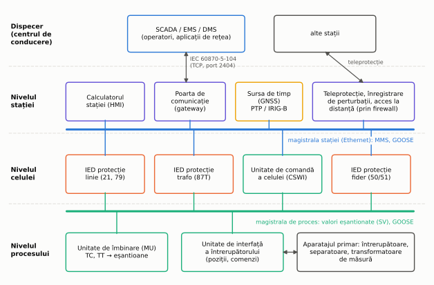
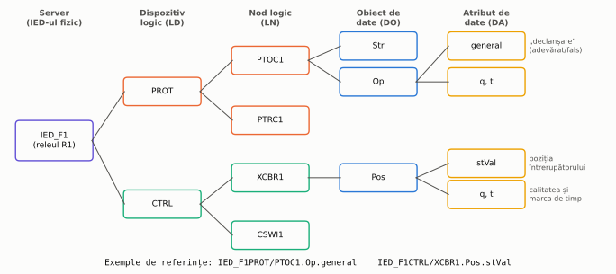
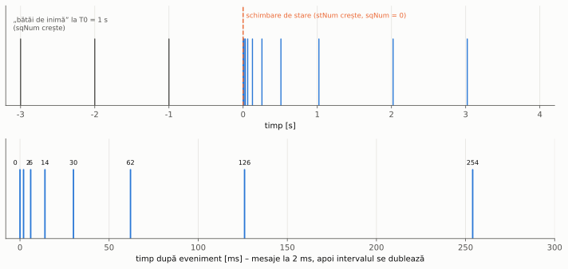
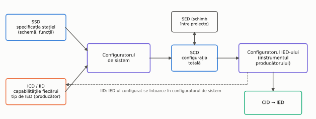
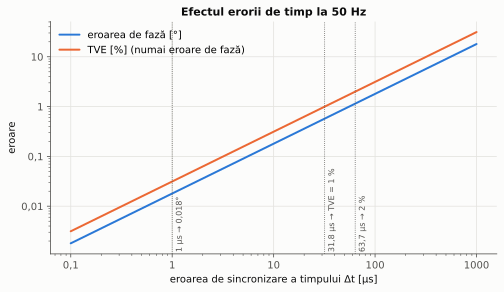
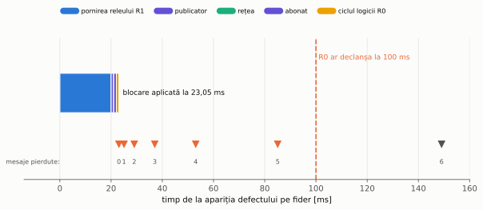

# Capitolul 9. Automatizarea stațiilor

> **Obiective.** După acest capitol ar trebui să puteți: (1) descrie nivelurile automatizării unei stații (proces, celulă, stație, dispecer) și rolul echipamentelor (RTU, IED, unitatea de comandă a celulei, calculatorul stației, poarta de comunicație, SCADA/EMS/DMS); (2) explica principiile teleconducerii cu IEC 60870-5-101/104; (3) descrie modelul de date, serviciile (MMS, GOOSE, valori eșantionate) și fluxul de inginerie (SCL) din IEC 61850; (4) calcula efectul unei erori de sincronizare a timpului asupra fazorilor și a protecțiilor diferențiale; (5) estima traficul de valori eșantionate și bugetul de timp al unui semnal GOOSE; (6) evalua disponibilitatea căilor de comunicație redundante și enunța principiile securității cibernetice.

În capitolele 2–8, protecțiile și automatizările au fost tratate ca funcții separate: un releu măsoară, decide și comandă un întrerupător. Într-o stație modernă, aceste funcții rulează în **echipamente electronice inteligente** (IED – *Intelligent Electronic Device*) legate între ele și cu dispecerul prin rețele de comunicație. Același IED care face protecția maximală a unui fider (capitolul 3) transmite poziția întrerupătorului spre dispecer, primește comenzi, marchează evenimentele în timp, înregistrează perturbațiile și schimbă semnale rapide cu alte IED-uri. Ghidul Alstom are un capitol dedicat stației digitale [1], iar cartea lui Brand, Lohmann și Wimmer [11] tratează pe larg automatizarea stațiilor; o imagine de ansamblu a echipamentelor actuale este în [4], iar o prezentare a standardului IEC 61850 în [12].

---

## 9.1. Nivelurile automatizării unei stații

Funcțiile de automatizare se grupează, după locul în care sunt executate, pe patru niveluri (figura 9.1).

*Figura 9.1 – Arhitectura automatizării unei stații: procesul, celula, stația și dispecerul. Magistrala stației leagă IED-urile între ele și cu nivelul stației; magistrala de proces (în stațiile digitale, § 9.7) leagă IED-urile de aparatajul primar.*

| Nivel | Echipamente | Funcții principale |
|---|---|---|
| **Proces** | aparatajul primar (întrerupătoare, separatoare, transformatoare de măsură); în stațiile digitale: unități de îmbinare (*merging units*, MU) și unități de interfață ale întrerupătoarelor | măsurarea curenților și tensiunilor, citirea pozițiilor, executarea comenzilor |
| **Celulă** (în engleză *bay*) | IED-urile de protecție, unitatea de comandă a celulei (*bay controller*) | protecția (cap. 3–6), automatizările locale (cap. 7), comenzile și interblocările celulei, măsurări, înregistrări |
| **Stație** | calculatorul stației cu interfața operator (HMI), poarta de comunicație (*gateway*), ceasul de timp, echipamentele de teleprotecție | imaginea stației, alarme, jurnalul de evenimente, interblocări între celule, comunicația cu dispecerul |
| **Dispecer** | SCADA, EMS, DMS | supravegherea și comanda de la distanță a mai multor stații, aplicațiile de rețea (cap. 8) |

Termenii folosiți în continuare:

- **RTU** (*Remote Terminal Unit*) – echipamentul clasic de teletransmisie al unei stații: culege semnalizările prin contacte și măsurările prin traductoare și le transmite dispecerului. În stațiile noi, funcția lui este preluată de **poarta de comunicație**, care primește datele de la IED-uri prin rețea și le „traduce” în protocolul cerut de dispecer.
- **Unitatea de comandă a celulei** – execută comenzile asupra aparatelor din celulă și verifică interblocările (§ 9.8); poate fi un echipament separat sau o funcție a IED-ului de protecție.
- **SCADA** (*Supervisory Control and Data Acquisition*) – sistemul de achiziție a datelor și de comandă de la distanță din centrul de conducere.
- **EMS** (*Energy Management System*) și **DMS** (*Distribution Management System*) – aplicațiile construite peste SCADA pentru rețelele de transport, respectiv de distribuție (de exemplu reglajul automat frecvență–putere din capitolul 8, localizarea defectelor și reconfigurarea rețelelor de distribuție).

## 9.2. Fire, linii seriale și rețele Ethernet

Legătura dintre echipamente a evoluat în trei etape:

1. **Prin fire** (circuite secundare clasice): fiecare semnal – o poziție, o comandă, o declanșare – are propria pereche de conductoare, între un contact și o intrare binară. Soluția este simplă și ușor de înțeles, dar cere mult cablu, iar un conductor întrerupt nu se observă decât dacă circuitul este supravegheat.
2. **Prin linii seriale**: mai multe informații sunt transmise pe aceeași legătură, cu un protocol. Viteza este limitată, iar fiecare legătură unește de obicei doar două echipamente sau un master cu mai mulți subordonați.
3. **Prin rețele Ethernet**, cu comutatoare (*switch*) și fibră optică: aceeași rețea transportă comenzile, rapoartele spre dispecer, semnalele rapide dintre IED-uri și – în stațiile digitale – valorile eșantionate ale curenților și tensiunilor.

Pentru transmiterea informației spre un nivel superior există două moduri: **interogarea ciclică** (masterul cere pe rând datele fiecărui echipament) și **transmisia spontană**, numai la schimbare, completată de o **interogare generală** la pornire sau după o întrerupere a legăturii. Transmisia spontană folosește mai bine legătura, dar are sens numai dacă fiecare eveniment primește la sursă o **marcă de timp**. Astfel ordinea evenimentelor (de exemplu: pornirea protecției, comanda de declanșare, deschiderea întrerupătorului) se poate reconstitui corect chiar dacă mesajele ajung la dispecer cu întârzieri diferite. Marcarea în timp cere ceasuri sincronizate (§ 9.9).

## 9.3. Teleconducerea: IEC 60870-5-101 și IEC 60870-5-104

Protocoalele din seria IEC 60870-5 sunt folosite pe scară largă pentru legătura dintre stații și dispecer:

- **IEC 60870-5-101** este varianta pentru legături seriale. În **transmisia neechilibrată** numai stația de comandă (masterul) inițiază schimbul, interogând stațiile controlate. În **transmisia echilibrată** oricare dintre cele două stații poate iniția un transfer.
- **IEC 60870-5-104** [S11] transportă aceleași tipuri de informații peste o rețea TCP/IP. Stația controlată (din stația electrică) este **server TCP**. Ea ascultă pe **portul 2404**, înregistrat la IANA pentru acest protocol. Stația de comandă (dispecerul) este clientul care deschide conexiunea.

Informațiile transmise sunt de câteva tipuri:

- **semnalizări simple** (un bit, de exemplu o alarmă);
- **semnalizări duble** (doi biți, folosite pentru pozițiile aparatelor, astfel încât o stare intermediară sau un defect al circuitului de semnalizare să poată fi recunoscute);
- **valori măsurate**;
- **comenzi**.

Fiecare informație poate avea o marcă de timp. Parametrii de temporizare ai legăturii (timpii de așteptare, numărul de mesaje trimise fără confirmare) se stabilesc la configurare și trebuie să fie identici la cele două capete.

În forma de bază, IEC 60870-5-104 nu autentifică mesajele și nu le criptează: datele circulă în clar. Măsurile de securitate pentru profilurile TCP/IP sunt definite în seria IEC 62351 (§ 9.12).

## 9.4. IEC 61850: modelul de date

Seria IEC 61850 [S10] nu definește doar un protocol. Ea definește:

- un **model de date** comun pentru toate funcțiile unei stații;
- **serviciile** prin care datele sunt citite, raportate și schimbate;
- un **limbaj de configurare** (SCL, § 9.6);
- **cerințele de performanță** ale comunicației.

Edițiile actuale ale părților principale sunt:

| Partea | Ediția actuală | Conținut |
|---|---|---|
| IEC 61850-5 | ed. 2.1, 2022 | cerințele de comunicație și performanță |
| IEC 61850-6 | ed. 2.2, 2024 | limbajul SCL |
| IEC 61850-7-4 | ed. 2.1 | nodurile logice |
| IEC 61850-8-1 | ed. 2.1 | transpunerea serviciilor pe MMS și pe cadre Ethernet pentru GOOSE |
| IEC 61850-9-2 | ed. 2.1, 2020 | valorile eșantionate |

Datele sunt organizate ierarhic (figura 9.2):

- **serverul** – IED-ul fizic;
- **dispozitivele logice** (LD) – grupări de funcții alese de proiectant, de exemplu „PROT” și „CTRL”;
- **nodurile logice** (LN) – fiecare reprezintă o funcție sau o parte a unei funcții;
- **obiectele de date** (DO) – de exemplu pornirea sau acționarea unei protecții, ori poziția unui aparat;
- **atributele de date** (DA) – valoarea propriu-zisă, calitatea ei (*q*) și marca de timp (*t*).

*Figura 9.2 – Modelul ierarhic de date pentru releul R1 al fiderului F1 (exemplu ilustrativ; numele dispozitivelor logice sunt alese de proiectant).*

Numele nodurilor logice au patru litere, iar prima indică grupa: **P** – protecție, **R** – funcții legate de protecție, **C** – comandă, **X** – aparate de comutație. Nodurile logice care corespund funcțiilor din acest curs sunt:

| Nod logic | Funcția | Cod ANSI (§ 0.6) | Capitolul |
|---|---|---|---|
| PTOC | protecție maximală de curent temporizată | 51 (50) | 3 |
| PDIF | protecție diferențială | 87 | 4 |
| PDIS | protecție de distanță | 21 | 5 |
| RREC | reanclanșare automată | 79 | 7 |
| RBRF | protecție la refuzul întrerupătorului | 50BF | 7 |
| PTRC | condiționarea comenzii de declanșare (reunește declanșările mai multor funcții de protecție) | – | 3–7 |
| CSWI | comanda unui aparat de comutație | – | § 9.8 |
| XCBR | întrerupătorul (poziție, comandă) | – | § 9.8 |

Un nume complet, de exemplu `IED_F1PROT/PTOC1.Op.general`, se citește: în dispozitivul logic PROT al IED-ului IED_F1, prima instanță a nodului logic PTOC, obiectul de date „acționare” (Op), atributul „general” (adevărat dacă protecția a acționat). Avantajul este că orice client care cunoaște standardul înțelege semnificația datei fără o listă de semnale specifică producătorului.

## 9.5. IEC 61850: serviciile de comunicație

IEC 61850 folosește trei mecanisme de comunicație, cu cerințe de timp foarte diferite.

**MMS (client–server, „vertical”).** Calculatorul stației și poarta de comunicație sunt clienți ai IED-urilor (servere). Ei citesc date, primesc rapoarte la schimbarea valorilor, transmit comenzi și descarcă fișiere, de exemplu înregistrările de perturbații. Serviciile abstracte ale standardului sunt transpuse pe protocolul MMS în IEC 61850-8-1. Comunicația folosește TCP/IP, deci este sigură (cu confirmări), dar nu este concepută pentru semnale de ordinul milisecundelor.

**GOOSE (publicare–abonare, „orizontal”).** Un IED (publicatorul) trimite un set de date ca **cadru Ethernet multicast**, direct, fără TCP/IP. Orice IED abonat îl primește. Mesajele GOOSE înlocuiesc firele dintre relee: declanșări, blocări (problema 9.3), pornirea protecției la refuzul întrerupătorului (capitolul 7) și pozițiile folosite în interblocări (§ 9.8).

Pentru că nu există confirmare, siguranța transmisiei se obține prin **repetare** (figura 9.3):

- după o schimbare de stare, mesajul este repetat la intervale scurte, care cresc treptat până la intervalul de repaus $T_0$ („bătaia de inimă”);
- contorul **stNum** crește la fiecare schimbare de stare, iar **sqNum** la fiecare repetare, astfel încât abonatul recunoaște mesajele pierdute sau duplicate;
- fiecare mesaj anunță un **timp de valabilitate** (*time allowed to live*, TAL). Dacă în acest timp nu sosește un mesaj nou, abonatul consideră informația invalidă și semnalizează pierderea legăturii.

Valorile intervalelor depind de producător și de configurare. În acest capitol folosim ca exemplu 2 ms la primul interval, cu dublare până la $T_0$ = 1 s.

*Figura 9.3 – Programul de transmisie al unui mesaj GOOSE (exemplu de configurare): „bătăi de inimă” la 1 s, apoi, după o schimbare de stare, repetări la 0, 2, 6, 14, 30, 62, 126, 254 … ms.*

**Valori eșantionate (SV, IEC 61850-9-2).** Unitățile de îmbinare publică eșantioanele curenților și tensiunilor în flux continuu:

- profilul de implementare **IEC 61850-9-2LE**: 80 de eșantioane pe ciclu la 50 Hz, adică 4000 de eșantioane pe secundă;
- standardul de produs **IEC 61869-9** [S9]: rata preferată de 4800 eșantioane/s pentru protecție și măsurări generale și de 14 400 eșantioane/s pentru măsurarea calității energiei. Ambele rate sunt transmise cu 2400 de cadre pe secundă, deci cu mai multe eșantioane într-un cadru.

**Performanța.** IEC 61850-5 definește **timpul de transfer**: durata de la momentul în care funcția emițătoare predă informația stivei sale de comunicație până la momentul în care funcția receptoare o primește. Timpul include deci prelucrarea în cele două IED-uri și traversarea rețelei. Pentru declanșări și blocări se cere clasa **TT6: cel mult 3 ms**; clasa TT5 înseamnă cel mult 10 ms. Tabelul complet, așa cum îl reproduce un document ABB după ediția a 2-a a IEC 61850-5, este dat mai jos. L-am găsit într-o singură sursă; numai valorile pentru TT5 și TT6 au fost confirmate independent.

| Clasa | TT0 | TT1 | TT2 | TT3 | TT4 | TT5 | TT6 |
|---|---|---|---|---|---|---|---|
| Timpul de transfer | > 1000 ms | 1000 ms | 500 ms | 100 ms | 20 ms | **10 ms** | **3 ms** |
| Exemple | fișiere | evenimente, alarme | comenzi ale operatorului | interacțiuni automate lente | interacțiuni automate rapide | eliberări, schimbări de stare | **declanșări, blocări** |

## 9.6. Ingineria: limbajul de configurare SCL

Configurația unei stații IEC 61850 este descrisă în fișiere **SCL** (*Substation Configuration Language*), de mai multe tipuri:

| Fișier | Conținut | Cine îl produce |
|---|---|---|
| **SSD** | specificația stației: schema monofilară și funcțiile cerute | proiectantul |
| **ICD** | capabilitățile unui tip de IED (nodurile logice disponibile) | producătorul IED-ului |
| **IID** | descrierea unui IED anume, după configurarea lui | instrumentul producătorului |
| **SCD** | configurația completă a stației: toate IED-urile, rețeaua, fluxurile GOOSE și SV | configuratorul de sistem |
| **CID** | configurația încărcată într-un IED | instrumentul producătorului, din SCD |
| **SED** | schimbul de informații între două proiecte (de exemplu între două stații legate) | configuratorul de sistem |

Fișierele IID și SED au fost introduse în ediția a 2-a a standardului.

Fluxul de lucru este cel din figura 9.4: specificația (SSD) și descrierile IED-urilor (ICD/IID) intră în **configuratorul de sistem**, care produce **SCD**-ul. Din SCD, instrumentul fiecărui producător generează configurația IED-ului (CID). Avantajul principal este că toate IED-urile, indiferent de producător, sunt configurate dintr-o singură descriere coerentă a stației.

*Figura 9.4 – Fluxul de inginerie cu fișiere SCL.*

## 9.7. Magistrala de proces și stația digitală

Într-o stație clasică, curenții și tensiunile secundare ale transformatoarelor de măsură sunt aduse prin cabluri de cupru până la releele din clădirea de comandă. În **stația digitală**:

- o **unitate de îmbinare**, montată în apropierea aparatajului, eșantionează semnalele transformatoarelor de măsură clasice sau neconvenționale (§ 2.7) și le publică pe **magistrala de proces** ca valori eșantionate;
- o **unitate de interfață** a întrerupătorului citește pozițiile și execută comenzile primite prin GOOSE;
- cablurile de cupru dintre curte și clădire sunt înlocuite de fibre optice.

Circuitele secundare ale transformatoarelor de curent rămân scurte și se închid local, în unitatea de îmbinare. Astfel scade riscul deschiderii accidentale a unui circuit secundar de curent (capitolul 2).

Prețul este o dependență mai mare de comunicație și de timp. Protecțiile primesc acum curenții prin rețea. Eșantioanele unităților de îmbinare diferite trebuie să fie sincrone (§ 9.9). Rețeaua trebuie să transporte fluxurile de date fără pierderi și cu întârzieri mici (problema 9.2) și trebuie să fie redundantă (§ 9.11). Ghidul Alstom tratează stația digitală într-un capitol separat [1].

## 9.8. Comanda aparatelor și interblocările

Comenzile asupra aparatelor de comutație se dau de obicei cu **selecție înainte de execuție**:

1. operatorul (sau dispecerul) selectează aparatul;
2. unitatea de comandă verifică condițiile: interblocările și, la conectarea a două părți de rețea, sincronismul (capitolul 7);
3. unitatea de comandă rezervă aparatul pentru această comandă;
4. execuția are loc numai după o a doua comandă, de confirmare.

Procedura împiedică acționarea unui aparat greșit și comenzile simultane din două locuri.

**Interblocările** împiedică manevrele periculoase, de exemplu manevrarea unui separator sub sarcină sau închiderea unui separator de legare la pământ pe o parte aflată sub tensiune. Condițiile se calculează din pozițiile aparatelor:

- **la nivelul celulei**, cu pozițiile proprii;
- **la nivelul stației**, cu pozițiile din alte celule, primite prin GOOSE.

Regula de bază este ca o poziție necunoscută sau invalidă să fie tratată ca **interzisă**. Exemple: o stare intermediară a semnalizării duble sau o informație GOOSE al cărei timp de valabilitate a expirat.

Același mecanism GOOSE permite **protecția barelor prin blocare** din § 3.6: releele de fider care pornesc la un defect pe fider blochează treapta rapidă a protecției de pe intrarea transformatorului. Problema 9.3 verifică dacă blocarea ajunge la timp și ce se întâmplă când legătura se pierde.

## 9.9. Sincronizarea timpului

Ceasurile IED-urilor trebuie sincronizate pentru:

- **marcarea în timp a evenimentelor**, ca succesiunea lor să poată fi reconstituită;
- **compararea înregistrărilor de perturbații** de la capetele unei linii;
- **eșantionarea sincronă** în unitățile de îmbinare;
- **măsurarea sincrofazorilor** (§ 9.10);
- **protecțiile diferențiale** care compară mărimi măsurate în locuri diferite (capitolul 4).

Sursa de timp este de obicei un receptor de semnale de la sateliți (GNSS). Timpul este distribuit în stație prin una dintre trei metode:

- **SNTP**, prin rețeaua Ethernet; este suficient pentru marcarea evenimentelor, dar precizia depinde de întârzierile din rețea;
- **IRIG-B**, un cod de timp transmis pe un cablu separat;
- **PTP** (*Precision Time Protocol*, IEEE 1588), cu profilul pentru energetică IEC/IEEE 61850-9-3:2016 [S10]. Profilul permite atingerea celor mai înalte clase de sincronizare cerute de IEC 61850-5 și IEC 61869-9. PTP marchează mesajele de sincronizare în hardware și compensează întârzierea fiecărui comutator.

Cât de precis trebuie să fie timpul? O eroare de timp $\Delta t$ înseamnă, la frecvența $f$, o eroare de fază

$$\boxed{\theta = 2\pi f\thinspace \Delta t}$$

– la 50 Hz, **1 µs corespunde la 0,018°** și 1 ms la 18°.

Calitatea unui fazor estimat se exprimă prin **eroarea vectorială totală** (TVE): modulul diferenței dintre fazorul estimat și cel adevărat, raportat la modulul fazorului adevărat. Dacă singura eroare este cea de fază, $\hat{\underline X} = \underline X\thinspace e^{j\theta}$ și

$$\boxed{\text{TVE} = \frac{|\underline X\thinspace e^{j\theta} - \underline X|}{|\underline X|} = 2\sin\frac{\theta}{2}}$$

Același raționament dă **curentul diferențial fals** al unei protecții diferențiale de linie ale cărei capete eșantionează decalat cu $\Delta t$, când prin linie trece curentul $I$:

$$I_d = 2I\sin(\pi f\thinspace \Delta t).$$

Figura 9.5 și problema 9.1 dau valorile numerice.

*Figura 9.5 – Eroarea de fază și TVE produse de o eroare de sincronizare a timpului, la 50 Hz.*

## 9.10. Sincrofazori și supravegherea de arie largă

Un **dispozitiv de măsurare a sincrofazorilor** (PMU – *Phasor Measurement Unit*) calculează fazorii tensiunilor și curenților, frecvența și viteza ei de variație. Fiecare valoare primește marca de timp a momentului de măsurare, în timp universal. Valorile sunt transmise cu o rată de raportare configurabilă (de ordinul zecilor de valori pe secundă) spre un concentrator de date (PDC). Cerințele de măsurare, inclusiv definiția TVE, sunt stabilite de **IEC/IEEE 60255-118-1:2018** [S13], care a înlocuit IEEE C37.118.1-2011.

Pentru că mărcile de timp sunt comune, fazorii din stații aflate la sute de kilometri distanță pot fi comparați direct. Sistemele de supraveghere de arie largă (WAMS) urmăresc astfel:

- diferențele de unghi dintre zone ale sistemului (o măsură a încărcării rețelei și a apropierii de limita de stabilitate, capitolul 7);
- oscilațiile electromecanice;
- separarea unor insule (capitolul 8).

Pe aceleași măsurări se pot construi **scheme de protecție a integrității sistemului**: automatizări de arie largă care deconectează generatoare sau consumatori ori separă controlat rețeaua. Ediția 2011 a ghidului Alstom le dedică un capitol, alături de măsurarea fazorilor și de schemele de arie largă [1].

## 9.11. Fiabilitatea comunicațiilor și redundanța

Când protecțiile depind de rețea, o defecțiune a rețelei poate scoate din funcțiune funcții de protecție. Rezultatul este fie refuzul de a acționa, fie acționarea neselectivă (capitolul 0, cerințele de fiabilitate și securitate). Măsurile sunt:

- **supravegherea continuă**: timpul de valabilitate al mesajelor GOOSE, contoarele stNum/sqNum și autosupravegherea IED-urilor semnalizează imediat pierderea unei legături;
- **comportarea sigură la pierderea informației**: logica fiecărei funcții trebuie să precizeze ce face când un semnal devine invalid (problema 9.3);
- **redundanța**: două rețele independente, cu echipamente conectate la ambele. Protocoalele de redundanță „fără timp de comutare” trimit fiecare cadru simultan pe două căi și păstrează prima copie sosită: **PRP** folosește două rețele separate, iar **HSR** un inel parcurs în ambele sensuri. Astfel defectarea unei căi nu întrerupe nici măcar un mesaj.

Redundanța este eficientă numai dacă cele două căi sunt **independente**: o sursă de alimentare comună, același traseu de cablu sau aceeași eroare de configurare le pot scoate din funcțiune simultan. Problema 9.4 arată cât de mult contează o asemenea cauză comună.

## 9.12. Securitatea cibernetică

Rețelele, accesul de la distanță și protocoalele standardizate fac din stație o țintă posibilă a atacurilor informatice. Multe protocoale folosite în stații, cum sunt IEC 60870-5-104 și GOOSE, au fost concepute fără autentificare: un echipament care poate trimite mesaje în rețea poate transmite comenzi false sau poate bloca o protecție.

Două serii de standarde acoperă domeniul:

- **IEC 62351** [S14] definește securitatea informației pentru protocoalele de conducere a sistemelor energetice: IEC 60870-5, IEC 60870-6, IEC 61850, IEC 61970 și IEC 61968. Partea 3 a seriei tratează securizarea cu TLS a profilurilor TCP/IP.
- **IEC 62443** [S15] tratează securitatea sistemelor de automatizare și control industrial pe tot ciclul lor de viață. Seria împarte responsabilitățile între proprietarul instalației, integratorul de sistem și furnizorul de produse și este organizată pe patru niveluri: general, politici și proceduri, sistem, componentă.

Principiul de bază este **apărarea în adâncime**: niciun mecanism nu este suficient singur, așa că se suprapun mai multe straturi:

- securitatea fizică a stației;
- **segmentarea** rețelei, cu rețeaua stației separată de rețeaua de birou prin firewall-uri și cu mesajele rapide (GOOSE, SV) ținute în interiorul rețelei stației;
- conturi individuale și drepturi minime necesare;
- acces de la distanță numai printr-un punct controlat;
- actualizarea programelor;
- jurnalizarea și supravegherea evenimentelor de securitate;
- copii de rezervă ale configurațiilor (fișierele SCL din § 9.6).

---

## Probleme rezolvate

Toate rezultatele sunt calculate și verificate de scriptul [`scripts/probleme_cap09.py`](scripts/probleme_cap09.py) (funcțiile de calcul sunt în [`scripts/calcul_cap09.py`](scripts/calcul_cap09.py)).

### Problema 9.1 – Eroarea de sincronizare a timpului

O unitate de îmbinare eșantionează o mărime de 50 Hz, iar ceasul ei are eroarea $\Delta t$ față de timpul de referință. (a) Calculați eroarea de fază și TVE pentru $\Delta t$ = 1 µs, 10 µs, 100 µs și 1 ms. (b) Ce eroare de timp corespunde unei TVE de 1 % (valoare luată ca exemplu de prag)? (c) O protecție diferențială de linie compară curenții celor două capete; capătul B eșantionează decalat cu $\Delta t$. Ce curent diferențial fals apare când linia transportă 1000 A și ce eroare de timp se poate admite pentru un curent fals de cel mult 2 % din curentul tranzitat?

**Rezolvare.** (a) Cu $\theta = 2\pi f\Delta t$ și TVE $= 2\sin(\theta/2)$:

| $\Delta t$ | 1 µs | 10 µs | 100 µs | 1 ms |
|---|---|---|---|---|
| eroarea de fază | 0,018° | 0,18° | 1,8° | 18° |
| TVE | 0,0314 % | 0,314 % | 3,14 % | 31,29 % |

(b) $2\sin(\theta/2) = 0{,}01 \Rightarrow \theta = 0{,}573°$, deci $\Delta t = \theta/(2\pi f) = $ **31,83 µs**.

(c) $I_d = 2I\sin(\pi f\Delta t)$: 3,14 A (0,314 %) la 10 µs, 31,41 A (3,14 %) la 100 µs și 312,87 A (31,3 %) la 1 ms. Pentru $I_d \le 0{,}02\thinspace I$: $\sin(\pi f\Delta t) \le 0{,}01$, deci $\Delta t \le$ **63,7 µs**.

O eroare de ordinul milisecundelor, acceptabilă pentru marcarea evenimentelor, este deci inacceptabilă pentru sincrofazori și pentru protecțiile diferențiale cu eșantionare distribuită. Pentru acestea, sincronizarea trebuie să fie de ordinul microsecundelor.

**Verificare.** Pe a doua cale, scriptul generează semnalul eșantionat cu ceasul decalat, cu 4000 și cu 4800 de eșantioane pe secundă. Fazorul este estimat cu transformata Fourier discretă pe un ciclu, iar TVE și eroarea de fază rezultate coincid cu formulele ✓. Pentru (c), curentul diferențial calculat din fazorii estimați ai celor două capete coincide cu formula ✓, la fel și eroarea de timp pentru pragul de 2 %, calculată pe cele două căi ✓.

### Problema 9.2 – Traficul de valori eșantionate pe magistrala de proces

Opt unități de îmbinare trimit valori eșantionate spre același port de 100 Mbit/s al unui comutator. Se compară două variante:

- **IEC 61850-9-2LE**: 4000 eșantioane/s, un set de eșantioane (ASDU) pe cadru, cadru de 130 de octeți;
- **IEC 61869-9**: 4800 eșantioane/s, două ASDU pe cadru, cadru de 210 octeți.

Lungimile cadrelor sunt date de problemă; în realitate depind, de exemplu, de lungimea identificatorului fluxului. Pe fir, fiecare cadru mai ocupă 8 octeți de preambul și 12 octeți de pauză minimă între cadre. Calculați numărul de eșantioane pe ciclu, debitul unui flux, încărcarea portului, întârzierea maximă în coada comutatorului și numărul maxim de fluxuri pentru o încărcare de cel mult 50 % (regulă de proiectare dată).

**Rezolvare.**

| | IEC 61850-9-2LE | IEC 61869-9 |
|---|---|---|
| eșantioane pe ciclu / pasul de eșantionare | 80 / 250,00 µs | 96 / 208,33 µs |
| cadre pe secundă | 4000 | 2400 |
| debitul unui flux: cadre/s · (L + 20) · 8 | 4,800 Mbit/s | 4,416 Mbit/s |
| încărcarea portului (N = 8) | **38,4 %** | **35,3 %** |
| durata unui cadru pe fir | 12,0 µs | 18,4 µs |
| întârzierea maximă în coadă (fluxuri sincrone) | 96,0 µs | 147,2 µs |
| numărul maxim de fluxuri la încărcare ≤ 50 % | 10 | 11 |

Unitățile de îmbinare sunt sincronizate (§ 9.9), deci eșantionează în același moment și cadrele lor ajung simultan la comutator. Ultimul cadru așteaptă ca celelalte șapte să fie transmise. Întârzierea maximă este $N$ ori durata unui cadru: 96,0 µs, respectiv 147,2 µs. Ea rămâne mai mică decât pasul de eșantionare, deci coada se golește înainte de setul următor de cadre. Pentru comparație, cu fluxuri decalate aleator întârzierea maximă simulată este de doar 23,6 µs, respectiv 29,8 µs.

**Verificare.** Pe a doua cale, debitul se obține numărând biții (preambul, cadru, pauză) cadru cu cadru pe o secundă ✓. Simularea pe evenimente a cozii FIFO a portului, pe o secundă, dă aceeași încărcare (38,4 % și 35,3 %) ✓ și o întârziere maximă egală cu $N$ ori durata unui cadru ✓.

### Problema 9.3 – Blocarea protecției barelor de 20 kV prin GOOSE

În schema din § 3.6, treapta rapidă a releului R0 (intrarea transformatorului T1) ar comanda declanșarea la 100 ms după apariția defectului, dacă nu este blocată. Blocarea vine de la releul fiderului afectat: la un defect pe fiderul F1, R1 pornește la 20 ms și publică un mesaj GOOSE spre R0. Datele lanțului sunt:

- prelucrarea în publicator: 1 ms; prelucrarea în abonat: 1 ms;
- ciclul logicii lui R0 (întârzierea maximă până la aplicarea blocării): 1 ms;
- cadrul GOOSE are 150 de octeți și trece prin două comutatoare cu memorare și retransmitere, fiecare cu o latență internă de 5 µs, pe legături de 100 Mbit/s;
- repetările urmează programul din figura 9.3 (2 ms, apoi dublare până la $T_0$ = 1 s), iar timpul de valabilitate în repaus este TAL = 2 s.

Se cer:

1. timpul de transfer și momentul în care blocarea devine efectivă;
2. câte mesaje consecutive se pot pierde fără ca R0 să declanșeze neselectiv;
3. probabilitatea unei blocări întârziate când mesajele se pierd independent cu probabilitatea $p$;
4. cât durează până la detectarea căderii legăturii și ce se întâmplă cu protecția barelor în acest caz.

**Rezolvare.** Cadrul este transmis de trei ori (R1 → comutator 1 → comutator 2 → R0). Durata lui pe fir este $(150 + 20)\cdot 8/10^8$ = 13,6 µs, deci rețeaua introduce $3\cdot 13{,}6 + 2\cdot 5$ = 50,8 µs. Rezultatele:

1. **Timpul de transfer** este $1 + 0{,}0508 + 1$ = **2,051 ms**, sub limita clasei TT6 (3 ms). Blocarea devine efectivă la $20 + 2{,}051 + 1$ = **23,05 ms** (figura 9.6), cu o rezervă de **76,95 ms** față de momentul în care ar declanșa R0.
2. **Mesajele pierdute.** Mesajele sunt emise la 0, 2, 6, 14, 30, 62, 126 … ms după pornire, adică al $(k+1)$-lea la $T_{min}(2^k - 1)$. Dacă se pierd primele $k$ mesaje, blocarea întârzie cu $T_{min}(2^k - 1)$, care trebuie să rămână sub 76,95 ms. Rezultă $2^k \le 1 + 76{,}95/2$, adică **$k \le 5$**: chiar dacă se pierd cinci mesaje consecutive, al șaselea aduce blocarea la 85,05 ms, înainte de 100 ms.
3. **Probabilitatea unei blocări întârziate** este probabilitatea ca primele șase mesaje să se piardă, $p^6$:
   - pentru o rețea foarte perturbată, cu $p$ = 0,3, rezultă $7{,}29\cdot 10^{-4}$, iar momentul mediu al blocării este 24,544 ms;
   - pentru $p = 10^{-3}$, rezultă $10^{-18}$, deci pierderile izolate de mesaje nu sunt o problemă.
4. **Căderea legăturii.** Pericolul real este căderea completă a legăturii. În repaus, mesajele vin la fiecare $T_0$ = 1 s, așa că R0 constată lipsa lor după un timp cuprins între $TAL - T_0$ = 1 s și $TAL$ = 2 s (în medie 1,5 s) de la cădere. Logica lui R0 trebuie să precizeze ce face atunci:
   - dacă păstrează treapta rapidă, un defect pe un fider din această perioadă ar deconecta toată bara (acționare neselectivă);
   - dacă scoate treapta rapidă din funcțiune, defectele pe bară sunt eliminate de treapta temporizată în $0{,}536 + 0{,}06$ = **0,596 s** în loc de 0,16 s.

   Alegerea ține de prioritățile operatorului de rețea. În ambele cazuri, pierderea legăturii trebuie semnalizată imediat.

*Figura 9.6 – Momentul în care blocarea devine efectivă (bara colorată) și momentele de sosire dacă se pierd primele 0 … 6 mesaje (triunghiuri). Al șaptelea mesaj (6 pierdute) ar sosi după declanșarea lui R0.*

**Verificare.** Pe a doua cale, o simulare pe evenimente a lanțului defect → pornire → emisie → recepție → aplicarea blocării dă același moment, 23,05 ms ✓. Numărul maxim de mesaje pierdute găsit căutând în programul de emisie coincide cu formula $\lfloor\log_2(1 + \text{rezervă}/T_{min})\rfloor = 5$ ✓. O simulare Monte Carlo cu un milion de încercări și $p$ = 0,3 dă probabilitatea $7{,}39\cdot 10^{-4}$ (teorie $7{,}29\cdot 10^{-4}$) ✓ și momentul mediu 24,548 ms (teorie 24,544 ms) ✓. Întârzierea detecției calculată cu formula coincide cu simularea explicită a mesajelor ✓, iar media ei pe 200 000 de momente aleatoare ale căderii este 1,500 s ✓.

### Problema 9.4 – Disponibilitatea unei căi de comunicație simple și a uneia dublate

O cale de comunicație între două IED-uri (comutator, fibre, porturi) are un timp mediu între defectări MTBF = 10 ani și un timp mediu de reparare MTTR = 48 h. Calculați indisponibilitatea și durata anuală a întreruperilor pentru: (a) o singură cale; (b) două căi identice și independente; (c) două căi alimentate de la o sursă comună cu MTBF = 30 ani și MTTR = 8 h.

**Rezolvare.** Indisponibilitatea unui element reparabil este $U = \dfrac{MTTR}{MTBF + MTTR}$. Pentru căi independente, sistemul dublat este indisponibil numai când ambele căi sunt defecte, deci $U_2 = U^2$. Sursa comună este în serie cu sistemul dublat: $U = 1 - (1 - U_{cc})(1 - U^2)$.

| Varianta | $U$ | întreruperi pe an |
|---|---|---|
| (a) cale simplă | $5{,}476\cdot 10^{-4}$ | 287,84 min (4,8 h) |
| (b) două căi independente | $2{,}999\cdot 10^{-7}$ | **9,5 s** |
| (c) două căi cu sursă comună | $3{,}074\cdot 10^{-5}$ | **16,16 min** |

Dublarea căii reduce indisponibilitatea de aproximativ 1800 de ori ($1/U$), dar numai dacă cele două căi sunt cu adevărat independente. Sursa comună, deși mult mai fiabilă decât o cale, mărește indisponibilitatea sistemului dublat de aproximativ 100 de ori: cauza comună domină. Concluzia practică: cele două rețele trebuie să aibă alimentări, trasee și echipamente separate.

**Verificare.** Pe a doua cale, o simulare Monte Carlo pe $5\cdot 10^6$ ani modelează fiecare element ca un proces alternant de funcționare și reparare, cu timpi exponențiali, și calculează suprapunerile intervalelor de defect. Rezultatele sunt $5{,}493\cdot 10^{-4}$ (a) ✓, $3{,}102\cdot 10^{-7}$ (b, din 553 de suprapuneri de defecte; abaterea de 3 % este în limita erorii statistice) ✓ și $3{,}067\cdot 10^{-5}$ (c) ✓.

---

## Întrebări de autoevaluare

1. Care sunt cele patru niveluri ale automatizării unei stații și ce echipamente se află pe fiecare?
2. Ce deosebește o RTU clasică de o poartă de comunicație dintr-o stație cu IED-uri?
3. De ce transmisia spontană a evenimentelor cere marcarea lor în timp la sursă?
4. Ce rol are stația controlată și ce rol are stația de comandă în IEC 60870-5-104? Pe ce port TCP ascultă serverul?
5. Explicați ierarhia server – dispozitiv logic – nod logic – obiect de date – atribut. Ce reprezintă `PTOC1.Op.general`?
6. De ce mesajele GOOSE nu folosesc TCP/IP și cum se asigură totuși că informația ajunge la abonat?
7. Ce înseamnă stNum, sqNum și timpul de valabilitate al unui mesaj GOOSE?
8. Ce este timpul de transfer și ce limită se cere pentru declanșări și blocări?
9. Ce conțin fișierele SSD, ICD, SCD și CID?
10. Ce avantaje și ce riscuri noi aduce magistrala de proces?
11. Ce eroare de fază produce, la 50 Hz, o eroare de timp de 1 µs? Dar de 1 ms? Ce metodă de sincronizare alegeți pentru o protecție diferențială cu eșantionare distribuită?
12. De ce o rețea dublată nu este de ajuns pentru o disponibilitate ridicată?
13. Ce înseamnă „apărare în adâncime”? Dați patru măsuri concrete pentru o stație.

<b>Răspunsuri</b>

1. Procesul (aparatajul primar, unitățile de îmbinare și de interfață), celula (IED-urile de protecție și comandă), stația (calculatorul stației, poarta de comunicație, ceasul, teleprotecția) și dispecerul (SCADA, EMS, DMS) (§ 9.1, figura 9.1).
2. RTU culege semnalele prin contacte și traductoare, cu fire. Poarta de comunicație primește datele deja prelucrate de la IED-uri prin rețea și le transmite dispecerului în protocolul cerut (§ 9.1).
3. Mesajele pot ajunge la dispecer cu întârzieri diferite. Numai marca de timp pusă în momentul evenimentului permite reconstituirea ordinii reale (§ 9.2).
4. Stația controlată, din stația electrică, este server TCP și ascultă pe portul 2404. Stația de comandă, dispecerul, este clientul care deschide conexiunea (§ 9.3).
5. IED-ul fizic conține dispozitive logice, acestea noduri logice (funcții), nodurile obiecte de date, iar obiectele atribute (valoare, calitate, marcă de timp). `PTOC1.Op.general` este atributul care arată că prima instanță a protecției maximale de curent a acționat (§ 9.4, figura 9.2).
6. Pentru a evita întârzierile stivei TCP/IP, mesajele sunt cadre Ethernet multicast. Siguranța vine din repetarea mesajului după fiecare schimbare și apoi periodic, plus supravegherea prin timpul de valabilitate (§ 9.5, problema 9.3).
7. stNum crește la fiecare schimbare de stare, sqNum la fiecare repetare. Timpul de valabilitate este intervalul după care abonatul consideră informația invalidă dacă nu a primit un mesaj nou (§ 9.5).
8. Timpul de la predarea informației de către funcția emițătoare până la primirea ei de către funcția receptoare, inclusiv prelucrarea în ambele IED-uri. Pentru declanșări și blocări se cere clasa TT6, cel mult 3 ms (§ 9.5, problema 9.3).
9. SSD – specificația stației; ICD – capabilitățile unui tip de IED; SCD – configurația completă a stației; CID – configurația încărcată într-un IED (§ 9.6).
10. Avantaje: mai puțin cupru, circuite secundare de curent scurte, închise local, mai puține erori de cablare. Riscuri: dependența de rețea și de sincronizarea timpului, trafic mare (§ 9.7, problemele 9.1 și 9.2).
11. 0,018°, respectiv 18°. Este nevoie de sincronizare de ordinul microsecundelor, adică PTP cu profilul IEC/IEEE 61850-9-3 sau o sursă locală GNSS cu distribuție precisă. SNTP nu este suficient (§ 9.9, problema 9.1).
12. Pentru că o cauză comună (alimentare, traseu, configurare) poate scoate din funcțiune ambele căi. În problema 9.4, o sursă comună crește întreruperile de la 9,5 s la 16 min pe an (§ 9.11).
13. Mai multe straturi de protecție, astfel încât spargerea unuia să nu fie suficientă. Exemple: securitatea fizică, segmentarea rețelei cu firewall-uri, conturi individuale cu drepturi minime, acces de la distanță controlat, actualizări, jurnalizare și supraveghere, copii de rezervă ale configurațiilor (§ 9.12).

---

**Bibliografie pentru capitol:** [1] (capitolele despre stația digitală, măsurarea fazorilor și schemele de protecție a integrității sistemului), [4], [11], [12]; standarde [S9], [S10], [S11], [S13], [S14], [S15]. Lista completă este în [README](README.md#bibliografie).

[← Capitolul 8](08-reglajul-frecventei-si-tensiunii.md) · [Cuprins](README.md) · [Îndrumar de laborator →](10-indrumar-laborator.md)
