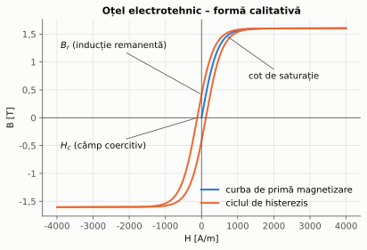
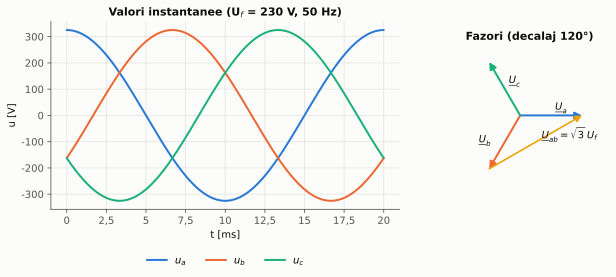
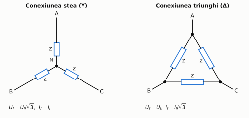
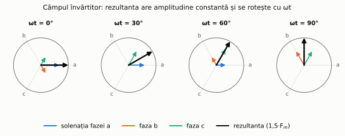

# Capitolul 0. Noțiuni fundamentale

> **Obiective.** După acest capitol ar trebui să puteți: (1) explica cele două legi fizice pe care funcționează toate mașinile electrice – legea inducției și forța electromagnetică; (2) calcula un circuit magnetic simplu; (3) lucra cu mărimi sinusoidale, fazori și puteri (P, Q, S); (4) face diferența dintre conexiunea stea și triunghi; (5) explica apariția câmpului magnetic învârtitor; (6) citi plăcuța indicatoare a unei mașini.

Capitolul este scris pentru studenți care nu au specializare electrică: recapitulează strictul necesar din electrotehnică, pe care se sprijină toate capitolele următoare.

---

## 0.1. Ce este o mașină electrică

O **mașină electrică** este un dispozitiv care transformă energia folosind câmpul magnetic:

| Tip | Ce transformă | Exemple |
|---|---|---|
| **Statică** (fără piese în mișcare) | energie electrică de c.a. → energie electrică de c.a. cu altă tensiune și alt curent | transformatorul |
| **Rotativă – motor** | energie electrică → energie mecanică | motorul asincron, motorul sincron |
| **Rotativă – generator** | energie mecanică → energie electrică | generatorul sincron din centrale |

Mașinile rotative sunt **reversibile**: aceeași mașină poate funcționa ca motor sau ca generator, în funcție de sensul în care circulă puterea. Vom vedea concret acest lucru la mașina asincronă (§ 2.5) și la mașina sincronă (cap. 3 și 4).

Clasificarea mașinilor rotative de curent alternativ, folosită în tot cursul:

- **mașini asincrone** (de inducție): rotorul se rotește cu o viteză *puțin diferită* de viteza câmpului magnetic învârtitor;
- **mașini sincrone**: rotorul se rotește *exact* cu viteza câmpului (în *sincronism* cu el).

## 0.2. Mărimi magnetice și unități de măsură

| Mărime | Simbol | Unitate SI | Semnificație |
|---|---|---|---|
| Intensitatea câmpului magnetic | $H$ | A/m | „efortul” de magnetizare produs de curenți |
| Inducția magnetică | $B$ | T (tesla) | densitatea fluxului; determină forțele și tensiunile induse |
| Fluxul magnetic | $\Phi$ | Wb (weber) | $\Phi = B\cdot A$ pentru un câmp uniform, perpendicular pe aria $A$ |
| Permeabilitatea | $\mu = \mu_0\mu_r$ | H/m | $B = \mu H$; $\mu_0 = 4\pi\cdot 10^{-7}$ H/m |
| Solenația (tensiunea magnetomotoare) | $\Theta = N I$ | A (amper-spiră) | curentul total care înconjoară circuitul magnetic |

Pentru aer $\mu_r = 1$. Oțelul electrotehnic (tablă silicioasă) are, în zona liniară, $\mu_r$ de ordinul miilor – de aceea miezurile mașinilor se fac din fier: același flux se obține cu o solenație de sute sau mii de ori mai mică.

### Curba de magnetizare și histerezisul

Relația $B(H)$ a materialelor feromagnetice **nu este liniară** (figura 0.1):

- la câmpuri mici, $B$ crește aproape proporțional cu $H$;
- peste „cotul” curbei (la oțelurile electrotehnice uzuale, în jur de 1,4–1,7 T) materialul se **saturează**: pentru a crește puțin inducția trebuie mărit mult curentul;
- la magnetizare alternativă, materialul parcurge un **ciclu de histerezis**; aria ciclului este proporțională cu energia pierdută la fiecare perioadă (pierderile prin histerezis).

*Figura 0.1 – Curba de primă magnetizare și ciclul de histerezis (formă calitativă; valorile exacte se iau din catalogul tablei).*

> **De reținut.** Mașinile sunt proiectate să lucreze aproape de cotul curbei de magnetizare: mai sus, curentul de magnetizare ar crește foarte mult; mai jos, materialul ar fi folosit ineficient.

## 0.3. Legea circuitului magnetic

**Legea lui Ampère** (legea circuitului magnetic): de-a lungul unei linii închise de câmp,

$$\oint \vec H\cdot d\vec l = \Theta = N I .$$

Pentru un circuit format din porțiuni cu $H$ constant pe fiecare porțiune:

$$\sum_k H_k\thinspace l_k = N I .$$

Scriind $H_k = \dfrac{B_k}{\mu_k} = \dfrac{\Phi}{\mu_k A_k}$, se obține o analogie cu legea lui Ohm:

$$N I = \Phi \sum_k \mathcal{R}_k, \qquad \mathcal{R}_k = \frac{l_k}{\mu_k A_k}\ \text{(reluctanța porțiunii } k\text{)} .$$

| Circuit electric | Circuit magnetic |
|---|---|
| tensiunea electromotoare $E$ [V] | solenația $\Theta = NI$ [A] |
| curentul $I$ [A] | fluxul $\Phi$ [Wb] |
| rezistența $R = \dfrac{l}{\sigma A}$ [Ω] | reluctanța $\mathcal{R} = \dfrac{l}{\mu A}$ [A/Wb] |

**Inductivitatea** unei bobine cu $N$ spire pe un circuit de reluctanță totală $\mathcal{R}$ este

$$L = \frac{N\Phi}{I} = \frac{N^2}{\mathcal{R}} .$$

Consecința practică cea mai importantă (vezi problema 0.2): **un întrefier de numai 1 mm poate „consuma” mai multă solenație decât o jumătate de metru de fier**, pentru că $\mu_0$ este de $\mu_r$ ori mai mic decât $\mu$ al fierului. De aceea întrefierul mașinilor rotative se face cât mai mic posibil din punct de vedere mecanic.

## 0.4. Legea inducției electromagnetice

**Legea lui Faraday:** într-o spiră înlănțuită de un flux variabil se induce tensiunea electromotoare

$$e = -\frac{d\Phi}{dt}, \qquad \text{iar într-o bobină cu } N \text{ spire:}\qquad e = -N\frac{d\Phi}{dt}.$$

Semnul minus exprimă **regula lui Lenz**: tensiunea indusă tinde să producă un curent care se opune variației fluxului.

Fluxul poate varia în două moduri, iar ambele sunt folosite în mașini:

1. **inducție de transformare** – conductorul stă pe loc, fluxul variază în timp (transformatorul);
2. **inducție de mișcare** – conductorul se mișcă într-un câmp: un conductor de lungime $l$ care se deplasează cu viteza $v$ perpendicular pe un câmp $B$ are la capete tensiunea

$$e = B\thinspace l\thinspace v \qquad \text{(generatoarele)} .$$

### Tensiunea indusă de un flux sinusoidal

Dacă $\Phi(t) = \Phi_{max}\sin\omega t$, cu $\omega = 2\pi f$, atunci

$$e = -N\frac{d\Phi}{dt} = -N\omega\Phi_{max}\cos\omega t,$$

deci amplitudinea este $E_{max} = 2\pi f N \Phi_{max}$, iar valoarea efectivă

$$\boxed{E = \frac{E_{max}}{\sqrt 2} = \sqrt 2\thinspace \pi f N\Phi_{max} \approx 4{,}44\thinspace f N \Phi_{max}}$$

Aceasta este **formula fundamentală a transformatorului** și, cu un factor de înfășurare $k_w < 1$, a tuturor mașinilor de c.a.: $E = 4{,}44\thinspace f N k_w \Phi$. Ea arată că, la tensiune și frecvență date, **fluxul este impus de tensiunea de alimentare** – idee folosită des în capitolele următoare.

## 0.5. Forța electromagnetică

Un conductor de lungime $l$, parcurs de curentul $I$ și aflat într-un câmp de inducție $B$ perpendicular pe el, este acționat de **forța Laplace**

$$F = B\thinspace I\thinspace l ,$$

cu sensul dat de regula mâinii stângi. Într-o mașină rotativă cu raza rotorului $r$, suma acestor forțe dă **cuplul electromagnetic** $M = \sum F\cdot r$. Cele două legi – inducția (§ 0.4) și forța (§ 0.5) – lucrează mereu împreună: când prin conductorul care se mișcă trece curent, puterea mecanică $F v = B I l v$ este egală cu puterea electrică $e I = B l v I$. Aceasta este, pe scurt, **conversia electromecanică a energiei**.

## 0.6. Regimul sinusoidal: valori efective, fazori, puteri

O tensiune sinusoidală $u(t) = U\sqrt 2 \sin(\omega t + \alpha)$ se caracterizează prin **valoarea efectivă** $U$ (cea indicată de voltmetre și scrisă pe plăcuțe), frecvența $f$ și faza $\alpha$. În rețeaua europeană $f = 50$ Hz; în America de Nord, 60 Hz.

Calculele se fac cu **fazori** (numere complexe), notați cu bară dedesubt: $\underline{U} = U e^{j\alpha} = U\angle\alpha$. Pentru un receptor cu impedanța $\underline{Z} = R + jX$:

$$\underline{U} = \underline{Z}\thinspace \underline{I}, \qquad X_L = \omega L,\quad X_C = -\frac{1}{\omega C}.$$

Unghiul $\varphi$ dintre $\underline{U}$ și $\underline{I}$ definește **factorul de putere** $\cos\varphi$. Puterile pe un receptor monofazat:

| Putere | Formulă | Unitate | Semnificație |
|---|---|---|---|
| activă | $P = U I\cos\varphi$ | W | se transformă în lucru mecanic, căldură etc. |
| reactivă | $Q = U I\sin\varphi$ | var | se schimbă periodic între sursă și câmpurile magnetice/electrice |
| aparentă | $S = U I = \sqrt{P^2 + Q^2}$ | VA | dimensionează conductoarele, transformatoarele, generatoarele |

Puterea complexă este $\underline{S} = \underline{U}\thinspace \underline{I}^{\ast} = P + jQ$ ($\underline{I}^{\ast}$ – conjugatul curentului). Convenție folosită în curs: $Q > 0$ pentru receptoare **inductive** (motoare asincrone, bobine), $Q < 0$ pentru receptoare **capacitive**.

> **De ce contează $\cos\varphi$?** La aceeași putere activă $P$ și aceeași tensiune, curentul este $I = P/(U\cos\varphi)$: un factor de putere mic înseamnă curent mare, deci pierderi mai mari în linii și echipamente mai mari. De aceea furnizorii de energie penalizează consumatorii cu $\cos\varphi$ mic, iar motorul sincron supraexcitat (cap. 4) este folosit și pentru compensarea lui.

## 0.7. Sisteme trifazate

Energia electrică se produce și se transportă în **sistem trifazat**: trei tensiuni de aceeași valoare efectivă, decalate cu 120° (figura 0.2).

*Figura 0.2 – Tensiunile de fază ale unui sistem trifazat simetric și fazorii lor. Tensiunea dintre două faze (de linie) este de $\sqrt 3$ ori mai mare decât tensiunea de fază.*

Cele trei faze ale unui receptor (de exemplu, cele trei înfășurări ale unui motor) se pot lega în **stea (Y)** sau în **triunghi (Δ)** (figura 0.3):

*Figura 0.3 – Conexiunile stea și triunghi; indicele $f$ – mărime de fază (pe o înfășurare), indicele $l$ – mărime de linie (pe conductorul de alimentare).*

| Conexiune | Tensiuni | Curenți |
|---|---|---|
| stea (Y) | $U_l = \sqrt 3\thinspace U_f$ | $I_l = I_f$ |
| triunghi (Δ) | $U_l = U_f$ | $I_l = \sqrt 3\thinspace I_f$ |

Pentru ambele conexiuni, puterile unui receptor trifazat echilibrat sunt

$$P = \sqrt 3\thinspace U_l I_l \cos\varphi, \qquad Q = \sqrt 3\thinspace U_l I_l \sin\varphi, \qquad S = \sqrt 3\thinspace U_l I_l ,$$

unde $\varphi$ este defazajul pe o fază. Rețeaua de joasă tensiune din România este 230/400 V: 230 V între fază și neutru, 400 V între două faze.

> **Atenție la plăcuțe.** Un motor marcat „230/400 V, Δ/Y” se leagă în **stea** la rețeaua de 400 V; un motor marcat „400/690 V, Δ/Y” se leagă în **triunghi** la 400 V. Doar al doilea poate porni stea-triunghi la rețeaua de 400 V (§ 2.7).

## 0.8. Câmpul magnetic învârtitor

Este ideea pe care se bazează **toate** mașinile rotative de c.a. (Ferraris și Tesla, sfârșitul secolului XIX).

Considerăm trei bobine identice, cu axele decalate în spațiu la 120°, alimentate cu trei curenți decalați în timp cu 120°. Fiecare bobină produce un câmp **pulsatoriu** (fix în spațiu, variabil în timp). Suma celor trei câmpuri este un câmp de **amplitudine constantă** ($1{,}5$ ori amplitudinea unei faze) care **se rotește** cu viteza unghiulară $\omega$ (figura 0.4).

*Figura 0.4 – Solenațiile celor trei faze (colorate) și rezultanta lor (negru) la patru momente succesive. Figura este calculată numeric (problema 0.6).*

Demonstrația, pentru solenațiile $\Theta_k = \Theta_m\cos(\omega t - k\cdot 120°)$ orientate după axele $\underline{a}_k = e^{jk\cdot 120°}$, $k = 0, 1, 2$:

$$\underline{\Theta}_{rez} = \sum_{k=0}^{2} \Theta_m\cos(\omega t - k\cdot 120°)\thinspace e^{jk\cdot 120°} = \frac{3}{2}\Theta_m\thinspace e^{j\omega t},$$

adică un vector de modul constant $\tfrac32\Theta_m$ care se rotește cu $\omega$ (s-au folosit $\cos x = \tfrac12(e^{jx}+e^{-jx})$ și faptul că $\sum_k e^{\pm jk\cdot 240°} = 0$).

Dacă înfășurarea are $p$ **perechi de poli** (bobinele se repetă de $p$ ori pe circumferință), câmpul parcurge o rotație completă în $p$ perioade, deci **viteza de sincronism** este

$$\boxed{n_1 = \frac{60 f}{p}\ \ [\text{rot/min}]}, \qquad \Omega_1 = \frac{2\pi f}{p}\ \ [\text{rad/s}] .$$

| $2p$ (poli) | 2 | 4 | 6 | 8 | 10 | 12 |
|---|---|---|---|---|---|---|
| $n_1$ la 50 Hz [rot/min] | 3000 | 1500 | 1000 | 750 | 600 | 500 |
| $n_1$ la 60 Hz [rot/min] | 3600 | 1800 | 1200 | 900 | 720 | 600 |

**Inversarea sensului de rotație:** se schimbă între ele **oricare două** faze de alimentare – succesiunea fazelor se inversează, deci și sensul câmpului.

## 0.9. Pierderi, încălzire, randament

Orice conversie de energie are pierderi, care se transformă în căldură:

| Pierderi | Cauză | Depind de |
|---|---|---|
| în cupru (Joule), $P_{Cu} = R I^2$ | rezistența înfășurărilor | pătratul curentului (sarcina) |
| în fier, $P_{Fe}$ | histerezis + curenți turbionari în miez | $B^2$ și frecvență (practic de tensiune) |
| mecanice, $P_{m}$ | frecări în lagăre, ventilație | viteză |
| suplimentare | câmpuri de dispersie, armonici | sarcină |

Miezurile se fac din **tole** (tablă subțire, uzual 0,20–0,65 mm, izolată) tocmai pentru a limita curenții turbionari, care ar circula altfel liber prin fierul masiv.

**Randamentul** este

$$\eta = \frac{P_2}{P_1} = \frac{P_2}{P_2 + \sum P_{pierderi}} .$$

**Încălzirea** limitează puterea unei mașini: căldura degajată ridică temperatura înfășurărilor, iar izolația se degradează din ce în ce mai repede pe măsură ce temperatura crește. Standardul IEC 60085 definește **clasele termice** ale sistemelor de izolație, de exemplu 130 (B), 155 (F) și 180 (H) – temperatura maximă de utilizare continuă, în °C, pentru care este evaluat sistemul de izolație [S4]. Pentru mașinile rotative, IEC 60034-1 [S1] limitează, în funcție de clasă, **supratemperatura** medie a înfășurărilor față de mediu. În practică, motoarele cu izolație clasa F sunt adesea folosite cu încălzirea limitată la clasa B, pentru o rezervă termică și o durată de viață mai mare.

**Regimurile de funcționare** standardizate (IEC 60034-1 [S1]) descriu cum variază sarcina în timp: **S1** – continuu, **S2** – de scurtă durată, **S3** – intermitent periodic, ... până la **S10**. O mașină de 15 kW în regim S1 poate da mai mult de 15 kW în regim S2 de 10 minute, pentru că nu ajunge la temperatura de regim permanent (§ 5.8).

## 0.10. Plăcuța indicatoare

Pe plăcuța unui motor asincron se găsesc, de regulă: tipul, standardul (IEC 60034), puterea **utilă** nominală $P_n$ (la arbore!), tensiunea și conexiunea, curentul nominal, frecvența, turația nominală, $\cos\varphi_n$, clasa de randament (IE2, IE3...) și randamentul, clasa de izolație, gradul de protecție **IP** (de exemplu IP55; IEC 60529 [S5]: prima cifră – protecția la corpuri solide/praf, a doua – la apă) și regimul de funcționare (S1).

> **Verificare rapidă de coerență** a datelor de pe plăcuță: $P_n = \sqrt 3\thinspace U_n I_n \cos\varphi_n\thinspace \eta_n$. Dacă relația nu se verifică aproximativ, una dintre valori este citită greșit (vezi problema 0.3).

---

## Probleme rezolvate

Toate rezultatele de mai jos sunt calculate și **verificate pe cel puțin două căi** de scriptul [`scripts/probleme_cap00.py`](scripts/probleme_cap00.py).

### Problema 0.1 – Tensiunea indusă într-o bobină

O bobină cu $N = 500$ spire este străbătută de un flux sinusoidal cu $\Phi_{max} = 2$ mWb și $f = 50$ Hz. Ce tensiune efectivă se induce?

**Rezolvare.**

$$E = 4{,}44\thinspace f N \Phi_{max} = 4{,}44 \cdot 50 \cdot 500 \cdot 0{,}002 = 222\ \text{V}.$$

Cu factorul exact $\sqrt 2\pi = 4{,}4429$: $E = 222{,}14$ V; amplitudinea este $E_{max} = 2\pi f N\Phi_{max} = 314{,}2$ V.

**Verificare (calea a doua).** Se calculează numeric $e(t) = -N\thinspace d\Phi/dt$ pe o perioadă, apoi valoarea efectivă $\sqrt{\frac1T\int_0^T e^2\thinspace dt}$: rezultă tot 222,14 V.

### Problema 0.2 – Circuit magnetic cu întrefier

Un miez de fier cu lungimea medie $l_{Fe} = 0{,}5$ m, secțiunea $A = 10$ cm² și $\mu_r = 2000$ (considerat constant) are un întrefier $\delta = 1$ mm. Bobina are $N = 200$ spire. Ce curent este necesar pentru $B = 1{,}2$ T? Cât este inductivitatea?

**Rezolvare (prin intensitățile câmpului).**

$$H_{Fe} = \frac{B}{\mu_0\mu_r} = \frac{1{,}2}{4\pi\cdot 10^{-7}\cdot 2000} = 477{,}5\ \text{A/m}, \qquad H_\delta = \frac{B}{\mu_0} = 954\thinspace 930\ \text{A/m}.$$

$$\Theta = H_{Fe}l_{Fe} + H_\delta\delta = 238{,}7 + 954{,}9 = 1193{,}7\ \text{A} \quad\Rightarrow\quad I = \frac{\Theta}{N} = 5{,}97\ \text{A}.$$

Întrefierul de 1 mm „consumă” **80 %** din solenație.

**Verificare (prin reluctanțe).** $\mathcal{R}_{Fe} = \dfrac{l_{Fe}}{\mu_0\mu_r A} = 1{,}989\cdot 10^{5}$ A/Wb, $\mathcal{R}_\delta = \dfrac{\delta}{\mu_0 A} = 7{,}958\cdot 10^{5}$ A/Wb, $\Phi = BA = 1{,}2$ mWb, deci $\Theta = \Phi(\mathcal{R}_{Fe} + \mathcal{R}_\delta) = 1193{,}7$ A ✓.

Inductivitatea: $L = N\Phi/I = 40{,}2$ mH, identic cu $L = N^2/(\mathcal{R}_{Fe}+\mathcal{R}_\delta)$ ✓.

### Problema 0.3 – Curentul absorbit de un motor trifazat

Un motor are pe plăcuță: $P_n = 11$ kW, $U_n = 400$ V, $\eta_n = 0{,}90$, $\cos\varphi_n = 0{,}85$. Ce curent absoarbe la sarcină nominală?

**Rezolvare.** $P_n$ este puterea **utilă**; puterea absorbită este $P_1 = P_n/\eta_n = 12\thinspace 222$ W, deci

$$I_n = \frac{P_n}{\sqrt 3\thinspace U_n\thinspace \eta_n \cos\varphi_n} = \frac{11\thinspace 000}{\sqrt 3 \cdot 400 \cdot 0{,}90 \cdot 0{,}85} = 20{,}75\ \text{A}.$$

**Verificare (două căi).** (a) Prin puterea aparentă: $S = P_1/\cos\varphi = 14\thinspace 379$ VA, $I = S/(\sqrt3 U) = 20{,}75$ A ✓. (b) Pe o fază, în conexiune stea: $P_1/3 = 4074$ W, $U_f = 230{,}9$ V, $I = 4074/(230{,}9\cdot 0{,}85) = 20{,}75$ A ✓. Puterea reactivă absorbită: $Q = \sqrt{S^2 - P_1^2} = 7575$ var.

### Problema 0.4 – Aceeași sarcină în stea și în triunghi

Trei impedanțe $\underline{Z} = 10 + j7{,}5$ Ω ($\lvert\underline{Z}\rvert = 12{,}5$ Ω, $\cos\varphi = 0{,}8$) se leagă la rețeaua de 400 V, întâi în stea, apoi în triunghi. Comparați curenții de linie și puterile.

**Rezolvare.**

- Stea: $U_f = 400/\sqrt 3 = 230{,}9$ V, $I_l = I_f = 230{,}9/12{,}5 = 18{,}48$ A, $P_Y = 3 I_f^2 R = 10\thinspace 240$ W.
- Triunghi: $U_f = 400$ V, $I_f = 32{,}0$ A, $I_l = \sqrt 3\cdot 32 = 55{,}43$ A, $P_\Delta = 3 I_f^2 R = 30\thinspace 720$ W.

Raportul puterilor și al curenților de linie este exact **3**. **Verificare:** $P_\Delta = \sqrt 3\thinspace U_l I_l\cos\varphi = \sqrt3 \cdot 400\cdot 55{,}43\cdot 0{,}8 = 30\thinspace 720$ W ✓.

**Concluzie utilă mai departe:** trecând un motor din triunghi în stea pe aceeași rețea, curentul de linie și cuplul scad de 3 ori – principiul pornirii stea-triunghi (§ 2.7, problema 2.4).

### Problema 0.5 – Viteze de sincronism

Valorile din tabelul din § 0.8 se obțin din $n_1 = 60f/p$; de exemplu, pentru $2p = 4$ la 50 Hz: $n_1 = 60\cdot 50/2 = 1500$ rot/min. Un motor asincron de „1450 rot/min” are deci 4 poli, iar unul de „2900 rot/min” are 2 poli (viteza reală este puțin sub cea de sincronism, cap. 2).

### Problema 0.6 – Câmpul învârtitor, verificat numeric

Scriptul calculează rezultanta celor trei solenații pentru 721 de valori ale lui $\omega t$ între 0 și 360°: modulul rămâne $1{,}500\thinspace \Theta_m$ (cu abatere sub $10^{-15}$), iar unghiul rezultantei este egal cu $\omega t$. Rezultatul confirmă demonstrația analitică din § 0.8 și a fost folosit pentru figura 0.4.

---

## Întrebări de autoevaluare

1. De ce miezurile mașinilor electrice se fac din fier și nu din aer?
2. De ce miezurile se fac din tole izolate și nu din fier masiv?
3. Ce înseamnă „saturație” și ce consecință are asupra curentului de magnetizare?
4. Scrieți formula tensiunii induse într-o bobină cu flux sinusoidal. De ce mărimi depinde fluxul, la o bobină alimentată de la o rețea cu tensiune fixă?
5. O bobină de 230 V, 50 Hz este alimentată la 230 V, 60 Hz. Cum se modifică fluxul din miez?
6. Ce relație există între tensiunea de linie și cea de fază în conexiunea stea? Dar în triunghi?
7. Cum se inversează sensul de rotație al unui motor trifazat?
8. Care este viteza de sincronism a unei mașini cu 6 poli la 50 Hz?
9. Ce clase termice de izolație cunoașteți și ce reprezintă ele?
10. Pe plăcuța unui motor scrie 7,5 kW. Este aceasta puterea absorbită din rețea sau puterea la arbore?

<b>Răspunsuri</b>

1. Pentru că $\mu_r$ al fierului este de ordinul miilor: pentru același flux este necesară o solenație (deci un curent de magnetizare) de mii de ori mai mică (§ 0.3).
2. Pentru a limita curenții turbionari induși în miez de fluxul variabil; ei ar produce pierderi și încălzire mari (§ 0.9).
3. Peste cotul curbei de magnetizare, inducția crește foarte puțin la creșteri mari ale lui $H$; curentul de magnetizare crește puternic și devine nesinusoidal (§ 0.2).
4. $E \approx 4{,}44 f N\Phi_{max}$. La tensiune impusă, $\Phi_{max} \approx U/(4{,}44 f N)$: fluxul depinde de tensiune și de frecvență, nu de sarcină (§ 0.4).
5. Fluxul scade de $60/50 = 1{,}2$ ori (devine $\approx 83$ % din valoarea inițială), pentru că $\Phi_{max} \propto U/f$.
6. Stea: $U_l = \sqrt3 U_f$, $I_l = I_f$; triunghi: $U_l = U_f$, $I_l = \sqrt3 I_f$ (§ 0.7).
7. Se inversează două faze oarecare ale alimentării (§ 0.8).
8. $2p = 6 \Rightarrow p = 3$, $n_1 = 60\cdot 50/3 = 1000$ rot/min.
9. De exemplu 130 (B), 155 (F), 180 (H) – temperatura maximă de utilizare continuă pentru care este evaluat sistemul de izolație, în °C, conform IEC 60085 (§ 0.9).
10. Puterea **utilă** (mecanică, la arbore); puterea absorbită este mai mare, $P_1 = P_n/\eta$ (§ 0.10).

---

**Bibliografie pentru capitol:** [1] cap. 1–2, [2] cap. 1–2, [3]; standarde [S1], [S4], [S5]. Lista completă este în [README](README.md#bibliografie).

[← Cuprins](README.md) · [Capitolul 1. Transformatorul →](01-transformatorul.md)
