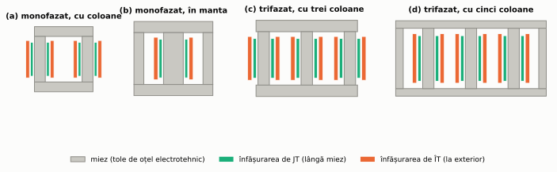
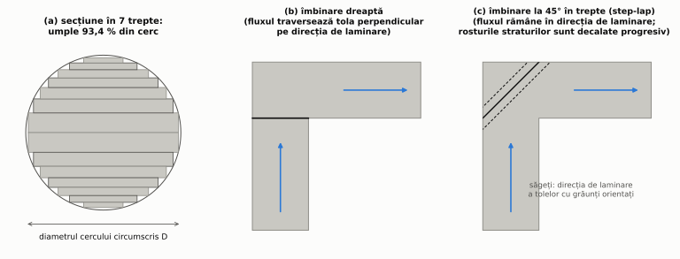
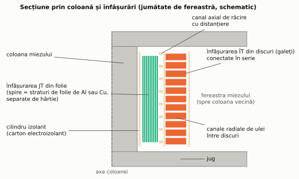
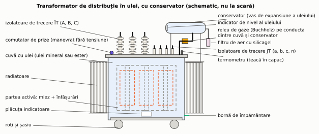
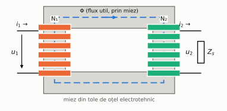
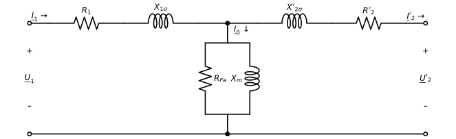
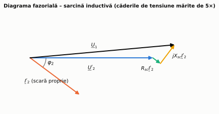
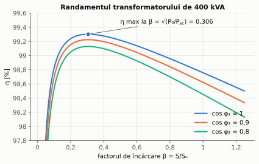

# Capitolul 1. Transformatorul

> **Obiective.** După acest capitol ar trebui să puteți: (1) explica de ce energia se transportă la tensiune înaltă; (2) descrie construcția și principiul de funcționare al transformatorului; (3) desena și folosi schema echivalentă; (4) determina parametrii schemei din încercările de gol și scurtcircuit; (5) calcula căderea de tensiune și randamentul în sarcină; (6) interpreta notația grupei de conexiuni (ex. Dyn11) și condițiile de funcționare în paralel.

Transformatorul este studiat **primul** pentru că este cea mai simplă mașină electrică (nu are piese în mișcare), iar ideile introduse aici – raportarea mărimilor, schema echivalentă, încercările de gol și scurtcircuit – se refolosesc direct la motorul asincron (cap. 2).

---

## 1.1. Rolul transformatorului

Transformatorul modifică **tensiunea și curentul** unui sistem de curent alternativ, păstrând frecvența și (aproape) puterea. Este indispensabil în transportul energiei: la aceeași putere $S = \sqrt3 U I$, creșterea tensiunii de $k$ ori reduce curentul de $k$ ori, iar pierderile în linie, $3RI^2$, scad de $k^2$ ori. De exemplu, transportând aceeași putere la 110 kV în loc de 20 kV ($k = 5{,}5$), pierderile în aceeași linie scad de circa 30 de ori.

Un lanț tipic: generator (la generatoarele mari, de ordinul 10–27 kV) → transformator ridicător → linii de 220–400 kV → transformatoare coborâtoare → rețele de 110 kV și 20 kV → **transformatoare de distribuție** 20/0,4 kV → consumatori la 230/400 V.

## 1.2. Construcția

Un transformator este format din **partea activă** (miezul magnetic și înfășurările, în care au loc fenomenele electromagnetice), **sistemul de izolație**, **cuva și sistemul de răcire** și **accesorii** de protecție și supraveghere. Secțiunea descrie fiecare componentă și materialele din care se face.

### Miezul magnetic

**Materialul.** Miezul se face din **tole de oțel electrotehnic cu grăunți orientați** (în engleză GO sau CRGO): oțel cu circa 3 % siliciu, laminat la rece și tratat termic astfel încât cristalele să fie aliniate pe direcția de laminare. Pe această direcție permeabilitatea este foarte mare și pierderile foarte mici; perpendicular pe ea, proprietățile sunt mult mai slabe. Tolele au grosimi standardizate de 0,20–0,35 mm și sunt acoperite cu un strat izolator subțire, care întrerupe drumul curenților turbionari între ele [S12], [W3].

**Cum se citește marca tablei** (EN 10107 [S12]): de exemplu **M120-30S** înseamnă pierderi specifice de cel mult **1,20 W/kg** la **1,7 T** și 50 Hz, grosime **0,30 mm**, calitate **S** (convențională); litera **P** desemnează tablele cu permeabilitate ridicată, cu pierderi mai mici [W3]. Ediția din 2020 a standardului internațional corespunzător (IEC 60404-8-7) cuprinde și o a treia clasă, cu **domenii magnetice rafinate** (pierderi și mai mici), și grosimi de la 0,20 mm [W28].

**Metalul amorf** este o alternativă pentru transformatoarele de distribuție: o bandă foarte subțire (de ordinul 0,02–0,03 mm), fără structură cristalină, cu rezistivitate mare. Pierderile la mers în gol scad puternic – studiile și producătorii raportează reduceri de ordinul 60–80 % față de oțelul cu grăunți orientați –, dar inducția de saturație este mai mică (puțin peste 1,5 T), iar transformatorul rezultă mai mare și mai greu [W4].

**Forma miezului** (figura 1.1):

- **cu coloane** – înfășurările înconjoară coloanele; este forma obișnuită la transformatoarele de putere;
- **în manta** – înfășurările stau pe coloana centrală, iar fluxul se închide prin cele două coloane laterale, care au jumătate din secțiune;
- **trifazat cu trei coloane** – forma uzuală pentru transformatoarele trifazate; fluxurile celor trei faze se închid unul prin celelalte (suma lor este, în fiecare moment, aproape zero);
- **trifazat cu cinci coloane** – două coloane laterale fără înfășurări preiau o parte din flux, astfel încât jugurile pot fi mai joase; se folosește la transformatoarele mari, pentru a încadra înălțimea în gabaritul de transport.

*Figura 1.1 – Tipuri de miezuri și așezarea înfășurărilor (schematic).*

**Secțiunea coloanei.** Bobinele sunt circulare (rezistă mai bine la forțele de scurtcircuit și se execută mai ușor), dar tolele sunt dreptunghiulare. Coloana se construiește de aceea **în trepte** din pachete de tole de lățimi diferite, care umplu cât mai bine cercul (figura 1.2a). Cu cât sunt mai multe trepte, cu atât secțiunea de fier este mai mare pentru același diametru al bobinelor – deci înfășurările sunt mai scurte și mai ieftine. Factorul de umplere al cercului cu $n$ trepte optim alese, calculat în [`scripts/constructie.py`](scripts/constructie.py):

| Trepte | 1 | 2 | 3 | 4 | 5 | 6 | 7 | 8 | 9 |
|---|---|---|---|---|---|---|---|---|---|
| Fracțiunea din cerc ocupată | 0,637 | 0,787 | 0,851 | 0,886 | 0,908 | 0,923 | 0,934 | 0,942 | 0,948 |

(o singură treaptă este pătratul înscris, $2/\pi = 0{,}637$ – valoare exactă, folosită la verificarea calculului). Câștigul scade cu fiecare treaptă în plus; specificațiile de achiziție pot impune un număr minim de trepte – de exemplu, specificația consultată pentru transformatoare de distribuție de 315 kVA cere cel puțin 7 [W5]. În plus, din cauza stratului izolator și a planeității imperfecte a tolelor, fierul ocupă doar o fracțiune din volumul pachetului (**factorul de umplere al tolelor**; pentru tablele cu grăunți orientați, producătorii garantează valori minime de circa 0,95–0,96 [W28]).

**Îmbinarea tolelor.** La colțurile miezului, tolele coloanelor se întâlnesc cu cele ale jugurilor. Îmbinarea dreaptă obligă fluxul să treacă, în colț, perpendicular pe direcția de laminare; de aceea tolele cu grăunți orientați se taie la **45°**, iar fluxul rămâne pe direcția favorabilă – pierderile și curentul de magnetizare scad. La îmbinarea la 45° obișnuită, rosturile alternează între două poziții de la un strat la altul; la îmbinarea **în trepte** (**step-lap**, figura 1.2c), rosturile straturilor (sau ale grupurilor de tole) succesive se decalează **progresiv**, în mai multe trepte, ceea ce reduce în plus pierderile și zgomotul. Un studiu experimental arată că 3–4 trepte aduc cea mai mare parte din reducerea zgomotului [W26].

*Figura 1.2 – (a) Secțiunea în trepte a coloanei; (b) îmbinare dreaptă; (c) îmbinare la 45° în trepte.*

Miezul se strânge cu **grinzi de strângere** și **bandaje**. Găurile prin tole (pentru șuruburi sau știfturi) se evită ori se plasează unde inducția este mică: în jurul lor fluxul se aglomerează, iar pierderile prin curenți turbionari cresc [W27]. Miezul se leagă la pământ **într-un singur punct**: legarea în mai multe puncte ar închide bucle prin care ar circula curenți induși.

### Înfășurările

**Materialul conductoarelor** este cuprul sau aluminiul:

| Material | Rezistivitate la 20 °C | Densitate | Pentru aceeași rezistență |
|---|---|---|---|
| cupru (100 % IACS) | 1,724·10⁻⁸ Ω·m | 8,89 g/cm³ | – |
| aluminiu (61 % IACS) | 2,826·10⁻⁸ Ω·m | 2,70 g/cm³ | secțiune de 1,64 ori mai mare, dar numai jumătate din masă (0,50) |

*Rezistivitățile corespund conductivităților de 100 % și 61 % IACS. Standardul internațional al cuprului recopt (IACS), adoptat de IEC în 1913, definește 100 % prin rezistivitatea de 1/58 Ω·mm²/m la 20 °C; aluminiul pentru conductoare are, după puritate, circa 60–64 % IACS [W6] – în exemplu am folosit 61 %.*

De exemplu, un conductor de 100 m cu rezistența de 10 mΩ are 172 mm² și 153 kg din cupru, sau 283 mm² și 76 kg din aluminiu (calcul în script). Aluminiul este mai ușor și mai ieftin, dar ocupă mai mult loc – miezul și cuva cresc. Ambele materiale se folosesc curent la transformatoarele de distribuție.

**Tipuri de înfășurări** (figura 1.3):

- **din folie** – fiecare spiră este o folie de aluminiu sau cupru cât toată înălțimea bobinei, separată de următoarea prin hârtie; uzuală pentru înfășurarea JT a transformatoarelor de distribuție (curenți mari, puține spire);
- **în straturi** – conductor rotund sau dreptunghiular, înfășurat în mai multe straturi; uzuală pentru ÎT la puteri mici și medii;
- **din discuri (galeți)** – bobine plate legate în serie, separate de canale radiale prin care circulă uleiul; uzuală pentru ÎT la transformatoarele de putere;
- **elicoidală** – puține spire din multe conductoare în paralel, pentru curenți foarte mari.

La curenți mari, conductorul se formează din multe fire elementare izolate și **transpuse** (în engleză *continuously transposed cable*), ca fiecare fir să ocupe pe rând toate pozițiile: astfel se reduc pierderile suplimentare prin curenți turbionari și curenții de circulație între fire.

**Așezarea.** Înfășurările sunt **concentrice**, cu JT lângă miez (la miezul în manta se folosesc și bobine alternate JT–ÎT). Între ele și între straturi se lasă **canale de răcire** axiale, menținute de distanțiere. La un scurtcircuit, forțele electrodinamice cresc cu pătratul curentului și pot deforma bobinele – de aceea înfășurările se strâng axial și se rigidizează.

*Figura 1.3 – Secțiune prin coloană și înfășurări: JT din folie lângă miez, canal de răcire, ÎT din discuri.*

### Izolația

- **Hârtia** (celuloză) izolează spirele și straturile, iar **cartonul electroizolant** (presspan) formează cilindrii, distanțierii și barierele dintre înfășurări și față de miez.
- **Uleiul** impregnează hârtia, completează izolația și transportă căldura spre pereții cuvei. Pe lângă uleiul mineral se folosesc **esterii** (naturali sau sintetici): esterii naturali au punctul de ardere peste 300 °C (de regulă în jur de 350 °C), deci sunt preferați acolo unde contează riscul de incendiu [S16], [W7].
- **Transformatoarele uscate** au înfășurările turnate în **rășină epoxidică** și răcire directă cu aer; nu conțin lichid inflamabil și se montează în clădiri (spitale, centre comerciale, posturi de transformare interioare).

Izolația celulozică îmbătrânește cu temperatura și umiditatea; de aceea încălzirea înfășurărilor și a uleiului (supratemperatura față de mediul de răcire) este limitată prin standard (IEC 60076-2 [S15]), iar uleiul este protejat de umezeala din aer.

### Cuva, răcirea și accesoriile

Partea activă a transformatoarelor în ulei stă într-o **cuvă** din tablă de oțel. Căldura se transmite aerului prin **radiatoare** sau prin **pereți ondulați**; la puteri mari se adaugă ventilatoare pentru aer și pompe pentru ulei. Sistemul de răcire se notează cu un cod din patru litere (IEC 60076-2 [S15], [W8]):

| Poziția | Ce arată | Litere uzuale |
|---|---|---|
| 1 | mediul de răcire interior | **O** – ulei mineral (sau lichid cu punct de ardere ≤ 300 °C); **K** – lichid cu punct de ardere > 300 °C (de exemplu esteri); **L** – lichid fără punct de ardere măsurabil |
| 2 | circulația mediului interior | **N** – naturală; **F** – forțată (pompe); **D** – forțată și dirijată prin înfășurări |
| 3 | mediul exterior | **A** – aer; **W** – apă |
| 4 | circulația mediului exterior | **N** – naturală; **F** – forțată (ventilatoare, pompe) |

Exemple: **ONAN** – ulei cu circulație naturală, aer cu circulație naturală (transformatoarele de distribuție); **ONAF** – aceeași, cu ventilatoare pe radiatoare, care permit o putere mai mare.

**Accesoriile** unui transformator în ulei (figura 1.4):

- **conservatorul** (vasul de expansiune) – preia variația volumului uleiului cu temperatura, astfel încât cuva să fie mereu plină; aerul care intră în conservator trece printr-un **filtru cu silicagel**, care reține umiditatea;
- **releul de gaze (Buchholz)** – montat pe conducta dintre cuvă și conservator; un defect intern descompune uleiul și produce gaze, care se adună în releu și dau semnal (la defect lent) sau declanșare (la defect brusc, cu val de ulei);
- **comutatorul de prize** – modifică numărul de spire al ÎT; la transformatoarele de distribuție se manevrează **fără tensiune**, la cele de putere există comutatoare **sub sarcină**;
- **izolatoarele de trecere** – scot conexiunile ÎT și JT prin capac;
- **termometre**, **indicator de nivel**, **supapă de suprapresiune**, bornă de împământare, plăcuță indicatoare.

Transformatoarele de distribuție **ermetice** nu au conservator: dilatarea uleiului este preluată de pereții ondulați elastici ai cuvei, iar uleiul nu vine în contact cu aerul.

*Figura 1.4 – Componentele unui transformator de distribuție în ulei, cu conservator.*

### Exemplu: miezul transformatorului de 400 kVA

Pentru transformatorul de 400 kVA, 20/0,4 kV, Dyn11 din problema 1.3, să estimăm miezul (calcul în [`scripts/constructie.py`](scripts/constructie.py)). Alegem **22 de spire** pentru înfășurarea JT (stea, 230,9 V pe fază), o inducție de **1,55 T** (valoarea maximă cerută de o specificație de achiziție pentru transformatoare de distribuție [W5]), un factor de umplere al tolelor de **0,95** și **7 trepte** (alegeri ale exemplului, în domeniile de mai sus).

1. Tensiunea pe spiră: $e = 230{,}9/22 = 10{,}50$ V.
2. Fluxul: $\Phi_{max} = e/(\sqrt2\pi f) = 47{,}25$ mWb (§ 0.4).
3. Secțiunea netă de fier: $A_{Fe} = \Phi_{max}/B = 304{,}9$ cm²; secțiunea pachetului: $304{,}9/0{,}95 = 320{,}9$ cm².
4. Diametrul cercului circumscris coloanei (7 trepte umplu 0,934 din cerc): $D = \sqrt{4\cdot 320{,}9/(\pi\cdot 0{,}934)} \approx 209$ mm.
5. Spirele ÎT (triunghi, 20 kV pe fază): $N_1 = 20\thinspace 000/10{,}50 \approx 1905$.

**Verificare (calea a doua).** Recalculând fluxul din partea de ÎT cu $N_1 = 1905$ (rotunjit), rezultă $\Phi_{max} = 47{,}26$ mWb și $B = 1{,}550$ T – practic aceleași valori; raportul spirelor, $1905/22 = 86{,}59$, diferă de cel cerut (86,60) cu doar 0,013 %. Exemplul arată de ce **tensiunea pe spiră** este primul parametru constructiv al unui transformator: ea fixează simultan secțiunea miezului și numărul de spire al ambelor înfășurări.

## 1.3. Principiul de funcționare. Transformatorul ideal

Primarul, alimentat cu tensiunea alternativă $u_1$, produce în miez un flux alternativ $\Phi$. Acesta străbate ambele înfășurări și induce în ele, conform legii inducției (§ 0.4), tensiunile

$$E_1 = 4{,}44\thinspace f N_1 \Phi_{max}, \qquad E_2 = 4{,}44\thinspace f N_2 \Phi_{max}.$$

*Figura 1.5 – Transformatorul monofazat: două înfășurări pe același miez magnetic, cuplate prin fluxul util Φ.*

**Transformatorul ideal** are înfășurări fără rezistență, tot fluxul trece prin miez (fără dispersie), iar miezul are permeabilitate infinită și nu are pierderi. Pentru el:

$$\boxed{\frac{U_1}{U_2} = \frac{N_1}{N_2} = k}, \qquad \boxed{\frac{I_1}{I_2} = \frac{N_2}{N_1} = \frac1k}, \qquad U_1 I_1 = U_2 I_2 .$$

$k$ este **raportul de transformare**. A doua relație rezultă din legea circuitului magnetic: un miez ideal nu are nevoie de solenație pentru a fi magnetizat, deci $N_1 I_1 - N_2 I_2 = 0$ – **solenația secundarului este compensată de primar**. Așa „află” primarul cât curent cere sarcina.

**Transferul impedanței.** O impedanță $\underline{Z}$ legată la secundar este „văzută” din primar ca

$$\underline{Z}' = \frac{U_1}{I_1} = \frac{k U_2}{I_2/k} = k^2\thinspace \underline{Z} .$$

> **Observație importantă.** Fluxul nu depinde de sarcină: la tensiune și frecvență constante, $\Phi_{max} = U_1/(4{,}44 f N_1)$ (§ 0.4). Când crește curentul secundar crește și cel primar, dar fluxul rămâne practic același.

## 1.4. Transformatorul real și schema echivalentă

Transformatorul real diferă de cel ideal prin:

| Fenomen | Element în schema echivalentă |
|---|---|
| rezistența înfășurărilor (pierderi Joule) | $R_1$, $R_2$ |
| fluxurile de dispersie (linii de câmp care înconjoară doar o înfășurare) | reactanțele de dispersie $X_{1\sigma}$, $X_{2\sigma}$ |
| curentul necesar magnetizării miezului | reactanța de magnetizare $X_m$ |
| pierderile în fier | rezistența $R_{Fe}$ |

Pentru a putea lega electric cele două părți, mărimile secundare se **raportează la primar** (se notează cu apostrof): $U_2' = kU_2$, $I_2' = I_2/k$, $R_2' = k^2R_2$, $X_{2\sigma}' = k^2X_{2\sigma}$. Raportarea păstrează puterile și pierderile. Ecuațiile transformatorului devin:

$$\underline{U}_1 = (R_1 + jX_{1\sigma})\thinspace \underline{I}_1 + \underline{E}_1, \qquad \underline{E}_1 = \underline{U}_2' + (R_2' + jX_{2\sigma}')\thinspace \underline{I}_2', \qquad \underline{I}_1 = \underline{I}_0 + \underline{I}_2',$$

cu $\underline{I}_0 = \underline{E}_1/R_{Fe} + \underline{E}_1/(jX_m)$ – **curentul de mers în gol**. Aici $\underline{E}_1$ este scrisă ca o **tensiune contraelectromotoare** (convenția de receptor pentru primar): ea echilibrează tensiunea aplicată, iar semnul minus din legea inducției (§ 0.4) este inclus în această alegere a sensurilor. Acestor ecuații le corespunde **schema echivalentă în T** (figura 1.6).

*Figura 1.6 – Schema echivalentă în T a transformatorului, cu mărimile secundare raportate la primar.*

Curentul de mers în gol este mic (de ordinul unităților de procent din curentul nominal la transformatoarele de putere), iar căderile de tensiune pe $R_1$, $X_{1\sigma}$ sunt și ele mici. De aceea, pentru calculul funcționării în sarcină, se folosește **schema simplificată** (figura 1.7), în care ramura de magnetizare se neglijează și impedanțele longitudinale se adună:

$$R_{sc} = R_1 + R_2', \qquad X_{sc} = X_{1\sigma} + X_{2\sigma}', \qquad \underline{U}_1 = \underline{U}_2' + (R_{sc} + jX_{sc})\thinspace \underline{I}_2' .$$

*Figura 1.7 – Schema echivalentă simplificată, folosită pentru calculul căderii de tensiune.*

Problema 1.2 arată că diferența dintre schema în T și cea simplificată este sub 0,1 % pentru tensiunea secundară.

### Diagrama fazorială

Ecuația schemei simplificate se reprezintă grafic prin **diagrama fazorială** (figura 1.8), construită pornind de la $\underline{U}_2'$ și $\underline{I}_2'$ (defazat cu $\varphi_2$), la care se adaugă căderea pe rezistență (paralelă cu curentul) și căderea pe reactanță (perpendiculară pe curent, înainte cu 90°).

*Figura 1.8 – Diagrama fazorială pentru sarcină inductivă, calculată pentru transformatorul din problema 1.2. Căderile de tensiune sunt mărite de 5 ori, altfel nu s-ar distinge.*

## 1.5. Încercarea de mers în gol

**Montaj** (lucrarea L1 din [îndrumarul de laborator](06-indrumar-laborator.md)): o înfășurare (de regulă JT) se alimentează la tensiunea nominală, cealaltă rămâne deschisă. Se măsoară $U_0$, $I_0$, $P_0$ (și $U_{20}$, pentru raportul de transformare).

**Interpretare.** Curentul $I_0$ este mic, deci pierderile Joule $R_1 I_0^2$ sunt neglijabile, iar tensiunea și fluxul sunt cele nominale. Prin urmare

$$P_0 \approx P_{Fe}, \qquad \cos\varphi_0 = \frac{P_0}{U_0 I_0}, \qquad R_{Fe} = \frac{U_0}{I_0\cos\varphi_0}, \qquad X_m = \frac{U_0}{I_0\sin\varphi_0}, \qquad k \approx \frac{U_{\hat{I}T}}{U_{JT}} .$$

(raportul de transformare se obține din cele două tensiuni măsurate, ÎT/JT; parametrii $R_{Fe}$, $X_m$ rezultă raportați la înfășurarea alimentată).

Curentul de gol procentual este $i_0 = 100\thinspace I_0/I_n$ [%].

## 1.6. Încercarea de scurtcircuit

**Montaj:** o înfășurare (de regulă ÎT) se alimentează de la o sursă reglabilă, cealaltă se scurtcircuitează (printr-un ampermetru). **Tensiunea se crește treptat de la zero** până când curentul ajunge la valoarea nominală. Se măsoară $U_{sc}$, $I_{sc} = I_n$, $P_{sc}$.

**Interpretare.** Tensiunea necesară este mică (câteva procente din $U_n$), deci fluxul și pierderile în fier sunt neglijabile, iar curenții sunt nominali:

$$P_{sc} \approx P_{Cu,n}, \qquad Z_{sc} = \frac{U_{sc}}{I_{n}}, \qquad R_{sc} = \frac{P_{sc}}{I_n^2}, \qquad X_{sc} = \sqrt{Z_{sc}^2 - R_{sc}^2}.$$

**Tensiunea de scurtcircuit procentuală** și componentele ei:

$$u_{sc} = 100\frac{U_{sc}}{U_n}\ [\text{%}], \qquad u_R = 100\frac{P_{sc}}{S_n}, \qquad u_X = \sqrt{u_{sc}^2 - u_R^2} .$$

$u_{sc}$ este o mărime de catalog foarte importantă: la transformatoarele de distribuție are valori de ordinul 4–6 %. Ea determină

- **căderea de tensiune în sarcină** (§ 1.7);
- **curentul de scurtcircuit** la bornele secundare (alimentare de la o rețea foarte puternică): $I_{sc,borne} \approx 100\thinspace I_n/u_{sc}$ – de exemplu, 25·$I_n$ pentru $u_{sc} = 4$ %;
- **împărțirea sarcinii** între transformatoare în paralel (§ 1.9).

## 1.7. Funcționarea în sarcină

### Căderea de tensiune

Definim **factorul de încărcare** $\beta = I_2/I_{2n} \approx S/S_n$. Proiectând ecuația fazorială a schemei simplificate pe direcția lui $\underline{U}_2'$, se obține formula practică

$$\boxed{\Delta U\text{%} \approx \beta\thinspace (u_R\cos\varphi_2 + u_X\sin\varphi_2)}$$

($\sin\varphi_2 > 0$ pentru sarcină inductivă, $< 0$ pentru capacitivă). O aproximare mai bună adaugă termenul de ordinul doi $\beta^2(u_X\cos\varphi_2 - u_R\sin\varphi_2)^2/200$; problemele 1.2 și 1.3 arată că, astfel corectată, formula coincide cu soluția exactă a ecuației fazoriale.

**Caracteristica externă** $U_2(\beta)$ la $U_1 = U_{1n}$ (figura 1.9): tensiunea scade cu sarcina inductivă și poate **crește** la sarcină capacitivă (când $u_X\lvert\sin\varphi_2\rvert > u_R\cos\varphi_2$).

*Figura 1.9 – Caracteristica externă a transformatorului de 400 kVA, 20/0,4 kV, $u_{sc}$ = 4 % din problema 1.3 (calcul exact cu schema simplificată).*

Pentru menținerea tensiunii consumatorilor, transformatoarele au **prize** (de obicei ±2×2,5 %) care modifică puțin numărul de spire al înfășurării ÎT.

### Randamentul

Pierderile sunt de două feluri: **constante** (în fier, $P_0$, independente de sarcină) și **variabile** (în cupru, $\beta^2 P_{sc}$). Randamentul este

$$\boxed{\eta = \frac{\beta S_n\cos\varphi_2}{\beta S_n\cos\varphi_2 + P_0 + \beta^2 P_{sc}}} .$$

Derivând în raport cu $\beta$ și egalând cu zero, se obține că **randamentul este maxim când pierderile variabile sunt egale cu cele constante**:

$$\beta^2 P_{sc} = P_0 \quad\Rightarrow\quad \beta_{opt} = \sqrt{\frac{P_0}{P_{sc}}} .$$

*Figura 1.10 – Randamentul transformatorului de 400 kVA ($P_0$ = 0,43 kW, $P_{sc}$ = 4,6 kW). Maximul este la $\beta \approx 0{,}31$, indiferent de $\cos\varphi_2$.*

Transformatoarele de distribuție funcționează mult timp la sarcini parțiale și sunt conectate permanent (pierderile în fier există 8760 h/an), de aceea sunt proiectate cu $P_0$ mic, deci cu $\beta_{opt}$ sub 0,5. Randamentul transformatoarelor de putere depășește, de regulă, 98 %.

Pierderile maxime admise pentru transformatoarele noi puse pe piața UE sunt reglementate de **Regulamentul (UE) nr. 548/2014** (proiectare ecologică), în două etape: Tier 1 din 1 iulie 2015 și Tier 2 din 1 iulie 2021 [S7].

## 1.8. Transformatorul trifazat

Un transformator trifazat poate fi realizat din trei transformatoare monofazate sau, mai economic, pe un **miez cu trei coloane**, câte o fază pe coloană.

**Conexiunile înfășurărilor** se notează cu **litere mari pentru ÎT** și **litere mici pentru JT**: Y/y – stea, D/d – triunghi, Z/z – zigzag; N/n – neutrul este scos la bornă.

**Atenție la raportul de transformare:** raportul tensiunilor *de linie* nu mai este neapărat egal cu raportul numărului de spire. La un transformator Dyn 20/0,4 kV, înfășurarea ÎT (în triunghi) are 20 kV pe fază, iar cea de JT (în stea) are $400/\sqrt3 = 230{,}9$ V pe fază: raportul spirelor este 86,6, nu 50 (problema 1.3).

### Grupa de conexiuni

Conexiunile diferite introduc un **defazaj** între tensiunile de linie ale ÎT și JT, întotdeauna multiplu de 30°. Defazajul se exprimă printr-un număr de la 0 la 11, după **analogia cu ceasul**: fazorul tensiunii ÎT este „minutarul” fixat la ora 12, iar fazorul corespunzător al JT este „orarul”. **Dyn11** înseamnă: ÎT în triunghi, JT în stea cu neutru accesibil, tensiunea JT defazată cu 11·30° = 330° în urma celei de ÎT (adică 30° înainte) – figura 1.11.

*Figura 1.11 – Grupa de conexiuni Dyn11 reprezentată pe cadranul ceasului.*

Dyn11 este conexiunea obișnuită a transformatoarelor de distribuție: neutrul JT permite alimentarea consumatorilor monofazați la 230 V, iar triunghiul de pe ÎT permite circulația curenților de secvență zero și a armonicilor de rang 3, care altfel ar deforma fluxul și ar dezechilibra tensiunile la sarcini nesimetrice.

## 1.9. Funcționarea în paralel

Două sau mai multe transformatoare funcționează în paralel când au legate împreună atât bornele primare, cât și cele secundare. Condiții:

1. **aceleași tensiuni nominale** (același raport de transformare) – altfel apare un curent de circulație chiar în gol;
2. **aceeași grupă de conexiuni** – altfel tensiunile secundare sunt defazate și curentul de circulație este de ordinul curentului de scurtcircuit;
3. **tensiuni de scurtcircuit cât mai apropiate** (în practică, abatere de cel mult ±10 %) – altfel sarcina nu se împarte proporțional cu puterile nominale;
4. ca recomandare practică, raportul puterilor nominale nu depășește 3:1.

Puterea preluată de transformatorul $i$ este invers proporțională cu impedanța lui (problema 1.4):

$$S_i = S_{total}\thinspace \frac{S_{ni}/u_{sc,i}}{\sum_j S_{nj}/u_{sc,j}} .$$

Transformatorul cu $u_{sc}$ mai mic se încarcă mai mult și limitează puterea totală care poate fi transmisă fără suprasarcină.

## 1.10. Transformatoare speciale

- **Autotransformatorul** are o singură înfășurare, cu o priză; o parte din putere trece direct, electric, și numai fracțiunea $1 - U_2/U_1$ este transferată electromagnetic (problema 1.5). Este mai mic și mai ieftin când raportul de transformare este apropiat de 1, dar **nu asigură separarea galvanică** între circuite. Autotransformatorul reglabil (cu cursor) este sursa reglabilă folosită în laborator.
- **Transformatorul de curent** (de măsură) are primarul în serie cu circuitul și secundarul închis pe un ampermetru (impedanță foarte mică). **Secundarul nu trebuie lăsat niciodată deschis** sub sarcină: dispare solenația care compensa primarul, fluxul crește foarte mult, iar în secundar apar tensiuni periculoase.
- **Transformatorul de tensiune** (de măsură) funcționează practic în gol; **secundarul lui nu se scurtcircuitează**.
- **Transformatorul de sudură** are reactanța de dispersie mare (caracteristică externă puternic căzătoare), care limitează curentul la scurtcircuitul produs de electrod.
- **Transformatorul de separație** (raport 1:1) izolează galvanic un consumator de rețea, pentru protecția împotriva electrocutării.

---

## Probleme rezolvate

Toate rezultatele sunt calculate și verificate pe cel puțin două căi de scriptul [`scripts/probleme_cap01.py`](scripts/probleme_cap01.py).

### Problema 1.1 – Transformatorul ideal

Un transformator ideal 230/12 V, 50 Hz, are $N_1 = 1150$ spire și alimentează un bec de 12 V, 60 W. Determinați $N_2$, curenții, rezistența becului raportată la primar și fluxul maxim. Ce secțiune trebuie să aibă miezul pentru $B_{max} = 1{,}2$ T?

**Rezolvare.** $k = 230/12 = 19{,}167$; $N_2 = N_1/k = 60$ spire. $I_2 = P/U_2 = 5$ A, $R = U_2/I_2 = 2{,}4$ Ω. $I_1 = I_2/k = 0{,}2609$ A. Rezistența raportată: $R' = k^2R = 881{,}7$ Ω.

$$\Phi_{max} = \frac{U_1}{4{,}44 f N_1} = \frac{230}{4{,}44\cdot 50\cdot 1150} = 0{,}901\ \text{mWb}, \qquad A_{Fe} = \frac{\Phi_{max}}{B_{max}} = 7{,}51\ \text{cm}^2 .$$

**Verificare.** $I_1 = U_1/R' = 230/881{,}7 = 0{,}2609$ A ✓; $U_1I_1 = U_2I_2 = 60$ VA ✓.

### Problema 1.2 – Parametrii schemei echivalente din încercări

Un transformator monofazat 20 kVA, 2400/240 V, 50 Hz a dat la încercări:

| Încercare | Partea alimentată | U | I | P |
|---|---|---|---|---|
| mers în gol | JT | 240 V | 2,0 A | 120 W |
| scurtcircuit | ÎT | 96 V | 8,33 A | 300 W |

Determinați: (a) parametrii schemei echivalente; (b) tensiunea secundară la sarcină nominală cu $\cos\varphi_2 = 0{,}8$ inductiv; (c) randamentul în aceste condiții și randamentul maxim.

**(a) Parametrii.** Curenții nominali: $I_{1n} = 20\thinspace 000/2400 = 8{,}333$ A, $I_{2n} = 83{,}33$ A.

*Mers în gol (mărimi raportate la JT):* $\cos\varphi_0 = \dfrac{120}{240\cdot 2} = 0{,}25$; $I_a = 0{,}5$ A, $I_\mu = 2\sqrt{1 - 0{,}25^2} = 1{,}936$ A;

$$R_{Fe} = \frac{240}{0{,}5} = 480\ \Omega, \qquad X_m = \frac{240}{1{,}936} = 123{,}9\ \Omega .$$

Raportate la ÎT (înmulțite cu $k^2 = 100$): $R_{Fe} = 48{,}0$ kΩ, $X_m = 12{,}39$ kΩ. Curentul de gol este $i_0 = 2/83{,}33 = 2{,}4$ %.

*Scurtcircuit (mărimi raportate la ÎT):*

$$Z_{sc} = \frac{96}{8{,}333} = 11{,}52\ \Omega,\qquad R_{sc} = \frac{300}{8{,}333^2} = 4{,}32\ \Omega,\qquad X_{sc} = \sqrt{11{,}52^2 - 4{,}32^2} = 10{,}68\ \Omega .$$

$u_{sc} = 96/2400 = 4$ %, $u_R = 300/20\thinspace 000 = 1{,}5$ %, $u_X = \sqrt{4^2 - 1{,}5^2} = 3{,}708$ %. Dacă nu există alte informații, se ia $R_1 \approx R_2' = R_{sc}/2$ și $X_{1\sigma} \approx X_{2\sigma}' = X_{sc}/2$.

**(b) Tensiunea secundară.** Cu formula aproximativă:

$$\Delta U\text,$$

iar cu termenul de ordinul doi: $3{,}425 + \dfrac{(3{,}708\cdot 0{,}8 - 1{,}5\cdot 0{,}6)^2}{200} = 3{,}446$ %. Deci $U_2 = 240\thinspace (1 - 0{,}03446) = 231{,}7$ V.

*Verificare (calea a doua, exactă):* rezolvând ecuația fazorială $\underline{U}_1 = \underline{U}_2' + (R_{sc}+jX_{sc})\underline{I}_2'$ cu $U_1 = 2400$ V: $U_2' = 2317{,}3$ V, adică $U_2 = 231{,}73$ V și $\Delta U = 3{,}446$ % ✓. Recalculând $\underline{U}_1$ din $\underline{U}_2'$ și $\underline{I}_2'$ se obține $2400{,}0\angle 1{,}18°$ V ✓.

*Verificare (calea a treia, schema completă în T):* $U_2' = 2316{,}2$ V – diferență de 0,05 % față de schema simplificată.

**(c) Randamentul.**

$$\eta = \frac{20\thinspace 000\cdot 0{,}8}{16\thinspace 000 + 120 + 300} = 97{,}44\ \text .$$

*Verificare:* (1) $\beta_{opt}$ și $\eta_{max}$ s-au regăsit prin scanarea numerică a funcției $\eta(\beta)$; (2) schema în T dă pierderi totale de 421,4 W față de $P_0 + P_{sc} = 420$ W (diferență 0,3 %). Randamentul din schema în T, 97,34 %, este ușor mai mic pentru că acolo $P_2$ se calculează la tensiunea reală (231,6 V), nu la cea nominală; folosind aceeași $P_2$ reală în formula cu pierderi, rezultă 97,35 % ✓. Formula cu $P_2 = \beta S_n\cos\varphi_2$ dă **randamentul convențional**, calculat la tensiunea nominală.

### Problema 1.3 – Transformatorul de distribuție

Un transformator trifazat 400 kVA, 20/0,4 kV, Dyn11 are $u_{sc} = 4$ %, $P_0 = 0{,}43$ kW, $P_{sc} = 4{,}6$ kW. Alimentează o sarcină de 300 kW la $\cos\varphi = 0{,}9$ inductiv. Calculați: curenții nominali, raportul spirelor, căderea de tensiune, randamentul, încărcarea optimă și curentul de scurtcircuit la bornele JT.

**Rezolvare.**

- Curenții de linie: $I_{1n} = \dfrac{400\thinspace 000}{\sqrt3\cdot 20\thinspace 000} = 11{,}55$ A, $I_{2n} = \dfrac{400\thinspace 000}{\sqrt3\cdot 400} = 577{,}4$ A. Prin înfășurarea ÎT (triunghi) circulă $11{,}55/\sqrt3 = 6{,}67$ A.
- Raportul tensiunilor de linie: 50; raportul spirelor (tensiuni de fază): $20\thinspace 000/230{,}9 = 86{,}6$.
- $u_R = 4{,}6/400 = 1{,}15$ %, $u_X = \sqrt{4^2 - 1{,}15^2} = 3{,}831$ %.
- Încărcarea: $S = 300/0{,}9 = 333{,}3$ kVA, $\beta = 0{,}8333$.
- Căderea de tensiune: $\Delta U \approx 0{,}8333\thinspace (1{,}15\cdot 0{,}9 + 3{,}831\cdot 0{,}436) = 2{,}254$ %; cu termenul de ordinul doi, 2,284 %; deci $U_2 = 390{,}9$ V.
- Pierderile: $P_0 + \beta^2P_{sc} = 430 + 0{,}8333^2\cdot 4600 = 3624$ W; randamentul $\eta = \dfrac{300\thinspace 000}{303\thinspace 624} = 98{,}81$ %.
- Încărcarea optimă: $\beta_{opt} = \sqrt{0{,}43/4{,}6} = 0{,}306$, adică 122 kVA; $\eta_{max}(\cos\varphi = 0{,}9) = 99{,}22$ %.
- Curentul de scurtcircuit la bornele JT (rețea de alimentare considerată de putere infinită): $I_{sc} \approx 577{,}4\cdot 100/4 = 14{,}4$ kA.

**Verificare.** Pe schema pe fază (stea echivalentă la 0,4 kV: $R_{sc} = 4{,}600$ mΩ, $X_{sc} = 15{,}32$ mΩ): ecuația fazorială exactă dă $\Delta U = 2{,}284$ % ✓, pierderile $3RI^2$ dau același randament ✓, iar $I_{sc} = 230{,}9/\lvert R_{sc}+jX_{sc}\rvert = 14{,}43$ kA ✓.

**Comentariu – eficiența energetică.** Pierderile din enunț (430 W, 4,6 kW) sunt exact limitele **Tier 1** ale Regulamentului (UE) nr. 548/2014 pentru un transformator în ulei de 400 kVA. Din 1 iulie 2021 (**Tier 2**), limitele sunt 387 W și 3250 W [S7]. Cu acestea, la aceeași sarcină, pierderile scad la $387 + 0{,}8333^2\cdot 3250 = 2644$ W ($\eta = 99{,}13$ %), adică cu 981 W – circa 8600 kWh pe an la sarcină constantă.

### Problema 1.4 – Funcționarea în paralel

Un transformator T1 de 630 kVA cu $u_{sc} = 6$ % și unul T2 de 400 kVA cu $u_{sc} = 4$ % (aceleași tensiuni și grupă) alimentează în paralel 1000 kVA. Cum se împarte sarcina? Ce putere maximă se poate transmite fără suprasarcină?

**Rezolvare.** $S_{n1}/u_{sc1} = 105$, $S_{n2}/u_{sc2} = 100$ (kVA/%):

$$S_1 = 1000\cdot\frac{105}{205} = 512{,}2\ \text{kVA}\ (81{,}3\ \text}) .$$

T2 este suprasolicitat, deși puterea totală instalată (1030 kVA) depășește sarcina. Limita este atinsă când T2 ajunge la 400 kVA: $S_{max} = 400\cdot 205/100 = 820$ kVA, adică doar 79,6 % din puterea instalată.

**Verificare (prin impedanțe în ohmi, raportate la 0,4 kV).** $Z_1 = 0{,}06\cdot 0{,}4^2/0{,}63 = 15{,}24$ mΩ, $Z_2 = 0{,}04\cdot 0{,}4^2/0{,}4 = 16{,}00$ mΩ. Curenții (și puterile) se împart invers proporțional cu impedanțele: $S_1 = 1000\cdot Z_2/(Z_1+Z_2) = 512{,}2$ kVA ✓. (Calculul presupune același raport $X/R$ la ambele transformatoare.)

### Problema 1.5 – Autotransformatorul

Un autotransformator 230/200 V alimentează o sarcină de 2 kVA. Ce curent trece prin porțiunea comună a înfășurării? Ce putere se transferă electromagnetic?

**Rezolvare.** $I_1 = 2000/230 = 8{,}696$ A, $I_2 = 2000/200 = 10$ A. Prin porțiunea comună circulă diferența $I_2 - I_1 = 1{,}304$ A. Puterea transferată electromagnetic este

$$S_{em} = S\left(1 - \frac{U_2}{U_1}\right) = 2000\cdot\frac{30}{230} = 260{,}9\ \text{VA}\ (13\ \text{%}\ \text{din}\ S).$$

**Verificare (două căi):** $U_2(I_2 - I_1) = 200\cdot 1{,}304 = 260{,}9$ VA ✓; $(U_1 - U_2)I_1 = 30\cdot 8{,}696 = 260{,}9$ VA ✓. Un transformator cu două înfășurări ar trebui dimensionat pentru 2000 VA; autotransformatorul, practic doar pentru 261 VA.

---

## Întrebări de autoevaluare

1. De ce se transportă energia electrică la tensiuni înalte?
2. De ce transformatorul nu funcționează în curent continuu?
3. Ce se întâmplă cu fluxul din miez când crește sarcina transformatorului? Justificați.
4. Ce reprezintă fiecare element din schema echivalentă în T?
5. De ce, la încercarea de mers în gol, puterea măsurată reprezintă pierderile în fier?
6. De ce, la încercarea de scurtcircuit, tensiunea se crește treptat de la zero? Ce s-ar întâmpla la tensiune nominală?
7. Ce informații practice furnizează tensiunea de scurtcircuit $u_{sc}$?
8. Poate crește tensiunea secundară la creșterea sarcinii? În ce condiții?
9. La ce încărcare are transformatorul randamentul maxim și de ce transformatoarele de distribuție sunt proiectate cu $\beta_{opt}$ mic?
10. Ce înseamnă notația Dyn11?
11. Care sunt condițiile de funcționare în paralel și ce se întâmplă dacă $u_{sc}$ diferă mult?
12. De ce secundarul unui transformator de curent nu trebuie lăsat deschis?
13. Ce înseamnă marca de tablă M120-30S? De ce miezul transformatorului folosește tablă cu grăunți orientați, iar statorul unui motor nu?
14. De ce coloana are secțiunea în trepte și de ce tolele se îmbină la 45°, cu rosturile decalate progresiv (step-lap)?
15. Ce avantaje și ce dezavantaje are aluminiul față de cupru în înfășurări?
16. Ce rol au conservatorul, filtrul cu silicagel și releul Buchholz? Ce înseamnă codul de răcire ONAN?
17. De ce miezul se leagă la pământ într-un singur punct și de ce se evită găurile prin tole?

<b>Răspunsuri</b>

1. La aceeași putere, curentul scade proporțional cu tensiunea, iar pierderile în linie scad cu pătratul ei (§ 1.1).
2. Tensiunea indusă este proporțională cu variația fluxului; în c.c. fluxul este constant, nu se induce nimic în secundar, iar curentul primar ar fi limitat doar de rezistența mică a înfășurării – transformatorul s-ar arde.
3. Rămâne practic constant: la tensiune și frecvență date, $\Phi_{max} \approx U_1/(4{,}44 f N_1)$; creșterea solenației secundare este compensată de creșterea curentului primar (§ 1.3).
4. $R_1$, $R_2'$ – rezistențele înfășurărilor (pierderi Joule); $X_{1\sigma}$, $X_{2\sigma}'$ – fluxurile de dispersie; $X_m$ – magnetizarea miezului; $R_{Fe}$ – pierderile în fier (§ 1.4).
5. Pentru că tensiunea (deci fluxul) este nominală, iar curentul este foarte mic, deci pierderile Joule sunt neglijabile (§ 1.5).
6. Pentru că, cu secundarul în scurtcircuit, curentul nominal se obține la doar câteva procente din tensiunea nominală; la tensiune nominală curentul ar fi de $100/u_{sc}$ ori (de ordinul 15–25 ori) mai mare decât cel nominal (§ 1.6).
7. Căderea de tensiune în sarcină, curentul de scurtcircuit la borne și modul de împărțire a sarcinii în paralel (§ 1.6).
8. Da, la sarcină capacitivă suficient de puternică: când $u_X\lvert\sin\varphi_2\rvert > u_R\cos\varphi_2$, $\Delta U$ devine negativ (figura 1.9).
9. La $\beta_{opt} = \sqrt{P_0/P_{sc}}$ (pierderi variabile = pierderi constante). Pentru că ele sunt conectate permanent și lucrează mult timp la sarcini parțiale; contează energia pierdută pe an, nu doar randamentul la sarcină nominală (§ 1.7).
10. ÎT în triunghi, JT în stea cu neutru scos, tensiunea JT defazată cu 330° în urma celei de ÎT (30° înainte) (§ 1.8).
11. Aceleași tensiuni, aceeași grupă de conexiuni, $u_{sc}$ apropiate (±10 %), raport de puteri de cel mult 3:1. La $u_{sc}$ diferite, transformatorul cu $u_{sc}$ mic se supraîncarcă înaintea celuilalt (§ 1.9, problema 1.4).
12. Dispare solenația secundară care compensa solenația primară; fluxul crește mult, miezul se saturează și se încălzește, iar în secundar apar tensiuni periculoase pentru om și pentru izolație (§ 1.10).
13. Pierderi specifice de cel mult 1,20 W/kg la 1,7 T și 50 Hz, grosime 0,30 mm, calitate convențională. În transformator fluxul are o direcție fixă (de-a lungul coloanelor și jugurilor), deci poate urma direcția favorabilă de laminare; într-o mașină rotativă fluxul se rotește, deci tabla trebuie să aibă proprietăți apropiate în toate direcțiile (§ 1.2, § 2.1).
14. Bobinele sunt circulare, iar treptele umplu mai bine cercul (0,934 din cerc cu 7 trepte, față de 0,637 cu una): mai mult fier pentru același diametru, deci înfășurări mai scurte. Îmbinarea la 45° păstrează fluxul pe direcția de laminare la colțuri, reducând pierderile și curentul de magnetizare; decalarea progresivă a rosturilor (step-lap) reduce în plus pierderile și zgomotul (§ 1.2).
15. Pentru aceeași rezistență, conductorul din aluminiu are secțiunea de 1,64 ori mai mare, dar numai jumătate din masă; este mai ușor și mai ieftin, dar ocupă mai mult loc, deci miezul și cuva cresc (§ 1.2).
16. Conservatorul preia dilatarea uleiului, astfel încât cuva să rămână plină; silicagelul reține umiditatea aerului care intră în conservator; releul Buchholz sesizează gazele produse de un defect intern (semnal sau declanșare). ONAN: ulei mineral cu circulație naturală, aer cu circulație naturală (§ 1.2).
17. Legarea în mai multe puncte ar închide bucle prin care ar circula curenți induși. Găurile prin tole se evită (sau se plasează unde inducția este mică), pentru că în jurul lor fluxul se aglomerează și cresc pierderile prin curenți turbionari (§ 1.2).

---

**Bibliografie pentru capitol:** [1] cap. 2, [2] cap. 2, [3], [10]; standarde [S3], [S7], [S12], [S15], [S16]; surse online [W3]–[W8], [W26]–[W28]. Lista completă este în [README](README.md#bibliografie).

[← Capitolul 0](00-notiuni-fundamentale.md) · [Cuprins](README.md) · [Capitolul 2. Mașina asincronă →](02-masina-asincrona.md)
