# Capitolul 2. Mașina asincronă (de inducție)

> **Obiective.** După acest capitol ar trebui să puteți: (1) explica de ce rotorul se rotește și de ce nu poate atinge viteza câmpului; (2) calcula alunecarea și frecvența rotorică; (3) folosi schema echivalentă și bilanțul puterilor; (4) interpreta caracteristica mecanică $M(n)$ și regimurile de funcționare; (5) alege o metodă de pornire, de reglare a vitezei și de frânare; (6) citi și verifica datele de catalog ale unui motor.

Motorul asincron trifazat cu rotorul în colivie este **cel mai răspândit motor electric din industrie**: este simplu, robust, ieftin, nu are perii și necesită foarte puțină întreținere. În tot capitolul folosim același motor de referință, **M15**, ale cărui date sunt mai jos.

> **Motorul de referință M15** (date de catalog tipice pentru un motor IE3): $P_n$ = 15 kW, $U_n$ = 400 V (conexiune Δ), $f_n$ = 50 Hz, $2p$ = 4, $n_n$ = 1466 rot/min, $I_n$ = 27,6 A, $\cos\varphi_n$ = 0,85, $\eta_n$ = 92,3 %, $M_{max}/M_n$ = 3,1, $M_p/M_n$ = 2,3, $I_p/I_n$ = 6,8, $J$ = 0,1 kg·m².
>
> Schema echivalentă pe fază (stea echivalentă, 230,9 V): $R_1$ = 0,25 Ω, $X_{1\sigma}$ = 0,60 Ω, $R_2'$ = 0,20 Ω, $X_{2\sigma}'$ = 0,75 Ω, $X_m$ = 19 Ω; pierderi în fier + mecanice $P_0$ = 330 W.
>
> *Verificare de coerență:* $\sqrt3\cdot 400\cdot 27{,}6\cdot 0{,}85\cdot 0{,}923 = 15{,}0$ kW ✓. Datele sunt construite pentru curs (nu aparțin unui produs anume), dar se încadrează în valorile uzuale; randamentul de 92,3 % depășește minimul clasei IE3 pentru 15 kW, 4 poli (92,1 % [S2]).

---

## 2.1. Construcția

Figura 2.1 arată părțile unui motor asincron cu rotorul în colivie, **închis și ventilat exterior** – execuția cea mai răspândită în industrie. Figura 2.2 arată aceeași mașină în secțiune transversală.

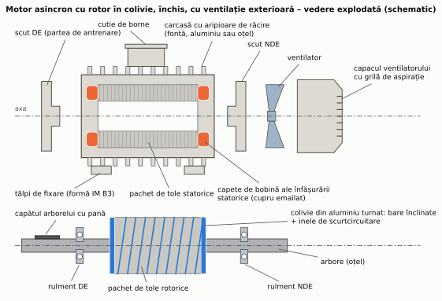

*Figura 2.1 – Părțile componente ale unui motor asincron închis, cu ventilație exterioară (rândul de sus: carcasa cu statorul și piesele fixe; rândul de jos: rotorul scos din stator).*

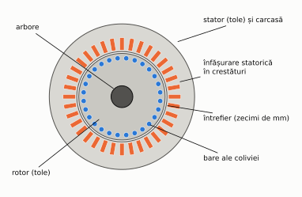

*Figura 2.2 – Secțiune transversală printr-un motor asincron cu rotorul în colivie (schematic).*

### Carcasa și scuturile

**Carcasa** susține statorul și transmite căldura spre exterior prin **aripioare**. Se face din fontă, din aluminiu (la motoarele mici, mai ușoare) sau din oțel sudat (la motoarele mari). Motorul se fixează prin **tălpi** (forma de montaj IM B3), prin **flanșă** (IM B5) sau prin ambele (IM B35), după IEC 60034-7 [S19]. Cele două **scuturi** închid carcasa la capete și poartă lagărele: scutul **DE** (*drive end*) pe partea capătului de arbore care antrenează mașina de lucru și scutul **NDE** pe partea opusă.

**Gabaritul** motoarelor este standardizat (IEC 60072-1 [S14]): numărul gabaritului este **înălțimea axului** față de planul tălpilor, în milimetri. De exemplu, gabaritul **160** are axul la 160 mm, capătul de arbore de Ø42 × 110 mm și pana de 12 × 8 mm [W9]. Literele **S, M, L** care urmează (160M, 160L) desemnează carcase de lungimi diferite, pentru pachete de tole mai scurte sau mai lungi: înălțimea axului rămâne aceeași, dar distanța dintre găurile tălpilor pe direcția axului crește (210 mm la 160M, 254 mm la 160L [W9]). Standardizarea permite înlocuirea unui motor cu altul, de la alt producător, fără modificarea fundației sau a cuplajului.

### Miezul statoric

Miezul este un pachet de **tole de oțel electrotehnic cu grăunți neorientați** (proprietăți magnetice aproape aceleași în toate direcțiile – necesar, pentru că fluxul se rotește), groase de 0,35–0,65 mm și izolate. Marca tablei arată pierderile garantate (EN 10106 [S11], [W1], [W2]): **M400-50A** înseamnă cel mult **4,00 W/kg** la **1,5 T** și 50 Hz, grosime **0,50 mm**, tablă livrată complet tratată (**A**); **M270-35A** – 2,70 W/kg, 0,35 mm. Pentru randamente mai mari se folosesc table cu pierderi specifice mai mici și mai subțiri.

Tolele se ștanțează cu **crestăturile** deschise spre întrefier (figura 2.3a); pachetul se presează și se fixează în carcasă. Fierul dintre crestături formează **dinții**, iar coroana exterioară – **jugul**.

### Înfășurarea statorică

- La motoarele de **joasă tensiune**, bobinele se fac din **sârmă rotundă de cupru emailată** și se introduc spiră cu spiră, prin deschiderea îngustă a **crestăturilor semiînchise**. Crestătura este căptușită cu **izolație de crestătură** (folii stratificate din materiale electroizolante), iar bobinele sunt reținute de o **pană** (figura 2.3a). Între fazele din aceeași crestătură și între capetele de bobină ale fazelor diferite se pun separatoare.
- La motoarele de **înaltă tensiune** (de exemplu 6 kV), bobinele sunt **preformate** din conductor dreptunghiular și izolate cu **bandă de mică**; ele se introduc în **crestături deschise**.
- Înfășurarea finită se **impregnează** cu lac sau rășină, care leagă conductoarele între ele, îmbunătățește transmiterea căldurii și protejează împotriva umidității. Clasa termică a sistemului de izolație (de exemplu F – 155 °C, § 0.9) este a ansamblului de materiale, nu a unui singur material.

Capetele celor trei faze se aduc în **cutia de borne** și se marchează **U1–U2, V1–V2, W1–W2** (IEC 60034-8 [S13]). Pe placa de borne, capetele sunt așezate astfel încât conexiunea **stea** sau **triunghi** să se facă doar prin mutarea a trei punți (figura 2.4).

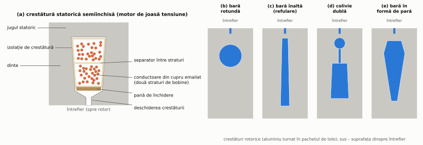

*Figura 2.3 – (a) Crestătura statorică semiînchisă a unui motor de joasă tensiune; (b)–(e) forme de crestături rotorice.*

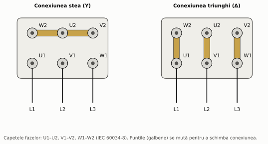

*Figura 2.4 – Placa de borne și punțile pentru conexiunile stea și triunghi.*

### Rotorul

**Rotorul în colivie.** Pachetul de tole rotorice are crestături în care se toarnă sub presiune **aluminiu**; barele și cele două **inele de scurtcircuitare** (adesea cu aripioare de ventilație) se formează dintr-o singură bucată (figura 2.5).

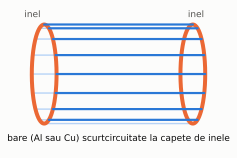

*Figura 2.5 – Colivia rotorică (fără miezul de tole).* La motoarele mari, colivia se face din bare de cupru sau aliaje de cupru, lipite de inele. **Colivia din cupru turnat** reduce pierderile din rotor și crește randamentul (cuprul conduce mai bine), dar turnarea este mai dificilă din cauza temperaturii de topire mai mari; rotorul trebuie reproiectat, pentru că se modifică și cuplul de pornire [W11].

**Forma crestăturilor rotorice** (figura 2.3b–e) stabilește caracteristicile de pornire: barele rotunde dau un motor cu alunecare mică și cuplu de pornire modest, iar **barele înalte** și **colivia dublă** folosesc efectul de refulare pentru un cuplu de pornire mare (§ 2.7).

**Înclinarea barelor.** Barele nu sunt paralele cu axa, ci ușor **înclinate** (cu aproximativ un pas de crestătură pe lungimea pachetului; figura 2.1). Înclinarea atenuează cuplurile parazite și zgomotul magnetic produse de interacțiunea dinților statorici și rotorici.

**Rotorul bobinat** are în crestături o înfășurare trifazată asemănătoare celei statorice, legată în stea, cu capetele aduse la trei **inele colectoare** pe arbore. Pe inele calcă **perii** din grafit sau metal-grafit, prin care se conectează rezistențele exterioare (§ 2.7). Construcția este mai scumpă și necesită întreținerea periilor.

### Întrefierul

Întrefierul este cât de mic permit toleranțele de execuție și deformațiile arborelui: de ordinul **zecimilor de milimetru** la motoarele mici și mijlocii, mai mare la mașinile mari și la cele rapide [W12]. Un întrefier mai mic reduce curentul de magnetizare și crește factorul de putere (§ 0.3, § 2.3), dar mărește pierderile suplimentare și riscul ca rotorul să atingă statorul.

### Arborele, lagărele și ventilația

- **Arborele** (oțel) transmite cuplul; capătul DE are o **pană** pentru cuplaj sau roată de curea.
- **Lagărele** sunt, la motoarele mici și mijlocii, **rulmenți radiali cu bile**. Simbolul rulmentului arată tipul și dimensiunile; de exemplu **6309-2Z/C3**: 6 – rulment radial cu bile; 3 – seria de dimensiuni; 09 – alezajul de 9 × 5 = **45 mm**; 2Z – două scuturi metalice de protecție; C3 – joc radial interior mai mare decât cel normal [W25]. Când arborele este încărcat radial puternic (transmisii prin curele), la capătul DE se folosesc rulmenți cu role. La motoarele alimentate de la convertor, rulmentul NDE poate fi **izolat electric**, pentru a întrerupe curenții prin lagăre (§ 5.9, § 5.12).
- **Ventilația**: un **ventilator** montat pe arbore, la capătul NDE, suflă aer printre aripioarele carcasei; ventilatorul este protejat de un **capac** cu grilă. Interiorul motorului rămâne închis (grad de protecție uzual IP55), iar metoda de răcire se notează **IC 411** (IEC 60034-6 [S20]).

### Fișa constructivă a unui motor real de 15 kW

Motorul de referință M15 are date construite pentru curs. Un motor real cu aceleași date nominale (15 kW, 4 poli, 50 Hz, IE3), din catalogul unui producător, are de exemplu: gabaritul **160L** (axul la 160 mm), capăt de arbore **Ø42 × 110 mm**, execuție cu tălpi (IM B3) sau cu flanșă (IM B5), grad de protecție **IP55**, răcire **IC 411**, rulmentul DE **6309-2Z/C3** și randamentul nominal **92,1 %** – exact minimul clasei IE3 la această putere (§ 2.11) [W10].

## 2.2. Principiul de funcționare. Alunecarea

1. Înfășurarea statorică produce un câmp învârtitor cu viteza de sincronism $n_1 = 60 f_1/p$.
2. Câmpul „taie” barele rotorului aflat în repaus și induce în ele tensiuni (inducție de mișcare, $e = Blv$, § 0.4).
3. Colivia fiind închisă, prin bare circulă curenți.
4. Asupra barelor parcurse de curent, aflate în câmp magnetic, acționează forțe ($F = BIl$, § 0.5) care rotesc rotorul **în sensul câmpului** (regula lui Lenz: rotorul „încearcă” să reducă viteza relativă care a produs curenții).

Dacă rotorul ar ajunge la viteza câmpului, barele nu ar mai fi „tăiate” de câmp: nu s-ar mai induce tensiuni, nu ar mai exista curenți și cuplu. Rotorul se rotește deci întotdeauna **puțin mai încet** decât câmpul – de aici numele de mașină **asincronă**. Diferența relativă de viteză se numește **alunecare**:

$$\boxed{s = \frac{n_1 - n}{n_1}}, \qquad n = n_1(1 - s) .$$

La sarcină nominală, $s_n$ este de ordinul 1–5 % (mai mic la motoarele mari). Motorul M15: $s_n = (1500 - 1466)/1500 = 2{,}27$ %.

**Frecvența mărimilor rotorice.** Câmpul se rotește față de rotor cu $n_1 - n = s\thinspace n_1$, deci tensiunile și curenții rotorici au frecvența

$$f_2 = s\thinspace f_1 .$$

La pornire ($s = 1$), $f_2 = f_1 = 50$ Hz; la funcționarea nominală a lui M15, $f_2 = 1{,}13$ Hz. Câmpul produs de curenții rotorici se rotește față de rotor cu $s\thinspace n_1$, deci față de stator cu $n + s\thinspace n_1 = n_1$: **câmpurile statoric și rotoric sunt fixe unul față de altul**, condiția pentru un cuplu constant.

## 2.3. Schema echivalentă

Mașina asincronă cu rotorul blocat este un **transformator** cu secundarul în scurtcircuit (statorul = primar, rotorul = secundar). Cu rotorul în mișcare se schimbă doar frecvența rotorică; se poate arăta că mașina se comportă ca un transformator la frecvența $f_1$, la care rezistența rotorică raportată devine $R_2'/s$ [1, 2]. Rezultă **schema echivalentă pe fază** (figura 2.6), identică cu cea a transformatorului (§ 1.4), cu sarcina $R_2'/s$:

$$\frac{R_2'}{s} = R_2' + R_2'\thinspace \frac{1-s}{s} .$$

Primul termen reprezintă pierderile Joule reale din rotor, al doilea – o **rezistență fictivă de sarcină**, în care puterea disipată este egală cu puterea mecanică.

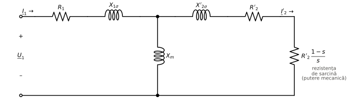

*Figura 2.6 – Schema echivalentă pe fază a mașinii asincrone. Pierderile în fier se grupează aici cu cele mecanice în $P_0$ (se determină împreună, din încercarea de mers în gol).*

Diferențe față de transformator: din cauza întrefierului, **curentul de magnetizare este mult mai mare** (25–50 % din $I_n$ la motoarele mici și mijlocii; la M15, $I_\mu = 11{,}4$ A, adică 41 %), iar factorul de putere în gol este foarte mic.

**Pentru motoarele conectate în triunghi** se lucrează cu **steaua echivalentă**: aceeași putere, tensiunea de fază $U_n/\sqrt3$, curentul egal cu cel de linie.

## 2.4. Bilanțul puterilor și cuplul

Puterea absorbită din rețea, $P_1 = \sqrt3 U I\cos\varphi$, se împarte astfel (figura 2.7):

| Mărime | Formulă | Unde se consumă |
|---|---|---|
| pierderi în cuprul statoric | $P_{Cu1} = 3R_1I_1^2$ | înfășurarea statorică |
| pierderi în fier (în $P_0$) | $P_{Fe}$ | miezul statoric (cel rotoric are frecvența mică $f_2$) |
| **puterea electromagnetică** | $P_\delta = 3\thinspace \dfrac{R_2'}{s}\thinspace I_2'^2$ | trece prin întrefier spre rotor |
| pierderi în cuprul rotoric | $P_{Cu2} = 3R_2'I_2'^2 = s\thinspace P_\delta$ | colivia |
| puterea mecanică internă | $P_{mi} = (1-s)\thinspace P_\delta$ | |
| pierderi mecanice (în $P_0$) | $P_m$ | lagăre, ventilator |
| **puterea utilă** | $P_2 = P_{mi} - P_m$ | arborele |

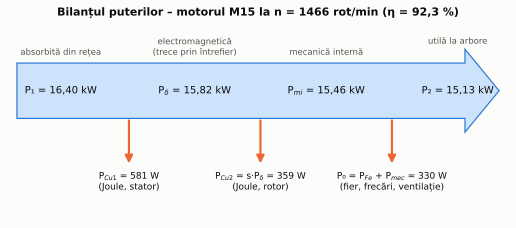

*Figura 2.7 – Bilanțul puterilor motorului M15 la 1466 rot/min, calculat din schema echivalentă (problema 2.2).*

Relația $P_{Cu2} = s\thinspace P_\delta$ este fundamentală: **o fracțiune egală cu alunecarea din puterea care ajunge la rotor se pierde în rotor**. O mașină care funcționează cu alunecare mare are, inevitabil, randament mic.

**Cuplul electromagnetic.** Câmpul transmite rotorului puterea $P_\delta$ cu viteza $\Omega_1$, deci

$$\boxed{M = \frac{P_\delta}{\Omega_1} = \frac{P_{mi}}{\Omega}}, \qquad \Omega_1 = \frac{2\pi n_1}{60} .$$

Cuplul util la arbore este $M_2 = P_2/\Omega$. Formula practică: $M\thinspace [\text{N·m}] = 9550\cdot P\thinspace [\text{kW}]/n\thinspace [\text{rot/min}]$.

## 2.5. Caracteristica mecanică

Mutând ramura de magnetizare la bornele de alimentare (schema Γ; pentru curentul rotoric efectul este același cu neglijarea ei, ca în schema simplificată a transformatorului) și notând $X_{sc} = X_{1\sigma} + X_{2\sigma}'$, curentul rotoric este $I_2' = U_f/\sqrt{(R_1 + R_2'/s)^2 + X_{sc}^2}$, deci

$$M = \frac{3\thinspace U_f^2\thinspace R_2'/s}{\Omega_1\left[\left(R_1 + R_2'/s\right)^2 + X_{sc}^2\right]} .$$

Derivând în raport cu $s$:

$$s_k = \frac{R_2'}{\sqrt{R_1^2 + X_{sc}^2}}, \qquad M_{max} = \frac{3\thinspace U_f^2}{2\thinspace \Omega_1\left(R_1 + \sqrt{R_1^2 + X_{sc}^2}\right)} .$$

Consecințe importante, valabile și pentru calculul exact:

- **$M \propto U^2$**: la o scădere a tensiunii cu 10 %, cuplul (inclusiv cel maxim și cel de pornire) scade cu circa 19 %;
- **$M_{max}$ nu depinde de $R_2'$**, dar **$s_k$ este proporțional cu $R_2'$** (figura 2.11);
- în zona de funcționare normală (s mic), cuplul este aproximativ proporțional cu alunecarea: caracteristica este „rigidă” (viteza scade puțin cu sarcina).

**Formula lui Kloss.** Neglijând și $R_1$, raportul $M/M_{max}$ depinde doar de $s/s_k$:

$$\boxed{M = \frac{2\thinspace M_{max}}{\dfrac{s}{s_k} + \dfrac{s_k}{s}}}$$

Este foarte utilă pentru că se aplică direct pe **datele de catalog**: din $s_n$ și capacitatea de supraîncărcare $\lambda = M_{max}/M_n$ rezultă

$$s_k = s_n\left(\lambda + \sqrt{\lambda^2 - 1}\right).$$

### Regimurile de funcționare

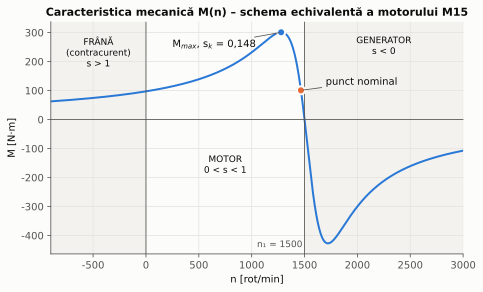

*Figura 2.8 – Caracteristica mecanică completă a motorului M15 (schema echivalentă).*

| Regim | Alunecare | Viteză | Puterea mecanică |
|---|---|---|---|
| **motor** | $0 < s < 1$ | $0 < n < n_1$, în sensul câmpului | cedată la arbore |
| **generator** | $s < 0$ | $n > n_1$ (antrenat din exterior) | primită la arbore, cedată rețelei |
| **frână (contracurent)** | $s > 1$ | rotorul se rotește invers față de câmp | primită și la arbore, și din rețea; totul se transformă în căldură în rotor |

Ramura dintre $s = 0$ și $s_k$ este zona **stabilă** de funcționare ca motor (strict, pentru sarcini cu cuplu constant sau crescător cu viteza; criteriul general este în § 5.5): dacă sarcina crește, viteza scade puțin și cuplul motorului crește până echilibrează sarcina (§ 5.5). Dacă sarcina depășește $M_{max}$, motorul se oprește („se calează”) și absoarbe curentul de pornire – protecțiile trebuie să-l deconecteze.

## 2.6. Caracteristicile de funcționare

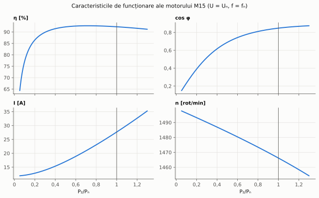

*Figura 2.9 – Randamentul, factorul de putere, curentul și turația lui M15 în funcție de puterea utilă.*

Observații practice:

- **randamentul** este aproape constant între 50 % și 100 % din sarcină și scade puternic la sarcini mici;
- **factorul de putere** scade mult la sarcini mici, pentru că motorul absoarbe practic același curent de magnetizare (reactiv) la orice sarcină;
- **concluzie:** motoarele **supradimensionate**, care lucrează mult timp la sarcină mică, au randament și $\cos\varphi$ mici. Motorul se alege cât mai aproape de puterea cerută (cap. 5).

## 2.7. Pornirea

La pornire ($s = 1$), impedanța motorului este mică, iar **curentul de pornire** este de 5–8 ori curentul nominal (la M15, 6,8·$I_n$). Problemele sunt: căderea de tensiune în rețea (care afectează alți consumatori), solicitările termice și electrodinamice ale motorului și șocul mecanic asupra transmisiei.

### Pornirea directă

Motorul se conectează direct la rețea, printr-un contactor (schema de forță în figura 5.9). Este cea mai simplă și cea mai ieftină metodă și se folosește ori de câte ori rețeaua și mașina de lucru permit.

### Pornirea stea-triunghi

Motorul (prevăzut pentru funcționare în **triunghi** la tensiunea rețelei) este pornit în **stea** și trecut în triunghi aproape de turația nominală. În stea, fiecare înfășurare primește $U/\sqrt3$, deci (problema 0.4, problema 2.4):

$$I_{p,Y} = \frac{I_{p,\Delta}}{3}, \qquad M_{p,Y} = \frac{M_{p,\Delta}}{3} .$$

Metoda este potrivită pentru pornirea **în gol sau cu sarcină mică** (ventilatoare, pompe centrifuge, unele mașini-unelte), nu și pentru sarcini cu cuplu mare la pornire (figura 2.10).

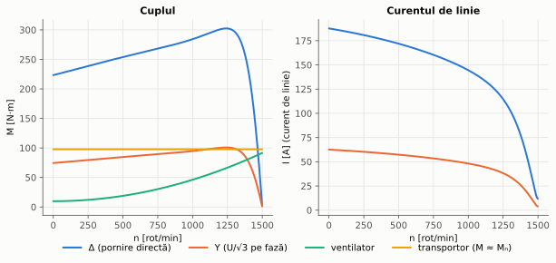

*Figura 2.10 – Cuplul și curentul lui M15 în conexiune triunghi și stea (model cu colivie dublă, § 2.7), comparate cu un ventilator și un transportor.*

### Alte metode

- **Autotransformator de pornire** cu raportul $k$ ($U_{motor} = U/k$): curentul motorului scade de $k$ ori, curentul din rețea de $k^2$ ori, iar cuplul de $k^2$ ori.
- **Pornitor static (soft-starter)**: tiristoare care cresc treptat tensiunea; curentul scade proporțional cu tensiunea, cuplul cu pătratul ei.
- **Convertor de frecvență**: pornire cu curent apropiat de cel nominal și cuplu mare, pentru că frecvența crește treptat de la valori mici, iar viteza de alunecare $n_1 - n$ (deci frecvența rotorică $f_2$) rămâne mică (§ 2.8); este soluția cea mai bună tehnic, dar și cea mai scumpă.
- **Rezistențe în circuitul rotoric** (doar la motoarele cu **rotor bobinat**): mărind $R_2'$, $s_k$ crește (figura 2.11) și cuplul maxim poate fi obținut chiar la pornire, cu curent redus. Rezistențele se scot treptat pe măsură ce motorul accelerează.

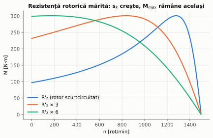

*Figura 2.11 – Mărirea rezistenței rotorice deplasează cuplul maxim spre turații mici, fără să-i modifice valoarea.*

### Efectul de refulare (colivia dublă, barele înalte)

Un motor cu colivie obișnuită și parametri constanți nu poate avea simultan alunecare nominală mică (randament bun) și cuplu de pornire mare: primul cere $R_2'$ mic, al doilea $R_2'$ mare. Soluția constructivă folosește **efectul de refulare (pelicular)**: la pornire, frecvența rotorică este 50 Hz și curentul se concentrează în partea barelor dinspre întrefier (bare înalte sau colivia exterioară a unei colivii duble), unde rezistența este mare; la funcționarea normală ($f_2 \approx 1$ Hz) curentul se repartizează uniform și rezistența este mică.

Figura 2.12 compară, pentru M15: modelul cu parametri constanți, formula lui Kloss (aplicată pe datele de catalog) și un **model cu colivie dublă**, ai cărui parametri ($X_{2c}$ = 0,23 Ω, ramurile 0,51 Ω + j0,21 Ω și 0,33 Ω + j1,39 Ω) au fost ajustați pentru curs astfel încât să reproducă datele de catalog. Primele două modele descriu bine zona de funcționare, dar **subestimează cuplul de pornire de 2,3–2,8 ori** – formula lui Kloss nu se folosește pentru calculul pornirii motoarelor cu colivie (problema 2.3).

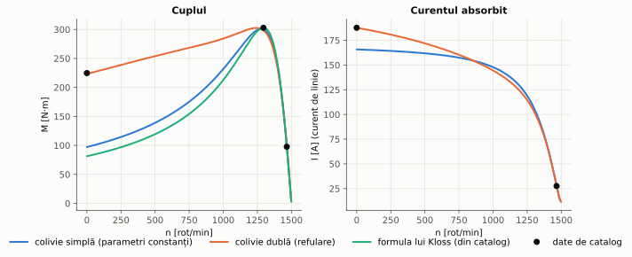

*Figura 2.12 – Cuplul și curentul motorului M15: modele comparate cu datele de catalog (punctele negre).*

## 2.8. Reglarea vitezei

Din $n = \dfrac{60 f_1}{p}(1 - s)$ rezultă trei căi:

1. **Schimbarea numărului de perechi de poli** – în trepte (de exemplu 1500/3000 rot/min cu conexiunea Dahlander); motoare speciale, pentru ventilatoare, mașini-unelte.
2. **Schimbarea frecvenței** – cu **convertor de frecvență** (§ 5.9); reglaj continuu, economic, cu randament bun. Este metoda modernă și cea mai răspândită.
3. **Schimbarea alunecării** – prin reducerea tensiunii sau prin rezistențe în rotor; metode **neeconomice**, pentru că puterea $s\thinspace P_\delta$ se pierde în rotor (§ 2.4).

### Comanda U/f = constant

Fluxul este proporțional cu $U/f$ (§ 0.4). Ca să rămână nominal (cuplul maxim să se păstreze, iar miezul să nu se satureze), convertorul modifică tensiunea proporțional cu frecvența: la 30 Hz, $U = 400\cdot 30/50 = 240$ V. Neglijând $R_1$, cuplul depinde doar de $U/f$ și de **viteza de alunecare** $n_1 - n$, astfel că **familia de caracteristici se deplasează paralel** (figura 2.13): la cuplu constant, $n_1 - n$ rămâne aproximativ același la orice frecvență (problema 2.5).

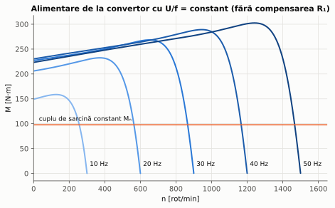

*Figura 2.13 – Caracteristicile mecanice ale lui M15 la U/f = constant. La frecvențe mici, căderea de tensiune pe $R_1$ reduce cuplul maxim; convertoarele compensează printr-o tensiune suplimentară („boost”).*

Peste frecvența nominală tensiunea nu mai poate crește (este limitată de rețea); fluxul scade ca $1/f$, iar motorul lucrează la **putere aproximativ constantă** (zona de „slăbire a câmpului”).

## 2.9. Frânarea electrică

- **Frânarea recuperativă (generator):** când $n > n_1$ – de exemplu la coborârea unei sarcini sau când convertorul scade frecvența – mașina trece în regim de generator și trimite energie înapoi (în rețea sau în circuitul intermediar al convertorului, § 5.9).
- **Frânarea în contracurent:** se inversează două faze în timpul mersului; câmpul își schimbă sensul, iar $s \approx 2$. Frânarea este energică, dar curenții sunt foarte mari și toată energia se transformă în căldură în rotor. Motorul trebuie deconectat la $n = 0$, altfel pornește în sens invers.
- **Frânarea dinamică (cu curent continuu):** statorul deconectat de la rețea se alimentează în c.c.; câmpul devine fix, iar rotorul care se rotește în el produce un cuplu de frânare. Energia cinetică se disipă în rotor.

## 2.10. Generatorul asincron. Motorul monofazat

**Generatorul asincron.** Antrenată peste viteza de sincronism, mașina asincronă livrează putere activă rețelei, dar **absoarbe în continuare putere reactivă** pentru magnetizare. Se folosește în microhidrocentrale și în unele turbine eoliene; la turbinele eoliene moderne de putere mare sunt răspândite **generatorul asincron dublu alimentat** (cu rotor bobinat și convertor în rotor) și generatoarele sincrone cu convertor complet.

**Motorul asincron monofazat.** O înfășurare monofazată produce un câmp **pulsatoriu**, echivalent cu două câmpuri care se rotesc în sensuri opuse; la pornire cuplurile lor se anulează. Pentru pornire se adaugă o **înfășurare auxiliară** decalată în spațiu, alimentată printr-un **condensator**, care creează un câmp învârtitor. Se folosește la puteri mici (electrocasnice, pompe, ventilatoare mici).

## 2.11. Eficiența energetică – clasele IE

Standardul IEC 60034-30-1 [S2] definește clasele de randament **IE1** (standard) ... **IE4** (super-premium), cu valori minime în funcție de putere și de numărul de poli (exemplu, 15 kW, 4 poli, 50 Hz: IE2 – 90,6 %, IE3 – 92,1 %, IE4 – 93,9 %, după ediția din 2014); ediția a 2-a (decembrie 2025) adaugă și clasa **IE5**. În UE, **Regulamentul (UE) 2019/1781** [S6] impune, din **1 iulie 2021**, cel puțin clasa **IE3** pentru motoarele trifazate de 0,75–1000 kW (2–8 poli) și, din **1 iulie 2023**, clasa **IE4** pentru motoarele de 75–200 kW cu 2, 4 sau 6 poli (cu unele excepții, de exemplu motoarele cu frână sau cele antideflagrante); variatoarele de viteză trebuie să îndeplinească clasa IE2 a convertoarelor.

Diferența de randament pare mică, dar motoarele funcționează mii de ore pe an: problema 2.6 arată că pentru un singur motor de 15 kW, trecerea de la IE2 la IE3 economisește peste 1000 kWh/an.

---

## Probleme rezolvate

Toate rezultatele sunt calculate și verificate de scriptul [`scripts/probleme_cap02.py`](scripts/probleme_cap02.py).

### Problema 2.1 – Alunecarea și frecvența rotorică

Pentru o mașină cu 4 poli la 50 Hz ($n_1$ = 1500 rot/min), calculați $s$ și $f_2$ la: (a) $n$ = 1466 rot/min; (b) pornire; (c) $n$ = 1530 rot/min.

**Rezolvare.**

| | $n$ [rot/min] | $s$ | $f_2 = \lvert s\rvert f_1$ | regim |
|---|---|---|---|---|
| (a) | 1466 | $34/1500 = 0{,}0227$ | 1,13 Hz | motor |
| (b) | 0 | 1 | 50 Hz | pornire |
| (c) | 1530 | $-30/1500 = -0{,}02$ | 1,0 Hz | **generator** ($s<0$) |

### Problema 2.2 – Funcționarea motorului M15 calculată din schema echivalentă

Calculați curentul, factorul de putere, puterile, pierderile, cuplul și randamentul lui M15 la $n$ = 1466 rot/min.

**Rezolvare.** $s = 0{,}022667$, $R_2'/s = 8{,}8235$ Ω, $U_f = 400/\sqrt3 = 230{,}94$ V.

1. Impedanța rotorică: $\underline{Z}_2' = 8{,}8235 + j0{,}75$ Ω; în paralel cu $jX_m = j19$ Ω: $\underline{Z}_p = 6{,}8074 + j3{,}7628$ Ω.
2. Impedanța totală: $\underline{Z} = R_1 + jX_{1\sigma} + \underline{Z}_p = 7{,}0574 + j4{,}3628 = 8{,}297\angle 31{,}72°$ Ω.
3. Curentul: $\underline{I}_1 = U_f/\underline{Z} = 27{,}83\angle -31{,}72°$ A, deci $\cos\varphi = 0{,}851$. (Motorul fiind în triunghi, 27,83 A este curentul de linie; prin fiecare înfășurare trec $27{,}83/\sqrt3 = 16{,}07$ A.)
4. Tensiunea pe ramura de magnetizare: $\underline{E} = U_f - (R_1 + jX_{1\sigma})\underline{I}_1 = 216{,}5\angle -2{,}79°$ V; curentul rotoric $I_2' = E/\lvert\underline{Z}_2'\rvert = 24{,}45$ A; curentul de magnetizare $I_\mu = E/X_m = 11{,}39$ A.
5. Puterile:

| $P_1$ | $P_{Cu1}$ | $P_\delta$ | $P_{Cu2} = sP_\delta$ | $P_{mi}$ | $P_0$ | $P_2$ |
|---|---|---|---|---|---|---|
| 16 403 W | 581 W | 15 822 W | 359 W | 15 463 W | 330 W | **15 133 W** |

6. Cuplul: $M = P_\delta/\Omega_1 = 15\thinspace 822/157{,}08 = 100{,}7$ N·m; la arbore $M_2 = P_2/\Omega = 15\thinspace 133/153{,}52 = 98{,}6$ N·m. Randamentul: $\eta = 15\thinspace 133/16\thinspace 403 = 92{,}3$ %.

**Verificări (căi independente).**
- Bilanțul: $P_2 + P_{Cu1} + P_{Cu2} + P_0 = P_1$ ✓ (exact).
- Cuplul: $P_\delta/\Omega_1 = P_{mi}/\Omega = 100{,}7$ N·m ✓.
- $P_1 = 3U_fI_1\cos\varphi = 16\thinspace 403$ W ✓; $P_{Cu2} = 3R_2'I_2'^2 = sP_\delta = 359$ W ✓.
- Rezultatele concordă cu datele de catalog (15 kW, 27,6 A, 0,85, 92,3 %) cu abateri sub 1 %.
- Cuplul maxim: căutare numerică pe schema completă și formula analitică pe echivalentul Thévenin dau aceeași valoare, $M_{max} = 300{,}9$ N·m la $s_k = 0{,}1476$ ✓. Formulele din § 2.5 (schema Γ) dau 313,8 N·m – o supraestimare de 4,3 %, prețul simplificării.

### Problema 2.3 – Formula lui Kloss din datele de catalog

Folosind doar datele de catalog ale lui M15, calculați: (a) cuplul la $n$ = 1440 rot/min; (b) turația la cuplul $0{,}5M_n$; (c) cuplul de pornire prezis de formulă.

**Rezolvare.** $s_n = 0{,}02267$, $M_n = 9550\cdot 15/1466 = 97{,}71$ N·m, $M_{max} = 3{,}1\thinspace M_n = 302{,}9$ N·m,

$$s_k = s_n\left(\lambda + \sqrt{\lambda^2-1}\right) = 0{,}02267\thinspace (3{,}1 + 2{,}934) = 0{,}1368 .$$

**(a)** $s = 0{,}04$: $M = \dfrac{2\cdot 302{,}9}{0{,}04/0{,}1368 + 0{,}1368/0{,}04} = 163{,}2$ N·m. *Verificare:* formula este calibrată pe cuplul util din catalog, deci se compară cu cuplul util al schemei echivalente (problema 2.2) la aceeași alunecare: $M_2 = 161{,}8$ N·m – abatere 0,9 % ✓ (cuplul electromagnetic este 164,0 N·m).

**(b)** Rezolvând ecuația lui Kloss pentru $M/M_{max} = m$: $s = s_k\left(\dfrac1m - \sqrt{\dfrac1{m^2} - 1}\right)$, cu $m = 48{,}85/302{,}9$: $s = 0{,}01110$, $n = 1483{,}3$ rot/min. *Verificare:* rezolvarea numerică dă aceeași valoare ✓; aproximarea liniară $s \approx s_n M/M_n = 0{,}01133$ ($n$ = 1483 rot/min) este și ea foarte bună în această zonă.

**(c)** La $s = 1$: $M_p = 81{,}3$ N·m $= 0{,}83\thinspace M_n$, față de $2{,}3\thinspace M_n = 224{,}7$ N·m din catalog. Diferența nu este o eroare de calcul, ci limita modelului cu parametri constanți (§ 2.7, efectul de refulare). Modelul cu colivie dublă dă $M_p = 2{,}29\thinspace M_n$ și $I_p = 6{,}80\thinspace I_n$, adică datele de catalog ✓.

### Problema 2.4 – Pornirea stea-triunghi

Calculați curentul și cuplul de pornire ale lui M15 pornit în stea. Poate porni astfel (a) un ventilator ($M_r \approx 0{,}1M_n$ la pornire); (b) un transportor ($M_r \approx M_n$)?

**Rezolvare.** În triunghi (catalog): $I_{p\Delta} = 6{,}8\cdot 27{,}6 = 187{,}7$ A, $M_{p\Delta} = 2{,}3\cdot 97{,}71 = 224{,}7$ N·m. În stea: $I_{pY} = 62{,}6$ A, $M_{pY} = 74{,}9$ N·m $= 0{,}77\thinspace M_n$.

(a) $74{,}9 > 9{,}8$ N·m – **ventilatorul pornește**; (b) $74{,}9 < 97{,}7$ N·m – **transportorul nu pornește** în stea.

**Verificare (prin impedanțe).** Impedanța unei înfășurări la pornire: $Z_f = 400/(187{,}7/\sqrt3) = 3{,}69$ Ω. În stea: $I_{pY} = (400/\sqrt3)/3{,}69 = 62{,}6$ A ✓; cuplul $\propto U_f^2$: $224{,}7\cdot(1/\sqrt3)^2 = 74{,}9$ N·m ✓. Figura 2.10 confirmă grafic ambele concluzii.

### Problema 2.5 – Alimentarea de la convertor de frecvență (U/f = constant)

M15 antrenează un cuplu de sarcină constant egal cu cel nominal și este alimentat la 30 Hz, 240 V. Cu ce viteză se rotește?

**Rezolvare (aproximativă).** $n_1 = 60\cdot 30/2 = 900$ rot/min. La U/f constant și $R_1$ neglijat, la același cuplu viteza de alunecare rămâne 1500 − 1466 = 34 rot/min, deci $n \approx 900 - 34 = 866$ rot/min.

**Verificare (schema echivalentă la 30 Hz, reactanțe înmulțite cu 30/50):** pentru același cuplu electromagnetic rezultă $s = 0{,}0393$, $n = 864{,}6$ rot/min – diferență de 0,16 % ✓.

**Observație:** la 30 Hz, cuplul maxim scade de la 300,9 la 267,7 N·m din cauza căderii pe $R_1$; pentru a-l reface ar fi necesară o tensiune de 254,5 V în loc de 240 V („boost”). La 5 Hz, fără compensare, cuplul maxim ar fi doar 91,7 N·m – sub cel nominal.

### Problema 2.6 – Economia de energie IE3 față de IE2

Un motor de 15 kW, 4 poli, funcționează 4000 h/an la sarcină nominală. Cât se economisește înlocuind un motor IE2 (η = 90,6 %) cu unul IE3 (η = 92,1 %)?

**Rezolvare.** $P_1 = 15/0{,}906 = 16{,}556$ kW, respectiv $15/0{,}921 = 16{,}287$ kW; diferența este 0,270 kW, adică **1079 kWh/an**.

**Verificare (prin pierderi).** Pierderile sunt $15(1/\eta - 1)$: 1,556 kW (IE2) și 1,287 kW (IE3); diferența este aceeași, 0,270 kW ✓. Pierderile scad cu 17 %, deși randamentul crește doar cu 1,5 puncte procentuale.

---

## Întrebări de autoevaluare

1. De ce rotorul unui motor asincron nu poate atinge viteza câmpului învârtitor?
2. Ce este alunecarea? Ce valori are la pornire, la mers în gol ideal și la sarcină nominală?
3. Ce frecvență au curenții din rotor la funcționarea nominală? De ce sunt mici pierderile în fierul rotoric?
4. Ce reprezintă rezistența $R_2'(1-s)/s$ din schema echivalentă?
5. De ce motorul asincron are un factor de putere mai mic decât un transformator de aceeași putere?
6. Cum se modifică cuplul maxim și cel de pornire dacă tensiunea rețelei scade cu 10 %?
7. Ce se întâmplă dacă se mărește rezistența rotorică a unui motor cu rotor bobinat?
8. Când se poate folosi pornirea stea-triunghi? Ce condiție trebuie să îndeplinească motorul?
9. De ce formula lui Kloss nu este potrivită pentru calculul pornirii motoarelor cu colivie?
10. De ce, la comanda U/f, tensiunea se mărește proporțional cu frecvența?
11. De ce reglarea vitezei prin rezistențe rotorice este neeconomică?
12. Ce regim de funcționare are o mașină asincronă antrenată peste viteza de sincronism?
13. De ce motoarele supradimensionate sunt ineficiente?
14. Ce clasă de randament minimă este obligatorie în UE pentru un motor nou de 15 kW?
15. Ce înseamnă gabaritul 160L? Ce avantaj practic aduce standardizarea gabaritelor?
16. Ce înseamnă marca de tablă M400-50A? De ce statorul folosește tablă cu grăunți neorientați?
17. Cum se execută o colivie din aluminiu? De ce barele sunt ușor înclinate față de axă?
18. Ce înseamnă simbolul rulmentului 6309-2Z/C3?
19. De ce întrefierul se face cât mai mic, dar nu oricât de mic?

<b>Răspunsuri</b>

1. La viteza câmpului, barele nu ar mai fi intersectate de câmp, nu s-ar induce tensiuni, nu ar exista curenți rotorici și nici cuplu (§ 2.2).
2. $s = (n_1 - n)/n_1$; $s = 1$ la pornire, $s = 0$ la mers în gol ideal, $s_n$ de ordinul 1–5 % la sarcină nominală.
3. $f_2 = s f_1$, de ordinul 1–2 Hz; pierderile în fier depind puternic de frecvență, deci în rotor sunt neglijabile (§ 2.2, § 2.4).
4. Rezistența fictivă în care puterea disipată este egală cu puterea mecanică internă (§ 2.3).
5. Din cauza întrefierului, care cere un curent de magnetizare (reactiv) mult mai mare (§ 2.3).
6. Ambele scad cu circa 19 %, pentru că sunt proporționale cu $U^2$ ($0{,}9^2 = 0{,}81$) (§ 2.5).
7. Cuplul maxim rămâne același, dar apare la o alunecare mai mare (o viteză mai mică); cuplul de pornire crește (dacă $s_k \le 1$), iar curentul de pornire scade (§ 2.7, figura 2.11).
8. La pornirea în gol sau cu sarcină mică, deoarece cuplul scade de 3 ori. Motorul trebuie să fie prevăzut pentru funcționare în triunghi la tensiunea rețelei (de exemplu 400/690 V la rețeaua de 400 V) (§ 2.7).
9. Pentru că presupune parametri constanți și neglijează efectul de refulare; subestimează cuplul de pornire de câteva ori (problema 2.3).
10. Pentru a menține fluxul constant ($\Phi \propto U/f$): cuplul maxim se păstrează, iar miezul nu se saturează (§ 2.8).
11. Pentru că puterea $s\thinspace P_\delta$ se transformă în căldură în rotor; la jumătate din viteza de sincronism se pierde jumătate din puterea electromagnetică (§ 2.4, § 2.8).
12. Regim de generator ($s < 0$): primește putere mecanică și dă putere activă rețelei, dar absoarbe putere reactivă (§ 2.5, § 2.10).
13. Lucrează la sarcină relativă mică, unde randamentul și mai ales factorul de putere sunt mici (§ 2.6).
14. IE3 (Regulamentul (UE) 2019/1781, de la 1 iulie 2021); IE4 este obligatorie de la 1 iulie 2023 pentru motoarele de 75–200 kW cu 2, 4 sau 6 poli (§ 2.11).
15. Axul se află la 160 mm deasupra planului tălpilor; L desemnează carcasa lungă (distanța dintre găurile tălpilor pe direcția axului 254 mm, față de 210 mm la 160M), pentru un pachet de tole mai lung. Un motor se poate înlocui cu altul, de la alt producător, fără modificarea fundației sau a cuplajului (§ 2.1).
16. Pierderi specifice de cel mult 4,00 W/kg la 1,5 T și 50 Hz, grosime 0,50 mm, tablă livrată complet tratată. Fluxul se rotește, deci tabla trebuie să aibă proprietăți apropiate în toate direcțiile (§ 2.1).
17. Aluminiul se toarnă sub presiune în crestăturile pachetului de tole rotorice; barele și inelele de scurtcircuitare (adesea cu aripioare de ventilație) rezultă dintr-o singură bucată. Înclinarea, de aproximativ un pas de crestătură, atenuează cuplurile parazite și zgomotul magnetic (§ 2.1).
18. Rulment radial cu bile (6), seria de dimensiuni 3, alezajul 9 × 5 = 45 mm, două scuturi metalice de protecție (2Z), joc radial interior mai mare decât cel normal (C3) (§ 2.1).
19. Un întrefier mic reduce curentul de magnetizare și îmbunătățește factorul de putere; dar toleranțele de execuție și deformațiile arborelui impun o valoare minimă, iar un întrefier prea mic mărește pierderile suplimentare și riscul ca rotorul să atingă statorul (§ 2.1).

---

**Bibliografie pentru capitol:** [1] cap. 6, [2] cap. 6, [3], [4], [9]; standarde [S1], [S2], [S6], [S8], [S11], [S13], [S14], [S19], [S20]; surse online [W1], [W2], [W9]–[W12], [W25]. Lista completă este în [README](README.md#bibliografie).

[← Capitolul 1](01-transformatorul.md) · [Cuprins](README.md) · [Capitolul 3. Generatorul sincron →](03-generatorul-sincron.md)
