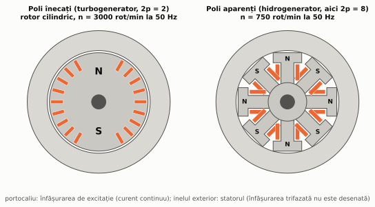
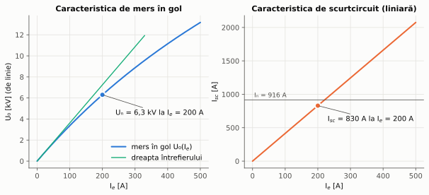
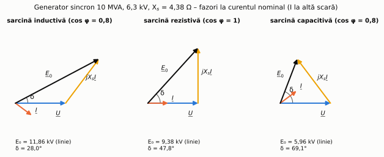
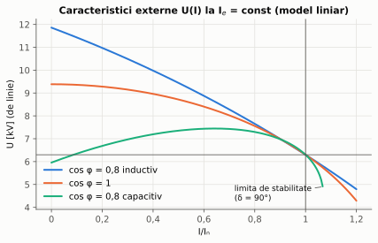
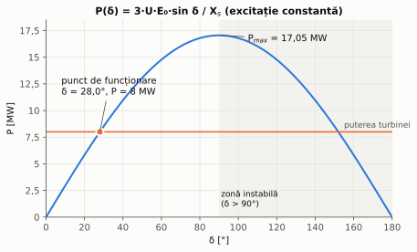
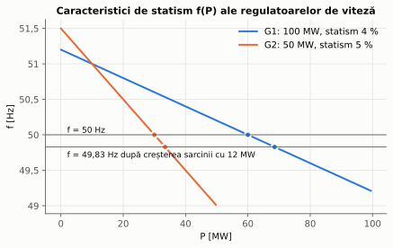

# Capitolul 3. Generatorul sincron

> **Obiective.** După acest capitol ar trebui să puteți: (1) descrie construcția generatoarelor sincrone (turbo- și hidrogeneratoare); (2) lega frecvența de turație și de numărul de poli; (3) folosi schema echivalentă și diagrama fazorială; (4) determina reactanța sincronă din încercări; (5) calcula puterea în funcție de unghiul intern și explica limita de stabilitate; (6) explica sincronizarea cu rețeaua și modul în care se reglează separat puterea activă (din turbină) și puterea reactivă (din excitație).

Aproape toată energia electrică produsă în centralele termoelectrice, nuclearelectrice și hidroelectrice este generată de **generatoare sincrone** – de la câțiva kVA (grupuri electrogene) până la peste 1000 MVA.

În capitol folosim generatorul de referință **G10**: $S_n$ = 10 MVA, $U_n$ = 6,3 kV (stea), $\cos\varphi_n$ = 0,8 inductiv, 50 Hz.

---

## 3.1. Construcția

- **Statorul (indusul)** – identic ca principiu cu statorul mașinii asincrone (§ 2.1): miez din tole cu o înfășurare trifazată în crestături, în care se induc tensiunile.
- **Rotorul (inductorul)** – poartă **înfășurarea de excitație**, alimentată în **curent continuu**, care produce un câmp magnetic fix față de rotor, cu $2p$ poli. Curentul de excitație $I_e$ este adus prin inele și perii de la o sursă de c.c. (excitatoare), sau – la sistemele **fără perii** (brushless) – de la o excitatoare de c.a. montată pe același arbore, prin diode rotative. La puteri mici și mijlocii, câmpul poate fi produs de **magneți permanenți**.

*Figura 3.1 – Rotor cu poli înecați (stânga) și rotor cu poli aparenți (dreapta), schematic.*

| | **Poli înecați** (rotor cilindric) | **Poli aparenți** |
|---|---|---|
| Unde se folosesc | turbogeneratoare (turbine cu abur sau gaze) | hidrogeneratoare, generatoare diesel |
| Număr de poli | 2 sau 4 | mulți (zeci, la hidrogeneratoare) |
| Turație la 50 Hz | 3000 sau 1500 rot/min | de la 1500 rot/min la sub 100 rot/min |
| Formă | rotor lung, cu diametru mic (forțe centrifuge mari) | rotor scurt, cu diametru mare |

Pe piesele polare se montează adesea o **înfășurare de amortizare** (o colivie), care amortizează oscilațiile rotorului și, la motoarele sincrone, servește la pornire (§ 4.4).

## 3.2. Principiul de funcționare

Rotorul excitat este rotit de turbină cu turația $n$. Câmpul lui, solidar cu rotorul, este un **câmp învârtitor obținut mecanic**, care induce în cele trei faze ale statorului tensiuni decalate cu 120° (fazele sunt decalate în spațiu). Frecvența lor este

$$\boxed{f = \frac{p\thinspace n}{60}}$$

– aceeași relație ca viteza de sincronism (§ 0.8), citită invers. Pentru a da 50 Hz, un turbogenerator cu 2 poli trebuie să se rotească cu 3000 rot/min, iar un hidrogenerator cu 48 de poli – cu 125 rot/min (problema 3.1).

Valoarea efectivă a tensiunii induse pe fază este (§ 0.4)

$$E_0 = 4{,}44\thinspace f\thinspace N\thinspace k_w\thinspace \Phi ,$$

unde $\Phi$ este fluxul pe pol, produs de curentul de excitație. La frecvență constantă, $E_0$ se reglează **numai prin curentul de excitație**.

## 3.3. Caracteristica de mers în gol

Cu statorul deschis, $U_0 = E_0$. Curba $U_0(I_e)$ la turație nominală (figura 3.2, stânga) are forma curbei de magnetizare: liniară la început (**dreapta întrefierului**), apoi saturată.

*Figura 3.2 – Caracteristicile de mers în gol și de scurtcircuit ale generatorului G10 (curba de gol este un model cu saturație, ajustat să treacă prin punctul măsurat).*

## 3.4. Reacția indusului

Când generatorul debitează, curenții statorici produc un **câmp învârtitor propriu**, care se rotește sincron cu rotorul și se suprapune peste câmpul de excitație. Efectul (**reacția indusului**) depinde de unghiul $\psi$ dintre curent și tensiunea electromotoare $\underline{E}_0$ (adică de poziția curentului față de axa polilor rotorului):

| Curentul față de $\underline{E}_0$ | Reacția indusului | Consecință |
|---|---|---|
| în fază ($\psi = 0$) | **transversală** – deformează câmpul | tensiunea variază puțin |
| în urmă cu 90° ($\psi = 90°$; sarcină pur inductivă) | **longitudinală demagnetizantă** – se opune excitației | tensiunea scade mult; e nevoie de mai mult curent de excitație |
| înainte cu 90° ($\psi = -90°$; sarcină pur capacitivă) | **longitudinală magnetizantă** – se adaugă excitației | tensiunea crește |

În cazurile intermediare, curentul are ambele componente. Atenție: la o sarcină **rezistivă** curentul este în fază cu $\underline{U}$, dar în urma lui $\underline{E}_0$ cu unghiul $\delta$, deci reacția este parțial transversală și **parțial demagnetizantă** (pentru G10 la $I_n$: $\psi = \delta = 47{,}8°$, componenta demagnetizantă $I\sin\psi = 0{,}74\thinspace I$). Tensiunea scade și la sarcină rezistivă, dar mai puțin decât la sarcină inductivă (figura 3.5).

## 3.5. Schema echivalentă și diagrama fazorială

Pentru o mașină cu poli înecați, nesaturată, efectul reacției indusului și al fluxului de dispersie se reprezintă printr-o singură reactanță, **reactanța sincronă** $X_s$. Ecuația pe fază (convenția de generator) este

$$\boxed{\underline{E}_0 = \underline{U} + (R + jX_s)\thinspace \underline{I}}$$

La generatoarele mari $R \ll X_s$ și se neglijează. Schema echivalentă este o sursă $\underline{E}_0$ în serie cu $jX_s$ (figura 3.3).

*Figura 3.3 – Schema echivalentă pe fază a generatorului sincron cu poli înecați.*

Spre deosebire de transformator, unde căderile de tensiune sunt de câteva procente, **căderea pe reactanța sincronă este de ordinul tensiunii nominale** ($x_s$ de ordinul 1 în unități relative), așa că diagramele fazoriale se pot desena la scară (figura 3.4). Unghiul $\delta$ dintre $\underline{E}_0$ și $\underline{U}$ se numește **unghi intern** (sau unghi de sarcină).

*Figura 3.4 – Diagramele fazoriale ale lui G10 la curentul nominal și tensiunea nominală, pentru trei tipuri de sarcină (problema 3.3). La sarcină inductivă este necesară cea mai mare tensiune electromotoare (excitație).*

## 3.6. Determinarea reactanței sincrone

Din cele două încercări (figura 3.2):

- **mers în gol**: $U_0(I_e)$;
- **scurtcircuit trifazat** la bornele statorului: $I_{sc}(I_e)$. Caracteristica este **liniară**, pentru că în scurtcircuit reacția indusului este puternic demagnetizantă și mașina nu se saturează.

La același curent de excitație, $E_0 = jX_s I_{sc}$, deci

$$X_s = \frac{U_{0f}(I_e)}{I_{sc}(I_e)}$$

(cu $U_{0f}$ tensiunea de fază). Calculată la curentul de excitație care dă tensiunea nominală în gol, ea este **reactanța sincronă saturată**, potrivită pentru funcționarea la tensiune nominală. Mărimea **SCR** (raportul de scurtcircuit) $= I_{e0}/I_{e,sc}$ – raportul dintre curentul de excitație care dă $U_n$ în gol și cel care dă $I_n$ în scurtcircuit – este aproximativ $1/x_s$ (problema 3.2).

## 3.7. Caracteristicile externe

La curent de excitație constant, tensiunea la borne variază puternic cu sarcina (figura 3.5) – mult mai mult decât la un transformator. Dacă sarcina inductivă nominală ar fi deconectată brusc, tensiunea (în regim permanent, pe modelul liniar) ar crește la $E_0$ – în problema 3.3, cu 88 %. De aceea generatoarele au un **regulator automat de tensiune** (RAT, în engleză AVR), care modifică excitația pentru a menține tensiunea constantă.

*Figura 3.5 – Caracteristicile externe ale lui G10 la excitație constantă (aleasă pentru $U_n$ la $I_n$, pentru fiecare factor de putere). La sarcină capacitivă, peste 1,07·$I_n$ nu mai există regim permanent stabil.*

## 3.8. Puterea și cuplul. Stabilitatea statică

Neglijând $R$, din diagrama fazorială rezultă (proiectând $jX_s\underline{I}$ perpendicular pe $\underline{U}$: $X_s I\cos\varphi = E_0\sin\delta$):

$$\boxed{P = 3\thinspace \frac{U\thinspace E_0}{X_s}\thinspace \sin\delta}, \qquad Q = 3\thinspace \frac{U E_0\cos\delta - U^2}{X_s}, \qquad M = \frac{P}{\Omega_1}$$

(mărimi de fază). Puterea crește cu unghiul intern până la **puterea maximă** la $\delta = 90°$:

$$P_{max} = 3\thinspace \frac{U E_0}{X_s} .$$

*Figura 3.6 – Caracteristica $P(\delta)$ a lui G10 la excitația nominală.*

**Stabilitatea statică.** Pentru $\delta < 90°$, dacă turbina dă puțin mai multă putere, rotorul accelerează, $\delta$ crește, crește și puterea electrică, care frânează rotorul: funcționarea este **stabilă**. Pentru $\delta > 90°$, creșterea lui $\delta$ micșorează puterea electrică, rotorul accelerează în continuare și **iese din sincronism** (pierde pasul). În practică se lucrează cu rezervă, la $\delta$ mult sub 90°; rezerva crește cu excitația ($P_{max} \propto E_0$).

La mașina cu **poli aparenți**, reactanța diferă pe axa polilor ($X_d$) și între poli ($X_q < X_d$); apare un termen suplimentar, **de reluctanță** [1, 2]:

$$P = 3\frac{U E_0}{X_d}\sin\delta + \frac{3U^2}{2}\left(\frac1{X_q} - \frac1{X_d}\right)\sin 2\delta .$$

## 3.9. Funcționarea în paralel cu rețeaua

Un generator conectat la un sistem energetic mare lucrează la **tensiune și frecvență impuse de rețea** (rețea „de putere infinită”).

### Sincronizarea

Înainte de închiderea întrerupătorului trebuie îndeplinite **condițiile de sincronizare**:

1. aceeași **valoare a tensiunii** (se reglează din excitație);
2. aceeași **frecvență** (se reglează din turația turbinei);
3. aceeași **succesiune a fazelor** (se verifică la punerea în funcțiune);
4. tensiunile **în fază** în momentul conectării.

Nerespectarea lor produce curenți și cupluri de șoc foarte mari. Sincronizarea se face cu sincronoscop sau, la generatoarele moderne, cu **sincronizatoare automate**; în laborator se pot folosi becuri de sincronizare (lucrarea L6).

### Reglajul puterii active și reactive

După conectare, cele două mărimi se reglează **independent** (problema 3.4):

- **Puterea activă** se reglează din **turbină** (mai mult abur sau apă). Cuplul motor crește, rotorul avansează puțin față de câmpul rețelei, $\delta$ crește și, conform $P = 3UE_0\sin\delta/X_s$, generatorul preia mai multă putere. Turația rămâne aceeași (sincronă).
- **Puterea reactivă** se reglează din **excitație**. Generatorul **supraexcitat** ($E_0\cos\delta > U$) livrează putere reactivă inductivă rețelei (ca un condensator), iar cel **subexcitat** o absoarbe (ca o bobină). Furnizarea puterii reactive cerute de motoare și transformatoare este o sarcină importantă a generatoarelor.

Limitele de funcționare sunt: curentul statoric (încălzirea statorului), curentul de excitație (încălzirea rotorului), puterea turbinei și stabilitatea statică – împreună ele formează **diagrama de capabilitate P–Q** din documentația generatorului.

## 3.10. Funcționarea autonomă. Reglajul frecvenței

Un generator care alimentează singur o rețea izolată (grup electrogen, rețea insulară) stabilește el însuși frecvența și tensiunea. Echilibrul dintre puterea turbinei și puterea cerută de consumatori se vede în **frecvență**: dacă sarcina crește, turația (deci frecvența) scade.

Regulatoarele de viteză ale turbinelor au o caracteristică cu **statism** (în engleză *droop*) $s_t$: frecvența scade liniar cu puterea,

$$f = f_0 - s_t\thinspace f_n\thinspace \frac{P}{P_n}, \qquad \text{deci}\qquad \Delta P = \frac{P_n}{s_t f_n}\thinspace (-\Delta f) .$$

Statismul permite împărțirea stabilă a variațiilor de sarcină între generatoarele care funcționează în paralel, proporțional cu $P_n/s_t$ (problema 3.5, figura 3.7). Valori tipice: 4–5 % [8].

*Figura 3.7 – Caracteristicile de statism ale celor două generatoare din problema 3.5 și noul punct de echilibru după creșterea sarcinii.*

## 3.11. Generatoare în sistemele moderne

- **Turbine eoliene**: generatoare asincrone dublu alimentate (§ 2.10) sau generatoare sincrone (adesea cu magneți permanenți) racordate printr-un convertor de frecvență complet; convertorul permite turație variabilă a turbinei la frecvența fixă a rețelei.
- **Grupuri electrogene** (diesel–generator sincron): alimentare de rezervă pentru spitale, centre de date, șantiere.
- **Microhidrocentrale**: generatoare sincrone sau asincrone.

---

## Probleme rezolvate

Toate rezultatele sunt calculate și verificate de scriptul [`scripts/probleme_cap03.py`](scripts/probleme_cap03.py).

### Problema 3.1 – Numărul de poli

Câți poli au: (a) un turbogenerator de 3000 rot/min la 50 Hz; (b) un hidrogenerator de 125 rot/min la 50 Hz; (c) un hidrogenerator de 150 rot/min la 60 Hz; (d) generatorul unui grup diesel de 1500 rot/min la 50 Hz?

**Rezolvare.** $p = 60f/n$: (a) $p = 1$, 2 poli; (b) $p = 24$, **48 de poli**; (c) $p = 24$, 48 de poli; (d) $p = 2$, 4 poli. **Verificare:** $f = pn/60$ redă frecvența în toate cazurile ✓.

### Problema 3.2 – Reactanța sincronă din încercări

La generatorul G10 s-au măsurat: în gol, la $I_e$ = 200 A, $U_0$ = 6300 V (tensiune de linie); în scurtcircuit, la același $I_e$ = 200 A, $I_{sc}$ = 830 A. Calculați $X_s$ (în ohmi și în unități relative) și SCR.

**Rezolvare.** $I_n = \dfrac{10\cdot 10^6}{\sqrt3\cdot 6300} = 916{,}4$ A, $U_f = 3637{,}3$ V, impedanța de bază $Z_b = U_n^2/S_n = 3{,}969$ Ω.

$$X_s = \frac{3637{,}3}{830} = 4{,}382\ \Omega, \qquad x_s = \frac{4{,}382}{3{,}969} = 1{,}104\ \text{u.r.}$$

Curentul de excitație care dă $I_n$ în scurtcircuit (caracteristica liniară): $200\cdot 916{,}4/830 = 220{,}8$ A, deci $SCR = 200/220{,}8 = 0{,}906$.

**Verificare.** $1/x_s = 0{,}906$ ✓ (cele două definiții coincid pentru caracteristica de scurtcircuit liniară).

### Problema 3.3 – Funcționarea la sarcină nominală

G10 debitează curentul nominal la $U_n$ și $\cos\varphi = 0{,}8$ inductiv. Calculați $E_0$, $\delta$, puterile, $P_{max}$ și creșterea tensiunii la deconectarea bruscă a sarcinii (fără regulator). $R$ se neglijează.

**Rezolvare.** Cu $\underline{U} = 3637{,}3\angle 0°$ V și $\underline{I} = 916{,}4\angle -36{,}87°$ A:

$$jX_s\underline{I} = 4{,}382\cdot 916{,}4\angle(90° - 36{,}87°) = 4016\angle 53{,}13° = 2409{,}6 + j3212{,}9\ \text{V},$$

$$\underline{E}_0 = \underline{U} + jX_s\underline{I} = 6046{,}9 + j3212{,}9 = 6847\angle 27{,}98°\ \text{V}.$$

Deci $E_0$ = 6847 V pe fază (11,86 kV de linie) și $\delta$ = 27,98°.

- Puterile: $P = \sqrt3\cdot 6300\cdot 916{,}4\cdot 0{,}8 = 8{,}00$ MW, $Q = 6{,}00$ Mvar.
- $P_{max} = 3\cdot 3637{,}3\cdot 6847/4{,}382 = 17{,}05$ MW, adică de 2,13 ori puterea debitată.
- Pe caracteristica liniară, curentul de excitație ar fi $200\cdot 6847/3637 = 377$ A; din cauza saturației, cel real este mai mare (figura 3.2).
- La deconectarea sarcinii cu excitația neschimbată, $U \to E_0$: creștere de **88 %** (în regim permanent, pe modelul liniar).

**Verificare (a doua cale pentru puteri).** $P = 3UE_0\sin\delta/X_s = 8{,}00$ MW ✓ și $Q = 3(UE_0\cos\delta - U^2)/X_s = 6{,}00$ Mvar ✓.

Pentru comparație, la același curent: cu $\cos\varphi = 1$, $E_0 = 5418$ V și $\delta = 47{,}8°$; cu $\cos\varphi = 0{,}8$ capacitiv, $E_0 = 3439$ V (mai mică decât $U$!) și $\delta = 69{,}1°$ (figura 3.4).

### Problema 3.4 – Reglajul excitației la funcționarea în paralel cu rețeaua

G10, conectat la o rețea de 6,3 kV, debitează $P$ = 8 MW (turbina nu se modifică). Cum variază curentul, factorul de putere și puterea reactivă când se modifică excitația?

**Rezolvare.** Pentru fiecare $E_0$: $\sin\delta = \dfrac{P X_s}{3UE_0}$, apoi $\underline{I} = (\underline{E}_0 - \underline{U})/(jX_s)$ și $\underline{S} = 3\underline{U}\thinspace \underline{I}^{\ast}$.

Excitația pentru $\cos\varphi = 1$: $I = P/(3U) = 733{,}1$ A și $E_0 = \sqrt{U^2 + (X_sI)^2} = 4853$ V.

| $E_0$ [V] | $\delta$ | $I$ [A] | $\cos\varphi$ | $Q$ [Mvar] | regim |
|---|---|---|---|---|---|
| 4000 | 53,4° | 787 | 0,932 | −3,12 | subexcitat: absoarbe Q |
| 4853 | 41,5° | 733 | 1,000 | 0 | excitație „normală” |
| 6847 | 28,0° | 916 | 0,800 | +6,00 | supraexcitat: livrează Q |
| 8000 | 23,7° | **1116** | 0,657 | +9,19 | supraexcitat – **depășește $I_n$** |

Concluzii: (1) puterea activă rămâne 8 MW – excitația nu o modifică; (2) curentul are un minim la $\cos\varphi = 1$; (3) creșterea excitației mărește rezerva de stabilitate ($\delta$ scade), dar e limitată de încălzirea statorului și a rotorului; (4) excitația minimă (la $\delta = 90°$) este $E_0 = PX_s/(3U) = 3213$ V.

**Verificare.** Pentru fiecare linie, $P$ recalculat din curent este 8,00 MW ✓, iar $Q$ din curent coincide cu $Q = 3(UE_0\cos\delta - U^2)/X_s$ ✓; pentru $\cos\varphi = 1$, $E_0$ fazorial coincide cu cel din teorema lui Pitagora ✓.

### Problema 3.5 – Împărțirea sarcinii între generatoare cu statism

Două generatoare funcționează în paralel la 50 Hz: G1 de 100 MW cu statism 4 % (încărcat la 60 MW) și G2 de 50 MW cu statism 5 % (încărcat la 30 MW). Sarcina crește brusc cu 12 MW. Care este noua frecvență și cum se împarte creșterea (fără reglaj secundar)?

**Rezolvare.** Energiile reglante: $K_1 = \dfrac{100}{0{,}04\cdot 50} = 50$ MW/Hz, $K_2 = \dfrac{50}{0{,}05\cdot 50} = 20$ MW/Hz.

$$\Delta f = -\frac{12}{50 + 20} = -0{,}1714\ \text{Hz} \Rightarrow f = 49{,}83\ \text{Hz}; \qquad \Delta P_1 = 50\cdot 0{,}1714 = 8{,}57\ \text{MW}, \quad \Delta P_2 = 3{,}43\ \text{MW}.$$

**Verificare.** Rezolvând sistemul liniar $\Delta P_1 + \Delta P_2 = 12$, $\Delta P_1 = -K_1\Delta f$, $\Delta P_2 = -K_2\Delta f$ cu `numpy.linalg.solve`, rezultă aceleași valori ✓. Frecvența revine la 50 Hz numai după intervenția **reglajului secundar** (automat, la nivelul sistemului), care deplasează caracteristicile în sus.

---

## Întrebări de autoevaluare

1. De ce turbogeneratoarele au 2 sau 4 poli, iar hidrogeneratoarele zeci de poli?
2. Cum se reglează tensiunea unui generator sincron care funcționează în gol?
3. De ce caracteristica de scurtcircuit este liniară, deși cea de gol este saturată?
4. Ce reprezintă reactanța sincronă?
5. De ce un generator are nevoie de mai multă excitație la sarcină inductivă decât la sarcină rezistivă?
6. Ce este unghiul intern $\delta$ și ce valoare maximă poate avea în regim stabil?
7. Care sunt condițiile de sincronizare cu rețeaua?
8. Un generator conectat la rețea primește mai mult abur în turbină. Ce se modifică: turația, puterea activă sau puterea reactivă?
9. Ce se întâmplă cu puterea reactivă dacă se mărește curentul de excitație al unui generator conectat la rețea?
10. Ce rol are statismul regulatorului de viteză?
11. De ce tensiunea unui generator izolat crește mult la deconectarea sarcinii?

<b>Răspunsuri</b>

1. Pentru că $f = pn/60$: turbinele cu abur sunt eficiente la turații mari (3000 sau 1500 rot/min la 50 Hz), iar turbinele hidraulice la turații mici (zeci sau sute de rot/min), care cer mulți poli (§ 3.1, problema 3.1).
2. Prin curentul de excitație (fluxul), la turație constantă (§ 3.2).
3. Pentru că în scurtcircuit reacția indusului este aproape pur demagnetizantă: fluxul rezultant este mic și mașina nu se saturează (§ 3.6).
4. Efectul combinat al reacției indusului și al fluxului de dispersie, reprezentat ca o reactanță în serie cu $E_0$ (§ 3.5).
5. Pentru că reacția indusului este demagnetizantă la sarcină inductivă; diagrama fazorială arată un $E_0$ mai mare (problema 3.3, figura 3.4).
6. Unghiul dintre $\underline{E}_0$ și $\underline{U}$ (și, în grade electrice, dintre axa rotorului și cea a câmpului rezultant); în regim stabil, $\delta < 90°$, iar practic mult mai mic (§ 3.8).
7. Aceeași tensiune, aceeași frecvență, aceeași succesiune a fazelor, tensiuni în fază la momentul conectării (§ 3.9).
8. Crește puterea activă (prin creșterea lui $\delta$); turația rămâne sincronă. La excitație constantă, puterea reactivă livrată scade, pentru că $Q = 3(UE_0\cos\delta - U^2)/X_s$ și $\cos\delta$ scade (pentru G10 la $E_0$ = 6847 V: de la 8,0 Mvar la $P = 0$ la 6,0 Mvar la $P$ = 8 MW) (§ 3.8, § 3.9).
9. Generatorul livrează mai multă putere reactivă inductivă (supraexcitat); puterea activă nu se modifică (problema 3.4).
10. Asigură împărțirea stabilă și previzibilă a variațiilor de sarcină între generatoare, proporțional cu $P_n/s_t$ (§ 3.10).
11. Pentru că dispare căderea mare de tensiune pe reactanța sincronă: tensiunea devine $E_0$. De aceea este necesar regulatorul automat de tensiune (§ 3.7).

---

**Bibliografie pentru capitol:** [1] cap. 5, [2] cap. 4–5, [3], [8]; standarde [S1]. Lista completă este în [README](README.md#bibliografie).

[← Capitolul 2](02-masina-asincrona.md) · [Cuprins](README.md) · [Capitolul 4. Motorul sincron →](04-motorul-sincron.md)
