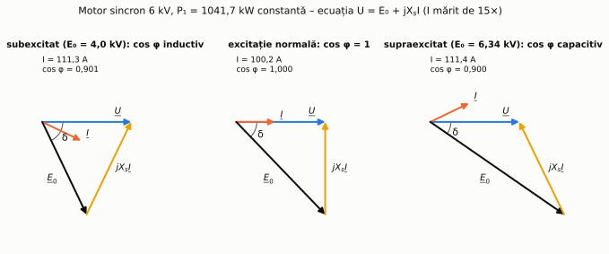
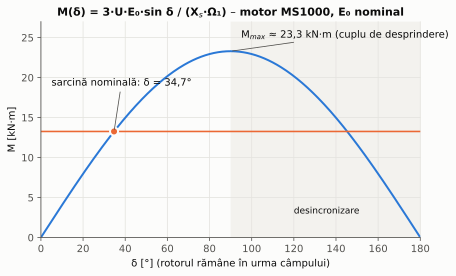
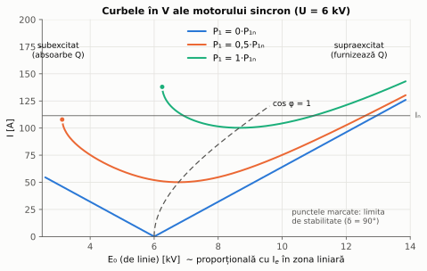

# Capitolul 4. Motorul sincron

> **Obiective.** După acest capitol ar trebui să puteți: (1) explica de ce motorul sincron se rotește cu turație constantă; (2) folosi ecuația și diagrama fazorială în convenția de motor; (3) calcula cuplul maxim (de desprindere); (4) interpreta curbele în V și folosi motorul supraexcitat la compensarea factorului de putere; (5) explica de ce motorul sincron nu pornește singur și cum se pornește; (6) recunoaște aplicațiile motoarelor sincrone cu magneți permanenți.

Construcția motorului sincron este aceeași ca a generatorului sincron (cap. 3): stator cu înfășurare trifazată, rotor cu excitație de c.c. (sau cu magneți permanenți). Mașina este **reversibilă**: aceleași ecuații descriu ambele regimuri, cu semnul puterii schimbat.

În capitol folosim motorul de referință **MS1000**: $P_n$ = 1000 kW (putere la arbore), $U_n$ = 6 kV (stea), 50 Hz, $2p$ = 8 ($n$ = 750 rot/min), $\eta_n$ = 96 %, $\cos\varphi_n$ = 0,9 **capacitiv** (supraexcitat), $X_s$ = 36 Ω pe fază, $R$ neglijat.

---

## 4.1. Principiul de funcționare

Statorul alimentat de la rețea produce un câmp învârtitor cu viteza $n_1 = 60f/p$ (§ 0.8). Rotorul excitat în c.c. se comportă ca un magnet cu $2p$ poli. Odată adus la viteza de sincronism, polii rotorului sunt „prinși” de polii de nume contrar ai câmpului învârtitor și se rotesc **exact cu viteza lui**:

$$\boxed{n = n_1 = \frac{60 f}{p}}\quad \text{indiferent de sarcină (până la cuplul maxim).}$$

Când crește cuplul de sarcină, rotorul **rămâne puțin în urmă** față de câmp (crește unghiul intern $\delta$), dar viteza medie rămâne cea de sincronism. Dacă sarcina depășește cuplul maxim, rotorul „se desprinde” (iese din sincronism) și motorul trebuie deconectat.

> **Comparație cu motorul asincron:** acolo turația scade puțin cu sarcina (alunecarea crește), iar cuplul cere o diferență de viteză; aici diferența de viteză este nulă, iar cuplul cere o diferență de **poziție** (unghiul $\delta$).

## 4.2. Ecuația, diagrama fazorială și cuplul

În **convenția de motor** (curentul $\underline{I}$ este absorbit din rețea), ecuația pe fază este

$$\boxed{\underline{U} = \underline{E}_0 + jX_s\thinspace \underline{I}}$$

– aceeași ecuație ca la generator (§ 3.5), cu sensul curentului inversat. Diagrama fazorială arată că, la motor, $\underline{E}_0$ este **în urma** tensiunii rețelei cu unghiul $\delta$ (figura 4.1). Puterea absorbită și cuplul electromagnetic sunt

$$P_1 = 3\thinspace \frac{U E_0}{X_s}\sin\delta, \qquad M = \frac{P_1}{\Omega_1} = \frac{3}{\Omega_1}\thinspace \frac{U E_0}{X_s}\sin\delta .$$

*Figura 4.1 – Diagramele fazoriale ale lui MS1000 la aceeași putere și trei excitații diferite (problemele 4.1 și 4.2).*

**Cuplul maxim (de desprindere)** apare la $\delta = 90°$ (figura 4.2):

$$M_{max} = \frac{3}{\Omega_1}\thinspace \frac{U E_0}{X_s} .$$

Se observă că $M_{max}$ este **proporțional cu $U$** (nu cu $U^2$, ca la motorul asincron) și crește cu excitația: motorul sincron este mai puțin sensibil la scăderile de tensiune, iar la nevoie se poate mări rezerva de stabilitate prin supraexcitare (problema 4.4).

*Figura 4.2 – Caracteristica $M(\delta)$ a lui MS1000 la excitația nominală.*

## 4.3. Influența excitației. Curbele în V

La **putere constantă**, curentul de excitație nu modifică puterea activă, ci **puterea reactivă** (și deci curentul și factorul de putere) – exact ca la generatorul conectat la rețea (§ 3.9):

| Excitație | $E_0$ față de $U$ | Factor de putere | Puterea reactivă |
|---|---|---|---|
| **subexcitat** | $E_0\cos\delta < U$ | inductiv (curent defazat în urmă) | **absoarbe** Q din rețea, ca un motor asincron |
| **normală** | $E_0\cos\delta = U$ | $\cos\varphi = 1$ | nu schimbă Q |
| **supraexcitat** | $E_0\cos\delta > U$ | capacitiv (curent defazat înainte) | **furnizează** Q rețelei, ca o baterie de condensatoare |

Graficul curentului în funcție de excitație, la putere constantă, are forma literei V – **curbele în V** (figura 4.3). Minimul fiecărei curbe corespunde lui $\cos\varphi = 1$. La excitație prea mică, $\delta$ ajunge la 90° și motorul iese din sincronism (punctele marcate).

*Figura 4.3 – Curbele în V ale lui MS1000, calculate din ecuația fazorială la trei puteri. Linia întreruptă unește punctele cu $\cos\varphi = 1$.*

**Aplicație: îmbunătățirea factorului de putere.** Într-o fabrică cu multe motoare asincrone (consumatoare de putere reactivă), unul sau mai multe motoare sincrone mari supraexcitate furnizează o parte din puterea reactivă necesară. Limita este dată de **încălzirea** statorului și a rotorului: curentul nu trebuie să depășească valoarea nominală (problema 4.3).

**Compensatorul sincron** este un motor sincron care funcționează în gol, doar pentru producerea (sau absorbția) de putere reactivă reglabilă continuu; se folosește în rețelele de transport pentru reglajul tensiunii.

## 4.4. Pornirea

La pornire rotorul stă pe loc, iar câmpul statoric trece pe lângă polii rotorului de 50 de ori pe secundă: cuplul își schimbă sensul la fiecare semiperioadă, iar **valoarea lui medie este zero**. Motorul sincron **nu pornește singur** la conectarea directă la rețea. Metode de pornire:

1. **Pornirea în asincron** (cea mai folosită la motoarele mari alimentate de la rețea): **înfășurarea de amortizare** (o colivie pe piesele polare) produce un cuplu asincron, ca la motorul asincron (cap. 2). În timpul pornirii, înfășurarea de excitație se închide pe o rezistență (lăsată deschisă, s-ar induce în ea tensiuni periculoase). Aproape de turația de sincronism se aplică excitația de c.c., iar rotorul este „tras” în sincronism.
2. **Pornirea cu convertor de frecvență**: frecvența crește treptat de la zero, iar câmpul învârtitor antrenează rotorul de la turații mici. Este metoda standard pentru motoarele cu magneți permanenți și pentru acționările cu turație variabilă.
3. **Pornirea cu motor auxiliar** (rar).

## 4.5. Pendulări și amortizare

La variații bruște ale sarcinii, rotorul nu trece instantaneu la noul unghi $\delta$, ci **oscilează** în jurul lui (sistemul rotor–câmp se comportă ca un arc cu o masă). Înfășurarea de amortizare, în care oscilațiile induc curenți, amortizează aceste pendulări.

## 4.6. Avantaje, dezavantaje, aplicații

**Avantaje:** turație strict constantă; factor de putere reglabil (poate compensa reactivul altor consumatori); randament ridicat; cuplu maxim proporțional cu $U$ (nu cu $U^2$); întrefier mai mare decât la motorul asincron (toleranțe mecanice mai largi).

**Dezavantaje:** necesită sursă de excitație de c.c. și sistem de pornire; construcție mai complexă și mai scumpă la puteri mici.

**Aplicații clasice** (de ordinul sutelor de kW până la zeci de MW): compresoare și pompe mari, ventilatoare mari, mori de ciment și de minereu, laminoare (cu convertor), compensatoare sincrone.

## 4.7. Motoare sincrone cu magneți permanenți și cu reluctanță

Electronica de putere a schimbat rolul motoarelor sincrone: alimentate de la un **convertor de frecvență**, ele pornesc ușor și au turație reglabilă continuu ($n = 60f/p$ cu $f$ reglabilă, problema 4.5).

- **Motorul sincron cu magneți permanenți** (în engleză PMSM): rotorul are magneți (de exemplu NdFeB) în loc de înfășurare de excitație – nu există pierderi de excitație, deci randamentul și densitatea de putere sunt mari. Se folosește în vehicule electrice, roboți, servomotoare, compresoare, pompe și ventilatoare eficiente. Motorul „fără perii de c.c.” (BLDC) este o variantă cu comandă simplificată.
- **Motorul sincron cu reluctanță** (SynRM): rotor din tole cu bariere de flux, fără magneți și fără colivie; cuplul provine din diferența dintre reactanțele $X_d$ și $X_q$ (termenul de reluctanță, § 3.8). Este o alternativă eficientă la motorul asincron în acționările cu convertor.
- **Motorul pas cu pas**: rotorul se deplasează cu un unghi fix la fiecare impuls de comandă; se folosește pentru poziționare în buclă deschisă (imprimante, mașini CNC mici).

---

## Probleme rezolvate

Toate rezultatele sunt calculate și verificate de scriptul [`scripts/probleme_cap04.py`](scripts/probleme_cap04.py).

### Problema 4.1 – Punctul nominal

Calculați pentru MS1000 la sarcină nominală: curentul, $E_0$, unghiul intern, puterea reactivă și cuplul maxim.

**Rezolvare.** $P_1 = P_n/\eta = 1041{,}7$ kW; $I_n = \dfrac{1\thinspace 041\thinspace 700}{\sqrt3\cdot 6000\cdot 0{,}9} = 111{,}4$ A; $\varphi = \arccos 0{,}9 = 25{,}84°$ (curent **înainte** față de tensiune, motor supraexcitat). $U_f = 3464{,}1$ V; $n_1$ = 750 rot/min, $\Omega_1 = 78{,}54$ rad/s; $M_n = P_n/\Omega_1 = 1\thinspace 000\thinspace 000/78{,}54 = 12\thinspace 732$ N·m.

$$jX_s\underline{I} = 36\cdot 111{,}4\angle(90° + 25{,}84°) = -1747{,}6 + j3608{,}4\ \text{V},$$

$$\underline{E}_0 = \underline{U} - jX_s\underline{I} = 5211{,}7 - j3608{,}4 = 6339\angle -34{,}70°\ \text{V}.$$

Deci $E_0$ = 6339 V pe fază (10,98 kV de linie), iar rotorul este cu $\delta$ = 34,70° în urma câmpului. Motorul **furnizează** rețelei $Q = 3U_fI\sin\varphi = 504{,}5$ kvar.

Puterea maximă la această excitație: $P_{1max} = 3\cdot 3464{,}1\cdot 6339/36 = 1830$ kW, deci $M_{max} \approx 1\thinspace 830\thinspace 000/78{,}54 = 23\thinspace 300$ N·m – de **1,76 ori** cuplul electromagnetic la sarcină nominală.

**Verificare.** $P_1 = 3U_fE_0\sin\delta/X_s = 1041{,}7$ kW ✓; $Q = 3(U_f^2 - U_fE_0\cos\delta)/X_s = -504{,}5$ kvar (semnul minus, în convenția de receptor, înseamnă Q furnizat) ✓.

### Problema 4.2 – Excitația pentru cos φ = 1 și curba în V

La aceeași putere absorbită (1041,7 kW), calculați excitația pentru $\cos\varphi = 1$ și curentul pentru alte câteva valori ale lui $E_0$.

**Rezolvare.** La $\cos\varphi = 1$: $I = P_1/(3U_f) = 100{,}2$ A, iar $\underline{E}_0 = U_f - jX_sI$, deci $E_0 = \sqrt{3464{,}1^2 + (36\cdot 100{,}2)^2} = 5002$ V, cu $\delta = 46{,}2°$.

Pentru alte excitații: $\sin\delta = P_1X_s/(3U_fE_0)$, apoi $\underline{I} = (\underline{U} - \underline{E}_0)/(jX_s)$:

| $E_0$ [V] | $\delta$ | $I$ [A] | $\cos\varphi$ |
|---|---|---|---|
| 4000 | 64,4° | 111,3 | 0,901 inductiv (subexcitat) |
| 5002 | 46,2° | 100,2 | 1,000 |
| 5500 | 41,0° | 102,0 | 0,982 capacitiv |
| 6339 | 34,7° | 111,4 | 0,900 capacitiv (nominal) |
| 7000 | 31,0° | 122,5 | 0,818 capacitiv – peste $I_n$ |

Acestea sunt punctele curbei în V pentru $P_1 = P_{1n}$ din figura 4.3. **Verificare:** pentru fiecare linie, puterea recalculată din curent este 1041,7 kW ✓; $E_0$ la $\cos\varphi = 1$ dă același rezultat fazorial și prin teorema lui Pitagora ✓.

### Problema 4.3 – Compensarea factorului de putere al unei fabrici

O fabrică absoarbe 2000 kW la $\cos\varphi = 0{,}7$ inductiv (din rețeaua de 6 kV). Se adaugă motorul MS1000 la sarcină nominală. (a) Care este noul factor de putere? (b) Se poate ajunge la $\cos\varphi = 0{,}95$ numai prin creșterea excitației motorului?

**Rezolvare.** (a) $Q_{fabrică} = 2000\tan(\arccos 0{,}7) = 2040{,}4$ kvar; motorul dă 504,5 kvar.

$$P = 2000 + 1041{,}7 = 3041{,}7\ \text{kW}, \quad Q = 2040{,}4 - 504{,}5 = 1535{,}9\ \text{kvar}, \quad \cos\varphi = \frac{3041{,}7}{\sqrt{3041{,}7^2 + 1535{,}9^2}} = 0{,}893 .$$

**Verificare (prin fazorii curenților):** fabrica absoarbe 274,9 A, motorul 111,4 A; suma **fazorială** este 327,9 A (nu suma aritmetică, 386,3 A), defazată cu un unghi al cărui cosinus este 0,893 ✓.

(b) Pentru $\cos\varphi = 0{,}95$, puterea reactivă totală admisă este $3041{,}7\cdot\tan(\arccos 0{,}95) = 999{,}7$ kvar, deci motorul ar trebui să dea $2040{,}4 - 999{,}7 = 1040{,}7$ kvar. Curentul lui ar fi $\sqrt{1041{,}7^2 + 1040{,}7^2}/(\sqrt3\cdot 6) = 141{,}7$ A $> I_n = 111{,}4$ A: **nu este admisibil** în regim permanent (s-ar supraîncălzi). Este nevoie și de o baterie de condensatoare (sau de un motor mai mare).

### Problema 4.4 – Scăderea tensiunii rețelei

Tensiunea rețelei scade cu 20 %, excitația rămâne cea nominală. Rămâne MS1000 în sincronism la sarcină nominală?

**Rezolvare.** $P_{1max} \propto U$: $P_{1max} = 0{,}8\cdot 1830 = 1464$ kW $> 1041{,}7$ kW, deci **rămâne în sincronism**; unghiul intern crește la $\delta = \arcsin(1041{,}7/1464) = 45{,}4°$ (de la 34,7°). **Verificare:** recalculare directă cu $U_f = 0{,}8\cdot 3464{,}1$ V ✓. (Pentru comparație, un motor asincron și-ar pierde 36 % din cuplul maxim, pentru că $M_{max} \propto U^2$.)

### Problema 4.5 – Motor sincron cu magneți permanenți alimentat de la convertor

Un motor cu magneți permanenți are 8 poli. Ce turație are la 50, 200 și 800 Hz? Ce frecvență este necesară pentru 12 000 rot/min?

**Rezolvare.** $n = 60f/p$, cu $p = 4$: 750, 3000 și 12 000 rot/min. Pentru 12 000 rot/min: $f = 12\thinspace 000\cdot 4/60 = 800$ Hz. Astfel de frecvențe sunt obișnuite la motoarele de tracțiune ale vehiculelor electrice.

---

## Întrebări de autoevaluare

1. De ce turația motorului sincron nu depinde de sarcină?
2. Ce se întâmplă dacă sarcina depășește cuplul maxim?
3. Cum se modifică unghiul intern când crește sarcina?
4. Ce mărime se modifică dacă, la putere constantă, se mărește curentul de excitație?
5. Desenați forma curbelor în V și indicați zonele sub- și supraexcitat.
6. De ce un motor sincron supraexcitat îmbunătățește factorul de putere al unei fabrici? Ce limitează această utilizare?
7. De ce motorul sincron nu pornește singur la conectarea directă la rețea?
8. Descrieți pornirea în asincron. De ce înfășurarea de excitație nu se lasă deschisă în timpul pornirii?
9. De ce motorul sincron este mai puțin sensibil decât cel asincron la scăderile de tensiune?
10. Ce avantaje are motorul sincron cu magneți permanenți?

<b>Răspunsuri</b>

1. Pentru că polii rotorului sunt „prinși” de polii câmpului învârtitor, care se rotește cu $n_1 = 60f/p$; sarcina modifică doar unghiul intern (§ 4.1).
2. Rotorul iese din sincronism (se desprinde); apar curenți și cupluri pulsatorii mari, iar protecțiile trebuie să deconecteze motorul (§ 4.1).
3. Crește (rotorul rămâne mai mult în urma câmpului), până la maximum 90° (§ 4.2).
4. Puterea reactivă (deci curentul și factorul de putere); puterea activă nu se modifică (§ 4.3).
5. Vezi figura 4.3: curentul are minim la $\cos\varphi = 1$; la stânga minimului motorul este subexcitat (inductiv), la dreapta supraexcitat (capacitiv).
6. Pentru că furnizează putere reactivă inductivă, care nu mai trebuie adusă din rețea. Limita este curentul nominal (încălzirea statorului și rotorului) (problema 4.3).
7. La rotorul în repaus, cuplul își schimbă sensul la fiecare semiperioadă și are valoare medie nulă (§ 4.4).
8. Motorul pornește ca un motor asincron, cu ajutorul coliviei de amortizare; aproape de sincronism se aplică excitația. Înfășurarea de excitație se închide pe o rezistență, pentru că, lăsată deschisă, în ea s-ar induce tensiuni periculoase (§ 4.4).
9. Pentru că $M_{max} \propto U$ la motorul sincron și $M_{max} \propto U^2$ la cel asincron; în plus, excitația poate fi mărită (problema 4.4).
10. Nu are pierderi de excitație, deci are randament și densitate de putere mari; alimentat de la convertor, are turație reglabilă și pornire ușoară (§ 4.7).

---

**Bibliografie pentru capitol:** [1] cap. 5, [2] cap. 5, [3], [6]. Lista completă este în [README](README.md#bibliografie).

[← Capitolul 3](03-generatorul-sincron.md) · [Cuprins](README.md) · [Capitolul 5. Acționări electrice →](05-actionari-electrice.md)
