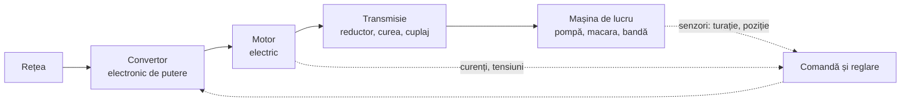
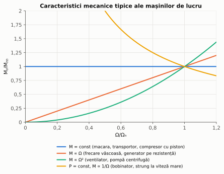
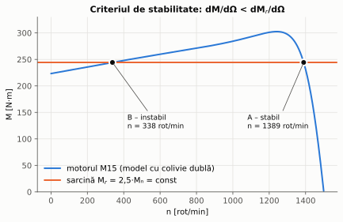
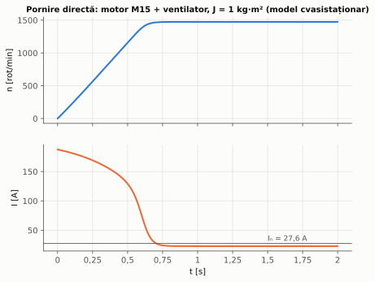
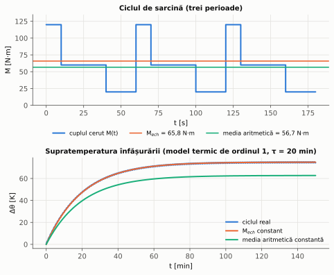
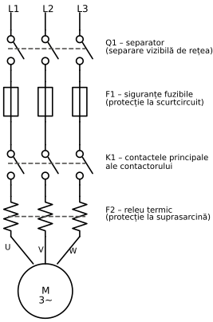
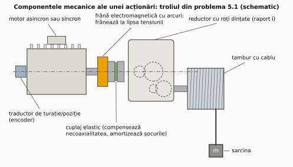
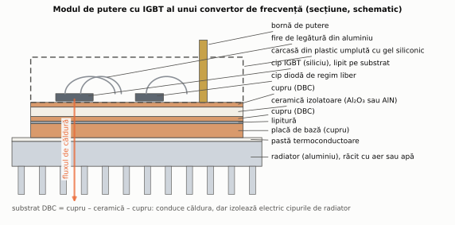

# Capitolul 5. Acționări electrice

> **Obiective.** După acest capitol ar trebui să puteți: (1) descrie structura unei acționări electrice; (2) scrie și folosi ecuația fundamentală a mișcării; (3) raporta cuplurile și momentele de inerție la arborele motorului; (4) determina punctul de funcționare și stabilitatea lui; (5) calcula timpul de pornire; (6) alege și verifica motorul pentru un ciclu de sarcină; (7) explica funcționarea convertorului de frecvență și economia de energie la pompe și ventilatoare; (8) citi o schemă de pornire directă cu contactor; (9) recunoaște componentele constructive ale unei acționări (frână, cuplaj, reductor, traductor, modulul de putere al convertorului) și criteriile după care se aleg.

Capitolele 1–4 au tratat mașinile; acest capitol tratează **sistemul**: mașina electrică împreună cu ce o alimentează și ce antrenează. Pentru un inginer mecanic, energetician sau mecatronist, aici se întâlnesc cel mai direct cele două lumi.

---

## 5.1. Structura unei acționări electrice

O **acționare electrică** este ansamblul care transformă energia electrică în lucru mecanic controlat:

- **Convertorul** (lipsește la acționările nereglabile, alimentate direct prin contactor) adaptează tensiunea și frecvența: convertor de frecvență, pornitor static, redresor comandat.
- **Motorul** – de regulă asincron cu colivie; pentru cerințe dinamice mari sau eficiență maximă, sincron cu magneți permanenți.
- **Transmisia** adaptează turația și cuplul motorului la cele ale mașinii de lucru.
- **Comanda și reglarea** – de la simpla pornire/oprire la reglarea turației, a cuplului sau a poziției.

## 5.2. Ecuația fundamentală a mișcării

Pentru un sistem rotativ cu momentul de inerție $J$ (raportat la arborele motorului), legea a doua a lui Newton pentru rotație este

$$\boxed{J\thinspace \frac{d\Omega}{dt} = M - M_r}$$

unde $M$ este cuplul motorului, iar $M_r$ cuplul rezistent al mașinii de lucru (inclusiv frecările). Diferența $M_d = M - M_r$ se numește **cuplu dinamic**:

- $M = M_r$ – **regim staționar**, viteză constantă;
- $M > M_r$ – sistemul **accelerează**;
- $M < M_r$ – sistemul **decelerează**.

## 5.3. Raportarea la arborele motorului

Între motor și mașina de lucru există de regulă o transmisie cu raportul $i = \Omega_{motor}/\Omega_{mașină}$ și randamentul $\eta_t$. Pentru calcule, toate mărimile se **raportează la arborele motorului**, păstrând puterea și energia cinetică:

**Cuplul rezistent** (din conservarea puterii, cu pierderile din transmisie):

$$M_r' = \frac{M_{r}}{i\thinspace \eta_t}\ \ \text{(puterea curge de la motor spre sarcină)}, \qquad M_r' = \frac{M_{r}\thinspace \eta_t}{i}\ \ \text{(puterea curge de la sarcină spre motor)} .$$

**Momentul de inerție** (din conservarea energiei cinetice, $\tfrac12 J\Omega_{maș}^2 = \tfrac12 J'\Omega_{motor}^2$):

$$J' = \frac{J}{i^2} .$$

**Masele în translație** (viteza $v$): $\tfrac12 m v^2 = \tfrac12 J'\Omega^2$, deci

$$J' = m\left(\frac{v}{\Omega}\right)^2 .$$

Consecința practică: masele care se rotesc încet (după un reductor cu raport mare) contribuie foarte puțin la inerția totală; contează mai ales inerția rotorului și a pieselor de pe arborele rapid (problema 5.1).

## 5.4. Caracteristicile mecanice ale mașinilor de lucru

*Figura 5.1 – Tipuri de caracteristici mecanice ale mașinilor de lucru (valori relative).*

| Tip | Exemple | Consecință pentru acționare |
|---|---|---|
| $M_r$ = const | macarale, lifturi, benzi transportoare, compresoare cu piston | motorul trebuie să dezvolte cuplul nominal de la pornire |
| $M_r \propto \Omega$ | frecare vâscoasă, generator debitând pe rezistență | |
| $M_r \propto \Omega^2$ | **ventilatoare, pompe centrifuge** | cuplu mic la pornire; puterea $\propto \Omega^3$ – potențial mare de economie la reglarea vitezei (§ 5.10) |
| $P$ = const ($M_r \propto 1/\Omega$) | bobinatoare, strunguri la viteze mari | cuplu mare la viteze mici |

## 5.5. Punctul de funcționare și stabilitatea lui

În regim staționar, acționarea funcționează la intersecția caracteristicii motorului $M(\Omega)$ cu cea a mașinii de lucru $M_r(\Omega)$. Un punct de funcționare este **stabil** dacă, după o mică perturbație, sistemul revine în el. Scriind ecuația mișcării pentru o abatere mică $\Delta\Omega$:

$$J\frac{d\Delta\Omega}{dt} = \left(\frac{dM}{d\Omega} - \frac{dM_r}{d\Omega}\right)\Delta\Omega ,$$

abaterea se amortizează numai dacă paranteza este negativă:

$$\boxed{\frac{dM}{d\Omega} < \frac{dM_r}{d\Omega}}\qquad \text{(criteriul de stabilitate statică)} .$$

*Figura 5.2 – Motorul M15 (model cu colivie dublă, care reproduce datele de catalog) și un cuplu rezistent constant de 2,5·$M_n$: două puncte de intersecție, dintre care doar A este stabil (problema 5.5).*

Pentru motorul asincron, aceasta înseamnă că zona dintre $s = 0$ și $s_k$ este stabilă pentru orice sarcină cu $M_r$ constant sau crescător cu viteza, iar zona dintre $s_k$ și $s = 1$ este, de regulă, instabilă.

## 5.6. Cele patru cadrane de funcționare

Semnele cuplului și ale vitezei definesc patru cadrane (figura 5.3). În cadranele I și III mașina electrică funcționează ca **motor** ($P = M\Omega > 0$); în II și IV ca **frână** (generator, $P < 0$). O acționare care trebuie să lucreze în toate cele patru cadrane (lift, macara, vehicul) are nevoie de un convertor capabil să preia energia de frânare.

*Figura 5.3 – Cadranele de funcționare, cu exemple pentru un troliu de macara.*

## 5.7. Regimurile tranzitorii. Pornirea

Din ecuația mișcării, timpul în care viteza crește de la $\Omega_a$ la $\Omega_b$ este

$$t = J\int_{\Omega_a}^{\Omega_b}\frac{d\Omega}{M(\Omega) - M_r(\Omega)} .$$

- Dacă **cuplul dinamic este constant** (de exemplu, convertor de frecvență cu limitare de curent și sarcină cu $M_r$ constant): $t = J\thinspace \Delta\Omega/(M - M_r)$.
- Pentru un **ventilator** ($M_r = k\Omega^2$) accelerat cu cuplu constant $M$, integrala are soluție analitică (problema 5.2):

$$t = \frac{J}{\sqrt{Mk}}\thinspace \operatorname{artanh}\left(\Omega\sqrt{\frac kM}\right).$$

- În general (motor alimentat direct de la rețea, cu caracteristica reală), integrala se calculează **numeric** (figura 5.4).

*Figura 5.4 – Pornirea directă a motorului M15 cu un ventilator (J total = 1 kg·m²), calculată numeric pe modelul cu colivie dublă. Model cvasistaționar: neglijează fenomenele electromagnetice tranzitorii, care produc în primele perioade vârfuri suplimentare de curent și cuplu.*

**Energia pierdută la pornire.** La pornirea **în gol** a unui motor asincron, energia transformată în căldură în rotor este egală cu energia cinetică finală, **oricare ar fi forma caracteristicii mecanice**:

$$W_{Cu2} = \int s\thinspace P_\delta\thinspace dt = \int s\thinspace M\thinspace \Omega_1\thinspace dt = \int_0^{\Omega_1} s\thinspace \Omega_1\thinspace J\thinspace d\Omega = J\Omega_1^2\int_0^1 s\thinspace ds = \frac12 J\Omega_1^2$$

(s-au folosit $P_{Cu2} = sP_\delta$, $M = J\thinspace d\Omega/dt$ și $d\Omega = -\Omega_1\thinspace ds$). De aceea numărul de porniri pe oră al unui motor este limitat, mai ales când inerția antrenată este mare (problema 5.7).

## 5.8. Alegerea motorului

Etapele alegerii unui motor:

1. **Turația și cuplul** cerute de mașina de lucru, eventual prin transmisie (§ 5.3).
2. **Puterea**, ținând seama de **regimul de funcționare** (S1...S10, § 0.9) și de **încălzire**: motorul nu trebuie să depășească temperatura admisă de clasa de izolație.
3. **Verificarea la suprasarcină:** cel mai mare cuplu cerut trebuie să fie sub $M_{max}$, cu rezervă pentru scăderile de tensiune ($M_{max} \propto U^2$ la motorul asincron).
4. **Verificarea la pornire:** cuplul de pornire trebuie să depășească cuplul rezistent, cu o rezervă pentru un timp de pornire acceptabil.
5. **Condițiile de mediu și montaj:** grad de protecție IP, temperatura mediului, altitudinea, forma constructivă, clasa de randament (IE3/IE4, § 2.11).

### Metoda cuplului echivalent

Pentru o sarcină care variază periodic (ciclul $M_k$ pe durata $t_k$), pierderile variabile ale motorului sunt aproximativ proporționale cu $M^2$ (curentul este aproximativ proporțional cu cuplul). Dacă perioada ciclului este mult mai mică decât **constanta termică de timp** a motorului (zeci de minute), motorul se încălzește ca la un cuplu constant egal cu **valoarea pătratică medie**:

$$\boxed{M_{ech} = \sqrt{\frac{\sum_k M_k^2\thinspace t_k}{\sum_k t_k}}}\qquad\text{și se cere}\qquad M_{ech} \le M_n .$$

Media aritmetică a cuplului **subestimează** încălzirea și nu se folosește pentru dimensionare (problema 5.3, figura 5.5).

*Figura 5.5 – Ciclul de sarcină din problema 5.3 și încălzirea calculată cu un model termic de ordinul 1: ciclul real încălzește motorul exact cât cuplul echivalent constant.*

### Regimul de scurtă durată (S2)

În regimul **S2** motorul funcționează un timp scurt $t_s$ (de exemplu 10 sau 30 de minute), apoi stă oprit până se răcește complet. Într-un model termic de ordinul 1, supratemperatura crește după legea $\Delta\theta(t) = \Delta\theta_\infty\left(1 - e^{-t/\tau}\right)$, unde $\Delta\theta_\infty$ este proporțională cu pierderile. Motorul nu are timp să ajungă la $\Delta\theta_\infty$, deci poate avea pierderi mai mari decât cele nominale (S1), atât timp cât la sfârșitul intervalului ajunge doar la supratemperatura nominală:

$$\frac{P_{pierderi,S2}}{P_{pierderi,n}} = \frac{1}{1 - e^{-t_s/\tau}} .$$

Problema 5.8 aplică această relație. Valorile admise în practică pentru S2 și S3 sunt indicate de producători (mașinile reale au mai multe constante de timp termice); relația de mai sus explică de ce ele sunt mai mari decât în S1. Cuplul maxim trebuie verificat separat (punctul 3 de mai sus).

## 5.9. Convertorul de frecvență

Convertorul de frecvență (în engleză *variable speed drive*, VSD, sau *inverter*) alimentează motorul cu tensiune și frecvență reglabile (figura 5.6):

1. **redresorul** (de regulă cu diode) transformă tensiunea alternativă a rețelei în tensiune continuă;
2. **circuitul intermediar de c.c.** (condensatoare) netezește tensiunea; la rețeaua de 400 V, valoarea medie a tensiunii redresate în punte trifazată este $\frac{3\sqrt2}{\pi}\cdot 400 \approx 540$ V, iar în gol condensatoarele se încarcă aproape de valoarea de vârf, $\sqrt2\cdot 400 \approx 565$ V;
3. **invertorul** cu tranzistoare IGBT comută tensiunea continuă astfel încât valoarea medie pe intervale scurte să urmărească o sinusoidă de frecvența dorită – **modulația în lățime a impulsurilor** (PWM, figura 5.7).

*Figura 5.6 – Structura unui convertor de frecvență cu circuit intermediar de tensiune continuă.*

*Figura 5.7 – Principiul PWM: tranzistoarele comută când referința sinusoidală intersectează purtătoarea triunghiulară. Fundamentala tensiunii de ieșire are amplitudinea $m_a U_d/2$ (verificat numeric: 216 V pentru $m_a$ = 0,8 și $U_d$ = 540 V). Inductivitatea motorului netezește curentul, care rezultă aproape sinusoidal.*

**Moduri de comandă:**

- **comanda scalară U/f** (§ 2.8): simplă, potrivită pentru pompe, ventilatoare, benzi transportoare;
- **comanda vectorială** (orientată după câmp) și **controlul direct al cuplului** (DTC): convertorul calculează în timp real fluxul și cuplul motorului și le reglează separat, obținând un comportament dinamic comparabil cu al motorului de curent continuu – pentru macarale, lifturi, mașini-unelte, servoacționări [6], [7].

**Frânarea.** Redresorul cu diode nu poate trimite energie înapoi în rețea. Energia de frânare încarcă circuitul intermediar și este disipată într-un **rezistor de frânare** (comandat de un chopper) sau – la acționările care frânează des (lifturi, macarale, centrifuge) – este trimisă în rețea de un **redresor activ** (frânare recuperativă).

**Aspecte practice:** convertorul produce armonici de curent în rețea (filtre, bobine de rețea), impulsuri de tensiune cu fronturi abrupte care solicită izolația motorului (mai ales la cabluri lungi) și pot produce curenți prin lagăre; producătorii indică lungimile maxime de cablu și filtrele necesare. În UE, convertoarele pentru motoare de 0,12–1000 kW trebuie să respecte clasa IE2 a variatoarelor [S6].

## 5.10. Eficiența energetică la pompe și ventilatoare

Pentru pompele centrifuge și ventilatoare, la turație variabilă (aceeași instalație, fără înălțime statică), se aplică **legile de similitudine**:

$$\frac{Q_2}{Q_1} = \frac{n_2}{n_1}, \qquad \frac{H_2}{H_1} = \left(\frac{n_2}{n_1}\right)^2, \qquad \frac{P_2}{P_1} = \left(\frac{n_2}{n_1}\right)^3 .$$

Reducerea debitului prin **clapetă** sau **vană de laminare** păstrează turația și disipă energia în clapetă; reducerea prin **turație** (convertor de frecvență) reduce puterea aproximativ cu cubul debitului. La 70 % din debit, puterea ideală este doar 34 % din cea nominală (problema 5.4, figura 5.8).

*Figura 5.8 – Puterea absorbită de un ventilator la debit redus.*

> **Atenție:** dacă instalația are o înălțime statică importantă (de exemplu, o pompă care ridică apa la un rezervor), legea cubului nu se mai aplică întregii puteri, iar economia este mai mică; calculul se face atunci cu caracteristicile pompei și ale instalației.

## 5.11. Scheme de comandă și protecție

Figura 5.9 prezintă **circuitul de forță** pentru pornirea directă a unui motor asincron:

*Figura 5.9 – Pornirea directă: separator, siguranțe (sau, în loc de ambele, un întrerupător automat), contactor, releu termic, motor.*

| Aparat | Rol |
|---|---|
| **separator** (montat primul, spre rețea) | separarea vizibilă de rețea pentru intervenții, inclusiv pentru schimbarea siguranțelor |
| **siguranțe fuzibile / întrerupător automat** | protecție la scurtcircuit |
| **contactor** | conectarea și deconectarea motorului (comandă de la distanță, multe manevre) |
| **releu termic** | protecție la suprasarcină (încălzirea motorului) și, la cele moderne, la lipsa unei faze |

**Circuitul de comandă** (desenat separat) conține butoanele „Pornire” (normal deschis) și „Oprire” (normal închis), bobina contactorului și un **contact auxiliar de automenținere** al contactorului, în paralel cu butonul de pornire: după eliberarea butonului, contactorul rămâne atras prin propriul contact. Contactul normal închis al releului termic, în serie cu bobina, deconectează motorul la suprasarcină. Un avantaj important al schemei: la dispariția tensiunii, contactorul cade și motorul **nu repornește singur** la revenirea ei.

**Inversarea sensului** se face cu două contactoare: K1 conectează fazele L1, L2, L3 la bornele U, V, W, iar K2 la W, V, U (două faze inversate, § 0.8). Cele două contactoare **nu trebuie să se poată închide simultan** (ar scurtcircuita două faze): se folosesc **interblocări** electrice (contactul normal închis al fiecăruia în circuitul bobinei celuilalt) și, de regulă, mecanice.

**Pornirea stea-triunghi** folosește trei contactoare (de linie, de stea și de triunghi, cu interblocare între ultimele două) și un releu de timp care comandă trecerea din stea în triunghi.

## 5.12. Componentele constructive ale unei acționări

Schema bloc din § 5.1 ascunde multe piese concrete. Figura 5.10 le arată pe cele mecanice ale troliului din problema 5.1, iar figura 5.11 – piesa principală a convertorului de frecvență. Exemplele numerice din această secțiune sunt calculate și verificate în [`scripts/constructie.py`](scripts/constructie.py).

*Figura 5.10 – Componentele mecanice ale troliului din problema 5.1 (schematic, fără scară).*

### Frâna de menținere

La acționările care țin o sarcină suspendată (macarale, lifturi, trolii, axele verticale ale mașinilor-unelte), motorul are o **frână electromagnetică cu arcuri**. Arcurile apasă un **disc cu garnituri de fricțiune** între o armătură mobilă și o placă fixă; când bobina electromagnetului este alimentată, ea atrage armătura și eliberează discul [W18]. Frâna **frânează deci la lipsa tensiunii** (principiul *fail-safe*): dacă rețeaua cade sau se întrerupe circuitul de comandă, sarcina rămâne ținută. Frâna se alege după:

- **cuplul de frânare**, cu o rezervă față de cuplul sarcinii raportat la arborele pe care este montată. De exemplu, reglementarea americană OSHA 1910.179 pentru podurile rulante cere ca frâna de menținere a mecanismului de ridicare să dezvolte cel puțin 125 % din cuplul de ridicare la sarcina nominală, în punctul în care acționează, atunci când frânarea din timpul manevrei se face pe altă cale decât mecanic (de exemplu, electric) [W17]. În Europa, cerințele de securitate pentru trolii și palane electrice sunt date de standardele EN 14492-1 și EN 14492-2 [S18];
- **capacitatea termică**: la fiecare oprire, frâna transformă în căldură energia cinetică a maselor în mișcare și lucrul făcut de sarcină în timpul opririi; aceeași reglementare cere o capacitate termică suficientă pentru frecvența manevrelor [W17].

**Exemplu – frâna troliului din problema 5.1**, montată pe arborele motorului. Cuplul static al sarcinii nominale raportat la arborele frânei, fără a conta pe frecările din reductor (care ajută la menținere), este $M_t/i = 3924/60 = 65{,}40$ N·m; 125 % din el înseamnă 81,75 N·m. Dacă se pornește, acoperitor, de la cuplul de ridicare (cu pierderile din reductor, 72,67 N·m), rezultă 90,83 N·m. Se alege o frână cu cuplul nominal $M_b$ = 100 N·m.

Dacă tensiunea dispare în timp ce sarcina coboară cu 0,512 m/s și frâna intră imediat, sarcina antrenează arborele cu $M_r' = M_t\eta_t/i = 58{,}86$ N·m (§ 5.3, problema 5.1), iar mișcarea este uniform încetinită:

$$t_{op} = \frac{J\Omega_m}{M_b - M_r'} = \frac{0{,}1236\cdot 153{,}52}{100 - 58{,}86} = 0{,}461 \text{ s},$$

$$s_{op} = \frac{v\thinspace t_{op}}{2} = \frac{0{,}512\cdot 0{,}461}{2} = 0{,}118 \text{ m}.$$

Arborele motorului se mai rotește cu $\theta = \Omega_m t_{op}/2 = 35{,}4$ rad, iar frâna disipă $M_b\theta$ = 3541 J. **Verificări:** bilanțul energetic $\tfrac12 J\Omega_m^2 + M_r'\theta = 1457 + 2084 = 3541$ J ✓; integrarea numerică a ecuației mișcării dă același timp și aceeași distanță ✓. În realitate, frâna are un timp de reacție (indicat în catalog) în care sarcina accelerează nefrânată, deci distanța de oprire este mai mare decât cea calculată.

### Cuplajul, reductorul și traductorul

**Cuplajul** leagă doi arbori și compensează **necoaxialitatea** lor inevitabilă – abaterile radiale, unghiulare și axiale datorate montajului și dilatării. Cuplajele **elastice** (cu elemente din elastomer între două semicuple) amortizează în plus șocurile de cuplu; alte tipuri sunt cuplajele dințate și cele cu lamele metalice. La un **motoreductor**, motorul este flanșat direct pe reductor.

**Reductorul** adaptează turația și cuplul (§ 5.3):

| Tip | Axele | Caracteristici |
|---|---|---|
| cu roți dințate cilindrice (de regulă cu dinți înclinați) | paralele | randament ridicat: ≈ 98 % cu o treaptă, ≈ 94 % cu trei trepte [W19] |
| cilindric-conic | perpendiculare | randament în același interval [W19] |
| melcat (sau cilindric-melcat) | perpendiculare, neconcurente | raport mare într-o singură treaptă; frecări de alunecare mari, deci randament mai mic, care poate scădea sub 50 % la rapoarte foarte mari [W19] |

Randamentul unui reductor cu mai multe trepte este produsul randamentelor treptelor: $0{,}98^3 = 0{,}941$, în acord cu valoarea de catalog de 94 % pentru trei trepte.

**Autoblocarea.** Un angrenaj melcat la care unghiul de înclinare al elicei melcului, $\gamma$, este mai mic decât unghiul de frecare $\rho$ ($\tan\rho = \mu$) nu poate fi rotit de la roată: este **autoblocant**. Randamentul la antrenarea de la melc este

$$\eta = \frac{\tan\gamma}{\tan(\gamma + \rho)} ;$$

la limita autoblocării ($\gamma = \rho$) se obține $\eta = \tan\rho/\tan 2\rho = (1 - \mu^2)/2$, deci **un melc autoblocant are întotdeauna randamentul sub 50 %** (verificat și numeric, pentru μ = 0,03…0,08; catalogul [W19] folosește aceeași limită de 50 %). Autoblocarea **nu înlocuiește frâna**: ungerea și vibrațiile pot micșora frecarea, iar producătorii recomandă o frână acolo unde este în joc siguranța [W19].

**Traductorul de turație sau de poziție** se montează, de regulă, pe capătul liber al arborelui motorului. Un **encoder incremental** dă un număr fix de impulsuri pe rotație: turația rezultă din frecvența impulsurilor, iar poziția – prin numărarea lor de la o poziție de referință. Un **encoder absolut** dă direct un cod unic pentru fiecare poziție, disponibil imediat după alimentare. La servomotoare se folosește și **resolverul**, un mic transformator rotativ ale cărui tensiuni de ieșire depind de unghiul rotorului.

### Convertorul de frecvență

Un convertor de joasă tensiune (figura 5.6) conține: puntea redresoare cu diode; **condensatoarele** circuitului intermediar, de regulă electrolitice cu aluminiu; **modulul cu IGBT** al invertorului, montat pe un radiator răcit de un **ventilator**; bobine (de rețea sau în circuitul intermediar), un filtru de compatibilitate electromagnetică, chopperul de frânare (§ 5.9) și placa electronică de comandă.

*Figura 5.11 – Secțiune schematică printr-un modul de putere cu IGBT (grosimile straturilor nu sunt la scară).*

**Modulul IGBT** (figura 5.11) este o construcție stratificată [W20]. Cipurile de siliciu (tranzistoarele IGBT și diodele) sunt lipite pe un substrat **DBC** (*direct bonded copper*): o placă ceramică subțire, din Al₂O₃ sau din AlN, acoperită cu cupru pe ambele fețe. Ceramica **izolează electric** cipurile, aflate la potențialul circuitului intermediar, de radiator, dar **conduce căldura** spre el. Substratul este lipit pe o **placă de bază** din cupru, prinsă cu șuruburi pe radiator, cu un strat de pastă termoconductoare între ele. Fețele de sus ale cipurilor sunt legate de pistele de cupru prin **fire subțiri de aluminiu** sudate pe ele (în engleză *wire bonding*). Interiorul carcasei este umplut cu **gel siliconic**, care izolează electric și protejează cipurile de umiditate și impurități [W20].

| Ceramica substratului | Conductivitatea termică | Rezistența termică a 1 cm² (flux unidimensional) | Încălzirea la 100 W prin 1 cm² |
|---|---|---|---|
| Al₂O₃ (alumină 96 %), 0,38 mm | 24 W/(m·K) [W20] | 0,158 K/W | 15,8 K |
| AlN (nitrură de aluminiu), 0,63 mm | 170 W/(m·K) [W20] | 0,037 K/W | 3,7 K |

*Rezistența termică $R_{th} = t/(\lambda A)$, verificată prin rezolvarea numerică a conducției pe o rețea de noduri. Valorile reale sunt mai mici, pentru că straturile de cupru împrăștie căldura pe o arie mai mare; comparația rămâne valabilă: deși mai groasă, ceramica din AlN are o rezistență termică de circa 4 ori mai mică, de aceea este preferată la densități mari de putere.*

**De ce se defectează modulele.** Straturile au coeficienți de dilatare termică diferiți. La fiecare ciclu de încălzire și răcire (pornire, accelerare, oprire), îmbinările sunt solicitate mecanic: firele de aluminiu se pot desprinde de pe cip, iar lipitura dintre cip și substrat obosește și se fisurează; rezistența termică crește, cipul se încălzește mai tare, iar degradarea se accelerează [W21]. De aceea, durata de viață a modulelor se estimează prin **încercări de ciclare a puterii** (conectarea și deconectarea repetată a sarcinii) [W21].

**Piese cu durată de viață limitată.** Manualele convertoarelor dau ventilatoarele și condensatoarele circuitului intermediar ca piese de înlocuit periodic: de exemplu, circa 2–3 ani pentru ventilatoare și 5–10 ani pentru condensatoare, în condiții precizate de temperatură ambiantă, încărcare și ore de funcționare pe zi [W23]. Durata de viață a unui condensator electrolitic se **dublează, aproximativ, la fiecare 10 °C** cu care scade temperatura lui [W22]:

$$L = L_0 \cdot 2^{(T_0 - T)/10} .$$

Un condensator garantat 5000 h la 105 °C ajunge astfel la 80 000 h (circa 9 ani de funcționare continuă) dacă miezul lui lucrează la 65 °C (formula reproduce și tabelul din [W22]). Curentul ondulat încălzește condensatorul peste temperatura aerului din jur, de aceea calculul se face cu temperatura miezului și cu formula producătorului [W22]. O răcire bună a dulapului prelungește deci direct viața convertorului.

**Motorul alimentat de la convertor.** Fronturile abrupte ale tensiunii PWM (§ 5.9) au două consecințe constructive:

- **izolația** înfășurării este solicitată suplimentar de vârfurile de tensiune, mai ales la cabluri lungi; specificația IEC TS 60034-25 [S17] tratează interacțiunea dintre motor și convertor și caracteristicile motoarelor proiectate special pentru alimentarea de la convertor;
- **curenții prin lagăre**: impulsurile de tensiune pot produce curenți prin rulmenți, ale căror descărcări repetate erodează treptat căile de rulare [W24]. Remediile sunt un **rulment izolat** la capătul opus acționării (de exemplu, cu un strat de oxid de aluminiu depus prin pulverizare în plasmă pe un inel), filtre de mod comun, cablarea și legarea la pământ corecte; alegerea lor depinde în principal de mărimea motorului [W24].

---

## Probleme rezolvate

Toate rezultatele sunt calculate și verificate de scriptul [`scripts/probleme_cap05.py`](scripts/probleme_cap05.py). Problemele folosesc motorul M15 din capitolul 2.

### Problema 5.1 – Troliul: raportarea la arborele motorului

Un troliu ridică o masă $m$ = 2000 kg cu un tambur de diametru $D$ = 0,4 m ($J_{tambur}$ = 5 kg·m²), printr-un reductor cu $i$ = 60 și $\eta_t$ = 0,90. Motorul este M15 ($J_m$ = 0,1 kg·m²), considerat la turația nominală. Calculați: viteza de ridicare, cuplul și puterea raportate la motor (la ridicare și la coborâre), momentul de inerție total și timpul de accelerare cu un cuplu motor constant de 1,5·$M_n$.

**Rezolvare.**

- Vitezele: $\Omega_m = 2\pi\cdot 1466/60 = 153{,}52$ rad/s, $\Omega_t = \Omega_m/i = 2{,}559$ rad/s, $v = \Omega_tD/2 = 0{,}512$ m/s.
- Cuplul la tambur: $M_t = mgD/2 = 2000\cdot 9{,}81\cdot 0{,}2 = 3924$ N·m.
- Raportat la motor, la **ridicare**: $M_r' = M_t/(i\eta_t) = 72{,}67$ N·m (74 % din $M_n$ = 97,71 N·m – motorul este potrivit); la **coborâre**: $M_r' = M_t\eta_t/i = 58{,}86$ N·m (motorul frânează sarcina).
- Puterea la ridicare: $P = M_r'\Omega_m = 11{,}16$ kW.
- Momentul de inerție raportat: motorul 0,1; tamburul $5/60^2 = 0{,}00139$; masa $m(v/\Omega_m)^2 = 0{,}0222$ kg·m²; **total 0,124 kg·m²** – tamburul contează foarte puțin.
- Accelerarea cu $M$ = 1,5·$M_n$ = 146,6 N·m: $t = \dfrac{J\Omega_m}{M - M_r'} = \dfrac{0{,}1236\cdot 153{,}52}{146{,}6 - 72{,}67} = 0{,}257$ s.

**Verificări.** $P = mgv/\eta_t = 11{,}16$ kW ✓ (bilanț de putere); $\tfrac12 J_{masă}\Omega_m^2 = \tfrac12 mv^2 = 261{,}9$ J ✓ (bilanț de energie cinetică); timpul de accelerare obținut prin integrarea numerică a ecuației mișcării este 0,2568 s ✓.

*Observație:* la 74 % din cuplul nominal, turația reală a lui M15 ar fi puțin mai mare decât 1466 rot/min (circa 1475 rot/min, după formula lui Kloss), deci viteza de ridicare ar fi cu circa 0,6 % mai mare; simplificarea nu schimbă concluziile.

### Problema 5.2 – Pornirea unui ventilator cu cuplu constant

Un ventilator ($J$ total = 1,0 kg·m², cuplul $M_r = k\Omega^2$, cu $M_r = 0{,}8\thinspace M_n$ la $\Omega_n$) este pornit de M15 alimentat de la un convertor care menține cuplul motor constant la 1,2·$M_n$ = 117,25 N·m până la turația nominală. Cât durează pornirea?

**Rezolvare.** $k = 0{,}8\cdot 97{,}71/153{,}52^2 = 3{,}32\cdot 10^{-3}$ N·m·s². Cu formula din § 5.7:

$$t = \frac{1}{\sqrt{117{,}25\cdot 0{,}00332}}\ \operatorname{artanh}\left(153{,}52\sqrt{\frac{0{,}00332}{117{,}25}}\right) = 1{,}838\ \text{s}.$$

**Verificări (două căi independente):** integrarea numerică a integralei $J\int d\Omega/(M - k\Omega^2)$ (cuadratură) și integrarea în timp a ecuației mișcării dau tot 1,838 s ✓ (figura 5.12).

Dacă s-ar presupune, greșit, că ventilatorul are tot timpul cuplul de la turația nominală, ar rezulta 3,93 s – o supraestimare de peste două ori.

*Figura 5.12 – Turația ventilatorului în timpul pornirii: soluția analitică, integrarea numerică și ipoteza greșită a cuplului rezistent constant.*

### Problema 5.3 – Alegerea motorului pentru un ciclu de sarcină

O mașină cere periodic, la circa 1460 rot/min: 120 N·m timp de 10 s, 60 N·m timp de 30 s și 20 N·m timp de 20 s (fără pauze). Este potrivit un motor de 11 kW, 1460 rot/min, cu $\lambda = M_{max}/M_n$ = 2,8?

**Rezolvare.**

$$M_{ech} = \sqrt{\frac{120^2\cdot 10 + 60^2\cdot 30 + 20^2\cdot 20}{60}} = 65{,}83\ \text{N·m}.$$

Motorul: $M_n = 9550\cdot 11/1460 = 71{,}95$ N·m ≥ 65,83 N·m – **acceptat termic**. La suprasarcină: cuplul maxim cerut, 120 N·m, trebuie asigurat și la $U = 0{,}9U_n$: $M_{max}\cdot 0{,}81 \ge 120$, deci $M_{max} \ge 148{,}1$ N·m; motorul are $2{,}8\cdot 71{,}95 = 201$ N·m – **acceptat**.

**Verificare (model termic).** S-a simulat încălzirea motorului cu un model de ordinul 1 (constanta de timp 20 min, pierderi = 350 W constante + 700 W·$(M/M_n)^2$) timp de 150 de cicluri: supratemperatura medie în regim periodic este 74,84 K, iar cu cuplul $M_{ech}$ constant – 74,88 K ✓ (diferență 0,05 %). Cu media aritmetică a cuplului (56,67 N·m) s-ar obține doar 62,7 K – o subestimare periculoasă (figura 5.5).

### Problema 5.4 – Ventilator: clapetă sau convertor de frecvență?

Un ventilator absoarbe 30 kW la debitul nominal. El funcționează 6000 h/an la 70 % din debit. Cu reglaj prin clapetă, puterea absorbită la 70 % debit este 80 % din cea nominală (valoare citită de pe caracteristica ventilatorului – dată a problemei). Cât se economisește cu un convertor de frecvență cu randamentul 97 %?

**Rezolvare.** Cu clapetă: $0{,}8\cdot 30 = 24$ kW. Cu convertor (legea cubului): $30\cdot 0{,}7^3/0{,}97 = 10{,}61$ kW. Economia: 13,39 kW, adică **80 350 kWh/an**.

**Verificare (prin legile separate):** $Q \propto n$ → 0,7; $H \propto n^2$ → 0,49; $P \propto QH$ → $0{,}7\cdot 0{,}49 = 0{,}343$ ✓.

### Problema 5.5 – Stabilitatea punctelor de funcționare

M15 este încărcat (pentru scurt timp) cu un cuplu rezistent constant $M_r = 2{,}5M_n = 244{,}3$ N·m. Determinați punctele de funcționare și stabilitatea lor. Se folosește modelul cu colivie dublă din capitolul 2, care reproduce datele de catalog și la turații mici (formula lui Kloss nu este potrivită aici, pentru că subestimează mult cuplul la alunecări mari – problema 2.3).

**Rezolvare.** Ecuația $M(s) = M_r$, rezolvată numeric, are două soluții (figura 5.2):

- $s_A = 0{,}0737$, $n_A = 1389$ rot/min, unde $dM/d\Omega = -10{,}9$ N·m·s < 0 = $dM_r/d\Omega$ – **stabil**;
- $s_B = 0{,}775$, $n_B = 338$ rot/min, unde $dM/d\Omega = +0{,}58$ N·m·s > 0 – **instabil**.

Observați și că $M_p = 223{,}3$ N·m < $M_r$: cu această sarcină aplicată de la început, motorul **nu poate porni**; punctul A este atins numai dacă sarcina crește după pornire. În plus, 2,5·$M_n$ este o suprasarcină admisibilă doar pentru scurt timp (încălzire).

**Verificare (prin simularea ecuației mișcării, $J$ = 0,3 kg·m²).** Pornind de la $n_A \pm 20$ rot/min, turația revine după cel mult 3 s la 1389 rot/min ✓. Pornind de la $n_B + 10$ rot/min, sistemul accelerează până în A, iar de la $n_B - 10$ rot/min decelerează până la oprire ✓ – exact comportarea prezisă de criteriul de stabilitate.

### Problema 5.6 – Punctul de funcționare al unui ventilator

Un ventilator cere $0{,}9M_n$ la turația nominală ($M_r = k_v\Omega^2$). La ce turație funcționează M15 alimentat direct de la rețea?

**Rezolvare.** Rezolvând numeric $M_{Kloss}(s) = k_v[(1-s)\Omega_1]^2$: $s = 0{,}02039$, $n = 1469{,}4$ rot/min, $M = 88{,}35$ N·m, $P = 13{,}6$ kW. **Verificare** (aproximarea liniară $M \approx M_n s/s_n$, ecuație de gradul doi): $n = 1469{,}3$ rot/min ✓.

### Problema 5.7 – Energia pierdută în rotor la pornire

Câtă căldură se degajă în rotorul lui M15 la o pornire directă în gol ($J$ = 0,1 kg·m²)?

**Rezolvare.** $W_{Cu2} = \tfrac12J\Omega_1^2 = \tfrac12\cdot 0{,}1\cdot 157{,}08^2 = 1234$ J (§ 5.7). **Verificare:** integrarea numerică a pierderilor $sP_\delta$ în timpul pornirii simulate (modelul cu colivie dublă, durata ≈ 0,07 s) dă 1233,7 J ✓. La pornirea cu sarcină, energia pierdută este mai mare; la pornirea cu convertor de frecvență (alunecare mică în tot timpul pornirii), mult mai mică.

### Problema 5.8 – Regimul de scurtă durată S2

Motorul de 11 kW din problema 5.3 are constanta termică de timp $\tau$ = 20 min, pierderi constante de 350 W și pierderi variabile de 700 W la cuplul nominal (supratemperatura nominală 84 K). Ce cuplu poate da în regim S2 de 10 minute, pornind rece?

**Rezolvare.** Pierderile admise: $\dfrac{1050}{1 - e^{-10/20}} = 2669$ W, adică de 2,54 ori cele nominale. Din $350 + 700\thinspace (M/M_n)^2 = 2669$ rezultă $M \approx 1{,}82\thinspace M_n$. Cuplul maxim al motorului ($2{,}8\thinspace M_n$, și $0{,}81\cdot 2{,}8 = 2{,}27\thinspace M_n$ la $0{,}9U_n$) permite această încărcare.

**Verificare (simulare).** Integrând numeric ecuația de încălzire cu pierderile de 2669 W timp de 10 minute, supratemperatura finală este exact 84,0 K ✓.

---

## Întrebări de autoevaluare

1. Care sunt componentele unei acționări electrice?
2. Scrieți ecuația fundamentală a mișcării și explicați regimurile pe care le descrie.
3. Cum se raportează un moment de inerție la arborele motorului printr-un reductor cu raportul $i$? De ce?
4. De ce cuplul raportat diferă la ridicarea și la coborârea unei sarcini?
5. Enunțați criteriul de stabilitate a punctului de funcționare.
6. Dați exemple de funcționare în cadranele II și IV.
7. De ce media aritmetică a cuplului nu este potrivită pentru alegerea motorului?
8. Care sunt etapele de conversie dintr-un convertor de frecvență?
9. De ce un convertor cu redresor cu diode are nevoie de rezistor de frânare?
10. Explicați de ce reglarea debitului unui ventilator prin turație este mult mai economică decât prin clapetă.
11. Ce rol are contactul de automenținere din schema de comandă a unui contactor?
12. De ce contactoarele de sens direct și invers trebuie interblocate?
13. De ce frâna unui troliu este una cu arcuri, eliberată de un electromagnet, și nu invers?
14. De ce un angrenaj melcat autoblocant are randamentul sub 50 %? Poate înlocui frâna?
15. Ce rol are ceramica substratului DBC dintr-un modul IGBT? De ce se folosește uneori AlN în loc de Al₂O₃?
16. Care sunt mecanismele tipice de îmbătrânire ale unui modul IGBT?
17. Cum influențează temperatura durata de viață a condensatoarelor electrolitice din circuitul intermediar?
18. Ce măsuri constructive se iau la motoarele alimentate de la convertor?

<b>Răspunsuri</b>

1. Rețeaua, convertorul (opțional), motorul, transmisia, mașina de lucru și sistemul de comandă și reglare (§ 5.1).
2. $J\thinspace d\Omega/dt = M - M_r$; regim staționar dacă $M = M_r$, accelerare dacă $M > M_r$, decelerare dacă $M < M_r$ (§ 5.2).
3. $J' = J/i^2$ – din conservarea energiei cinetice; masele de după un reductor cu raport mare contează puțin (§ 5.3).
4. Pentru că pierderile din transmisie sunt acoperite de motor la ridicare (cuplul raportat crește) și de sarcină la coborâre (cuplul raportat scade) (§ 5.3, problema 5.1).
5. $dM/d\Omega < dM_r/d\Omega$ în punctul de funcționare (§ 5.5).
6. Frânarea unui vehicul în mers înainte (II); coborârea unei sarcini grele cu o macara (IV) (§ 5.6).
7. Pentru că încălzirea depinde de pierderi, proporționale aproximativ cu $M^2$; media aritmetică subestimează pierderile (§ 5.8, problema 5.3).
8. Redresare (c.a. → c.c.), filtrare în circuitul intermediar, invertare PWM (c.c. → c.a. de frecvență și tensiune reglabile) (§ 5.9).
9. Pentru că energia de frânare nu poate trece prin diode înapoi în rețea; ar ridica tensiunea circuitului intermediar până la deconectarea convertorului (§ 5.9).
10. Puterea ventilatorului variază cu cubul turației; clapeta reduce debitul păstrând turația și disipă energia în pierderi de presiune (§ 5.10).
11. Menține bobina contactorului alimentată după eliberarea butonului de pornire; la căderea tensiunii, motorul nu repornește singur (§ 5.11).
12. Închiderea simultană ar scurtcircuita două faze ale rețelei (§ 5.11).
13. Pentru că frânează la lipsa tensiunii (principiul *fail-safe*): la căderea rețelei sau la întreruperea circuitului de comandă, sarcina rămâne ținută (§ 5.12).
14. La limita autoblocării ($\gamma = \rho$), randamentul este $(1 - \mu^2)/2 < 0{,}5$. Nu: ungerea și vibrațiile pot micșora frecarea, iar producătorii recomandă o frână acolo unde este în joc siguranța (§ 5.12).
15. Izolează electric cipurile de radiator, dar conduce căldura spre el. AlN are conductivitatea termică de circa 170 W/(m·K), față de 24 W/(m·K) la Al₂O₃: chiar mai groasă, ceramica din AlN are o rezistență termică de circa 4 ori mai mică (§ 5.12).
16. Ciclurile de încălzire și răcire, combinate cu coeficienții de dilatare diferiți ai straturilor, duc la desprinderea firelor de aluminiu de pe cipuri și la oboseala și fisurarea lipiturilor (§ 5.12).
17. Durata se dublează aproximativ la fiecare 10 °C cu care scade temperatura miezului condensatorului: un condensator de 5000 h la 105 °C ajunge la circa 80 000 h la 65 °C (§ 5.12).
18. O izolație a înfășurării care suportă vârfurile de tensiune ale impulsurilor PWM (IEC TS 60034-25) și măsuri împotriva curenților prin lagăre: rulment izolat la capătul opus acționării, filtre de mod comun, cablare și legare la pământ corecte (§ 5.12).

---

**Bibliografie pentru capitol:** [3], [5], [6], [7]; standarde [S1], [S6], [S17], [S18]; surse online [W17]–[W24]. Lista completă este în [README](README.md#bibliografie).

[← Capitolul 4](04-motorul-sincron.md) · [Cuprins](README.md) · [Îndrumar de laborator →](06-indrumar-laborator.md)
