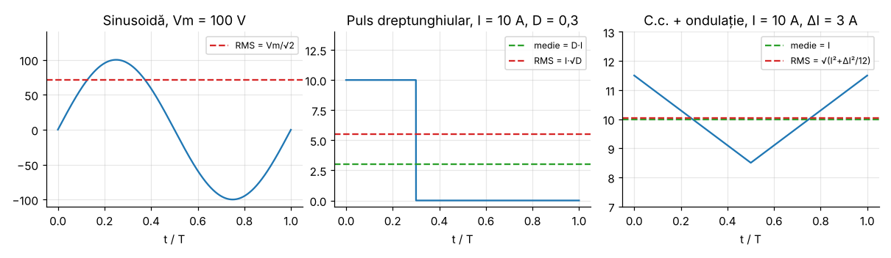

# Modulul 2 — Mărimi și relații fundamentale

**Obiective.** La finalul modulului vei putea:

- calcula valoarea medie și valoarea efectivă (RMS) a formelor de undă tipice;
- defini puterea activă, puterea aparentă, factorul de putere și THD;
- aplica **bilanțul volt-secundă** (bobină) și **bilanțul de sarcină**
  (condensator) în regim permanent periodic — cele două unelte cu care vom
  analiza toate convertoarele.

---

## 2.1 Valoarea medie și valoarea efectivă

Pentru o mărime periodică $x(t)$ de perioadă $T$:

$$\langle x \rangle = X_{med} = \frac{1}{T}\int_0^T x(t)\,dt, \qquad
X_{rms} = \sqrt{\frac{1}{T}\int_0^T x^2(t)\,dt}.$$

- **Valoarea medie** determină, de exemplu, tensiunea continuă livrată de un
  redresor sau curentul mediu printr-o diodă (pierderile prin $V_F$).
- **Valoarea efectivă** determină încălzirea rezistivă: un curent $i(t)$
  disipă într-un rezistor $R$ puterea medie $P = R\, I_{rms}^2$ (rezultă direct
  din definiție: $P = \frac{1}{T}\int R i^2\,dt$).

### Formule pentru formele de undă uzuale

| Formă de undă | Valoare medie | Valoare efectivă |
|---|---|---|
| sinusoidă, amplitudine $V_m$ | 0 | $V_m/\sqrt2$ |
| sinusoidă redresată monoalternanță | $V_m/\pi$ | $V_m/2$ |
| sinusoidă redresată dublă alternanță | $2V_m/\pi$ | $V_m/\sqrt2$ |
| puls dreptunghiular $I$, factor de umplere $D$ | $D I$ | $I\sqrt{D}$ |
| triunghi (sau dinte de fierăstrău) $0 \dots I_{pk}$ | $I_{pk}/2$ | $I_{pk}/\sqrt3$ |
| c.c. $I$ + ondulație triunghiulară vârf-vârf $\Delta I$ | $I$ | $\sqrt{I^2 + \Delta I^2/12}$ |
| trapez pe intervalul $D$ (curentul comutatorului unui buck) | $D I$ | $\sqrt{D\,(I^2 + \Delta I^2/12)}$ |

**Derivarea formulei pentru c.c. + ondulație.** Fie $i(t) = I + r(t)$, cu
$r(t)$ triunghi de medie zero și vârf-vârf $\Delta I$. Atunci

$$I_{rms}^2 = \langle (I + r)^2\rangle = I^2 + 2I\langle r\rangle + \langle r^2\rangle = I^2 + \langle r^2 \rangle,$$

deoarece $\langle r \rangle = 0$. Pe o rampă liniară de la $-\Delta I/2$ la
$+\Delta I/2$, $\langle r^2\rangle = \frac{1}{\Delta I}\int_{-\Delta I/2}^{\Delta I/2} x^2\,dx = \frac{\Delta I^2}{12}$.
Pentru trapezul care există doar pe intervalul $D T$, aceeași medie se ia pe o
fracțiune $D$ din perioadă, de unde factorul $D$.

**Consecință practică.** O ondulație de 30 % ($\Delta I = 0{,}3\,I$) mărește
$I_{rms}^2$ doar cu $0{,}09/12 = 0{,}75\ \%$. De aceea, la calculul pierderilor
de conducție, ondulația moderată contează puțin.

### Valoarea efectivă a unei sume de armonici (Parseval)

Dacă $x(t) = X_0 + \sum_n X_n \sin(n\omega t + \varphi_n)$, atunci, pentru că
armonicile de ordine diferite sunt ortogonale (media produsului lor pe o
perioadă este zero),

$$X_{rms} = \sqrt{X_0^2 + \sum_{n\ge1} \frac{X_n^2}{2}}.$$

## 2.2 Puterea și factorul de putere

- **Puterea instantanee:** $p(t) = v(t)\,i(t)$.
- **Puterea activă:** $P = \langle p \rangle$ (media pe o perioadă).
- **Puterea aparentă:** $S = V_{rms} I_{rms}$.
- **Factorul de putere:** $\mathrm{PF} = P/S$ (fără unitate, $\le 1$).

**Regim sinusoidal.** Cu $v = \sqrt2 V \sin\omega t$ și
$i = \sqrt2 I \sin(\omega t - \varphi)$ se obține $P = VI\cos\varphi$, deci
$\mathrm{PF} = \cos\varphi$.

**Tensiune sinusoidală, curent deformat** (situația tipică a redresoarelor
conectate la rețea). Descompunem curentul în armonici. Datorită ortogonalității,
doar armonica de același ordin cu tensiunea, adică fundamentala, produce putere
activă:

$$P = V\, I_1 \cos\varphi_1,$$

unde $I_1$ este valoarea efectivă a fundamentalei curentului și $\varphi_1$
defazajul ei față de tensiune. Atunci

$$\mathrm{PF} = \frac{V I_1 \cos\varphi_1}{V I} = \underbrace{\frac{I_1}{I}}_{\text{factor de distorsiune}} \cdot \underbrace{\cos\varphi_1}_{\text{factor de deplasare (DPF)}}.$$

**Distorsiunea armonică totală** (pentru un curent fără componentă continuă,
cum sunt curenții absorbiți din rețea):

$$\mathrm{THD} = \frac{\sqrt{\sum_{n\ge2} I_n^2}}{I_1} = \frac{\sqrt{I^2 - I_1^2}}{I_1}
\quad\Rightarrow\quad \frac{I_1}{I} = \frac{1}{\sqrt{1 + \mathrm{THD}^2}}.$$

**Exemplu.** Un curent dreptunghiular $\pm I_d$ în fază cu tensiunea are
$I = I_d$ și $I_1 = \frac{4 I_d}{\pi\sqrt2}$, deci
$\mathrm{PF} = \frac{2\sqrt2}{\pi} \approx 0{,}900$ și $\mathrm{THD} \approx 48{,}3\ \%$,
deși nu există niciun defazaj. **Un factor de putere mic nu înseamnă neapărat
defazaj**: poate proveni din deformarea curentului.

## 2.3 Bobina și condensatorul în regim permanent periodic

### Bilanțul volt-secundă (bobina)

Din $v_L = L\,\dfrac{di_L}{dt}$, prin integrare pe o perioadă:

$$i_L(T) - i_L(0) = \frac{1}{L}\int_0^T v_L\,dt = \frac{T}{L}\,\langle v_L\rangle.$$

În regim permanent periodic $i_L(T) = i_L(0)$, deci

$$\boxed{\langle v_L \rangle = 0}$$

Dacă media tensiunii pe bobină nu ar fi zero, curentul ar crește (sau scădea) la
fiecare perioadă cu $\langle v_L\rangle T/L$ și nu ar exista regim permanent.

### Bilanțul de sarcină (condensatorul)

Analog, din $i_C = C\,\dfrac{dv_C}{dt}$:

$$\boxed{\langle i_C \rangle = 0}$$

Aceste două relații, aplicate pe intervalele de conducție ale comutatoarelor,
dau caracteristicile de transfer ale tuturor convertoarelor DC-DC (Modulul 5).

### Aproximarea ondulației mici

Într-un convertor bine proiectat, tensiunea pe condensatorul de ieșire variază
puțin într-o perioadă (de exemplu sub 1 %). La calculul pantelor curentului prin
bobină o considerăm **constantă**, egală cu media. Aproximarea face formulele
foarte simple. Modulul 5 arată prin simulare exact cât de mică este eroarea
(de ordinul $10^{-4}$ în exemplele de acolo).

### Două reguli de bază ale comutației

1. **Nu se scurtcircuitează o sursă de tensiune** (sau un condensator
   încărcat): $i = C\,dv/dt$, iar un salt brusc de tensiune ar cere un curent
   teoretic infinit.
2. **Nu se întrerupe curentul unei bobine**: $v = L\,di/dt$, iar întreruperea
   bruscă a curentului produce o supratensiune care distruge comutatorul.

A doua regulă explică de ce convertoarele au **diode de regim liber**: când
tranzistorul se blochează, dioda oferă bobinei o cale pentru curent.

### Energia stocată

$$W_L = \tfrac12 L i_L^2, \qquad W_C = \tfrac12 C v_C^2.$$

## 2.4 Verificare numerică

Scriptul `verificari/v02_fundamente.py` compară fiecare formulă de mai sus cu
integrarea numerică directă a formei de undă (2²⁰ eșantioane pe perioadă).
Rezultate: **19/19 verificări trecute**. Câteva exemple:

| Mărime | Formula | Integrare numerică | Eroare relativă |
|---|---|---|---|
| RMS trapez buck ($I$ = 10 A, $\Delta I$ = 3 A, $D$ = 0,25) | 5,01871 A | 5,01871 A | 6·10⁻⁷ |
| PF curent dreptunghiular în fază | 0,900316 | 0,900316 | 3·10⁻¹² |
| PF curent deformat $= (I_1/I)\cos\varphi_1$ | 0,872099 | 0,872099 ($P/S$ direct) | ~10⁻¹⁶ |
| energia bobinei $\tfrac12 L I^2$ (100 µH, 5 A) | 1,25 mJ | 1,25 mJ ($\int v i\,dt$) | 2·10⁻¹⁵ |

## Întrebări de autoevaluare

1. Un curent are 8 A c.c. și o ondulație triunghiulară de 4 A vârf-vârf. Care
   este valoarea efectivă? *(Răspuns: $\sqrt{64 + 16/12} = 8{,}083$ A.)*
2. De ce armonicile curentului nu contribuie la puterea activă când tensiunea
   este sinusoidală?
3. Un consumator are $\cos\varphi_1 = 1$ și THD = 100 %. Cât este PF?
   *(Răspuns: $1/\sqrt2 \approx 0{,}707$.)*
4. Ce s-ar întâmpla cu curentul unei bobine dacă $\langle v_L\rangle = 0{,}5$ V,
   $L$ = 100 µH, $T$ = 10 µs? *(Răspuns: ar crește cu 50 mA la fiecare perioadă.)*

---

[← Modulul 1](01-introducere.md) · [Cuprins](../README.md) · [Modulul 3 →](03-dispozitive.md)
