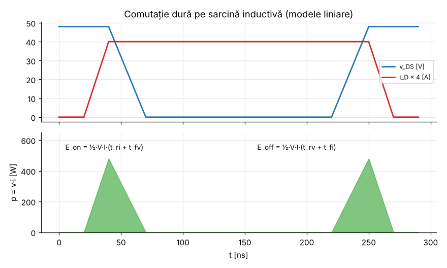

# Modulul 3 — Dispozitive semiconductoare de putere

**Obiective.** La finalul modulului vei putea:

- clasifica dispozitivele după cât de mult le poți comanda (necomandate,
  semicomandate, complet comandate);
- compara dioda, tiristorul, MOSFET-ul, IGBT-ul și dispozitivele cu bandă
  interzisă largă (SiC, GaN);
- calcula pierderile de conducție și de comutație cu modele simple.

---

## 3.1 De la comutatorul ideal la cel real

| Proprietate | Comutator ideal | Comutator real |
|---|---|---|
| tensiune de blocare | infinită | limitată ($V_{DS,max}$, $V_{CES}$, $V_{RRM}$ …) |
| curent în conducție | infinit | limitat (termic) |
| cădere în conducție | 0 | $R_{DS(on)} \cdot i$ sau $V_{CE(sat)}$, $V_F$ |
| curent în blocare | 0 | curent de scurgere (de obicei neglijabil) |
| timp de comutație | 0 | zeci de ns … µs |
| putere de comandă | 0 | mică (MOSFET/IGBT), dar nenulă |

Pierderile au deci două surse: **conducția** (cădere de tensiune × curent) și
**comutația** (intervalele în care tensiunea și curentul sunt simultan mari).

## 3.2 Clasificare după controlabilitate

| Clasă | Pornire | Oprire | Dispozitive |
|---|---|---|---|
| necomandate | impusă de circuit ($v_{AK} > 0$) | impusă de circuit ($i \to 0$) | diodă |
| semicomandate | prin impuls de grilă (cu $v_{AK} > 0$) | **doar** de circuit ($i$ scade sub curentul de menținere) | tiristor (SCR) |
| complet comandate | prin grilă | prin grilă | MOSFET, IGBT, GTO/IGCT, (BJT de putere — istoric) |

## 3.3 Dioda de putere

- Conduce când este polarizată direct; cădere $V_F$ tipic 0,7 … 2 V la diodele
  pn de putere (crește cu curentul).
- **Model pentru pierderi:** $v_F \approx V_{F0} + r_D\, i$, deci

  $$P_{cond} = V_{F0}\, I_{med} + r_D\, I_{rms}^2.$$

- **Recuperarea inversă:** o diodă pn care conducea are sarcină stocată
  ($Q_{rr}$). La blocare, ea conduce un scurt timp **în sens invers**
  ($t_{rr}$). Rezultă pierderi suplimentare în diodă și, mai ales, în
  tranzistorul care se deschide. Aproximativ, $P_{rr} \approx Q_{rr}\, V\, f_s$
  (o estimare; valorile exacte depind de $di/dt$ și de temperatură, vezi foaia
  de catalog).
- **Dioda Schottky** (joncțiune metal-semiconductor) nu are sarcină stocată de
  purtători minoritari, deci practic nu are recuperare inversă (rămâne doar
  sarcina capacitivă a joncțiunii). În **siliciu** are $V_F$ mic, dar se
  folosește doar la tensiuni mici. În **SiC**, diodele Schottky (și variantele
  MPS, *merged PiN Schottky*) acoperă în produse comerciale de la 650 V până la
  3,3 kV [B18]. $V_F$ al lor **nu** este mic (tipic ~1,3–1,8 V la curentul
  nominal); avantajul lor este lipsa recuperării inverse.

## 3.4 Tiristorul (SCR)

- Structură pnpn. Se aprinde printr-un impuls de curent în grilă, dacă
  $v_{AK} > 0$. Odată aprins, **rămâne în conducție** fără comandă, până când
  curentul scade sub **curentul de menținere** $I_H$.
- **De ce nu se poate bloca din grilă.** Structura pnpn se modelează ca două
  tranzistoare (pnp și npn) conectate astfel încât curentul de colector al
  fiecăruia este curentul de bază al celuilalt. După amorsare, această reacție
  pozitivă (*zăvorâre*, *latching*) se autoîntreține, iar grila nu mai are
  control. Tiristorul se blochează doar când circuitul exterior aduce curentul
  sub $I_H$. În redresoarele conectate la rețea alternativă, acest lucru se
  întâmplă natural (**comutație de la rețea**). GTO-ul și IGCT-ul sunt variante
  construite special ca să poată fi blocate și din grilă.
- Puncte forte: tensiuni și curenți foarte mari, cădere mică în conducție,
  robustețe. Tiristoarele de clasa 8,5 kV sunt folosite la transportul HVDC
  [B9].
- Aplicații: redresoare comandate (Modulul 4), HVDC, pornire lină a
  motoarelor, variatoare de tensiune alternativă.
- Limitări: frecvență mică (de ordinul frecvenței rețelei), sensibilitate la
  $dv/dt$ (aprindere parazită) și la $di/dt$ la pornire.

## 3.5 MOSFET-ul de putere

- **Dispozitiv unipolar**: conduce doar prin purtători majoritari, deci nu are
  sarcină stocată și comută foarte repede (zeci de ns).
- În conducție se comportă ca un rezistor: $v_{DS} = R_{DS(on)}\, i_D$, deci

  $$P_{cond} = R_{DS(on)}\, I_{rms}^2.$$

- $R_{DS(on)}$ **crește cu temperatura** (în Si, tipic de 1,5–2 ori între
  25 °C și 125–150 °C; valoarea exactă se ia din foaia de catalog). Efectul are
  și o parte bună: MOSFET-urile puse în paralel își împart curentul relativ
  bine, pentru că cel mai cald conduce mai puțin.
- **Comandă în tensiune**: grila este izolată. Totuși, la fiecare comutație
  trebuie încărcată/descărcată sarcina de grilă $Q_g$:

  $$P_{grilă} = Q_g\, V_{GS}\, f_s$$

  (puterea absorbită de la sursa driverului; se disipă în driver și în
  rezistențele de grilă).
- Are o **diodă intrinsecă** (*body diode*) între sursă și drenă, utilizabilă
  ca diodă de regim liber, dar de obicei lentă (recuperare inversă mare) la
  MOSFET-urile de Si de tensiune mare.
- Limitare fundamentală în Si: pentru a bloca o tensiune mai mare, stratul de
  drift trebuie să fie mai gros și mai slab dopat. Teoria arată că rezistența
  specifică ideală crește aproximativ cu $V_B^{2{,}5}$ [B5]. Din acest motiv,
  MOSFET-urile de Si domină la tensiuni mici și medii. Structurile
  *superjunction* împing această limită pentru clasa 600–900 V.

## 3.6 IGBT-ul

- Combină o comandă MOS (grilă izolată) cu o conducție bipolară: zona de drift
  este „inundată” cu purtători (modulația conductivității). Rezultatul este o
  cădere în conducție mică, care **crește mult mai lent cu tensiunea nominală**
  decât $R_{DS(on)}$ al unui MOSFET de Si (orientativ: ~1,5–2 V la dispozitivele
  de 650–1200 V, ~3–4 V la cele de 6,5 kV; valorile exacte sunt în catalog).
- Model pentru conducție: $v_{CE} \approx V_{CE0} + r_{CE}\, i$, deci
  $P_{cond} = V_{CE0} I_{med} + r_{CE} I_{rms}^2$.
- **Coada de curent** la blocare (purtătorii stocați trebuie să dispară) mărește
  pierderile la blocare. De aceea IGBT-urile lucrează tipic la frecvențe mai
  mici decât MOSFET-urile (de la câțiva kHz la câteva zeci de kHz).
- Nu are diodă intrinsecă utilizabilă, așa că modulele includ o diodă
  antiparalel.
- Tensiuni: de la 600 V până la module comerciale de 6,5 kV (tracțiune
  feroviară, acționări de medie tensiune) [B10, B11].

## 3.7 Dispozitive cu bandă interzisă largă: SiC și GaN

Proprietățile de material (valori aproximative la temperatura camerei; sursele
diferă, mai ales la conductivitatea termică — vezi bibliografia [B12–B14, B17]):

| Proprietate | Si | 4H-SiC | GaN |
|---|---|---|---|
| lățimea benzii interzise $E_g$ [eV] | 1,12 | 3,26 | ~3,4 |
| câmpul electric critic $E_c$ [MV/cm] | ~0,3 | ~2,5–3 | ~3,3 |
| conductivitate termică [W/(cm·K)] | ~1,5 | ~2,7–4,9 (depinde de sursă, dopaj și orientare) | ~1,3–2,1 |

**De ce contează câmpul critic.** Grosimea stratului care blochează tensiunea
$V_B$ scade proporțional cu $1/E_c$, iar dopajul poate crește. Pentru un câmp
critic de ~10 ori mai mare, rezistența specifică ideală la aceeași tensiune
scade cu câteva ordine de mărime (dependență teoretică $\propto 1/E_c^3$ [B5]).
Așadar, la aceeași $R_{DS(on)}$, cipul este mult mai mic, are capacități
parazite mai mici și comută mai repede.

- **SiC MOSFET** și **diode Schottky SiC**: MOSFET-urile discrete sunt tipic de
  650–1700 V; există și module de 3,3 kV pentru tracțiune [B15].
  Pot lucra la temperaturi mai mari și disipă bine căldura. Aplicații:
  invertoare pentru vehicule electrice, încărcătoare rapide, invertoare
  fotovoltaice.
- **GaN HEMT**: structură laterală, canal format de un gaz electronic
  bidimensional (2DEG). Comută extrem de repede și nu are sarcină de
  recuperare inversă. Pe piață există două segmente mari: GaN de **joasă
  tensiune** (aprox. 15–350 V: convertoare DC-DC, LiDAR, acționări mici) [B19]
  și GaN de **~650 V**, pentru surse alimentate din rețea [B16]. Au apărut și
  comutatoare GaN integrate de 1250–1700 V (de exemplu un circuit integrat
  flyback cu comutator GaN de 1700 V, lansat în 2024) [B20]. Aplicații:
  încărcătoare compacte, surse pentru servere, LiDAR.

> **Notă de prudență.** Gamele de tensiune și frecvență de mai sus sunt
> orientative și evoluează rapid. Pentru un proiect real, sursa de adevăr este
> catalogul producătorului.

## 3.8 Pierderile de comutație — modelul liniar

Cazul cel mai des întâlnit este **comutația dură pe sarcină inductivă**.
Tranzistorul comută un curent $I$ impus de o bobină (practic constant pe durata
comutației), iar o diodă de regim liber „clampează” tensiunea la $V$.

**La pornire** (dioda conduce încă, deci tranzistorul rămâne la tensiunea $V$):

1. curentul crește de la 0 la $I$ în $t_{ri}$, cu $v = V$, deci
   $E_1 = \int_0^{t_{ri}} V \cdot \frac{I t}{t_{ri}}\,dt = \tfrac12 V I t_{ri}$;
2. abia când tranzistorul preia tot curentul, dioda se blochează și tensiunea
   scade la 0 în $t_{fv}$, cu $i = I$, deci $E_2 = \tfrac12 V I t_{fv}$.

$$E_{on} = \tfrac12 V I (t_{ri} + t_{fv}), \qquad E_{off} = \tfrac12 V I (t_{rv} + t_{fi}),$$

$$P_{sw} = (E_{on} + E_{off})\, f_s.$$

**Comparație cu sarcina rezistivă.** Acolo tensiunea și curentul se schimbă
simultan ($v = V(1 - t/t_c)$, $i = I t/t_c$), iar
$E = \int_0^{t_c} v\,i\,dt = \tfrac16 V I t_c$, de **3 ori mai puțin** la
aceeași durată. Sarcina inductivă „clampată” este deci cazul cel mai
defavorabil, și tocmai acesta apare în convertoare.

Alte componente ale pierderilor de comutație:

- energia stocată în capacitatea de ieșire, $E_{oss}$ (aprox. $\tfrac12 C_{oss}V^2$
  pentru o capacitate liniară; $C_{oss}$ real este neliniară, așa că se
  folosește valoarea $E_{oss}$ din catalog), disipată la fiecare pornire dură;
- recuperarea inversă a diodei ($\approx Q_{rr} V f_s$).

> **Verificare.** `verificari/v07_pierderi.py` integrează numeric
> $p(t) = v(t)\,i(t)$ pe formele de undă liniarizate și regăsește exact
> $\tfrac12 VI(t_{ri}+t_{fv})$ (12 µJ pentru 48 V, 10 A, 50 ns) și
> $\tfrac16 V I t_c$ (4 µJ). Raportul 3 este confirmat.

> **Limitele modelului.** Modelul liniar este o aproximare. Formele reale
> depind de capacitățile parazite neliniare, de inductanțele parazite și de
> driver [B8]. Pentru proiectare se folosesc energiile $E_{on}$, $E_{off}$
> măsurate de producător (date în catalog pentru anumite condiții de test).

## 3.9 Comanda pe grilă (pe scurt)

- **Driverul** trebuie să furnizeze vârfuri de curent de ordinul amperilor
  pentru a încărca rapid capacitatea de grilă. Rezistența de grilă $R_g$
  reglează viteza de comutație (compromis între pierderi, pe de o parte, și
  supratensiuni/EMI, pe de alta).
- **Platoul Miller**: în timpul variației tensiunii drenă-sursă, curentul de
  grilă încarcă în principal capacitatea grilă-drenă, iar $v_{GS}$ stă
  aproximativ constantă.
- Tranzistorul „de sus” dintr-un braț are sursa la potențial variabil și cere
  driver izolat sau alimentare *bootstrap*.
- Între comutatoarele aceluiași braț se introduce un **timp mort**, ca să nu
  conducă simultan (scurtcircuit al sursei — regula 1 din Modulul 2).
- La SiC MOSFET și la IGBT se folosește frecvent o tensiune **negativă** de
  blocare pe grilă, pentru imunitate la pornirea parazită.

## 3.10 Ghid orientativ de alegere

| Aplicație tipică | Dispozitiv uzual | Motiv |
|---|---|---|
| surse DC-DC de joasă tensiune (< ~200 V), frecvență mare | MOSFET Si | $R_{DS(on)}$ mic la tensiune mică, comutație rapidă |
| surse compacte 400 V, încărcătoare | MOSFET superjunction, GaN | pierderi de comutație mici, frecvență mare |
| invertoare 400–800 V c.c., zeci–sute kW (vehicule electrice) | SiC MOSFET, IGBT | tensiune mare, pierderi mici; IGBT ieftin la frecvență moderată |
| acționări și tracțiune de medie tensiune (kV) | IGBT (module 3,3–6,5 kV) | tensiune și curent mari |
| HVDC, redresoare de mare putere la frecvența rețelei | tiristor | tensiune și curent foarte mari, pierderi mici în conducție |

## Întrebări de autoevaluare

1. De ce nu se poate bloca un tiristor din grilă?
2. Un MOSFET cu $R_{DS(on)} = 20$ mΩ conduce un curent de 10 A RMS. Ce
   pierderi de conducție are? *(2 W.)* Cum se schimbă la 125 °C, dacă
   $R_{DS(on)}$ crește de 1,7 ori? *(3,4 W.)*
3. De ce pierderile de comutație cresc proporțional cu $f_s$?
4. Ce avantaj principal aduce câmpul critic mare al SiC/GaN?
5. Un MOSFET are $Q_g = 40$ nC, este comandat cu 12 V la 250 kHz. Ce putere
   absoarbe driverul pentru grilă? *(0,12 W.)*

---

[← Modulul 2](02-fundamente.md) · [Cuprins](../README.md) · [Modulul 4 →](04-redresoare.md)
