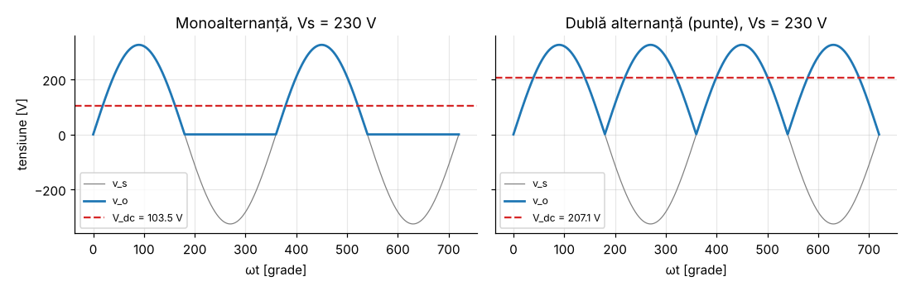
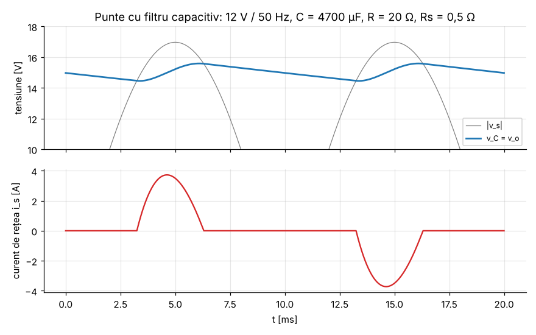
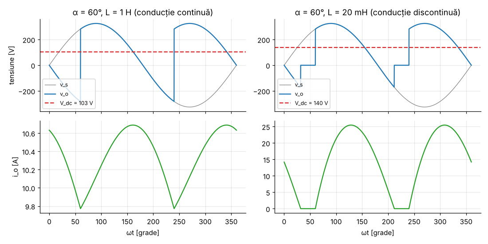
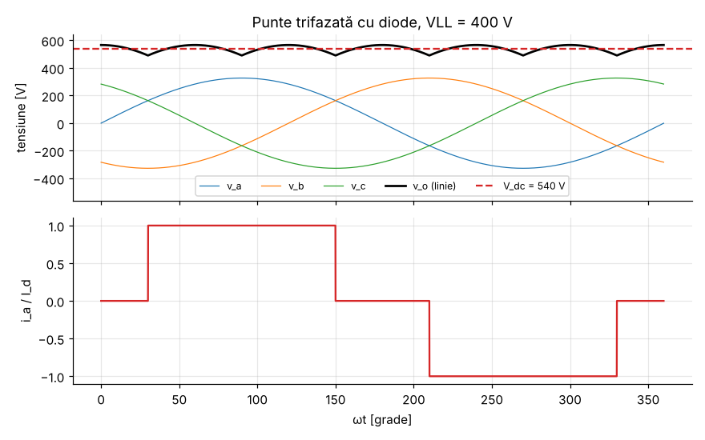

# Modulul 4 — Redresoare (conversie AC → DC)

**Obiective.** La finalul modulului vei putea:

- calcula tensiunea continuă a redresoarelor monofazate și trifazate,
  necomandate și comandate;
- dimensiona un filtru capacitiv și înțelege cât de bună este formula uzuală;
- explica de ce redresoarele cu filtru capacitiv au factor de putere mic.

Notații: $V_s$ = valoarea efectivă a tensiunii de alimentare (fază),
$V_m = \sqrt2 V_s$ = amplitudinea, $V_{LL}$ = tensiunea efectivă de linie
(trifazat), $\omega = 2\pi f$.

---

## 4.1 Redresorul monoalternanță cu sarcină rezistivă

```
   ┌────►|────┐
   │    D     │
  v_s         R   v_o        D conduce doar când v_s > 0
   │          │
   └──────────┘
```

$$V_{dc} = \frac{1}{2\pi}\int_0^{\pi} V_m \sin\theta\,d\theta = \frac{V_m}{\pi} \approx 0{,}45\,V_s,
\qquad V_{o,rms} = \frac{V_m}{2}.$$

Tensiunea inversă maximă pe diodă este $V_m$. Dezavantaje: ondulație mare,
curent cu componentă continuă prin transformator (îl saturează). În practică se
folosește doar la puteri foarte mici.

## 4.2 Redresorul în punte (dublă alternanță) cu sarcină rezistivă

```
                (+) ───────────┐
           ┌─────┴─────┐       │
           ▲ D1        ▲ D3    │
           │           │       R   v_o
  a ───────┤           ├─── b  │
           ▲ D2        ▲ D4    │
           │           │       │
           └─────┬─────┘       │
                (−) ───────────┘
   ▲ = sensul de conducție al diodei;  v_s se aplică între a și b
```
În fiecare alternanță conduc **două** diode în serie (D1–D4 când $v_s > 0$,
D3–D2 când $v_s < 0$), iar pe sarcină se obține $|v_s|$.

$$V_{dc} = \frac{1}{\pi}\int_0^{\pi} V_m \sin\theta\,d\theta = \frac{2V_m}{\pi} = \frac{2\sqrt2}{\pi}V_s \approx 0{,}9\,V_s,
\qquad V_{o,rms} = V_s.$$

- **Factorul de formă:** $\mathrm{FF} = V_{rms}/V_{dc} = \pi/(2\sqrt2) \approx 1{,}111$.
- **Factorul de ondulație:** $\mathrm{RF} = V_{ac,rms}/V_{dc} = \sqrt{\mathrm{FF}^2 - 1} \approx 0{,}483$.
- Ondulația are frecvența $2f$ (100 Hz la rețeaua de 50 Hz). Prima armonică a
  tensiunii de ieșire are amplitudinea $4V_m/(3\pi)$.
- Fiecare diodă trebuie să blocheze $V_m$ și conduce curentul mediu $I_{dc}/2$.
- Cu diode reale, din tensiune se scade $2V_F$ (două diode în conducție).



## 4.3 Redresorul în punte cu filtru capacitiv

Cel mai folosit redresor: intrarea oricărui alimentator conectat la rețea. Un
condensator mare $C$ pus în paralel cu sarcina se încarcă aproape de $V_m$ la
vârful tensiunii. Între vârfuri, diodele sunt blocate, iar condensatorul
alimentează singur sarcina.



### Formula uzuală (aproximativă)

Presupunem că (a) condensatorul se descarcă **o semiperioadă întreagă** $T/2$
și (b) cu curent **constant** $I_o \approx V_m/R$. Atunci
$\Delta V = I_o \frac{T}{2} / C$, adică

$$\boxed{\Delta V \approx \frac{I_o}{2 f C} = \frac{V_m}{2 f R C}}, \qquad V_{dc} \approx V_m - \frac{\Delta V}{2}.$$

### Soluția exactă (diode ideale, sursă fără impedanță)

- Conducția se termină când panta lui $|v_s|$ devine mai mică decât panta de
  descărcare a condensatorului:
  $V_m\omega\cos\theta = -\frac{V_m \sin\theta}{RC}$, deci
  $\theta_{off} = \pi - \arctan(\omega R C)$.
- Apoi $v_C(\theta) = V_m\sin\theta_{off}\, e^{-(\theta-\theta_{off})/(\omega R C)}$,
  până când întâlnește din nou $|v_s|$, la $\theta_{on}$ (ecuație
  transcendentă, rezolvată numeric).
- $\Delta V = V_m - v_C(\theta_{on})$.

### Cât de bună este formula uzuală?

Exemplu: 12 V / 50 Hz ($V_m$ = 16,97 V), $R$ = 20 Ω, $C$ = 4700 µF.
Rezultatele din `verificari/v04_redresoare.py`:

| Metodă | $\Delta V$ | $V_{dc}$ |
|---|---|---|
| formula uzuală $V_m/(2fRC)$ | 1,805 V | 16,07 V |
| soluția exactă (diode ideale) | 1,485 V | 16,26 V |
| simulare în timp (RK4, $R_s$ = 0,01 Ω) | 1,476 V | 16,25 V |

Simularea confirmă soluția exactă (diferență 0,6 %). Formula uzuală
**supraestimează** ondulația, deci este **acoperitoare** (dimensionarea pe baza
ei este sigură). Eroarea ei scade odată cu ondulația relativă:

| $C$ | $\Delta V / V_m$ (exact) | eroarea formulei uzuale |
|---|---|---|
| 2200 µF | 16,7 % | +36,4 % |
| 4700 µF | 8,8 % | +21,6 % |
| 10 000 µF | 4,4 % | +13,3 % |
| 47 000 µF | 1,0 % | +5,3 % |

Explicația: ipoteza (a) ignoră timpul de conducție. Conducția începe când
$|v_s|$ ajunge la $V_m - \Delta V$, adică la unghiul $\theta_c$ înainte de vârf
cu $\cos\theta_c = 1 - \Delta V/V_m$, deci $\theta_c \approx \sqrt{2\Delta V/V_m}$.
Unghiul de conducție scade doar ca rădăcina pătrată a ondulației relative, de
aceea eroarea se micșorează încet.

### Curentul absorbit din rețea și factorul de putere

Diodele conduc doar un interval scurt în jurul vârfului, așa că rețeaua
furnizează **impulsuri de curent** mari. Cu o rezistență de sursă de 0,5 Ω
(transformator mic), simularea dă:

| Mărime | Valoare |
|---|---|
| $I_{rms}$ / $I_1$ | 1,493 A / 1,038 A |
| THD | 103 % |
| $\cos\varphi_1$ (DPF) | 0,996 |
| **PF** | **0,693** |

Factorul de putere este mic **din cauza deformării**, nu a defazajului.
Scriptul verifică că $P/S$ calculat direct este egal cu
$(I_1/I)\cos\varphi_1$ (eroare 10⁻¹¹) și că puterea luată din sursă este egală
cu puterea din sarcină plus pierderile din $R_s$ (eroare 2·10⁻⁸).

**Consecințe practice:**

- Armonicile de curent încarcă rețeaua și sunt limitate prin standarde (de
  exemplu IEC 61000-3-2 pentru echipamente cu curent ≤ 16 A pe fază [B7]).
  Peste anumite puteri se folosesc circuite de corecție a factorului de putere
  (**PFC**, de regulă un convertor boost comandat să absoarbă curent
  sinusoidal).
- La pornire, condensatorul descărcat produce un **curent de șoc** (*inrush*)
  foarte mare, limitat cu un termistor NTC sau cu un circuit de pre-încărcare.

## 4.4 Redresorul monofazat comandat (punte cu tiristoare)

Diodele se înlocuiesc cu tiristoare aprinse cu **unghiul de comandă** $\alpha$,
măsurat de la trecerea prin zero a tensiunii.

**Conducție continuă** (sarcină puternic inductivă: curentul nu se anulează).
Perechea T1–T4 conduce de la $\alpha$ la $\pi + \alpha$, chiar și după ce $v_s$
devine negativă (bobina menține curentul). Deci

$$V_{dc} = \frac{1}{\pi}\int_{\alpha}^{\pi+\alpha} V_m\sin\theta\,d\theta = \frac{2V_m}{\pi}\cos\alpha \approx 0{,}9\,V_s\cos\alpha.$$

- Pentru $\alpha > 90°$, $V_{dc} < 0$: puntea **trimite energie înapoi în
  rețea** (regim de invertor). Asta cere ca sarcina să conțină o sursă care
  menține curentul, de exemplu un motor de c.c. în frânare. O sarcină R-L pur
  pasivă nu poate susține acest regim.
- Cu curent de sarcină constant $I_d$, curentul de rețea este dreptunghiular
  $\pm I_d$, defazat cu $\alpha$: $\mathrm{PF} = \frac{2\sqrt2}{\pi}\cos\alpha \approx 0{,}9\cos\alpha$.

**Conducție discontinuă** (inductanță mică). Curentul se anulează la unghiul de
stingere $\beta < \pi + \alpha$, iar între $\beta$ și $\pi+\alpha$ tensiunea
pe sarcină este zero:

$$V_{dc} = \frac{V_m}{\pi}(\cos\alpha - \cos\beta) \;>\; 0{,}9\,V_s\cos\alpha.$$



**Verificare prin simulare** (230 V, 50 Hz, $R$ = 10 Ω):

| Caz | Formula | Simulare |
|---|---|---|
| $\alpha$ = 30°, $L$ = 1 H: $V_{dc}$ | 179,33 V | 179,32 V |
| $\alpha$ = 60°, $L$ = 1 H: $V_{dc}$ | 103,54 V | 103,56 V |
| $\alpha$ = 30°, $L$ = 1 H: PF | 0,7797 | 0,7797 |
| $\alpha$ = 60°, $L$ = 20 mH (discontinuu, $\beta$ = 211,8° din simulare): $V_{dc}$ | 139,81 V | 139,84 V |

## 4.5 Puntea trifazată (redresor cu 6 pulsuri)

Șase diode (sau tiristoare). În grupul de sus conduce dioda fazei cu tensiunea
cea mai mare, iar în grupul de jos cea a fazei cu tensiunea cea mai mică.
Tensiunea de ieșire este anvelopa tensiunilor de linie: 6 segmente de 60° pe
perioadă.

$$V_{dc} = \frac{3}{\pi}\int_{\pi/3}^{2\pi/3}\sqrt2\,V_{LL}\sin\theta\,d\theta = \frac{3\sqrt2}{\pi}V_{LL} \approx 1{,}35\,V_{LL}.$$

Cu tiristoare și unghi de comandă $\alpha$: $V_{dc} = 1{,}35\,V_{LL}\cos\alpha$.

- Ondulația are frecvența $6f$ (300 Hz) și este mult mai mică decât la
  monofazat: tensiunea de ieșire conține doar armonici de ordin $6k$.
- Cu curent de sarcină constant, curentul de fază este un dreptunghi de 120°:
  $I_{rms} = \sqrt{2/3}\,I_d$, $I_1/I = 3/\pi \approx 0{,}955$,
  armonici de ordin $6k \pm 1$ (5, 7, 11, 13, …) cu $I_h = I_1/h$,
  $\mathrm{THD} \approx 31{,}08\ \%$, iar $\mathrm{PF} = (3/\pi)\cos\alpha$.



**Verificare** (VLL = 400 V): construcția numerică a formei de undă dă
$V_{dc}$ = 540,19 V (formula: 540,19 V). La $\alpha$ = 30° se obține 467,82 V,
iar la 60°, 270,10 V. Curentul are THD = 31,084 %, iar armonicile 2, 3, 4, 6, 9
lipsesc.

## 4.6 Efectul inductanței rețelei: suprapunerea comutației

Rețeaua și transformatorul au inductanță $L_s$, așa că curentul nu poate trece
instantaneu de la o diodă la alta. Pe durata **suprapunerii** (unghiul $u$)
conduc simultan diodele ambelor faze, iar tensiunea de ieșire „pierde” o arie.

- **Punte monofazată** (curent $I_d$ constant): curentul de rețea trebuie să
  treacă din $-I_d$ în $+I_d$. În acest timp $v_o = 0$ și
  $L_s\,di/dt = v_s$, deci
  $\int_0^u V_m\sin\theta\,d\theta = 2\omega L_s I_d$:

  $$\cos u = 1 - \frac{2\omega L_s I_d}{V_m}, \qquad V_{dc} = 0{,}9\,V_s - \frac{2\omega L_s I_d}{\pi}.$$

- **Punte trifazată**: la fiecare dintre cele 6 comutații pe perioadă se pierde
  aria $\omega L_s I_d$ (volți·radiani), deci

  $$V_{dc} = 1{,}35\,V_{LL} - \frac{3\omega L_s I_d}{\pi}.$$

Ambele relații au fost verificate prin integrarea numerică a ecuației
$L_s\,di/dt$ (de exemplu, monofazat 230 V, $L_s$ = 2 mH, $I_d$ = 20 A:
$u$ = 22,67°, $V_{dc}$ = 199,07 V, eroare 5·10⁻⁷). Practic, tensiunea scade
cu sarcina, ca și cum redresorul ar avea o „rezistență internă” fără pierderi.

## Întrebări de autoevaluare

1. De ce puntea monofazată are ondulația la $2f$, iar puntea trifazată la $6f$?
2. Un redresor în punte alimentat la 24 V RMS, cu diode cu $V_F$ = 0,9 V și
   sarcină rezistivă: ce tensiune medie dă? *(≈ $0{,}9 \cdot 24 - 2\cdot0{,}9$ = 19,8 V,
   aproximativ: căderea pe diode nu este constantă pe toată alternanța.)*
3. De ce formula $\Delta V \approx I_o/(2fC)$ este „acoperitoare”?
4. Ce unghi $\alpha$ trebuie pentru ca o punte trifazată la 400 V să dea
   270 V c.c.? *(60°.)*
5. Un redresor are PF = 0,69 și $\cos\varphi_1$ = 0,996. Ce cauzează factorul
   de putere mic?

---

[← Modulul 3](03-dispozitive.md) · [Cuprins](../README.md) · [Modulul 5 →](05-convertoare-dc-dc.md)
