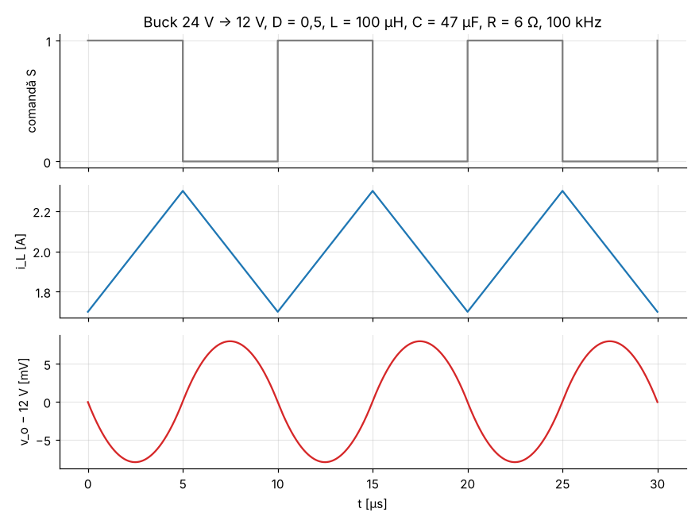
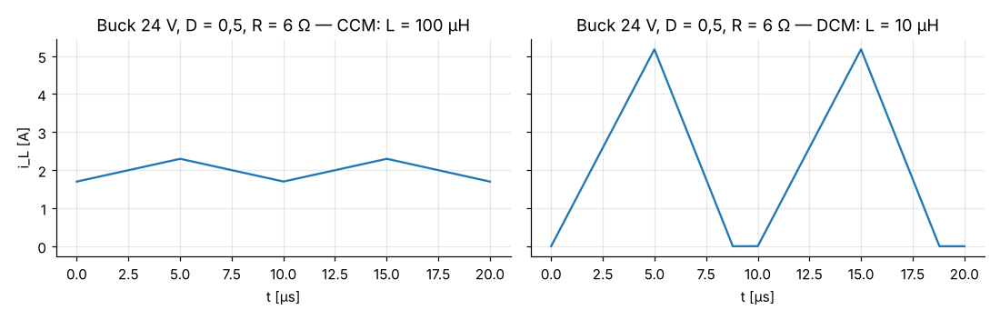
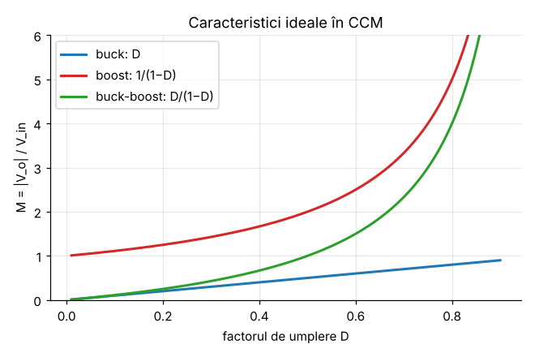

# Modulul 5 — Convertoare DC-DC

**Obiective.** La finalul modulului vei putea:

- deriva caracteristica de transfer a convertoarelor buck, boost și
  buck-boost din bilanțul volt-secundă;
- calcula ondulațiile de curent și de tensiune și dimensiona $L$ și $C$;
- recunoaște regimul de conducție discontinuă (DCM) și calcula tensiunea în
  DCM;
- explica de ce câștigul real al unui boost este limitat.

Notații: $D$ = factor de umplere, $T_s = 1/f_s$, $R$ = rezistența de sarcină,
$I_o = V_o/R$, $\Delta i_L$ = ondulația **vârf-vârf** a curentului prin bobină,
$\Delta v_o$ = ondulația vârf-vârf a tensiunii de ieșire.
**CCM** = conducție continuă (curentul bobinei nu ajunge la zero),
**DCM** = conducție discontinuă.

---

## 5.1 Convertorul coborâtor (buck)

```
          S          L
 Vin ─────/ ───┬────ΥΥΥΥ────┬──────┬───── +
  +            │            │      │
               ▲ D          C      R    Vo
               │            │      │
 ─────────────┴────────────┴──────┴───── −
```

**Intervalul ON** ($0 < t < DT_s$): S închis, D blocată,
$v_L = V_{in} - V_o$.
**Intervalul OFF** ($DT_s < t < T_s$): S deschis, curentul bobinei trece prin
D, $v_L = -V_o$.

### Caracteristica de transfer (CCM)

Din bilanțul volt-secundă (Modulul 2), $\langle v_L\rangle = 0$:

$$(V_{in} - V_o)\,D + (-V_o)(1-D) = 0 \quad\Rightarrow\quad \boxed{V_o = D\,V_{in}}$$

Pentru buck relația este **exactă** în CCM, chiar și cu ondulație: media lui
$v_L$ este $D V_{in} - \langle v_o\rangle$ indiferent de forma lui $v_o$.
Din bilanțul de sarcină pe $C$: $\langle i_L\rangle = I_o$.

### Ondulații

Pe intervalul ON curentul crește liniar cu panta $(V_{in}-V_o)/L$:

$$\Delta i_L = \frac{(V_{in} - V_o)\,D}{L f_s} = \frac{V_o(1-D)}{L f_s}.$$

Componenta alternativă a lui $i_L$ (triunghi) trece prin condensator. Sarcina
acumulată pe semiperioada pozitivă este aria unui triunghi de bază $T_s/2$ și
înălțime $\Delta i_L/2$: $\Delta Q = \tfrac12\cdot\tfrac{T_s}{2}\cdot\tfrac{\Delta i_L}{2}$, deci

$$\Delta v_o = \frac{\Delta Q}{C} = \frac{\Delta i_L}{8 C f_s}.$$

(Aproximare: tot curentul alternativ trece prin $C$ și se neglijează
rezistența serie echivalentă, ESR, a condensatorului; în practică ESR adaugă
$\approx \Delta i_L \cdot \mathrm{ESR}$.)

### Limita CCM/DCM

CCM se păstrează cât timp valoarea minimă a curentului rămâne pozitivă:
$I_o > \Delta i_L/2$. Înlocuind:

$$L > L_{crit} = \frac{(1-D)\,R}{2 f_s}.$$



### Exemplu verificat prin simulare

$V_{in}$ = 24 V, $D$ = 0,5, $L$ = 100 µH, $C$ = 47 µF, $R$ = 6 Ω, $f_s$ = 100 kHz.
Simulatorul (`verificari/simulator_dcdc.py`) rezolvă **exact** ecuațiile de
stare ale fiecărei topologii, pornind din repaus până la regim permanent
(1370 de perioade). Nu folosește nicio formulă din acest modul.

| Mărime | Formula | Simulare | Eroare relativă |
|---|---|---|---|
| $V_o$ | 12 V | 12,000000 V | 10⁻¹¹ |
| $\langle i_L \rangle$ | 2 A | 2,000000 A | 2·10⁻¹¹ |
| $\Delta i_L$ | 0,600 A | 0,6003 A | 4·10⁻⁴ |
| $\Delta v_o$ | 15,96 mV | 15,97 mV | 5·10⁻⁴ |
| $\langle v_L\rangle$, $\langle i_C\rangle$ | 0 | ~10⁻¹⁰ | — |
| $P_{in} = P_{out}$ (comutatoare ideale) | 24 W | 24 W | 8·10⁻¹² |

$L_{crit}$ = 15 µH. Simularea confirmă că la $1{,}05\,L_{crit}$ convertorul
este în CCM, iar la $0{,}95\,L_{crit}$ în DCM.

### Regimul de conducție discontinuă (DCM)

Dacă $L < L_{crit}$ (sau sarcina este mică), curentul bobinei ajunge la zero
înainte de sfârșitul perioadei. Apare un al treilea interval, în care S și D
sunt ambele blocate și $i_L = 0$. Notăm cu $D_2 T_s$ durata conducției diodei
și cu $K = \dfrac{2L}{R\,T_s}$.

- volt-secundă: $(V_{in} - V_o)\,D = V_o D_2$;
- curentul mediu prin bobină (triunghiuri de vârf $I_{pk} = (V_{in}-V_o)DT_s/L$)
  este egal cu $I_o$: $\tfrac12 I_{pk}(D + D_2) = V_o/R$.

Eliminând $D_2$ și notând $M = V_o/V_{in}$ se obține $K M^2 + D^2 M - D^2 = 0$, cu
soluția pozitivă

$$M = \frac{2}{1 + \sqrt{1 + 4K/D^2}}, \qquad \text{DCM dacă } K < K_{crit} = 1 - D.$$

Pentru $K = 1 - D$ formula dă exact $M = D$: cele două regimuri se racordează.
**În DCM tensiunea depinde de sarcină**, deci bucla de reglare trebuie să
modifice $D$ (vezi Exercițiul 7).



**Verificare** ($L$ = 10 µH, deci $K$ = 0,333 < 0,5):

| $C$ | $V_o$ formula | $V_o$ simulare | Eroare |
|---|---|---|---|
| 47 µF | 13,650 V | 13,671 V | 1,6·10⁻³ |
| 470 µF | 13,650 V | 13,652 V | 1,6·10⁻⁴ |

Formula DCM presupune tensiune de ieșire constantă. Cu un condensator de 10 ori
mai mare, eroarea scade de 10 ori, ceea ce confirmă că diferența provine din
ondulație, nu dintr-o greșeală de derivare.

## 5.2 Convertorul ridicător (boost)

```
          L              D
 Vin ────ΥΥΥΥ────┬──────►|──────┬──────┬───── +
  +              │              │      │
                 S              C      R    Vo
                 │              │      │
 ────────────────┴──────────────┴──────┴───── −
```

**ON:** S închis, $v_L = V_{in}$ (bobina acumulează energie), iar $C$
alimentează sarcina.
**OFF:** S deschis, bobina descarcă energie prin D în ieșire:
$v_L = V_{in} - V_o$.

$$V_{in} D + (V_{in} - V_o)(1-D) = 0 \quad\Rightarrow\quad \boxed{V_o = \frac{V_{in}}{1-D}}$$

- Curentul mediu prin bobină = curentul de intrare: din
  $P_{in} = P_{out}$ sau din bilanțul de sarcină pe $C$
  ($\langle i_D\rangle = I_o$, iar dioda conduce $i_L$ pe fracțiunea $1-D$):
  $I_L = I_o/(1-D)$.
- $\Delta i_L = \dfrac{V_{in} D}{L f_s}$.
- În ON, condensatorul furnizează singur $I_o$ timp de $DT_s$:
  $\Delta v_o = \dfrac{I_o D}{C f_s}$.
- $L_{crit} = \dfrac{D(1-D)^2 R}{2 f_s}$; în DCM ($K < D(1-D)^2$):
  $M = \dfrac{1 + \sqrt{1 + 4D^2/K}}{2}$.
- Comutatorul și dioda blochează $V_o$.

**Verificare** ($V_{in}$ = 12 V, $D$ = 0,5, $L$ = 100 µH, $C$ = 47 µF, $R$ = 24 Ω):
$V_o$ = 23,997 V (formula 24 V, eroare 1,1·10⁻⁴; formula boost este exactă
doar pentru ondulație nulă), $\Delta i_L$ = 0,600 A, $\Delta v_o$ = 106,4 mV
(formula 106,4 mV). În DCM ($L$ = 5 µH): simulare 35,9999 V, formula 36 V.

### Câștigul real este limitat: rezistența bobinei

Formula $1/(1-D)$ tinde la infinit când $D \to 1$, dar asta nu se întâmplă în
realitate. Cu rezistența serie a bobinei $R_L$, bilanțul volt-secundă devine
$V_{in} - I_L R_L - (1-D)V_o = 0$, iar $I_L = V_o/(R(1-D))$, deci

$$M = \frac{1}{1-D}\cdot\frac{1}{1 + \dfrac{R_L}{R(1-D)^2}}, \qquad
\eta = \frac{1}{1 + \dfrac{R_L}{R(1-D)^2}}.$$

Câștigul maxim, $M_{max} = \tfrac12\sqrt{R/R_L}$, se atinge la
$D = 1 - \sqrt{R_L/R}$. Peste această valoare, mărirea lui $D$ **scade**
tensiunea, iar randamentul se prăbușește.

Verificare ($R_L$ = 0,1 Ω, $R$ = 24 Ω, simulare cu $R_L$ inclus):

| $D$ | $V_o$ formula | $V_o$ simulare | $\eta$ |
|---|---|---|---|
| 0,50 | 23,61 V | 23,60 V | 98,4 % |
| 0,80 | 54,34 V | 54,34 V | 90,6 % |
| 0,90 | 84,71 V | 84,70 V | 70,6 % |
| 0,95 | 90,00 V | 90,00 V | 37,5 % |

$M_{max}$ = 7,746 la $D$ = 0,935 (ideal ar fi „infinit”). Concluzie practică:
boost-urile cu $D$ peste ~0,8–0,85 sunt rareori eficiente. Pentru rapoarte mari
se folosesc topologii cu transformator.

## 5.3 Convertorul buck-boost (inversor)

```
          S                   D
 Vin ─────/ ───┬──────────|◄──────┬──────┬───── (−)
  +            │                  │      │
               L                  C      R   |Vo|
               │                  │      │
 ─────────────┴──────────────────┴──────┴───── (+)   ieșire inversată
```

**ON:** $v_L = V_{in}$. **OFF:** bobina se descarcă în ieșire prin D,
$v_L = -|V_o|$.

$$V_{in} D - |V_o|(1-D) = 0 \quad\Rightarrow\quad \boxed{|V_o| = \frac{D}{1-D}V_{in}}\quad\text{(polaritate inversată)}$$

- $D < 0{,}5$: coboară; $D > 0{,}5$: ridică.
- $I_L = I_o/(1-D)$, $\Delta i_L = V_{in}D/(Lf_s)$, $\Delta v_o = I_o D/(C f_s)$.
- Comutatorul și dioda blochează $V_{in} + |V_o|$, cel mai mare stres dintre
  cele trei topologii.
- $L_{crit} = (1-D)^2 R/(2f_s)$; în DCM: $M = D/\sqrt{K}$.

**Verificare** ($V_{in}$ = 12 V, $D$ = 0,4, $R$ = 8 Ω): CCM — simulare
7,998 V (formula 8 V). DCM ($L$ = 5 µH) — simulare 13,5762 V (formula 13,5765 V).

## 5.4 Comparație



| | Buck | Boost | Buck-boost |
|---|---|---|---|
| $M = V_o/V_{in}$ (CCM) | $D$ | $1/(1-D)$ | $-D/(1-D)$ |
| tensiunea pe comutator | $V_{in}$ | $V_o$ | $V_{in} + \lvert V_o\rvert$ |
| curent de intrare | pulsatoriu | continuu (= $i_L$) | pulsatoriu |
| curent spre ieșire | continuu (= $i_L$) | pulsatoriu | pulsatoriu |
| $L_{crit}$ | $\frac{(1-D)R}{2f_s}$ | $\frac{D(1-D)^2R}{2f_s}$ | $\frac{(1-D)^2R}{2f_s}$ |
| $M$ în DCM, $K = \frac{2L}{RT_s}$ | $\frac{2}{1+\sqrt{1+4K/D^2}}$ | $\frac{1+\sqrt{1+4D^2/K}}{2}$ | $\frac{D}{\sqrt K}$ |

Toate cele 12 puncte de pe curbele CCM ($D$ = 0,2; 0,35; 0,65; 0,8 pentru
cele trei topologii) au fost verificate prin simulare. La buck eroarea este de
~10⁻¹¹ (relație exactă), iar la boost și buck-boost este sub 7·10⁻⁵ (efectul
ondulației, cu $C$ = 100 µF).

## 5.5 Variante cu transformator (pe scurt)

Când este nevoie de **izolare galvanică** sau de raport mare de conversie, se
introduce un transformator cu raportul de spire $n = N_2/N_1$:

- **Flyback**, derivat din buck-boost: transformatorul funcționează ca o bobină
  cuplată. Același bilanț volt-secundă pe inductanța de magnetizare dă
  $V_o = n\,\dfrac{D}{1-D}\,V_{in}$ (CCM). Este foarte răspândit la puteri mici
  (încărcătoare, surse auxiliare).
- **Forward**, derivat din buck: $V_o = n\,D\,V_{in}$. Necesită un mecanism
  de demagnetizare a miezului, care limitează $D$ (de exemplu $D \le 0{,}5$ cu
  înfășurare de demagnetizare cu același număr de spire).

> Aceste două relații sunt date prin derivare analitică (aceeași metodă ca mai
> sus). Spre deosebire de restul modulului, nu sunt simulate separat.

## 5.6 Redresarea sincronă

La tensiuni mici de ieșire, dioda domină pierderile: ea conduce $(1-D)I_o$ cu
o cădere $V_F$ comparabilă cu $V_o$. Înlocuirea ei cu un MOSFET comandat
(**redresare sincronă**) reduce mult pierderile. Calculul cantitativ este în
Modulul 7: pentru un buck 48 V → 12 V la 10 A, pierderile scad de la 8,7 W la
3,5 W.

## Pași de proiectare (buck, CCM)

1. $D = V_o/V_{in}$ (cu $V_{in}$ nominal; verifică și la extremele domeniului).
2. Alege ondulația de curent, tipic $\Delta i_L \approx$ 20–40 % din $I_o$
   (un compromis uzual între mărimea bobinei și ondulație), apoi
   $L = V_o(1-D)/(f_s \Delta i_L)$. Calculează la $V_{in,max}$, unde
   ondulația este maximă.
3. $C \ge \Delta i_L/(8 f_s \Delta v_o)$, apoi verifică ESR-ul:
   $\Delta i_L \cdot \mathrm{ESR} \ll \Delta v_o$.
4. Curentul de vârf al bobinei, $I_o + \Delta i_L/2$, trebuie să fie sub
   curentul de saturație.
5. Verifică sarcina minimă pentru CCM: $I_{o,min} > \Delta i_L/2$; sub ea,
   convertorul intră în DCM.

## Întrebări de autoevaluare

1. De ce $V_o = DV_{in}$ este exactă pentru buck, iar $V_o = V_{in}/(1-D)$
   este doar aproximativă pentru boost?
2. Cum se modifică $\Delta i_L$ la buck dacă dublezi $f_s$? Dar $\Delta v_o$?
   *(scade de 2 ori; scade de 4 ori.)*
3. Un boost 12 V → 48 V: ce $D$ ideal? Ce curent mediu prin bobină la 2 A
   ieșire? *(0,75; 8 A.)*
4. De ce buck-boost-ul solicită cel mai mult comutatorul?
5. Ce se întâmplă cu tensiunea unui buck în buclă deschisă când sarcina scade
   mult (DCM)?

---

[← Modulul 4](04-redresoare.md) · [Cuprins](../README.md) · [Modulul 6 →](06-invertoare.md)
