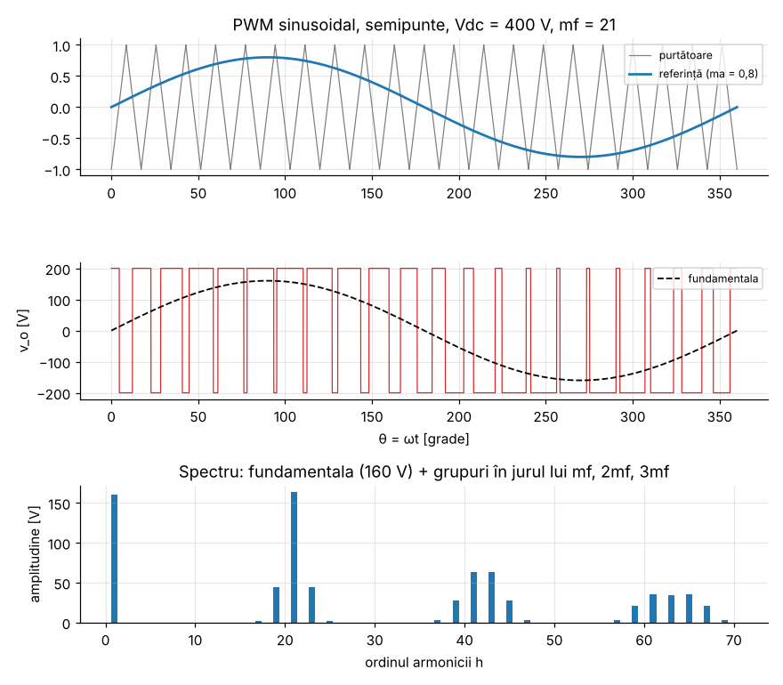
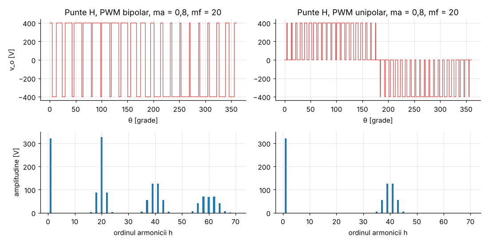

# Modulul 6 — Invertoare (conversie DC → AC)

**Obiective.** La finalul modulului vei putea:

- descrie semipuntea, puntea H și invertorul trifazat;
- calcula spectrul tensiunii în undă dreptunghiulară și cvasi-dreptunghiulară;
- explica modulația PWM sinusoidală (SPWM): indicii $m_a$, $m_f$, zona
  liniară, supramodulația;
- compara PWM-ul bipolar cu cel unipolar și calcula tensiunea de linie a unui
  invertor trifazat.

Notații: $V_{dc}$ = tensiunea de alimentare continuă, $f_1$ = frecvența
fundamentalei, $V_h$ = **amplitudinea** armonicii de ordin $h$.

---

## 6.1 Topologii

```
 Semipunte (un braț)                     Punte H (două brațe)
     +Vdc/2 ──┬──                        +Vdc ──┬───────────┬──
              S1 (+ diodă antiparalel)          S1          S3
              ├──── a ──► sarcină ──┐           ├── a   b ──┤
              S2                    │           S2          S4
     −Vdc/2 ──┴──     punct median 0 ┘     0 ──┴───────────┴──
     (doi condensatori formează punctul median)   v_o = v_a − v_b
```

- Cele două comutatoare ale unui braț **nu conduc niciodată simultan** (ar
  scurtcircuita sursa). Între comenzile lor se introduce un timp mort.
- Fiecare comutator are o **diodă antiparalel**. Prin ea circulă curentul
  sarcinilor inductive când tensiunea și curentul au semne opuse (energia
  reactivă se întoarce în condensatorul de c.c.).
- Semipuntea dă $v_o \in \{+V_{dc}/2, -V_{dc}/2\}$. Puntea H dă
  $v_o \in \{+V_{dc}, 0, -V_{dc}\}$.

## 6.2 Comanda în undă dreptunghiulară

Semipuntea comutată la $f_1$, cu factor de umplere 50 %, dă o undă
dreptunghiulară $\pm V_{dc}/2$. Seria Fourier conține doar armonici impare:

$$v_o(\theta) = \sum_{h=1,3,5,\dots} \frac{4}{h\pi}\frac{V_{dc}}{2}\sin(h\theta)
\quad\Rightarrow\quad V_1 = \frac{4}{\pi}\frac{V_{dc}}{2},\quad V_h = \frac{V_1}{h}.$$

Valoarea efectivă totală este $V_{dc}/2$, iar fundamentala are valoarea
efectivă $\frac{4}{\pi\sqrt2}\frac{V_{dc}}{2}$, deci

$$\mathrm{THD} = \sqrt{\frac{\pi^2}{8} - 1} \approx 48{,}3\ \%.$$

**Puntea H cu defazare.** Dacă cele două brațe sunt comandate în undă
dreptunghiulară, defazate între ele, ieșirea este un puls de lățime $\delta$ pe
fiecare semiperioadă (cu zero între pulsuri):

$$V_h = \frac{4V_{dc}}{h\pi}\,\sin\frac{h\delta}{2}, \qquad h \text{ impar}.$$

Amplitudinea fundamentalei se reglează prin $\delta$. Pentru $\delta = 120°$,
$\sin(3 \cdot 60°) = 0$, deci **armonica a 3-a dispare**.

**Verificare** ($V_{dc}$ = 400 V, FFT pe 2¹⁸ eșantioane): $V_1$ = 254,648 V
(semipunte), $V_3$ = 84,88 V = $V_1/3$, THD = 48,343 %. Punte H: $V_1$ =
509,30 / 491,94 / 441,06 V pentru $\delta$ = 180° / 150° / 120°, iar
$V_3 \approx 0$ la 120°.

## 6.3 Modulația PWM sinusoidală (SPWM)

Se compară o **referință** sinusoidală $v_{ref} = m_a \sin(2\pi f_1 t)$ cu o
**purtătoare** triunghiulară de amplitudine 1 și frecvență $f_s$. Brațul este
în starea „sus” când $v_{ref} > v_{purt}$ și „jos” în rest.

- **Indicele de modulație în amplitudine:** $m_a = \hat V_{ref}/\hat V_{purt}$.
- **Indicele de modulație în frecvență:** $m_f = f_s/f_1$.



### De ce fundamentala este $m_a V_{dc}/2$

Pe o perioadă a purtătoarei (scurtă față de $1/f_1$), referința este
practic constantă. Brațul stă „sus” o fracțiune
$d = \tfrac12(1 + v_{ref})$ din timp, deci media locală a tensiunii este

$$\langle v_o \rangle_{T_s} = d\frac{V_{dc}}{2} + (1-d)\left(-\frac{V_{dc}}{2}\right) = v_{ref}\,\frac{V_{dc}}{2}.$$

Media locală reproduce deci referința la scară:

$$\boxed{V_1 = m_a \frac{V_{dc}}{2}} \qquad (m_a \le 1, \text{ zona liniară}).$$

### Unde sunt armonicile

Analiza exactă (descompunere Fourier dublă, Holmes & Lipo [B4]) arată că, la
eșantionarea naturală, armonicile apar doar **în grupuri în jurul multiplilor
lui $m_f$**, cu amplitudini date de funcții Bessel. Pentru semipunte:

- armonica de ordin $m_f$: $\dfrac{2V_{dc}}{\pi} J_0\!\left(\dfrac{\pi m_a}{2}\right)$;
- benzile laterale $m_f \pm 2$: $\dfrac{2V_{dc}}{\pi} J_2\!\left(\dfrac{\pi m_a}{2}\right)$;
- grupul $2m_f \pm 1$: $\dfrac{V_{dc}}{\pi} J_1(\pi m_a)$, iar
  $2m_f \pm 3$: $\dfrac{V_{dc}}{\pi} J_3(\pi m_a)$.

Consecințe:

- **nu există armonici de ordin mic**, deci un $m_f$ mare împinge tot
  conținutul armonic la frecvențe mari, ușor de filtrat (sau filtrate natural
  de inductanța unui motor);
- cu $m_f$ **impar**, unda are simetrie de semiundă și **armonicile pare
  lipsesc**.

### Verificare pe trei căi

$V_{dc}$ = 400 V, $m_a$ = 0,8, $m_f$ = 21 (`verificari/v06_invertoare.py`):

| Mărime | Formulă | FFT pe eșantioane | Fourier exact din fronturi* |
|---|---|---|---|
| $V_1$ | 160,000 V | 160,004 V | 160,000 V (eroare 9·10⁻¹⁶) |
| $V_{21}$ (Bessel $J_0$) | 163,614 V | 163,610 V | 163,614 V |
| $V_{19} = V_{23}$ (Bessel $J_2$) | 43,969 V | — | 43,969 V |
| $V_{41} = V_{43}$ (Bessel $J_1$) | 62,871 V | — | 62,871 V |

\* Momentele de comutație sunt găsite prin bisecție, iar coeficienții Fourier
se integrează exact pe fiecare segment constant, fără eșantionare. Funcțiile
Bessel sunt calculate independent, din reprezentarea lor integrală.

Se mai verifică faptul că $V_1$ nu depinde de $m_f$ (identic pentru $m_f$ = 9,
15, 51) și că armonicile 2 … 16 sunt practic zero (< 0,03 V).

Observație: armonica de la $m_f$ (163,6 V) este **mai mare decât
fundamentala**. Pare surprinzător, dar este corect: ea se află la $21 \cdot 50$ =
1050 Hz (sau mult mai sus la $f_s$ reale de kHz) și este ușor de filtrat.

### Supramodulația ($m_a > 1$)

Când referința depășește purtătoarea, unele pulsuri dispar și relația devine
neliniară: $V_1 < m_a V_{dc}/2$. Fundamentala este oricum limitată de unda
dreptunghiulară:

$$V_1 = \frac{1}{\pi}\left|\int_0^{2\pi} v_o \sin\theta\,d\theta\right| \le
\frac{1}{\pi}\frac{V_{dc}}{2}\int_0^{2\pi}|\sin\theta|\,d\theta = \frac{4}{\pi}\frac{V_{dc}}{2},$$

cu egalitate doar pentru $v_o = \frac{V_{dc}}{2}\,\mathrm{sgn}(\sin\theta)$.

| $m_a$ | 1,0 | 1,5 | 3,0 | 20 |
|---|---|---|---|---|
| $V_1$ simulat [V] | 200,0 | 234,4 | 249,7 | 254,65 |
| $m_a V_{dc}/2$ [V] | 200 | 300 | 600 | 4000 |

Limita este $\frac{4}{\pi}\cdot 200$ = 254,65 V.

## 6.4 Puntea H: PWM bipolar vs. unipolar

- **Bipolar:** brațele comută în opoziție, $v_o = \pm V_{dc}$. Fundamentala
  este $m_a V_{dc}$, iar armonicile sunt ca la semipunte, dar la scara $V_{dc}$.
- **Unipolar:** brațul A este comandat de $+v_{ref}$, brațul B de $-v_{ref}$,
  cu aceeași purtătoare. Ieșirea are trei niveluri ($+V_{dc}$, 0, $-V_{dc}$).
  Fundamentala este tot $m_a V_{dc}$, dar armonicile din jurul lui $m_f$ **se
  anulează** (sunt identice în cele două brațe), iar primul grup apare la
  $2m_f \pm 1$. Frecvența aparentă a ondulației se dublează fără să se dubleze
  numărul de comutații.



**Verificare** ($m_a$ = 0,8, $m_f$ = 20, $V_{dc}$ = 400 V): $V_1$ = 320,0 V în
ambele cazuri. Cea mai mare armonică este de 327 V la $h$ = 20 (bipolar),
respectiv 126 V la $h$ = 39 și 41, adică $2m_f \pm 1$ (unipolar). În cazul unipolar, armonicile 17 … 23
sunt sub 0,02 V.

## 6.5 Invertorul trifazat

Trei brațe, cu referințe defazate la 120°. Tensiunea de linie
$v_{ab} = v_a - v_b$ are fundamentala

$$\hat V_{LL1} = \sqrt3\, m_a\frac{V_{dc}}{2}, \qquad V_{LL1,rms} = \frac{\sqrt3}{2\sqrt2}\,m_a V_{dc} \approx 0{,}612\,m_a V_{dc}.$$

- Dacă $m_f$ este **multiplu de 3**, armonica de la $m_f$ (identică în toate
  fazele) **dispare din tensiunea de linie**. Verificare: 163,6 V în tensiunea
  de fază, 0,015 V în tensiunea de linie.
- **Injecția armonicii a 3-a.** Referința
  $m_a\left(\sin\theta + \tfrac16\sin 3\theta\right)$ are vârful
  $\tfrac{\sqrt3}{2}m_a$ (atins la $\theta = 60°$). Zona liniară se extinde deci
  până la $m_a = 2/\sqrt3 \approx 1{,}155$ (+15,5 % tensiune). Armonica a 3-a
  este identică în toate fazele și se anulează în tensiunea de linie. La
  $m_a = 2/\sqrt3$, amplitudinea tensiunii de linie atinge $V_{dc}$, maximul
  posibil pentru o tensiune de linie sinusoidală (tensiunea de linie nu poate
  depăși $V_{dc}$). Modulația vectorială (SVM) atinge aceeași limită.
- **Comanda în șase trepte** (*six-step*, fiecare braț în undă
  dreptunghiulară): $V_{LL1,rms} = \frac{\sqrt6}{\pi}V_{dc} \approx 0{,}78\,V_{dc}$,
  cu armonici $6k \pm 1$ de amplitudine $V_{LL1}/h$.

**Verificare** ($V_{dc}$ = 400 V, $m_f$ = 21):

| Caz | Formula | Simulare |
|---|---|---|
| SPWM, $m_a$ = 0,8: $V_{LL1,rms}$ | 195,96 V | 195,95 V |
| injecție a 3-a, $m_a$ = 1,15: $\hat V_{LL1}$ | 398,37 V | 398,36 V |
| fără injecție, $m_a$ = 1,15 (supramodulație): $\hat V_{LL1}$ | 398,37 V (formula nu se mai aplică) | 376,6 V |
| six-step: $V_{LL1,rms}$ | 311,88 V | 311,88 V |

## 6.6 Aspecte practice

- **Timpul mort** distorsionează tensiunea (eroare de tensiune dependentă de
  semnul curentului). Controlerele performante îl compensează.
- **Filtrarea:** UPS-urile și invertoarele de rețea folosesc filtre LC sau LCL
  la ieșire. Motoarele au inductanță proprie, care filtrează curentul.
- **Alegerea lui $f_s$:** o frecvență mare înseamnă armonici ușor de filtrat și
  zgomot acustic redus (peste ~20 kHz), dar pierderi de comutație mai mari
  (Modulul 7).

## Întrebări de autoevaluare

1. De ce o undă dreptunghiulară nu are armonici pare?
2. Ce $m_a$ trebuie pentru 230 V RMS cu o punte H alimentată la 400 V?
   *(0,813 — vezi Exercițiul 8.)*
3. De ce, în trifazat, se aleg de obicei valori $m_f$ impare și multiplu de 3?
4. Cu cât crește tensiunea maximă liniară prin injecția armonicii a 3-a și de
   ce nu apare armonica a 3-a în curenții unui motor conectat în stea fără
   neutru?
5. De ce un SPWM cu $m_f$ = 21 nu are armonici de ordin 3, 5, 7?

---

[← Modulul 5](05-convertoare-dc-dc.md) · [Cuprins](../README.md) · [Modulul 7 →](07-pierderi-termic-practica.md)
